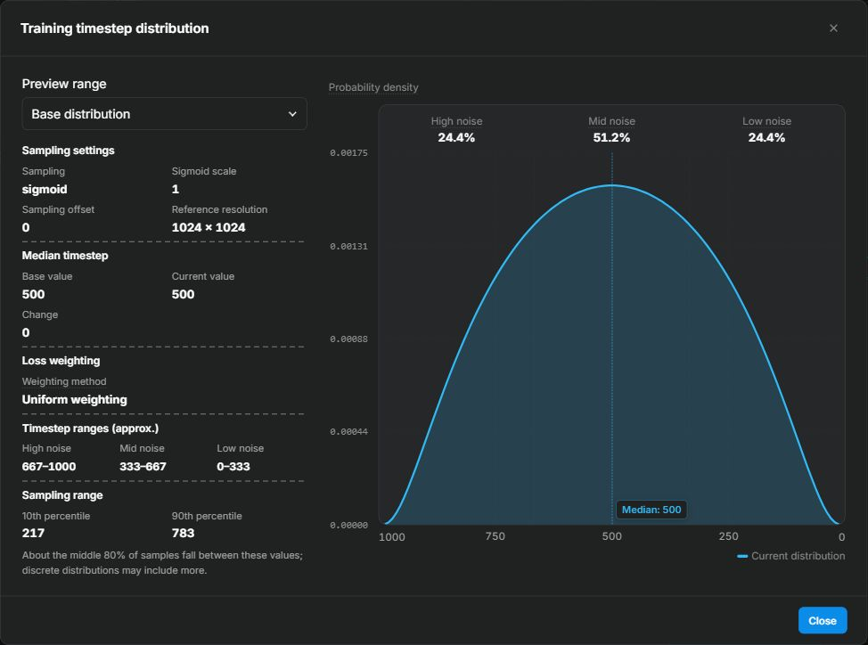
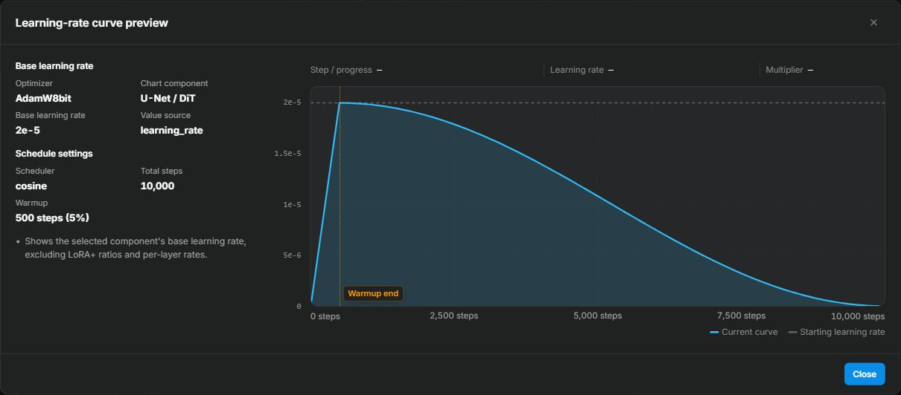
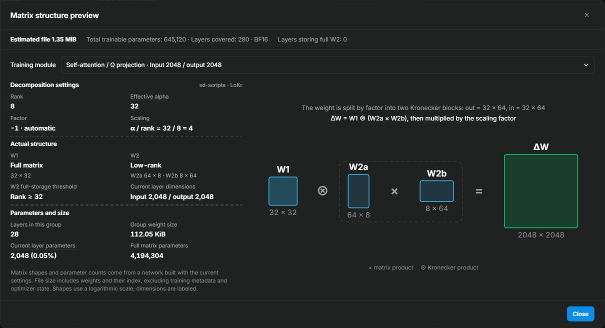

<div align="center">

# lora-scripts-anima

_A local LoRA training tool for Anima, SDXL, MOSS-Image, and Krea 2._

Configure training, tag images, edit captions in bulk, and monitor training progress in real time.

</div>

<p align="center">
  <a href="https://github.com/amenorira/lora-scripts-anima" style="margin: 2px;">
    
  </a>
  <a href="https://raw.githubusercontent.com/amenorira/lora-scripts-anima/main/LICENSE" style="margin: 2px;">
    
  </a>
</p>

<p align="center">
  <a href="https://github.com/amenorira/lora-scripts-anima/blob/main/README.md">中文</a> ·
  <a href="https://github.com/amenorira/lora-scripts-anima/blob/main/README-ja.md">日本語</a>
</p>

### Supported Model Types

| Base Model | Training Engine | Native Algorithms | LyCORIS |
|------------|-----------------|-------------------|---------|
| SDXL | sd-scripts | LoRA / LoHa / LoKr | LoCon / LoHa / LoKr |
| Anima | sd-scripts | LoRA / LoHa / LoKr | LoCon / LoHa / LoKr |
| MOSS-Image | sd-scripts | LoRA / LoHa / LoKr | — |
| Krea 2 RAW DiT | musubi-tuner | LoRA | LoCon / LoHa / LoKr |

- **MOSS-Image** can train the DiT's text projection and refiner layers. The Qwen text encoder stays frozen.
- **Krea 2** requires image latent and Qwen3-VL text-encoder caches before training.

## Feature Overview

- **Training configuration** — Edit training settings, preview TOML, import YAML / TOML, export YAML, and review training history
- **Pre-training previews** — Timestep distribution, learning-rate curve, and matrix structure modals computed locally; [see the next section](#pre-training-previews)
- **LyCORIS adapter panel** — LoCon / LoHa / LoKr with algorithm-aware parameters, a selectable kernel backend (auto / Triton / TileLang / compile / Torch), LoRA+ support, and Anima training-scope refinement
- **Many optimizers** — AdamW, Lion, Prodigy, CAME, StableAdamW, Adafactor, ScheduleFree, Adan, AdEMAMix, Muon, plus the bundled LoRA-RITE and the experimental LoRA-Muon, each with its own defaults and constraint hints
- **Real-time Hardware Monitor** — GPU utilization, VRAM, and temperature; CPU and RAM usage; Chart.js charts, TensorBoard integration, and live logs
- **Native Tag Editor** — Built-in image tag editor with batch find-and-replace, deduplication, sorting, cleanup, and more
- **Tagger Workspace** — WD EVA02-Large, WD ViT-Large, CL Tagger, Camie Tagger, and [PixAI Tagger v1.0](https://huggingface.co/pixai-labs/pixai-tagger-v1.0) with single-image inspection, category thresholds, and batch caption output; PixAI runs locally with PyTorch, supports style tags, and downloads about 1.95 GB on first use; AI tagging connects to any vision API speaking OpenAI-compatible (Chat Completions / Responses) or Anthropic Messages protocols
- **EmoSens Adaptive Optimizer** — Built-in EmoSens v3.9 adjusts the learning rate based on loss changes and suggests when to stop
- **Internationalization (i18n)** — Chinese, English, and Japanese UI and built-in guides, with browser-language detection and a persistent language preference
- **Three themes** — Light, dark, and ComfyUI themes, with auto-follow system preference or manual toggle
- **Backend Connectivity Indicator** — Real-time frontend-backend connection status with disconnect duration

<a name="pre-training-previews"></a>

## Pre-training Previews

### Timestep distribution

Open **View timestep distribution** under the sampling field to inspect sampling density, loss weighting, and high / mid / low noise shares. Switch between base and overall training distributions, compare median timesteps, and hover to read curve values. See the [timestep guide](docs/parameters/timesteps.en-US.md).



### Learning-rate curve

Open **View learning-rate curve** under the schedule field to inspect warmup, decay, restarts, and rates at individual steps. The sidebar shows the effective rate and warmup steps for the selected DiT or text-encoder component. Optimizers that manage their own schedule display the relevant explanation. See the [optimizer guide](docs/parameters/optimizers.en-US.md).



### Matrix structure

For Anima, MOSS-Image, or Krea 2 training, open **Structure preview** under **Training network module**. Switch between attention, MLP, and other modules to inspect matrix shapes, effective rank and alpha, scaling, matching layer counts, and parameter counts.

The same panel shows the **estimated weight file size**, so you can check how much disk space the saved weights will use before training. [Matrix structure and file size guide](docs/parameters/matrix-preview.en-US.md)



## Usage

### Quick Start

Run the command for your platform from the extracted or cloned project folder.

| Platform | Install + Launch |
|----------|-----------------|
| Windows | `.\start.bat` |
| Linux | `bash start.sh` |

First launch automatically creates a virtual environment and installs all dependencies. The GUI opens at [http://127.0.0.1:12333](http://127.0.0.1:12333).

### Prerequisites

- **Windows** can install 64-bit Python 3.12 for the current user on first launch, alongside existing Python installations. The ZIP setup can also install Git.
- **Linux** requires Git and 64-bit Python 3.12. If the system reports that `venv` is missing, install the matching package, such as `python3.12-venv`.
- **Training** requires an NVIDIA GPU and driver R580 or newer. The startup script installs PyTorch 2.12.1 with CUDA 13.0 for RTX 30/40/50 series GPUs. The GUI can also run on machines without an NVIDIA GPU.

If an incompatible Python version created the project's `venv`, rename that folder and rerun the startup script to rebuild the environment.

Krea 2 and sd-scripts share the project's main `venv`. Once training works in the main environment, you can remove any legacy `venv/cores/musubi` folder manually. [Project dependencies](requirements.txt)

### Windows: Download ZIP (beginner-friendly)

1. On GitHub, choose **Code → Download ZIP**, fully extract it, and double-click `start.bat`.
2. If `.git` is missing, the bootstrap asks to install Git for Windows and repair the folder as an updateable repository; choose the recommended option.
3. Repair fetches only `main`, without other branches or tags. Source files that would be replaced are first saved to `bootstrap-backups/<timestamp>.zip`. The process excludes `venv`, models, outputs, caches, logs, and the entire user `config` directory, so they are never overwritten or cleaned.
4. After the source files are synchronized, the bootstrap restarts once, creates `venv`, and installs the training dependencies.

Git installation failures and repair failures before source synchronization only produce a warning, allowing the original ZIP to start and setup to be retried later. Failures after synchronization begins stop startup and retain backup details; resolve the error and run `start.bat` again to retry. Python or core dependency failures also stop startup with a bilingual error.

### Clone with Git

```sh
git clone --depth 1 --single-branch --branch main --no-tags https://github.com/amenorira/lora-scripts-anima.git
cd lora-scripts-anima
git config pull.ff only
```

This downloads the latest main and supports normal `git pull` updates. Fetch full history with `git fetch --unshallow` and tags with `git fetch --tags`, or omit the clone options for development.

To use dev, run these commands once, then switch with `git switch main` / `git switch dev`:

```sh
git config --add remote.origin.fetch "+refs/heads/dev:refs/remotes/origin/dev"
git fetch --no-tags origin
git switch --track origin/dev
```

### Realtime and Slow Remote Connections

For SSH access, forward the GUI port. Open TensorBoard by adding `/tensorboard/` to the GUI address, for example `http://127.0.0.1:12333/tensorboard/`. Use your local forwarded port if it differs. If TensorBoard fails to start, check `logs/tensorboard.log`.

If remote previews slow down live updates, enable **Slow connection compatibility** in **UI Settings** to load thumbnails one at a time. Before you set a preference, the mode turns on automatically when the browser reports a slow connection or data saver mode.

### Updating later

On Windows, close the trainer, double-click **`update.bat`**, then run `start.bat` after success. You can also run `git pull` in the project folder. Updates fast-forward the current branch (main or dev); source edits, staged changes, or divergence stop the update. Starting the trainer does not update source files.

When legacy sample prompts, Accelerate settings, and the cache version file stop being tracked, the updater backs them up and preserves their contents. Defaults live in `tools/defaults/`; startup creates only missing settings. If an older folder has no updater, run `& "new-ZIP-folder\update.bat" "--bootstrap-root=absolute-path-to-old-project"` in PowerShell to migrate without replacing its bootstrap or training environment.

## Training Parameter Guides

Detailed training parameter documentation lives in `docs/parameters/`:

- [LoRA+ Guide](docs/parameters/lora-plus.en-US.md): how LoRA+ works, ratio selection, optimizer compatibility, and evaluation
- [Optimizer Selection and Parameter Guide](docs/parameters/optimizers.en-US.md): optimizer comparison, learning rate and weight decay starting points, dataset-based selection
- [Timestep Guide](docs/parameters/timesteps.en-US.md): flow-matching timestep sampling, loss weighting, and the distribution preview
- [AdaLN Modulation Guide](docs/parameters/adaln.en-US.md): what the modulation layers do, upstream defaults, and when enabling them helps
- [Matrix Structure and File Size](docs/parameters/matrix-preview.en-US.md): actual module shapes, parameter counts, training scope, and saved-weight estimates

## Program Arguments

| Parameter | Type | Default | Description |
|-----------|------|---------|-------------|
| `--host` | str | "127.0.0.1" | Server hostname |
| `--port` | int | 12333 | Server port |
| `--listen` | bool | false | Enable listening mode (allow external access) |
| `--skip-prepare-environment` | bool | false | Do not check or repair dependencies at startup |
| `--skip-prepare-onnxruntime` | bool | false | Skip the onnxruntime-gpu install check only |
| `--disable-tensorboard` | bool | false | Do not launch the bundled TensorBoard with the GUI |
| `--tensorboard-port` | int | 0 | Internal TensorBoard port; 0 selects an available port automatically |
| `--localization` | str | | Interface language and localization setting |
| `--dev` | bool | false | Developer mode |
| `--quiet` / `-q` | bool | false | Automatically install Python/venv dependencies; optional Git repair remains disabled |
| `--setup-git` | bool | false | Windows: non-interactively perform the recommended Git install/ZIP repair |
| `--skip-git-setup` | bool | false | Windows: suppress Git installation or repository-repair prompts for this launch |

## Attention Acceleration

Anima / MOSS defaults to `torch` and Krea2 to `sdpa`. SDPA selects available kernels based on the PyTorch build and input; Windows builds may not include built-in FlashAttention.

For external FlashAttention 2, install it from Environment and select `attn_mode=flash` for Anima / MOSS after installation completes. The installer matches Python, PyTorch, CUDA and platform, and installs only the extension without replacing PyTorch. Krea2's legacy `flash_attn` setting still maps to `sdpa`.

## EmoSens Adaptive Optimizer

The bundled EmoSens v3.9 lives in `vendor/emo_optimizer/`.

### Recommended Settings

| Training Type | Learning Rate | Scheduler | max_grad_norm |
|---------------|:------------:|:---------:|:-------------:|
| SDXL LoRA | 1.0 | constant | 0 |
| Anima LoRA (DiT) | 0.1 | constant | 0 |

Select `EmoSens` from the optimizer dropdown in the training form.

## Training Configuration Import and Export

- **Export**: Download the current YAML configuration from the training preview panel; the TOML preview shows the training parameters
- **Import**: Load YAML or a legacy flat TOML file and apply supported fields to the matching training form; unsupported fields are reported as ignored

## Environment Management

The GUI **Environment** tab provides:
- Python / PyTorch / CUDA version info
- core status for sd-scripts, the LyCORIS adapter backend, and musubi-tuner
- musubi-tuner Krea 2 shared-runtime status (shared CUDA-enabled PyTorch and dependency-version alignment)
- Flash Attention installation status with one-click install
- Candidate wheel list preview

## Project Structure

```
lora-scripts-anima/
├── vendor/sd-scripts/          ← Anima / SDXL / MOSS-Image training engine (pinned upstream snapshot)
├── vendor/musubi-tuner/        ← Krea 2 core (pinned upstream snapshot)
├── vendor/lycoris/             ← LyCORIS adapter backend (pinned upstream snapshot)
├── vendor/emo_optimizer/       ← EmoSens adaptive optimizer
├── vendor/lora_muon/           ← LoRA-Muon experimental optimizer
├── backend/                    ← FastAPI backend
│   ├── server/                 ← App assembly, HTTP routes, static assets, and proxy
│   ├── core/                   ← Realtime task coordination and install-job lifecycle
│   ├── training/               ← Training modules grouped by responsibility
│   │   ├── fields/             ← Field registry, defaults, and option metadata
│   │   ├── config/             ← Configuration conversion, import/export, and validation
│   │   ├── datasets/           ← Dataset parsing, repeat counts, and step estimation
│   │   ├── execution/          ← Run preparation, launch dispatch, and process management
│   │   └── cache/              ← Cache inspection, generation, and reuse
│   ├── monitor/                ← Training monitor (GPU/system/logs/preview/history)
│   ├── tageditor/              ← Native tag editor
│   ├── tagger/                 ← Tagging module (WD / CL / Camie / PixAI / AI endpoints)
│   ├── regularization/         ← Regularization image generation, sampling, and recovery
│   └── gui.py                  ← Internal GUI entry (called by launch scripts)
├── frontend/                   ← Alpine.js SPA frontend
│   ├── js/                     ← Scripts grouped by feature
│   │   ├── app/                ← Application assembly and route configuration
│   │   ├── shared/             ← Shared controls, notifications, i18n, and realtime transport
│   │   ├── training/           ← Training forms, configuration, and previews
│   │   ├── monitor/            ← Monitoring, history, logs, and outputs
│   │   ├── environment/        ← Environment status, component installation, and downloads
│   │   ├── tagger/             ← Automatic tagging and AI captioning workspaces
│   │   ├── docs/               ← Parameter documentation reader
│   │   ├── regularization/     ← Regularization image generation workspace
│   │   ├── tag-editor/         ← Caption editing, sessions, and persistence
│   │   └── tag-dictionary/     ← Dictionary, Worker, and hover cards
│   ├── templates/              ← Workspace HTML templates loaded on demand
│   └── css/ · i18n/ · assets/   ← Styles, translations, and static assets
├── config/                     ← Local configuration and autosaves
├── docs/                       ← Parameter guides and preview screenshots
├── tools/                      ← Bootstrap, installation and runtime tools; developer scripts in tools/dev/
├── tests/                      ← Backend regressions and frontend interaction tests
├── start.bat / start.sh        ← Launch scripts
└── requirements.txt            ← Single authoritative dependency list (backend and training cores share it; torch is installed by the launcher)
```

## Acknowledgements

- [kohya-ss/sd-scripts](https://github.com/kohya-ss/sd-scripts) — Anima / SDXL / MOSS-Image training engine
- [kohya-ss/musubi-tuner](https://github.com/kohya-ss/musubi-tuner) — Krea 2 training core
- [**LyCORIS**](https://github.com/KohakuBlueleaf/LyCORIS) — LoCon / LoHa / LoKr training algorithms and adapter support
- [Akegarasu/lora-scripts](https://github.com/Akegarasu/lora-scripts) — Early design reference

## License

This project is released under the [MIT License](LICENSE). Third-party components under `vendor/` keep their original licenses (Apache-2.0 / MIT).
