<div align="center">

# lora-scripts-anima

_A local LoRA training suite for Anima, SDXL, MOSS-Image, and Krea 2_

Download base models, auto-tag images, generate AI captions and regularization images, edit tags in bulk, preview training schedules, and monitor runs in real time.

</div>

<p align="center">
  <a href="https://github.com/amenorira/lora-scripts-anima" style="margin: 2px;">
    
  </a>
  <a href="https://raw.githubusercontent.com/amenorira/lora-scripts-anima/main/LICENSE" style="margin: 2px;">
    
  </a>
</p>

<p align="center">
  <a href="https://github.com/amenorira/lora-scripts-anima/blob/main/README.md">中文</a> ·
  <a href="https://github.com/amenorira/lora-scripts-anima/blob/main/README-ja.md">日本語</a>
</p>

## Supported Models and VRAM Reference

| Base Model | Training Engine | Native Algorithms | LyCORIS Algorithms | 1024px VRAM Reference (Batch 1) |
|------------|-----------------|-------------------|--------------------|---------------------------------|
| SDXL | [sd-scripts](https://github.com/kohya-ss/sd-scripts) | LoRA / LoHa / LoKr | [LoCon / LoHa / LoKr](https://github.com/KohakuBlueleaf/LyCORIS) | ≥ 8 GB |
| Anima | [sd-scripts](https://github.com/kohya-ss/sd-scripts) | LoRA / LoHa / LoKr | LoCon / LoHa / LoKr | From ≈ 6.5 GB (bf16 + gradient checkpointing) |
| MOSS-Image | [sd-scripts](https://github.com/kohya-ss/sd-scripts) | LoRA / LoHa / LoKr | — | ≈ 9–10 GB (ConvRot INT8, down to ≈ 5.2 GB with block swap) / ≈ 13.5 GB (bf16) |
| Krea 2 RAW DiT | [musubi-tuner](https://github.com/kohya-ss/musubi-tuner) | LoRA | LoCon / LoHa / LoKr | Supports scaled FP8 / ConvRot INT8 and block swap |

- **Base model downloads**: Open **Environment → Models** in the sidebar to check required files and download Anima, Krea 2, and MOSS-Image base models, VAEs, text encoders, and preview acceleration LoRAs directly into `models/` with resume support.
- **MOSS-Image**: Optionally trains the DiT's text input projection and refiner layers while keeping the Qwen text encoder frozen.
- **Krea 2**: Generates image latent and Qwen3-VL text-encoder caches directly from the training page before a run starts (saved under `.krea2-cache` inside the dataset folder).
- Detailed VRAM and step-speed benchmarks across GPUs and block-swap settings are available in the [Memory and Speed Guide](docs/parameters/memory-optimization.en-US.md).

## Quick Start

### Prerequisites

- **OS and Python**: 64-bit Windows or Linux. On first launch, Windows can install 64-bit Python 3.12 for the current user alongside existing Python versions without modifying `PATH`, and ZIP downloads can also install Git automatically. On Linux, install `git`, `python3.12`, and `python3.12-venv` beforehand.
- **GPU and driver**: Training requires an NVIDIA GPU with driver **R580 or newer**. The launcher installs **PyTorch 2.12.1 + CUDA 13.0** for RTX 30 / 40 / 50 series GPUs. Machines without an NVIDIA GPU can still launch the GUI to prepare datasets and configurations.

### Install and launch

| Platform | Setup Method | Launch Command |
|----------|--------------|----------------|
| Windows (beginner-friendly) | Click **Code → Download ZIP** on GitHub and extract completely | Double-click `start.bat` (or run `.\start.bat` in a terminal) |
| Windows / Linux | `git clone --depth 1 --no-tags https://github.com/amenorira/lora-scripts-anima.git` | Windows: `.\start.bat` · Linux: `bash start.sh` |

On first launch, the launcher prompts to create the `venv` virtual environment and install dependencies (pass `--quiet` / `-q` for unattended installation). Once the terminal prints `READY`, open **[http://127.0.0.1:12333](http://127.0.0.1:12333)** in your browser (if port 12333 is in use, an available port in `30000–30020` is selected automatically and printed in the terminal).

<details>
<summary>ZIP repository setup, switching to dev, and rebuilding venv</summary>

- **Automatic Git setup for Windows ZIP downloads**: When `.git` is missing, `start.bat` offers to install Git for Windows and initialize the folder as an updateable repository tracking `main` only. Any differing source files are backed up to `bootstrap-backups/<timestamp>.zip` first, while `venv`, `models`, `output`, `config`, `cache`, and `logs` remain untouched. After syncing source files, the launcher restarts once and sets up `venv`. Failures before synchronization starts only show a warning and continue launching; interruptions during synchronization stop startup and retain the backup record for retry.
- **Switching to the `dev` branch**: After a shallow clone, run these commands the first time you switch to `dev`:
  ```sh
  git remote set-branches --add origin dev
  git fetch origin
  git switch --track origin/dev
  ```
  Use `git switch main` or `git switch dev` afterward. Run `git fetch --unshallow` for full commit history or `git fetch --tags` for tags.
- **Rebuilding `venv`**: If `venv` was created with an incompatible Python version, rename or delete the project's `venv` folder and rerun the launcher. Krea 2 and `sd-scripts` share the main `venv` (see [requirements.txt](requirements.txt)); any legacy `venv/cores/musubi` folder can be removed manually once training works.

</details>

## Core Workflow and Features

### 1. Runtime, accelerators, and model downloads (Sidebar: **Environment**)
- **Runtime**: Check Python / PyTorch / CUDA versions and `sd-scripts`, `LyCORIS`, and `musubi-tuner` readiness; install or toggle `FlashAttention 2`, `xformers`, `Triton`, and **MOSS Text Acceleration (FLA + Conv1D)** in one click.
- **Models**: Verify required base models, text encoders, VAEs, and preview LoRAs by group, and download missing files into `models/` with resume support.
- **Downloads**: Download and update the offline **Danbooru Chinese dictionary** for tag search and hover definitions in the Tag Editor.

### 2. Dataset tagging, captioning, and regularization (Sidebar: **Tools**)
- **Tagger**: Local auto-tagging with WD EVA02-Large, WD ViT-Large, CL Tagger, Camie Tagger, and [PixAI Tagger v1.0](https://huggingface.co/pixai-labs/pixai-tagger-v1.0) (local PyTorch inference with style tags; ~1.95 GB download on first use), featuring single-image inspection, category thresholds, and batch output.
- **AI Annotation**: Dedicated workspace connecting to any vision API compatible with OpenAI (Chat Completions / Responses) or Anthropic Messages protocols, with multi-length caption presets and resume support for unfinished images.
- **Tag Editor**: Chip and plain-text views, batch find-and-replace, deduplication, sorting, cleanup, edit-history restore, and offline dictionary search with hover cards.
- **Regularization Images**: Batch-generate regularization images locally from prompts, with run resume, failed-item retry, and single-image regeneration.

### 3. Training configuration, adapters, and optimizers (Sidebar: **LoRA Training**)
- **Configuration and import/export**: Edit grouped parameters while viewing live step calculations and generated TOML; export YAML presets, import YAML or legacy flat TOML files (with notices for ignored fields), and inspect past runs under **Training Records**.
- **LyCORIS adapter modal**: Configure LoCon / LoHa / LoKr with algorithm-specific fields, selectable kernel backends (`auto` / `Triton` / `TileLang` / `compile` / `Torch`), LoRA+, DoRA, and module-level target filtering (such as attention, MLP, and AdaLN).
- **20+ built-in optimizers**: Includes AdamW (standard / 8-bit / Paged), StableAdamW, CAME, Adan, Lion, AdEMAMix, Prodigy, ProdigyPlusScheduleFree, AdamWScheduleFree, AdaFactor, Muon, SOAP, plus bundled LoRA-RITE, Automagic3 / Automagic4, experimental LoRA-Muon, and **EmoSens v3.9.3** (in `vendor/emo_optimizer/`, adapting step size from loss changes and logging stop hints; defaults to LR `1.0` on SDXL and `0.1` on Anima / MOSS-Image with `constant` scheduler and `max_grad_norm=0`), each with curated starting values and constraint hints.
- **[Four pre-training previews](#pre-training-previews)**: Inspect dataset bucket crops, timestep distributions, learning-rate curves, and matrix shapes with estimated file size before starting a run.

### 4. Real-time monitoring, run controls, and diagnostics (Sidebar: **Monitor**)
- **Resource and loss monitoring**: Live GPU utilization, VRAM, temperature, and CPU / RAM metrics alongside loss trend analysis, live logs, and bundled TensorBoard.
- **Live run controls**: Pause/resume `sd-scripts` runs (SDXL / Anima / MOSS-Image), save weights or training state on demand, and trigger manual preview sampling at any step; checkpoint resuming is supported across all four model types.
- **Dataset diagnostics**: Uses per-sample loss logs from `sd-scripts` (SDXL / Anima / MOSS-Image) to compare residuals and per-epoch slopes within matching noise intervals, spotting hard-to-learn, mislabeled, or poorly cropped images with direct links to the Tag Editor.
- **Internationalization and desktop themes**: Chinese, English, and Japanese UI and built-in guides (auto-detects browser language and saves your choice), light / dark / ComfyUI themes, and a real-time backend connection indicator.

## Interface Tour

### Training form and preview prompts

Adjust parameters by group alongside live step estimates and TOML output; configure quality, positive, and negative sampling prompts or assemble them directly from dataset tags.

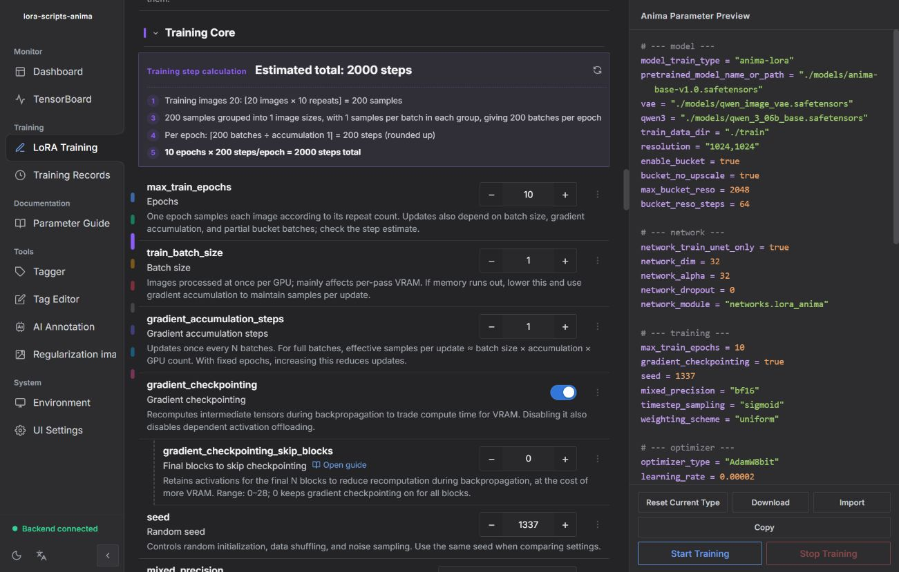

| Preview sampling and prompt settings | Assembling preview prompts from dataset tags |
| --- | --- |
| 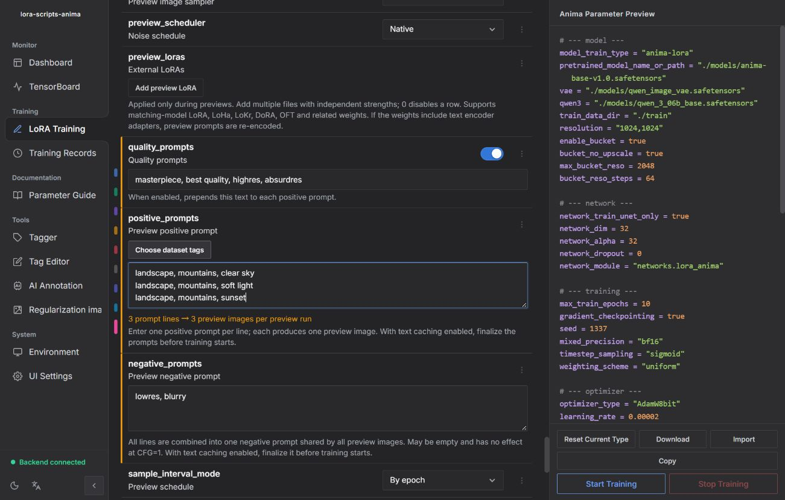 | 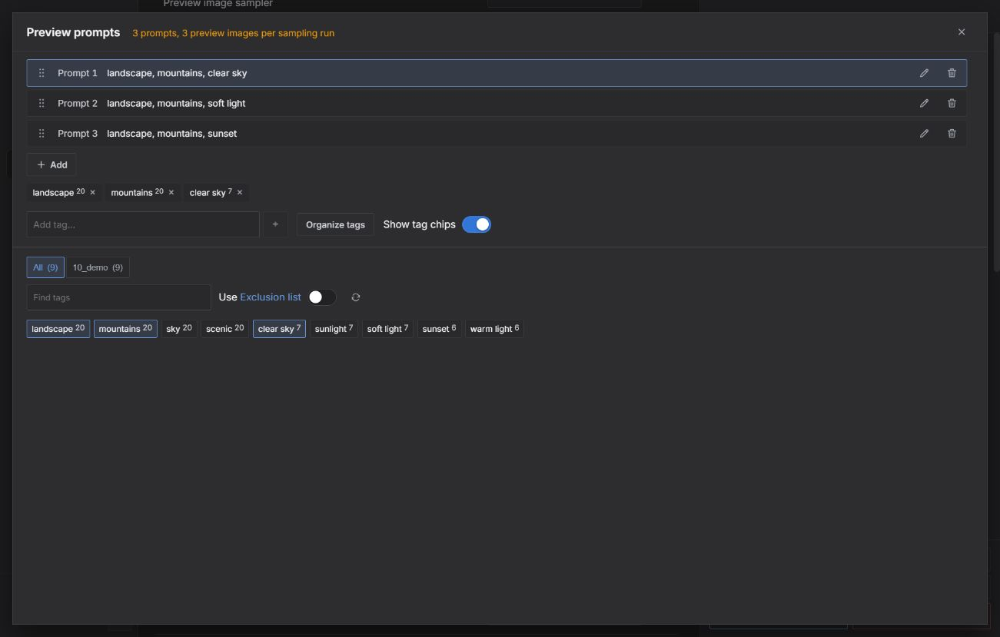 |

### Monitor dashboard, sample comparison, and dataset diagnostics

Track progress, step speed, and loss trends in **Monitor → Dashboard** while pausing, saving, or sampling on demand; pin preview images across epochs to compare stages, or inspect persistently high-residual images in Dataset diagnostics (demo samples and diagnostic data shown).

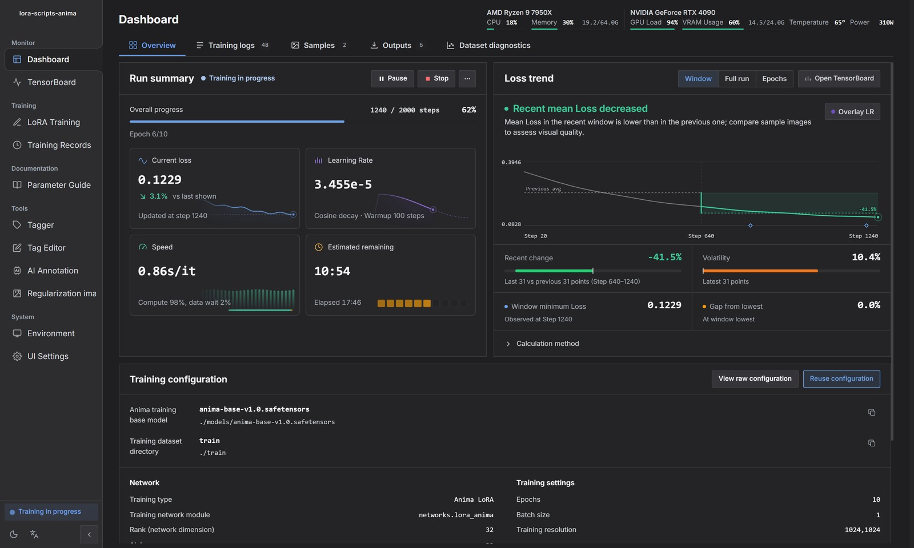

| Sample browser and generation metadata | Side-by-side comparison across training stages |
| --- | --- |
| 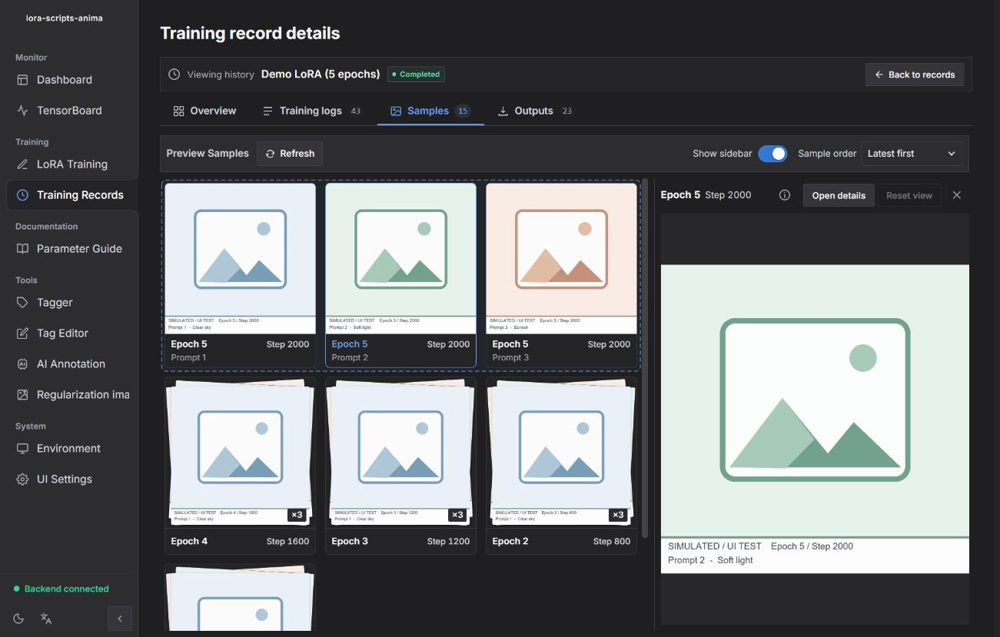 | 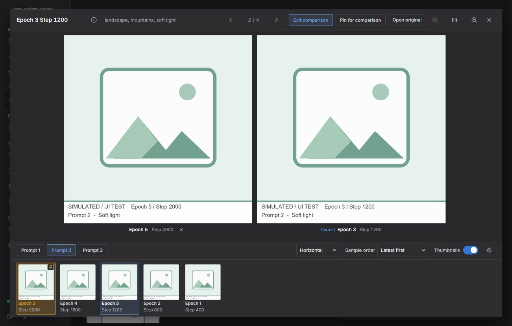 |

| Dataset diagnostics overview (zone scatter and group comparison) | Single-image bucket crop and caption inspection |
| --- | --- |
| 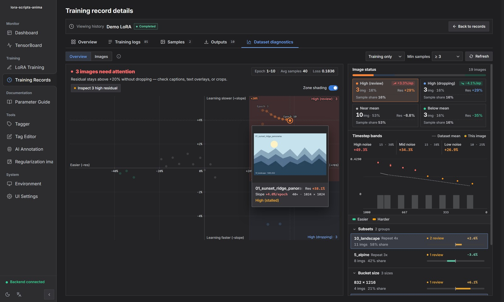 | 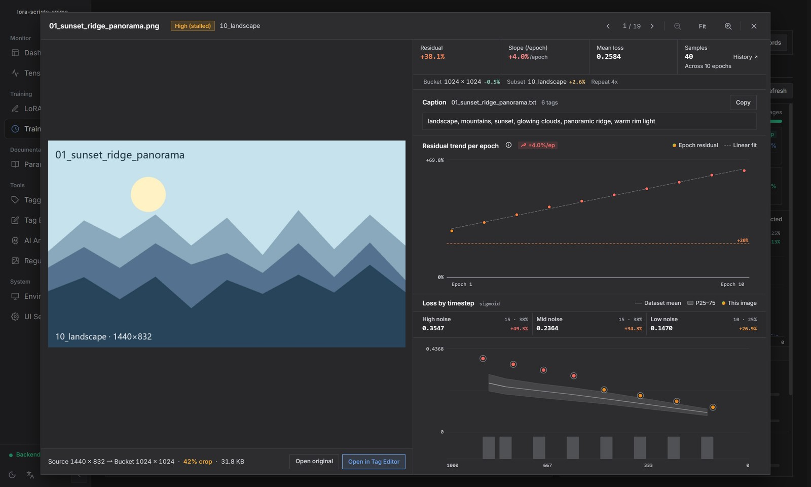 |

<a id="pre-training-previews"></a>

## Pre-training Previews

- **Bucket and crop preview**: Click **Preview image crops** under the dataset section to check original dimensions, bucket assignments, crop regions, and upscaling before training.
- **Timestep distribution preview**: Click **View timestep distribution** under **Timestep sampling** (`Timestep sampling method` on Krea 2) to inspect probability density, loss weighting, high / mid / low noise shares, and median timestep shifts between base and overall distributions. See the [Timestep Guide](docs/parameters/timesteps.en-US.md).
- **Learning-rate curve preview**: Click **View learning-rate curve** under **Learning rate scheduler** to read warmup, decay, and restart values at any step and switch between DiT and text-encoder components; optimizers that manage their own schedule (such as ScheduleFree, Automagic, and EmoSens) note that external scheduling is bypassed. See the [Optimizer and Scheduler Guide](docs/parameters/optimizers.en-US.md).
- **Matrix structure and file-size preview**: For Anima, MOSS-Image, or Krea 2, click **Structure preview** under **Training network module** to inspect per-module matrix shapes, effective rank / alpha, scaling, matching layer counts, parameter counts, and the **estimated weight file size**. See the [Matrix Structure and File Size Guide](docs/parameters/matrix-preview.en-US.md).

| Timestep distribution preview | Learning-rate curve preview |
| --- | --- |
| 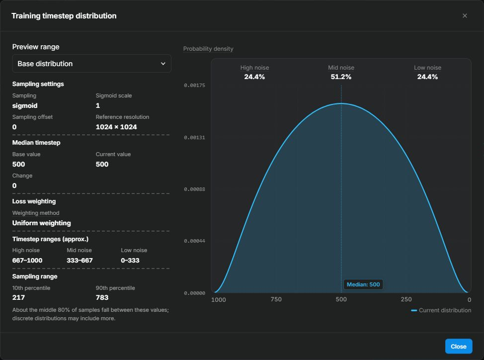 | 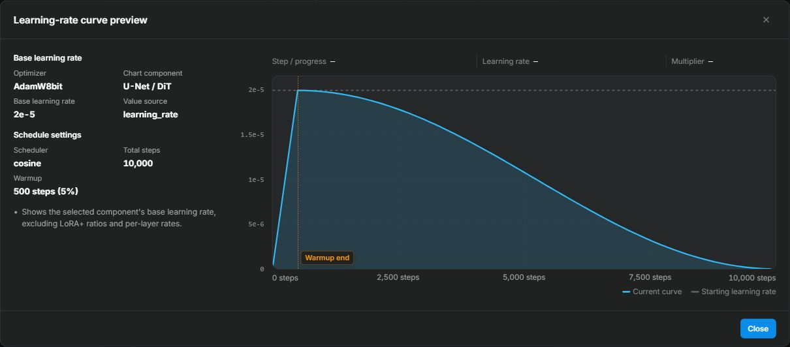 |

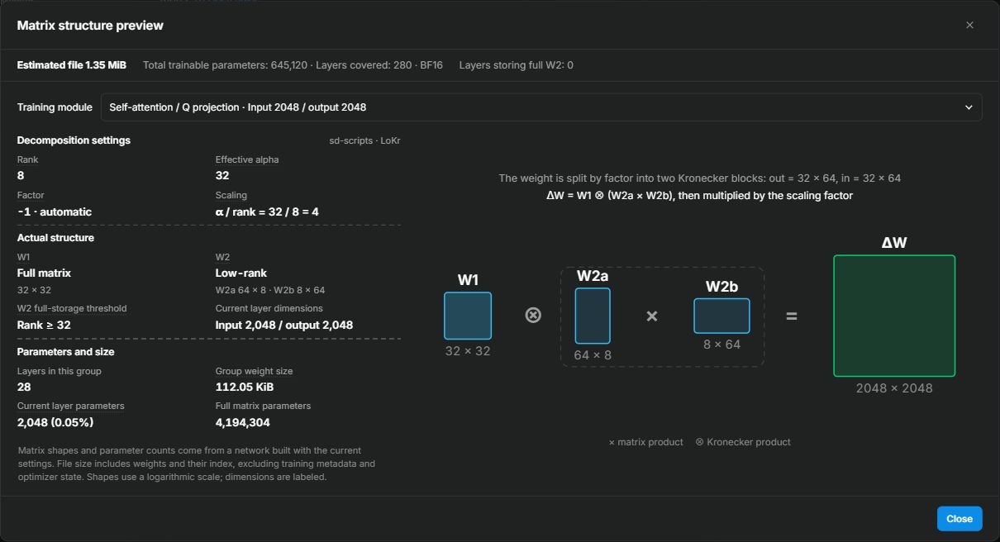

## Attention and Training Acceleration

- **Anima / MOSS-Image**: `attn_mode` defaults to `torch` (PyTorch SDPA, which selects an available kernel for the installed PyTorch version and inputs). After installing standalone FlashAttention 2 or xformers from **Environment → Runtime**, switch `attn_mode` to `flash` or `xformers` (the installer matches Python, PyTorch, CUDA, and platform to install only the extension without replacing PyTorch). MOSS-Image also supports one-click installation and toggling of **MOSS Text Acceleration (FLA + Conv1D)** on the same page.
- **Krea 2**: Attention backend defaults to `SDPA` and can also be switched to `FlashAttention` or `xFormers` (`xFormers` requires split attention enabled).
- **SDXL**: Supports `sdpa` and `xformers` in the performance section.

## Training Parameter Guides

Built-in parameter documentation lives in `docs/parameters/` (also accessible from **Parameter Guide** in the sidebar or via help buttons next to form fields):

- [Network Parameters Guide](docs/parameters/network-parameters.en-US.md): LoRA / LoHa / LoKr comparison, rank and alpha, DoRA, MOSS text layers, and Krea 2 target modules
- [LoRA+ Guide](docs/parameters/lora-plus.en-US.md): Asymmetric matrix learning rates, recommended ratios, optimizer compatibility, and evaluation
- [AdaLN Modulation Guide](docs/parameters/adaln.en-US.md): Role of modulation layers, default scope differences between native networks and LyCORIS, and when to enable them
- [Matrix Structure and File Size Guide](docs/parameters/matrix-preview.en-US.md): Per-module shapes, parameter-count alignment across algorithms, support boundaries, and disk-size estimates
- [Optimizer and Scheduler Guide](docs/parameters/optimizers.en-US.md): Quick selection across six optimizer groups, starting learning rates per model, scheduler curves, and optimizer-specific options
- [Timestep Guide](docs/parameters/timesteps.en-US.md): Flow-matching timestep sampling, high / mid / low noise learning roles, loss weighting, and subset offsets
- [Memory and Speed Guide](docs/parameters/memory-optimization.en-US.md): Recommended settings by VRAM tier, partial gradient checkpointing, ConvRot INT8, and block-swap benchmarks
- [Dataset Diagnostics Guide](docs/parameters/dataset-diagnostics.en-US.md): Six-state residual and slope rules, zone-shading filters, and single-image inspection workflow

## Updating and Remote Access

### Updating

Close the trainer before updating. On Windows, double-click **`update.bat`**, then run `start.bat` once the update completes; on Linux (or manually), run `git pull --ff-only` in the project root. Updates fast-forward the current branch without touching `config/`, `models/`, `train/`, or `output/`, and stop safely if tracked source files have local or staged edits.

<details>
<summary>Legacy configuration preservation and cross-folder migration</summary>

Default templates live in `tools/defaults/`; startup creates only missing configuration files without overwriting existing ones. Legacy sample prompts and Accelerate configs that stopped being tracked by Git are backed up and preserved automatically during updates. To migrate an older folder that has no `update.bat`, run `& "new-ZIP-folder\update.bat" "--bootstrap-root=absolute-path-to-old-project"` in PowerShell without replacing its virtual environment.

</details>

### Remote access and slow connections

For SSH access, forward only the GUI port. Open the bundled TensorBoard by appending `/tensorboard/` to the GUI URL, such as `http://127.0.0.1:12333/tensorboard/` (substitute your local forwarded port if different; check `logs/tensorboard.log` if TensorBoard fails to start).

If loading preview images over a remote link delays real-time status updates, enable **Slow connection compatibility** under **UI Settings** to load thumbnails one at a time. Before you choose a preference, this mode defaults on automatically when the browser reports a slow connection or data saver mode.

## Launch Arguments and Project Layout

Pass arguments to the launch script as needed (for example, `.\start.bat --listen` or `bash start.sh --port 12345`):

<details>
<summary>View all launch arguments</summary>

| Argument | Scope | Type | Default | Description |
|----------|-------|------|---------|-------------|
| `--host` | Backend server | str | `"127.0.0.1"` | Server listen hostname |
| `--port` | Backend server | int | `12333` | Server listen port (falls back to `30000–30020` if occupied) |
| `--listen` | Backend server | bool | `false` | Listen on `0.0.0.0` for LAN or external access |
| `--skip-prepare-environment` | Backend server | bool | `false` | Skip dependency check and repair at startup |
| `--skip-prepare-onnxruntime` | Backend server | bool | `false` | Skip the `onnxruntime-gpu` check only |
| `--disable-tensorboard` | Backend server | bool | `false` | Do not launch the bundled TensorBoard |
| `--tensorboard-port` | Backend server | int | `0` | Internal TensorBoard port; `0` picks a free port automatically (accessed via `/tensorboard/`) |
| `--dev` | Backend server | bool | `false` | Developer mode (enables CORS and auto-reload) |
| `--quiet` / `-q` | Launcher script | bool | `false` | Create `venv` and install dependencies unattended; skips optional Git setup prompts |
| `--setup-git` | Windows launcher | bool | `false` | Perform the recommended Git install and ZIP repository setup non-interactively |
| `--skip-git-setup` | Windows launcher | bool | `false` | Suppress Git installation and repository setup prompts for this launch |

</details>

### Key user directories

- `models/` — Default directory for base models, VAEs, text encoders, and preview acceleration LoRAs
- `train/` — Default directory for training datasets (images and matching caption files)
- `output/` — Saved LoRA weights, resume states, preview samples, and run records
- `config/` — Autosaved form drafts, presets, and local settings
- `logs/` — Application logs (`anima.log`) and `tensorboard.log`

<details>
<summary>View full project and source directory tree</summary>

```text
lora-scripts-anima/
├── models/ · train/ · output/  ← Models, datasets, and training outputs (protected user data)
├── config/ · logs/             ← Local settings, autosaves, and runtime logs
├── vendor/
│   ├── sd-scripts/             ← Anima / SDXL / MOSS-Image training engine (pinned upstream snapshot)
│   ├── musubi-tuner/           ← Krea 2 training core (pinned upstream snapshot)
│   ├── lycoris/                ← LyCORIS adapter backend (pinned upstream snapshot)
│   ├── emo_optimizer/          ← EmoSens v3.9.3 adaptive optimizer
│   ├── automagic_optimizer/    ← Automagic3 / Automagic4 adaptive optimizers
│   └── lora_muon/              ← LoRA-Muon experimental optimizer
├── backend/                    ← FastAPI backend
│   ├── server/                 ← App assembly, HTTP routes, static assets, and proxy
│   ├── core/                   ← Real-time task coordination and install-job lifecycle
│   ├── training/               ← Field registry, config validation, step estimation, caches, and execution
│   ├── monitor/                ← Resource monitoring, sample comparison, history, and dataset diagnostics
│   ├── tageditor/              ← Tag Editor backend
│   ├── tagger/                 ← Local taggers (WD / CL / Camie / PixAI) and AI captioning endpoints
│   ├── regularization/         ← Regularization image generation, sampling, and recovery
│   └── gui.py                  ← Internal GUI server entry (invoked by launch scripts)
├── frontend/                   ← Alpine.js SPA frontend
│   ├── js/                     ← Feature modules (training / monitor / environment / tagger / tag-editor / tag-dictionary / regularization / docs / shared)
│   ├── templates/              ← On-demand workspace HTML templates
│   └── css/ · i18n/ · assets/   ← Stylesheets, trilingual locale bundles, and static assets
├── docs/                       ← Built-in parameter guides (docs/parameters/) and UI screenshots
├── tools/                      ← Launcher bootstrap, accelerator installers, and runtime utilities (dev scripts in tools/dev/)
├── tests/                      ← Backend regression and frontend interaction tests
├── start.bat / start.sh        ← Windows / Linux launch scripts
├── update.bat                  ← Windows fast-forward update script
└── requirements.txt            ← Single authoritative dependency list shared by backend and both training engines (PyTorch is installed separately by the launcher)
```

</details>

## Acknowledgements

- [kohya-ss/sd-scripts](https://github.com/kohya-ss/sd-scripts) — Anima / SDXL / MOSS-Image training engine
- [kohya-ss/musubi-tuner](https://github.com/kohya-ss/musubi-tuner) — Krea 2 training core
- [KohakuBlueleaf/LyCORIS](https://github.com/KohakuBlueleaf/LyCORIS) — LoCon / LoHa / LoKr training algorithms and adapter support
- [Akegarasu/lora-scripts](https://github.com/Akegarasu/lora-scripts) — Early design reference

## License

This project is released under the [MIT License](LICENSE). Third-party components under `vendor/` retain their original licenses (Apache-2.0 / MIT).
