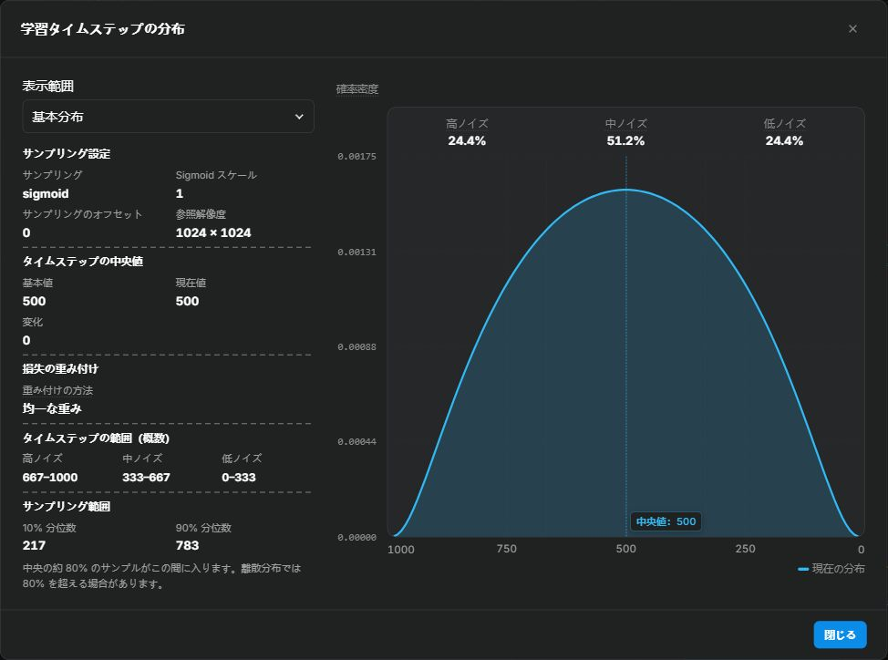
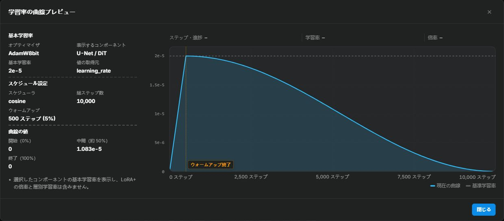
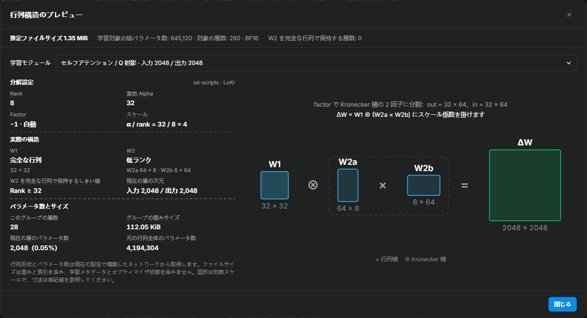

<div align="center">

# lora-scripts-anima

_Anima、SDXL、MOSS-Image、Krea 2 に対応したローカル LoRA 学習ツール。_

学習設定、画像のタグ付け、キャプションの一括編集、学習進捗のリアルタイム監視ができます。

</div>

<p align="center">
  <a href="https://github.com/amenorira/lora-scripts-anima" style="margin: 2px;">
    
  </a>
  <a href="https://raw.githubusercontent.com/amenorira/lora-scripts-anima/main/LICENSE" style="margin: 2px;">
    
  </a>
</p>

<p align="center">
  <a href="https://github.com/amenorira/lora-scripts-anima/blob/main/README.md">中文</a> ·
  <a href="https://github.com/amenorira/lora-scripts-anima/blob/main/README-en.md">English</a>
</p>

### 対応モデル

| ベースモデル | 学習エンジン | ネイティブ方式 | LyCORIS |
|--------------|--------------|----------------|---------|
| SDXL | sd-scripts | LoRA / LoHa / LoKr | LoCon / LoHa / LoKr |
| Anima | sd-scripts | LoRA / LoHa / LoKr | LoCon / LoHa / LoKr |
| MOSS-Image | sd-scripts | LoRA / LoHa / LoKr | — |
| Krea 2 RAW DiT | musubi-tuner | LoRA | LoCon / LoHa / LoKr |

- **MOSS-Image** では DiT のテキスト投影層と Refiner を学習対象にできます。Qwen テキストエンコーダーは凍結したままです。
- **Krea 2** の学習前に、画像の潜在表現（latent）と Qwen3-VL のテキストエンコード結果をキャッシュしてください。

## 主な機能

- **学習設定** — 学習パラメータの編集、TOML のプレビュー、YAML / TOML のインポート、YAML のエクスポート、学習履歴の確認
- **学習前のプレビュー** — タイムステップ分布、学習率曲線、行列構造をローカルで計算して表示する 3 種類のダイアログ。[次の節を参照](#pre-training-previews)
- **LyCORIS アダプターパネル** — LoCon / LoHa / LoKr に対応し、アルゴリズムに応じたパラメータを表示。カーネルバックエンド（auto / Triton / TileLang / compile / Torch）の選択、LoRA+、Anima の学習範囲の詳細設定に対応
- **豊富なオプティマイザー** — AdamW、Lion、Prodigy、CAME、StableAdamW、Adafactor、ScheduleFree、Adan、AdEMAMix、Muon などに加え、内蔵の LoRA-RITE と実験的な LoRA-Muon を提供。各オプティマイザーの既定値と制約を表示
- **リアルタイムのハードウェア監視** — GPU 使用率・VRAM・温度、CPU・RAM 使用率を表示。Chart.js のグラフ、TensorBoard、リアルタイムログを統合
- **内蔵タグエディター** — 画像のタグを編集し、一括検索・置換、重複除去、並べ替え、クリーンアップなどを実行
- **タグ付けワークスペース** — WD EVA02-Large、WD ViT-Large、CL Tagger、Camie Tagger、[PixAI Tagger v1.0](https://huggingface.co/pixai-labs/pixai-tagger-v1.0) を統合。画像単位の確認、カテゴリ別のしきい値、一括キャプション出力に対応。PixAI はローカルの PyTorch で推論し、スタイルタグに対応。初回のダウンロードは約 1.95 GB。AI タグ付けでは OpenAI 互換（Chat Completions / Responses）または Anthropic Messages プロトコルの画像対応 API を利用可能
- **EmoSens 適応型オプティマイザー** — 損失の変化に応じて学習率を調整し、停止時期を提示する EmoSens v3.9 を内蔵
- **多言語対応（i18n）** — 中国語・英語・日本語の UI と内蔵ガイド。ブラウザーの言語を自動検出し、選択した言語を保存
- **3 種類のテーマ** — ライト、ダーク、ComfyUI。システム設定への追従と手動切り替えに対応
- **バックエンド接続状態の表示** — 接続状態と切断からの経過時間をリアルタイムで表示

<a name="pre-training-previews"></a>

## 学習前のプレビュー

### タイムステップ分布

学習タイムステップのサンプリング設定で **「タイムステップ分布を表示」** を開くと、確率密度、損失の重み、高・中・低ノイズの割合を確認できます。基本分布と学習全体の分布を切り替えてタイムステップの中央値を比較し、グラフにカーソルを合わせて値を読み取れます。詳しくは[タイムステップガイド](docs/parameters/timesteps.ja-JP.md)を参照してください。



### 学習率曲線

学習率スケジュールの設定から学習率のプレビューを開くと、ウォームアップ、減衰、リスタート、各学習ステップの学習率を確認できます。サイドバーには選択した DiT / テキストエンコーダーの実効学習率とウォームアップステップ数を表示します。スケジュールを自動管理するオプティマイザーには、その動作の説明を表示します。詳しくは[オプティマイザーガイド](docs/parameters/optimizers.ja-JP.md)を参照してください。



### 行列構造

Anima、MOSS-Image、Krea 2 の学習では、学習ネットワークモジュールの設定から **「構造プレビュー」** を開けます。Attention や MLP などのモジュールを切り替え、行列の形状、実効 rank と alpha、スケーリング、該当する層数、パラメータ数を確認できます。

同じ場所の **推定重みファイルサイズ** で、重みの保存に必要なディスク容量を学習前に確認できます。[行列構造とファイルサイズのガイド](docs/parameters/matrix-preview.ja-JP.md)



## 使い方

### クイックスタート

展開またはクローンしたプロジェクトフォルダーで、使用する OS のコマンドを実行してください。

| OS | インストールと起動 |
|----|--------------------|
| Windows | `.\start.bat` |
| Linux | `bash start.sh` |

初回起動時に仮想環境を作成し、依存パッケージを自動インストールします。起動後、GUI が [http://127.0.0.1:12333](http://127.0.0.1:12333) で自動的に開きます。

### 必要な環境

- **Windows** では初回起動時に、案内に従って現在のユーザー向けに 64 ビット版 Python 3.12 を追加できます。既存の Python と併用できます。ZIP 版では Git もインストールできます。
- **Linux** では Git と 64 ビット版 Python 3.12 を事前にインストールしてください。`venv` が見つからない場合は、`python3.12-venv` などの対応パッケージを追加してください。
- **学習**には NVIDIA GPU と R580 以降のドライバーが必要です。起動スクリプトは RTX 30/40/50 シリーズに対応する PyTorch 2.12.1 + CUDA 13.0 を自動インストールします。GUI は NVIDIA GPU のない環境でも起動できます。

互換性のない Python でプロジェクトの `venv` を作成した場合は、そのフォルダーの名前を変更し、起動スクリプトを再実行して環境を作り直してください。

Krea 2 と sd-scripts はプロジェクトのメイン `venv` を共有します。メイン環境で学習できることを確認した後、旧版の `venv/cores/musubi` を手動で削除できます。[プロジェクトの依存関係](requirements.txt)

### Windows：ZIP をダウンロード（初心者向け）

1. GitHub で **Code → Download ZIP** を選び、すべて展開してから `start.bat` をダブルクリックします。
2. `.git` がない場合は、Git for Windows のインストールと、更新可能なリポジトリへの修復を確認する画面が出ます。推奨の選択肢を選んでください。
3. 修復時には `main` のみ取得し、他のブランチやタグは取得しません。置き換え対象のソースファイルは、先に `bootstrap-backups/<日時>.zip` に保存します。`venv`、モデル、出力、キャッシュ、ログ、ユーザー設定を含む `config` ディレクトリ全体は同期対象から除外し、上書きや削除は行いません。
4. ソースの同期後、起動処理を一度再実行してから `venv` を作成し、学習用の依存パッケージをインストールします。

Git のインストール、またはソース同期開始前の修復に失敗しても元の ZIP で起動を続行し、次回再試行できます。同期開始後に失敗した場合は起動を停止し、バックアップ情報を残します。エラーを解決してから `start.bat` を再実行してください。Python または必須の依存パッケージのインストール失敗時も停止し、二言語のエラーを表示します。

### Git でクローン

```sh
git clone --depth 1 --single-branch --branch main --no-tags https://github.com/amenorira/lora-scripts-anima.git
cd lora-scripts-anima
git config pull.ff only
```

最新の main のみ取得し、その後も通常の `git pull` で更新できます。完全な履歴は `git fetch --unshallow`、タグは `git fetch --tags` で取得できます。開発者はクローンのオプションを省略できます。

dev を使う場合は次のコマンドを一度実行し、その後は `git switch main` / `git switch dev` で切り替えます。

```sh
git config --add remote.origin.fetch "+refs/heads/dev:refs/remotes/origin/dev"
git fetch --no-tags origin
git switch --track origin/dev
```

### リアルタイム通信と低速なリモート接続

SSH でアクセスする場合は、GUI のポートを転送します。GUI の URL の末尾に `/tensorboard/` を付けると TensorBoard を開けます。例は `http://127.0.0.1:12333/tensorboard/` です。転送先のローカルポートが異なる場合は、そのポートを使ってください。TensorBoard の起動に失敗した場合は `logs/tensorboard.log` を確認してください。

リモートのプレビューでリアルタイム更新が遅くなる場合は、**UI 設定 → 低速接続向けモード**をオンにすると、サムネイルを 1 枚ずつ読み込みます。手動で設定するまでは、ブラウザーが低速接続またはデータ節約モードを報告した場合に自動でオンになります。

### 更新方法

Windows では学習ツールを閉じて **`update.bat`** をダブルクリックし、成功後に `start.bat` を実行します。プロジェクト内で `git pull` も利用できます。現在のブランチ（main または dev）を快進更新し、ソースの変更、ステージ済みの変更、分岐がある場合は停止します。起動時にソースの自動更新は行いません。

旧版のサンプルプロンプト、Accelerate 設定、キャッシュのバージョンファイルが Git の追跡対象から外れる際は、先にバックアップし元の内容を保持します。既定のサンプルは `tools/defaults/` に置き、起動時には不足する設定だけを作成します。旧版に更新スクリプトがない場合は、PowerShell から `& "新ZIPフォルダー\update.bat" "--bootstrap-root=旧プロジェクトの絶対パス"` を実行すれば、旧起動スクリプトや学習環境を入れ替えずに移行できます。

## 学習パラメータガイド

学習パラメータの詳細は `docs/parameters/` にあります。

- [LoRA+ ガイド](docs/parameters/lora-plus.ja-JP.md)：仕組み、倍率の選択、オプティマイザーとの互換性、評価方法
- [オプティマイザー選択とパラメータガイド](docs/parameters/optimizers.ja-JP.md)：オプティマイザーの比較、学習率・weight decay の初期設定、データセットに応じた選択
- [タイムステップガイド](docs/parameters/timesteps.ja-JP.md)：flow matching のタイムステップサンプリング、損失の重み、分布プレビュー
- [AdaLN モジュレーション層ガイド](docs/parameters/adaln.ja-JP.md)：モジュレーション層の役割、上流の既定動作、有効化が適する学習
- [行列構造とファイルサイズのガイド](docs/parameters/matrix-preview.ja-JP.md)：実際のモジュール形状、パラメータ数、学習範囲、保存サイズの推定

## 起動引数

| 引数 | 型 | 既定値 | 説明 |
|------|----|--------|------|
| `--host` | str | "127.0.0.1" | サーバーのホスト名 |
| `--port` | int | 12333 | サーバーのポート |
| `--listen` | bool | false | 外部からのアクセスを許可 |
| `--skip-prepare-environment` | bool | false | 起動時の依存環境の確認・修復を省略 |
| `--skip-prepare-onnxruntime` | bool | false | onnxruntime-gpu のインストール確認のみ省略 |
| `--disable-tensorboard` | bool | false | GUI と同時に内蔵 TensorBoard を起動しない |
| `--tensorboard-port` | int | 0 | TensorBoard の内部ポート。0 は自動割り当て。通常は設定不要 |
| `--localization` | str | | UI の言語とローカライズ設定 |
| `--dev` | bool | false | 開発者モード |
| `--quiet` / `-q` | bool | false | Python / venv の依存パッケージを自動インストール。オプションの Git 修復は既定で実行しない |
| `--setup-git` | bool | false | Windows：推奨の Git インストール / ZIP リポジトリ修復を非対話で実行 |
| `--skip-git-setup` | bool | false | Windows：今回の起動では Git インストールやリポジトリ修復の確認を表示しない |

## Attention の高速化

Anima / MOSS の既定値は `torch`、Krea2 は `sdpa` です。SDPA は PyTorch のビルドと入力に応じて利用可能なカーネルを選択します。Windows 版に内蔵 FlashAttention が含まれているとは限りません。

外部 FlashAttention 2 は「環境管理」でインストールし、完了後に Anima / MOSS の `attn_mode` を `flash` に設定します。インストーラーは Python・PyTorch・CUDA・プラットフォームを照合し、PyTorch を変更せず拡張機能だけをインストールします。Krea2 の旧 `flash_attn` 設定は引き続き `sdpa` に変換します。

## EmoSens 適応型オプティマイザー

内蔵の EmoSens v3.9 は `vendor/emo_optimizer/` にあります。

### 推奨設定

| 学習方式 | 学習率 | スケジューラー | max_grad_norm |
|----------|:------:|:--------------:|:-------------:|
| SDXL LoRA | 1.0 | constant | 0 |
| Anima LoRA（DiT） | 0.1 | constant | 0 |

学習フォームのオプティマイザーの一覧から `EmoSens` を選択すると利用できます。

## 学習設定のインポート・エクスポート

- **エクスポート**：学習ページのパラメータプレビューから現在の YAML 設定をダウンロード。TOML プレビューでは学習パラメータを確認
- **インポート**：YAML または旧形式のフラットな TOML ファイルを読み込み、対応する学習方式のフォームに有効なフィールドを反映。未対応のフィールドは無視した旨を表示

## 環境管理

GUI の **「環境」** タブで次の情報や機能を利用できます。

- Python / PyTorch / CUDA のバージョン情報
- sd-scripts、LyCORIS アダプターバックエンド、musubi-tuner の状態
- musubi-tuner Krea 2 の共有実行環境の状態（sd-scripts と共有する CUDA 版 PyTorch、依存パッケージのバージョン統一状況）
- Flash Attention のインストール状態の確認とワンクリックインストール
- インストール候補の wheel 一覧のプレビュー

## プロジェクト構成

```
lora-scripts-anima/
├── vendor/sd-scripts/          ← Anima / SDXL / MOSS-Image 学習エンジン（固定した上流スナップショット）
├── vendor/musubi-tuner/        ← Krea 2 学習エンジン（固定した上流スナップショット）
├── vendor/lycoris/             ← LyCORIS アダプターバックエンド（固定した上流スナップショット）
├── vendor/emo_optimizer/       ← EmoSens 適応型オプティマイザー
├── vendor/lora_muon/           ← 実験的な LoRA-Muon オプティマイザー
├── backend/                    ← FastAPI バックエンド
│   ├── server/                 ← アプリ構成、HTTP ルート、静的リソース、プロキシ
│   ├── core/                   ← リアルタイムタスクの調整とインストール処理
│   ├── training/               ← 役割別に整理した学習モジュール
│   │   ├── fields/             ← フィールド定義、既定値、選択肢のメタデータ
│   │   ├── config/             ← 設定変換、インポート・エクスポート、検証
│   │   ├── datasets/           ← データセット解析、繰り返し回数、ステップ数の推定
│   │   ├── execution/          ← 実行準備、起動振り分け、プロセス管理
│   │   └── cache/              ← キャッシュの確認、生成、再利用
│   ├── monitor/                ← 学習監視（GPU、システム、ログ、プレビュー、履歴）
│   ├── tageditor/              ← 内蔵タグエディター
│   ├── tagger/                 ← タグ付けモジュール（WD / CL / Camie / PixAI / AI API）
│   ├── regularization/         ← 正則化画像の生成、サンプリング、復旧
│   └── gui.py                  ← GUI の内部エントリーポイント（起動スクリプトから呼び出し）
├── frontend/                   ← Alpine.js SPA フロントエンド
│   ├── js/                     ← 機能別に整理したスクリプト
│   │   ├── app/                ← アプリ構成とルーティング設定
│   │   ├── shared/             ← 共通 UI、通知、国際化、リアルタイム通信
│   │   ├── training/           ← 学習フォーム、設定、プレビュー
│   │   ├── monitor/            ← 監視、履歴、ログ、出力
│   │   ├── environment/        ← 環境情報、コンポーネント導入、モデル取得
│   │   ├── tagger/             ← 自動タグ付けと AI キャプションのワークスペース
│   │   ├── docs/               ← パラメータガイドの閲覧
│   │   ├── regularization/     ← 正則化画像生成のワークスペース
│   │   ├── tag-editor/         ← タグ編集、セッション、永続化
│   │   └── tag-dictionary/     ← 辞書、Worker、ホバーカード
│   ├── templates/              ← 必要時に読み込むワークスペース HTML
│   └── css/ · i18n/ · assets/   ← スタイル、翻訳、静的リソース
├── config/                     ← ローカル設定と自動保存
├── docs/                       ← パラメータガイドとプレビュー画像
├── tools/                      ← 起動・インストール・実行ツール。開発用スクリプトは tools/dev/
├── tests/                      ← バックエンド回帰テストとフロントエンド操作テスト
├── start.bat / start.sh        ← 起動スクリプト
└── requirements.txt            ← プロジェクト全体で共通の依存関係一覧（torch は起動時に別途インストール）
```

## 謝辞

- [kohya-ss/sd-scripts](https://github.com/kohya-ss/sd-scripts) — Anima / SDXL / MOSS-Image 学習エンジン
- [kohya-ss/musubi-tuner](https://github.com/kohya-ss/musubi-tuner) — Krea 2 学習エンジン
- [**LyCORIS**](https://github.com/KohakuBlueleaf/LyCORIS) — LoCon / LoHa / LoKr の学習アルゴリズムとアダプター
- [Akegarasu/lora-scripts](https://github.com/Akegarasu/lora-scripts) — 初期設計の参考

## ライセンス

本プロジェクトは [MIT ライセンス](LICENSE) で公開しています。`vendor/` 内のサードパーティーコンポーネントは、それぞれ元のライセンス（Apache-2.0 / MIT）を保持します。
