<div align="center">

# lora-scripts-anima

_Anima・SDXL・MOSS-Image・Krea 2 に対応したローカル LoRA 学習ツール_

ベースモデルのダウンロード、自動タグ付け、AI キャプション、タグ一括編集、正則化画像の生成、事前プレビュー、リアルタイム監視をひとつの画面で行えます。

</div>

<p align="center">
  <a href="https://github.com/amenorira/lora-scripts-anima" style="margin: 2px;">
    
  </a>
  <a href="https://raw.githubusercontent.com/amenorira/lora-scripts-anima/main/LICENSE" style="margin: 2px;">
    
  </a>
</p>

<p align="center">
  <a href="https://github.com/amenorira/lora-scripts-anima/blob/main/README.md">中文</a> ·
  <a href="https://github.com/amenorira/lora-scripts-anima/blob/main/README-en.md">English</a>
</p>

## 対応モデルと VRAM 目安

| ベースモデル | 学習エンジン | ネイティブ方式 | LyCORIS 方式 | 1024px 学習時の VRAM 目安（Batch 1） |
|--------------|--------------|----------------|--------------|--------------------------------------|
| SDXL | [sd-scripts](https://github.com/kohya-ss/sd-scripts) | LoRA / LoHa / LoKr | [LoCon / LoHa / LoKr](https://github.com/KohakuBlueleaf/LyCORIS) | 8 GB 以上 |
| Anima | [sd-scripts](https://github.com/kohya-ss/sd-scripts) | LoRA / LoHa / LoKr | LoCon / LoHa / LoKr | 約 6.5 GB から（bf16 + 勾配チェックポイント） |
| MOSS-Image | [sd-scripts](https://github.com/kohya-ss/sd-scripts) | LoRA / LoHa / LoKr | — | 約 9〜10 GB（ConvRot INT8、ブロックスワップ併用で約 5.2 GB）／約 13.5 GB（bf16） |
| Krea 2 RAW DiT | [musubi-tuner](https://github.com/kohya-ss/musubi-tuner) | LoRA | LoCon / LoHa / LoKr | スケール付き FP8 / ConvRot INT8・ブロックスワップに対応 |

- **ベースモデルの入手**：起動後、サイドバーの **環境 → モデル** から必要な構成ファイルを確認し、Anima・Krea 2・MOSS-Image のメインモデル、VAE、テキストエンコーダ、プレビュー高速化 LoRA を `models/` へ直接ダウンロードできます（レジューム対応）。
- **MOSS-Image**：DiT のテキスト入力投影層と Refiner を学習対象に含めることも可能です（Qwen テキストエンコーダは凍結）。
- **Krea 2**：学習開始前に、学習画面から画像 latent と Qwen3-VL テキストエンコーダの出力キャッシュを生成できます（データセット内の `.krea2-cache` に保存）。
- GPU やブロックスワップ設定ごとの実測値は [VRAM と速度の実測ガイド](docs/parameters/memory-optimization.ja-JP.md) を参照してください。

## クイックスタート

### 動作環境

- **OS と Python**：64 ビット版 Windows または Linux。Windows では初回起動時に、案内に従って現在のユーザー向けに 64 ビット版 Python 3.12 を既存環境や `PATH` に影響させず導入でき、ZIP 版では Git も導入できます。Linux では事前に `git`、`python3.12`、`python3.12-venv` をインストールしてください。
- **GPU とドライバ**：学習には NVIDIA GPU と **R580 以降のドライバ** が必要です。起動スクリプトは RTX 30 / 40 / 50 シリーズに対応する **PyTorch 2.12.1 + CUDA 13.0** を導入します。NVIDIA GPU のない環境でも GUI を起動してデータセットや設定を編集できます。

### インストールと起動

| OS | 入手方法 | 起動コマンド |
|----|----------|--------------|
| Windows（初心者向け） | GitHub で **Code → Download ZIP** を選び、すべて展開 | `start.bat` をダブルクリック（またはターミナルで `.\start.bat`） |
| Windows / Linux | `git clone --depth 1 --no-tags https://github.com/amenorira/lora-scripts-anima.git` | Windows：`.\start.bat` · Linux：`bash start.sh` |

初回起動時は、確認プロンプトに従って仮想環境 `venv` の作成と依存パッケージの導入を行います（`--quiet` / `-q` を付けると確認なしで自動実行します）。ターミナルに `READY` と表示されたら、ブラウザで **[http://127.0.0.1:12333](http://127.0.0.1:12333)** を開いてください（ポート 12333 が使用中の場合は `30000〜30020` の空きポートへ自動変更し、URL をターミナルに表示します）。

<details>
<summary>ZIP 版の Git 初期化・dev ブランチへの切り替え・venv の再構築</summary>

- **Windows ZIP 版の自動リポジトリ初期化**：フォルダ内に `.git` がない場合、`start.bat` は Git for Windows の導入と `main` ブランチを追跡する更新可能なリポジトリへの初期化を提案します（推奨の選択肢を選んでください）。差分のある古いソースファイルは先に `bootstrap-backups/<日時>.zip` へ退避し、`venv`・`models`・`output`・`config`・`cache`・`logs` などのユーザーデータは保護されます。同期完了後、起動スクリプトが自動的に一度再起動してから `venv` を構築します。同期開始前に失敗した場合は元の ZIP のまま起動を続行し、同期途中の失敗や Python・必須パッケージ導入失敗時は英語・中国語のエラーメッセージを表示して停止します。
- **`dev` ブランチへの切り替え**：浅いクローンから初めて `dev` へ切り替える際は次のコマンドを実行します。
  ```sh
  git remote set-branches --add origin dev
  git fetch origin
  git switch --track origin/dev
  ```
  以降は `git switch main` / `git switch dev` で切り替えられます。完全な履歴は `git fetch --unshallow`、タグは `git fetch --tags` で取得できます。
- **`venv` の作り直し**：非対応バージョンの Python で作成した `venv` がある場合は、プロジェクト内の `venv` フォルダの名前を変更または削除して起動スクリプトを再実行してください。Krea 2 と `sd-scripts` はメインの `venv` を共有するため（[依存パッケージ一覧](requirements.txt)）、メイン環境での動作を確認した後は旧版の `venv/cores/musubi` を手動で削除できます。

</details>

## 主な機能とワークフロー

### 1. 実行環境・高速化・モデル取得（サイドバー「環境」）
- **実行環境**：Python / PyTorch / CUDA や `sd-scripts`、`LyCORIS`、`musubi-tuner` の準備状態を確認し、`FlashAttention 2`、`xformers`、`Triton`、**MOSS テキスト高速化（FLA + Conv1D）** をワンクリックで導入・切り替えできます。
- **モデル**：メインモデル、テキストエンコーダ、VAE、プレビュー用 LoRA の配置状況をグループごとに確認し、不足ファイルを `models/` へ直接ダウンロードできます。
- **ダウンロード**：オフライン利用可能な **Danbooru 中国語辞書** を取得・更新し、タグ編集での検索とホバー解説に利用できます。

### 2. データセット作成・タグ整理・正則化（サイドバー「ツール」）
- **Tagger**：WD EVA02-Large、WD ViT-Large、CL Tagger、Camie Tagger、[PixAI Tagger v1.0](https://huggingface.co/pixai-labs/pixai-tagger-v1.0)（ローカル PyTorch 推論・スタイルタグ対応、初回のみ約 1.95 GB を取得）を統合し、1 枚単位の確認、カテゴリ別のしきい値調整、一括出力を行えます。
- **AI キャプション**：独立したワークスペースから OpenAI 互換（Chat Completions / Responses）や Anthropic Messages プロトコルの画像対応 API に接続し、複数の長さプリセットによる生成や未完了分の追加生成を行えます。
- **タグ編集**：タグチップとテキストの切り替え、一括検索・置換、重複除去、並べ替え、クリーンアップ、編集履歴からの復元に加え、オフライン辞書検索とホバーカードを備えています。
- **正則化画像の生成**：プロンプトからローカルで正則化画像を一括生成でき、中断からの再開、失敗項目の再試行、1 枚単位の再生成に対応します。

### 3. 学習設定・アダプタ・オプティマイザ（サイドバー「LoRA 学習」）
- **フォーム編集とインポート・エクスポート**：グループ別にパラメータを編集しながらステップ数計算と生成される TOML をリアルタイムで確認できます。YAML 設定のエクスポート、YAML や旧形式のフラットな TOML のインポート（未対応項目の通知付き）に対応し、過去の実行は **学習履歴** から確認できます。
- **LyCORIS アダプタ設定**：LoCon / LoHa / LoKr に対応し、方式に応じた項目を表示します。カーネルバックエンド（`auto` / `Triton` / `TileLang` / `compile` / `Torch`）、LoRA+、DoRA、対象モジュール（Attention、MLP、AdaLN など）の絞り込みを設定できます。
- **20 種類以上のオプティマイザ**：AdamW（標準 / 8-bit / Paged）、StableAdamW、CAME、Adan、Lion、AdEMAMix、Prodigy、ProdigyPlusScheduleFree、AdamWScheduleFree、AdaFactor、Muon、SOAP に加え、内蔵の LoRA-RITE、Automagic3 / Automagic4、実験的な LoRA-Muon、適応型の **EmoSens v3.9.3**（`vendor/emo_optimizer/` に収録。損失の変化から学習率を自動調整し停止時期の目安をログに表示。既定値は SDXL が学習率 `1.0`、Anima / MOSS-Image が `0.1`、スケジューラ `constant`、`max_grad_norm=0`）を搭載し、選択時に推奨初期値と制約を自動反映します。
- **[4 種類の事前プレビュー](#pre-training-previews)**：学習を始める前に、バケットのトリミング範囲、タイムステップ分布、学習率曲線、行列構造と推定ファイルサイズを確認できます。

### 4. リアルタイム監視・実行制御・データセット診断（サイドバー「モニター」）
- **リソースと損失の監視**：GPU 使用率・VRAM・温度、CPU・RAM 使用率、損失推移の診断、リアルタイムログ、内蔵 TensorBoard を統合しています。
- **学習中の実行制御**：`sd-scripts`（SDXL / Anima / MOSS-Image）の学習中はいつでも一時停止・再開、重みや学習状態の即時保存、手動プレビュー生成を実行できます。保存済み状態からの学習再開は全 4 モデルに対応します。
- **データセット診断**：`sd-scripts` のサンプル別損失ログ（SDXL / Anima / MOSS-Image 対応）に基づき、同じノイズ区間での**残差**とエポックごとの傾きから学習しにくい画像やタグ・トリミングの不備を特定し、タグ編集へ直接移動できます。
- **多言語 UI とテーマ**：日本語・中国語・英語の UI と内蔵ガイド（ブラウザ言語の自動検出と設定保存に対応）、ライト・ダーク・ComfyUI の 3 テーマ、バックエンド接続状態の表示を備えています。

## 画面プレビュー

### 学習フォームとプレビュープロンプト

グループごとに設定を調整しながらステップ数の計算過程と TOML 出力を確認できます。プレビュー用の品質・ポジティブ・ネガティブプロンプトは直接入力するほか、学習データのタグから選択・編集・並べ替えもできます。

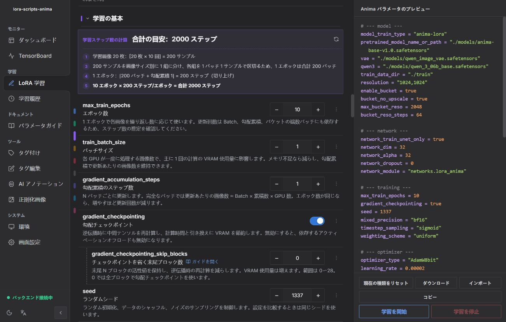

| プレビューのサンプリングとプロンプト設定 | 学習データのタグからプロンプトを編集 |
| --- | --- |
| 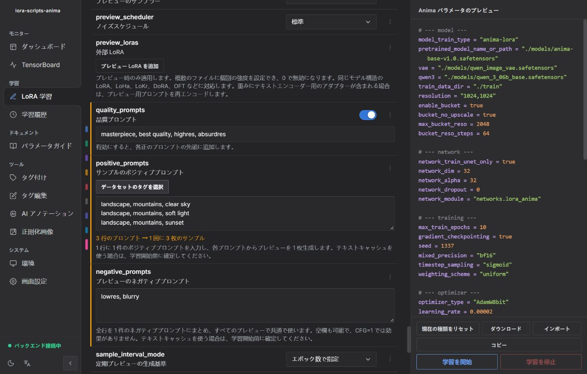 | 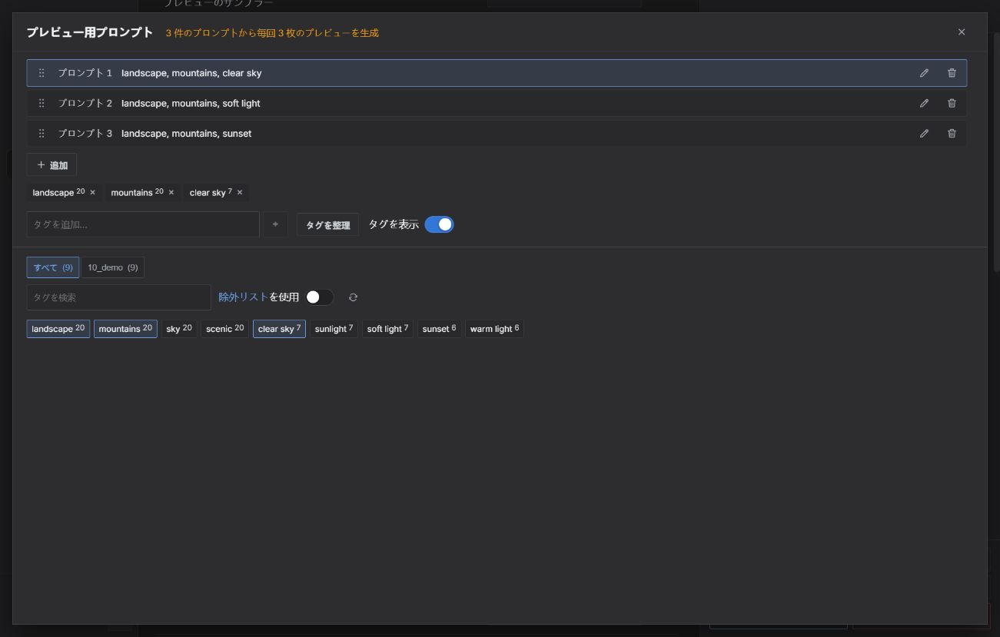 |

### 学習モニター・サンプル比較・データセット診断

**モニター → ダッシュボード** で進捗・速度・損失の推移を追跡しつつ、一時停止や即時保存、手動プレビューを実行できます。段階ごとのサンプルを固定して並べ比べたり、データセット診断で残差が高いままの画像を絞り込んで確認したりできます（画面のサンプルと診断データはデモ用です）。

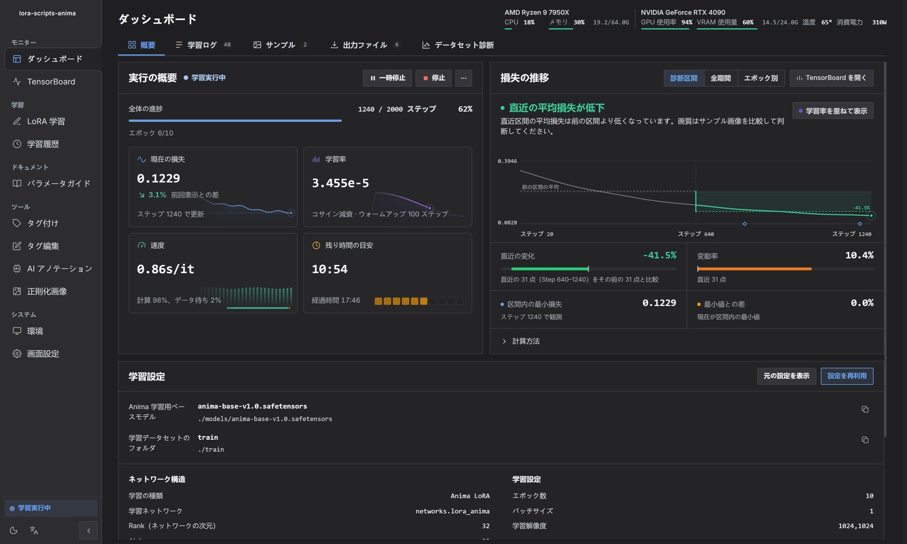

| 学習サンプル一覧と生成情報 | 学習段階ごとのサンプル比較 |
| --- | --- |
| 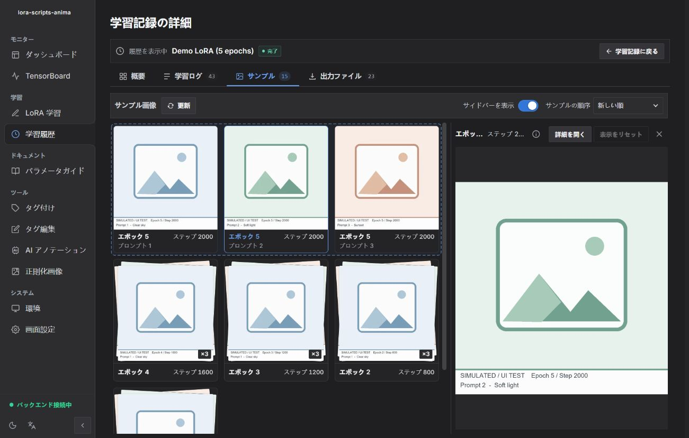 | 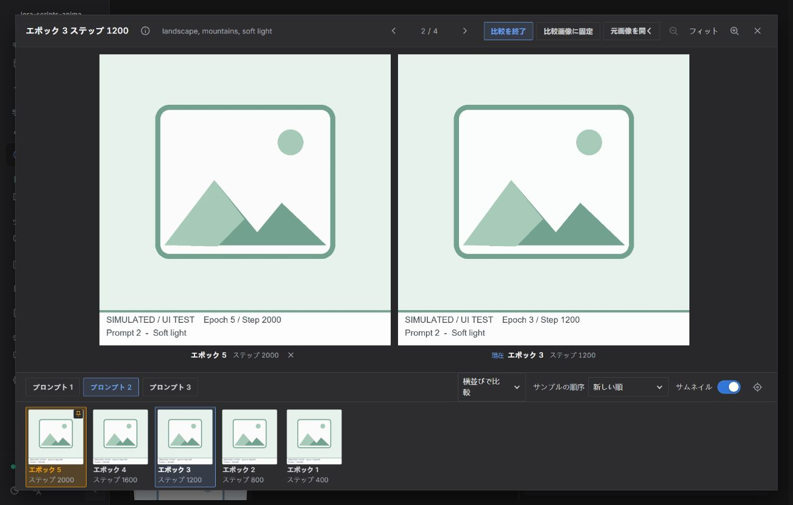 |

| データセット診断の概要（領域散布図とグループ比較） | 画像別のトリミング範囲・キャプション確認 |
| --- | --- |
| 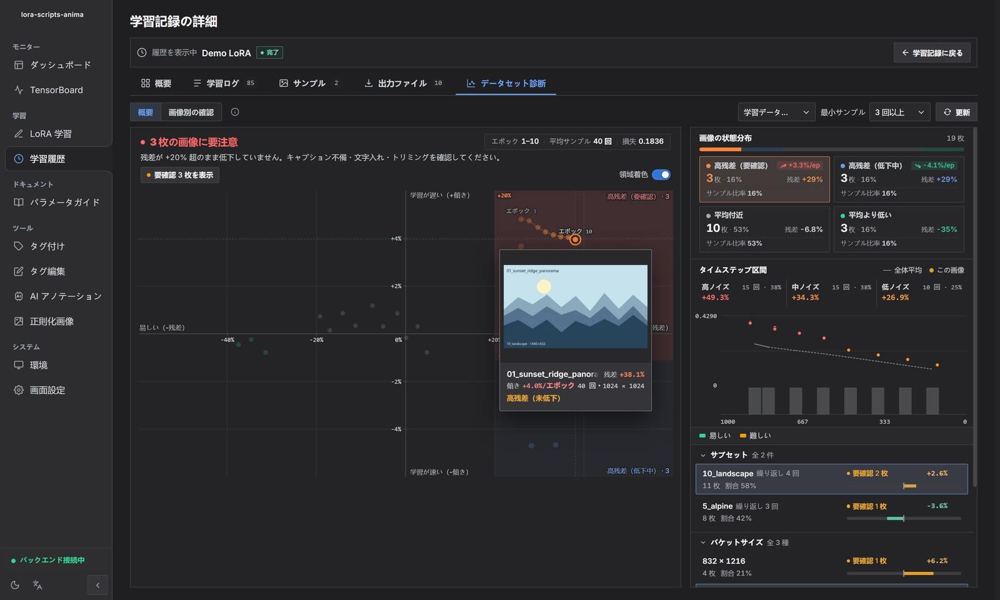 | 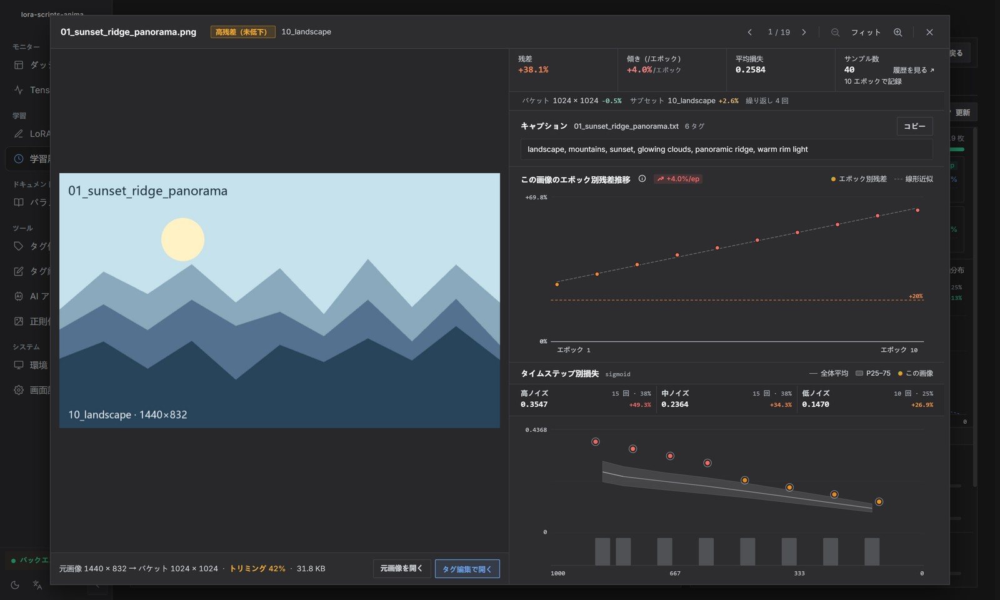 |

<a id="pre-training-previews"></a>

## 学習前のプレビュー

- **バケットとトリミングのプレビュー**：データセット設定にある **「トリミングをプレビュー」** から、元画像のサイズ、バケット割り当て、トリミング範囲、拡大の有無を事前に確認できます。
- **タイムステップ分布プレビュー**：**タイムステップのサンプリング**（Krea 2 では **タイムステップのサンプリング方法**）にある **「タイムステップ分布を表示」** を開き、確率密度、損失の重み、高・中・低ノイズ領域の割合、基本分布と全体分布の中央値の差を確認できます。詳しくは [タイムステップガイド](docs/parameters/timesteps.ja-JP.md) を参照してください。
- **学習率曲線プレビュー**：**学習率スケジューラ** にある **「学習率の曲線を表示」** を開き、ウォームアップ・減衰・リスタートの推移や DiT / テキストエンコーダ別の学習率を読み取れます。内部でスケジュールを管理するオプティマイザ（ScheduleFree、Automagic、EmoSens など）では外部スケジューラを使わない旨を表示します。詳しくは [オプティマイザとスケジューラのガイド](docs/parameters/optimizers.ja-JP.md) を参照してください。
- **行列構造とファイルサイズのプレビュー**：Anima、MOSS-Image、Krea 2 では、**学習ネットワーク** にある **「構造プレビュー」** から Attention や MLP ごとの行列形状、実効 Rank / Alpha、スケーリング、該当レイヤー数、パラメータ数、**推定重みファイルサイズ** を確認できます。詳しくは [行列構造とファイルサイズのガイド](docs/parameters/matrix-preview.ja-JP.md) を参照してください。

| タイムステップ分布プレビュー | 学習率曲線プレビュー |
| --- | --- |
| 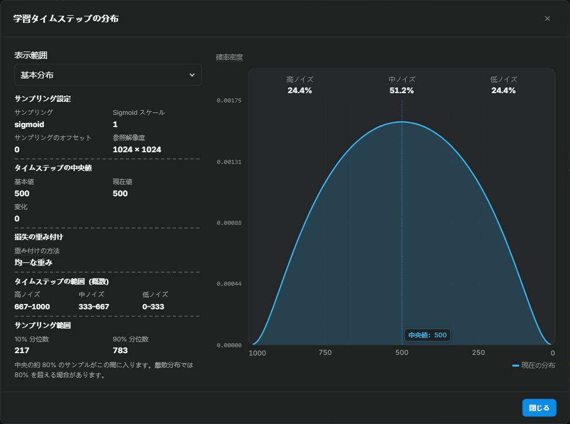 | 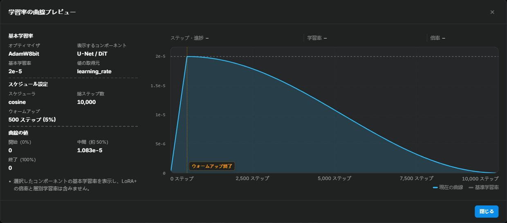 |

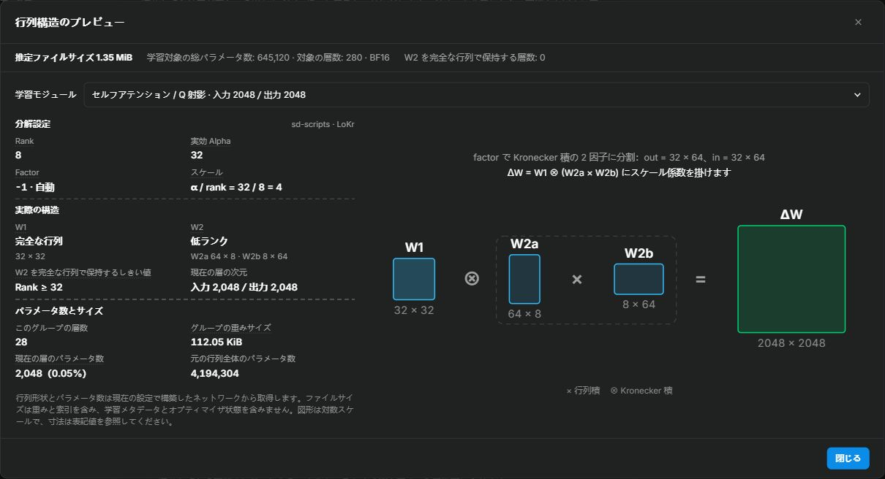

## Attention と学習の高速化

- **Anima / MOSS-Image**：`attn_mode` の既定値は `torch`（PyTorch SDPA。導入済みの PyTorch バージョンと入力に応じて利用可能なカーネルを選択）です。**環境 → 実行環境** で外部 FlashAttention 2 または xformers を導入した後は、`attn_mode` を `flash` または `xformers` に切り替えられます（Python・PyTorch・CUDA・OS に合う拡張パッケージのみを導入し、既存の PyTorch は変更しません）。MOSS-Image では同じ画面から **MOSS テキスト高速化（FLA + Conv1D）** も導入・有効化できます。
- **Krea 2**：Attention バックエンドの既定値は `SDPA` で、`FlashAttention` または `xFormers` も選択できます（`xFormers` 利用時は分割 Attention が必要です）。
- **SDXL**：パフォーマンス設定で `sdpa` または `xformers` を有効化できます。

## 学習パラメータガイド

詳細なガイドは `docs/parameters/` に収録しており、サイドバーの **パラメータガイド** や各設定項目のヘルプボタンからも閲覧できます。

- [ネットワークパラメータガイド](docs/parameters/network-parameters.ja-JP.md)：LoRA / LoHa / LoKr の比較、Rank / Alpha、DoRA、MOSS テキスト層、Krea 2 対象モジュール
- [LoRA+ ガイド](docs/parameters/lora-plus.ja-JP.md)：上下行列で学習率を分ける仕組み、推奨倍率、オプティマイザ互換性、効果の見極め方
- [AdaLN モジュレーション層ガイド](docs/parameters/adaln.ja-JP.md)：モジュレーション層の役割、ネイティブと LyCORIS の既定範囲の違い、有効化が適する場面
- [行列構造とファイルサイズのガイド](docs/parameters/matrix-preview.ja-JP.md)：モジュール別の行列形状、アルゴリズム間のパラメータ数の揃え方、対応範囲、保存容量の推定
- [オプティマイザとスケジューラのガイド](docs/parameters/optimizers.ja-JP.md)：6 グループ別の選び方、モデル別の初期学習率、スケジューラ比較、専用オプション
- [タイムステップガイド](docs/parameters/timesteps.ja-JP.md)：flow matching のサンプリング、高・中・低ノイズ域の役割、損失の重み、サブセットオフセット
- [VRAM と速度の実測ガイド](docs/parameters/memory-optimization.ja-JP.md)：VRAM 容量別の推奨設定、勾配チェックポイントの部分スキップ、ConvRot INT8、ブロックスワップ実測値
- [データセット診断ガイド](docs/parameters/dataset-diagnostics.ja-JP.md)：サンプル別の残差と傾きによる 6 段階判定、領域着色フィルタ、問題画像の確認手順

## 更新方法とリモート接続

### 更新方法

更新前に本ツールを終了してください。Windows では **`update.bat`** をダブルクリックし、完了後に `start.bat` を起動します。Linux または手動更新ではプロジェクトのルートフォルダで `git pull --ff-only` を実行します。更新処理は現在のブランチをファストフォワードで進め、`config/`・`models/`・`train/`・`output/` などのユーザーデータは変更しません。追跡中のソースに未コミット・ステージ済みの変更や履歴の分岐がある場合は安全のため停止します。

<details>
<summary>旧設定の引き継ぎと旧フォルダからの移行</summary>

初期設定のテンプレートは `tools/defaults/` にあり、起動時は不足している設定ファイルのみを作成します。過去に Git 管理対象だったサンプルプロンプトや Accelerate 設定は、更新時に自動バックアップしたうえで元の内容を保持します。`update.bat` がない古いフォルダを更新する場合は、PowerShell で `& "新ZIPフォルダ\update.bat" "--bootstrap-root=旧プロジェクトの絶対パス"` を実行すると、仮想環境を作り直さずに移行できます。

</details>

### リモート接続と低速回線

SSH 経由で利用する場合は GUI のポートのみを転送します。URL の末尾に `/tensorboard/` を付けると内蔵 TensorBoard を開けます（例：`http://127.0.0.1:12333/tensorboard/`。ローカル側の転送ポートが異なる場合はそのポートに読み替えてください。起動に失敗した場合は `logs/tensorboard.log` を確認してください）。

リモート環境でプレビュー画像の読み込みによりリアルタイム更新が遅くなる場合は、**画面設定 → 低速接続向けモード** をオンにするとサムネイルを 1 枚ずつ読み込みます。手動で変更するまでは、ブラウザが低速接続またはデータセーバーを報告した場合に自動でオンになります。

## 起動引数とディレクトリ構成

必要に応じて起動スクリプトへ引数を渡せます（例：`.\start.bat --listen`、`bash start.sh --port 12345`）。

<details>
<summary>すべての起動引数を表示</summary>

| 引数 | 対象 | 型 | 既定値 | 説明 |
|------|------|----|--------|------|
| `--host` | バックエンド | str | `"127.0.0.1"` | サーバーの待ち受けホスト名 |
| `--port` | バックエンド | int | `12333` | サーバーの待ち受けポート（使用時は `30000〜30020` にフォールバック） |
| `--listen` | バックエンド | bool | `false` | `0.0.0.0` で待ち受け、LAN・外部アクセスを許可 |
| `--skip-prepare-environment` | バックエンド | bool | `false` | 起動時の依存環境チェック・修復を省略 |
| `--skip-prepare-onnxruntime` | バックエンド | bool | `false` | `onnxruntime-gpu` のチェックのみ省略 |
| `--disable-tensorboard` | バックエンド | bool | `false` | GUI と同時に内蔵 TensorBoard を起動しない |
| `--tensorboard-port` | バックエンド | int | `0` | TensorBoard の内部ポート。`0` は自動割り当て（アクセスは `/tensorboard/` 経由） |
| `--dev` | バックエンド | bool | `false` | 開発者モード（CORS と自動リロードを有効化） |
| `--quiet` / `-q` | 起動スクリプト | bool | `false` | 確認なしで `venv` と依存パッケージを導入（任意の Git 初期化確認は省略） |
| `--setup-git` | Windows 起動処理 | bool | `false` | 推奨の Git 導入と ZIP リポジトリ初期化を非対話で実行 |
| `--skip-git-setup` | Windows 起動処理 | bool | `false` | 今回の起動では Git 導入・リポジトリ初期化の確認を表示しない |

</details>

### 主なユーザー用フォルダ

- `models/` — ベースモデル、VAE、テキストエンコーダ、プレビュー高速化 LoRA の既定保存先
- `train/` — 学習データセット（画像と同名のキャプションファイル）の既定フォルダ
- `output/` — 出力された重み、再開用ステート、プレビュー画像、実行記録
- `config/` — 自動保存されたフォームの下書き、プリセット、ローカル設定
- `logs/` — アプリケーションログ（`anima.log`）および `tensorboard.log`

<details>
<summary>プロジェクト全体のディレクトリ構成を表示</summary>

```text
lora-scripts-anima/
├── models/ · train/ · output/  ← モデル・学習データ・出力先（保護対象のユーザーデータ）
├── config/ · logs/             ← ローカル設定・自動保存・実行ログ
├── vendor/
│   ├── sd-scripts/             ← Anima / SDXL / MOSS-Image 学習エンジン（上流の固定スナップショット）
│   ├── musubi-tuner/           ← Krea 2 学習エンジン（上流の固定スナップショット）
│   ├── lycoris/                ← LyCORIS アダプタバックエンド（上流の固定スナップショット）
│   ├── emo_optimizer/          ← EmoSens v3.9.3 適応型オプティマイザ
│   ├── automagic_optimizer/    ← Automagic3 / Automagic4 適応型オプティマイザ
│   └── lora_muon/              ← 実験的な LoRA-Muon オプティマイザ
├── backend/                    ← FastAPI バックエンド
│   ├── server/                 ← アプリ構成、HTTP ルート、静的配信、プロキシ
│   ├── core/                   ← リアルタイムタスク調整・インストール処理管理
│   ├── training/               ← フィールド定義、設定検証、ステップ数推定、キャッシュ、実行管理
│   ├── monitor/                ← リソース監視、サンプル比較、履歴、データセット診断
│   ├── tageditor/              ← タグ編集バックエンド
│   ├── tagger/                 ← 自動タグ付け（WD / CL / Camie / PixAI）・AI キャプション API
│   ├── regularization/         ← 正則化画像の生成・サンプリング・復旧
│   └── gui.py                  ← GUI サーバーの内部エントリ（起動スクリプトから呼び出し）
├── frontend/                   ← Alpine.js SPA フロントエンド
│   ├── js/                     ← 機能別モジュール（training / monitor / environment / tagger / tag-editor / tag-dictionary / regularization / docs / shared）
│   ├── templates/              ← オンデマンド読み込みのワークスペース HTML
│   └── css/ · i18n/ · assets/   ← スタイル、3 言語翻訳ファイル、静的アセット
├── docs/                       ← 内蔵パラメータガイド（docs/parameters/）と画面スクリーンショット
├── tools/                      ← 起動・高速化モジュール導入・実行補助ツール（開発用は tools/dev/）
├── tests/                      ← バックエンド回帰テスト・フロントエンド操作テスト
├── start.bat / start.sh        ← Windows / Linux 起動スクリプト
├── update.bat                  ← Windows ファストフォワード更新スクリプト
└── requirements.txt            ← バックエンドと両学習エンジンで共有する単一の依存関係一覧（PyTorch は起動時に別途導入）
```

</details>

## 謝辞

- [kohya-ss/sd-scripts](https://github.com/kohya-ss/sd-scripts) — Anima / SDXL / MOSS-Image 学習エンジン
- [kohya-ss/musubi-tuner](https://github.com/kohya-ss/musubi-tuner) — Krea 2 学習エンジン
- [KohakuBlueleaf/LyCORIS](https://github.com/KohakuBlueleaf/LyCORIS) — LoCon / LoHa / LoKr の学習アルゴリズムとアダプタ
- [Akegarasu/lora-scripts](https://github.com/Akegarasu/lora-scripts) — 初期設計の参考

## ライセンス

本プロジェクトは [MIT ライセンス](LICENSE) で公開しています。`vendor/` 内のサードパーティコンポーネントは、それぞれ元のライセンス（Apache-2.0 / MIT）を保持します。
