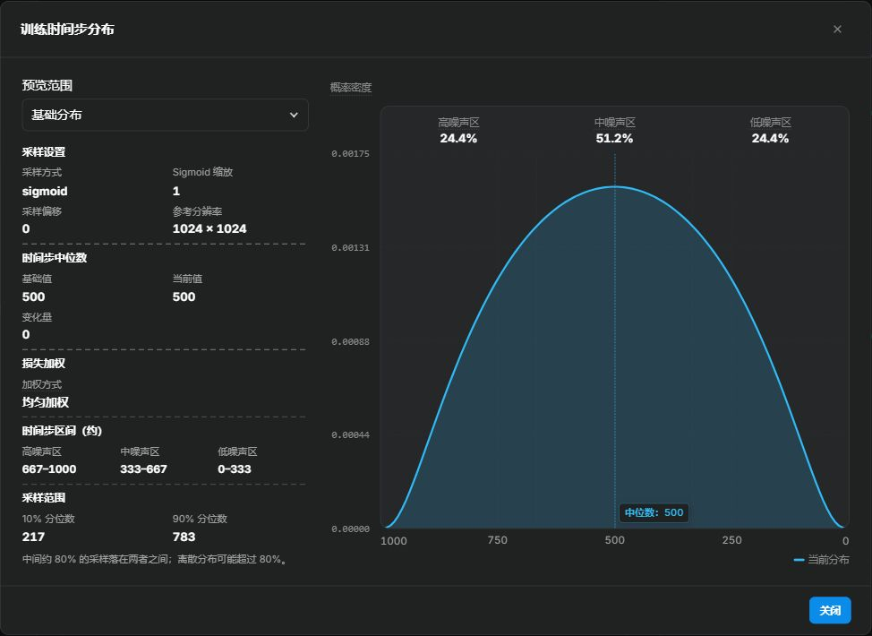
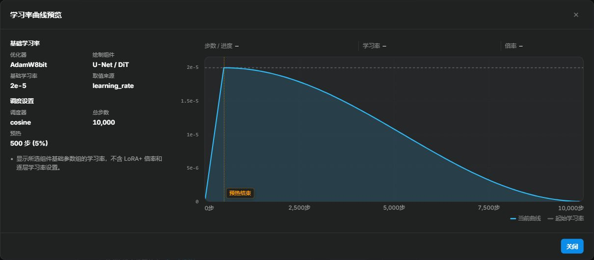
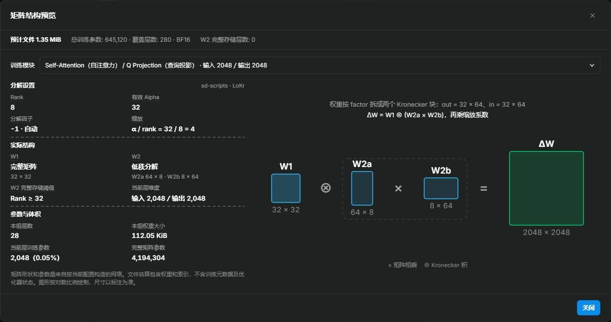

<div align="center">

# lora-scripts-anima

_本地 LoRA 训练工具，支持 Anima、SDXL、MOSS-Image 和 Krea 2。_

集成训练配置、图片打标、标签批量编辑和训练进度实时监控。

Anima、SDXL 和 MOSS-Image 使用 [kohya-ss/sd-scripts](https://github.com/kohya-ss/sd-scripts) 作为训练核心，Krea 2 使用 [kohya-ss/musubi-tuner](https://github.com/kohya-ss/musubi-tuner)。通过 [LyCORIS](https://github.com/KohakuBlueleaf/LyCORIS)，Anima、SDXL 和 Krea 2 还可使用 LoCon、LoHa、LoKr 等训练算法。

</div>

<p align="center">
  <a href="https://github.com/amenorira/lora-scripts-anima" style="margin: 2px;">
    
  </a>
  <a href="https://raw.githubusercontent.com/amenorira/lora-scripts-anima/main/LICENSE" style="margin: 2px;">
    
  </a>
</p>

<p align="center">
  <a href="https://github.com/amenorira/lora-scripts-anima/blob/main/README-en.md">English</a> ·
  <a href="https://github.com/amenorira/lora-scripts-anima/blob/main/README-ja.md">日本語</a>
</p>

### 支持的模型类型

| 底模 | 训练引擎 | 原生算法 | LyCORIS |
|------|----------|----------|---------|
| SDXL | sd-scripts | LoRA / LoHa / LoKr | LoCon / LoHa / LoKr |
| Anima | sd-scripts | LoRA / LoHa / LoKr | LoCon / LoHa / LoKr |
| MOSS-Image | sd-scripts | LoRA / LoHa / LoKr | — |
| Krea 2 RAW DiT | musubi-tuner | LoRA | LoCon / LoHa / LoKr |

- **MOSS-Image** 可选择训练 DiT 的文本投影与细化层。Qwen 文本编码器保持冻结。
- **Krea 2** 开始训练前需先准备图像 latent 和 Qwen3-VL 文本编码缓存。

## 功能简介

- **训练配置** — 编辑训练参数、预览 TOML、导入 YAML / TOML、导出 YAML，并查看训练记录
- **训练前预览** — 时间步分布、学习率曲线与矩阵结构三个本地预览弹窗，[见下一节](#pre-training-previews)
- **LyCORIS 适配器面板** — 支持 LoCon / LoHa / LoKr，按算法动态显示参数，可选内核后端（auto / Triton / TileLang / compile / Torch），并支持 LoRA+ 与 Anima 训练范围细化
- **多种优化器** — AdamW、Lion、Prodigy、CAME、StableAdamW、Adafactor、ScheduleFree、Adan、AdEMAMix、Muon 等常用优化器，外加内置的 LoRA-RITE 与测试中的 LoRA-Muon，各自带默认值与约束提示
- **实时硬件监控** — 显示 GPU 利用率、显存与温度，以及 CPU/RAM 使用率；集成 Chart.js 动态图表、TensorBoard 和实时日志
- **原生标签编辑器** — 内置图片标签编辑器，支持批量查找替换、去重、排序、清理等操作
- **Tagger 工作台** — 集成 WD EVA02-Large、WD ViT-Large、CL Tagger、Camie Tagger 与 [PixAI Tagger v1.0](https://huggingface.co/pixai-labs/pixai-tagger-v1.0)，支持单图检查、分类阈值控制和批量标签写入；PixAI 使用本地 PyTorch 推理，支持风格分类，首次下载约 1.95 GB；另可对接 OpenAI 兼容（Chat Completions / Responses）或 Anthropic Messages 协议的 AI 打标
- **EmoSens 自适应优化器** — 内置 EmoSens v3.9，可根据损失变化调整学习率并提示停止时机
- **国际化（i18n）** — 中文、英文和日语界面及内置指南，支持浏览器语言自动检测并保存语言偏好
- **三种主题** — 浅色、深色与 ComfyUI 主题，支持跟随系统、手动切换
- **后端连接状态指示器** — 实时显示前后端连接状态及断连时长

<a name="pre-training-previews"></a>

## 训练前预览

### 时间步分布预览

在 **训练时间步采样方式** 下点击「查看时间步分布」，检查采样密度、Loss 权重和高 / 中 / 低噪声占比。可切换基础分布与整体训练分布，对比中位时间步的变化，并通过悬浮读数检查曲线。详见[时间步指南](docs/parameters/timesteps.zh-CN.md)。



### 学习率曲线预览

在 **学习率变化方式** 下点击「查看学习率曲线」，预览预热、衰减与重启，读取各训练步的学习率。侧栏显示当前组件的生效学习率和预热步数，支持切换 DiT / 文本编码器；自行管理调度的优化器会显示相应说明。详见[优化器指南](docs/parameters/optimizers.zh-CN.md)。



### 矩阵结构预览

训练 Anima、MOSS-Image 或 Krea 2 时，在 **训练网络模块** 下点击「结构预览」。可切换注意力、MLP 等模块，查看矩阵形状、生效 rank / alpha、缩放、匹配层数和参数量。

同一入口也显示 **预计权重文件大小**，可在训练前估算保存权重所需的磁盘空间。[矩阵结构与文件大小指南](docs/parameters/matrix-preview.zh-CN.md)



## 使用方法

### 快速开始

进入解压或克隆后的项目目录，执行对应平台的命令。

| 平台 | 安装 + 启动 |
|------|------------|
| Windows | `.\start.bat` |
| Linux | `bash start.sh` |

首次启动会自动创建虚拟环境并安装所有依赖。启动后 GUI 自动打开 [http://127.0.0.1:12333](http://127.0.0.1:12333)。

### 必要依赖

- **Windows** 首次启动时可按提示为当前用户安装 64 位 Python 3.12，与已有 Python 并存。ZIP 下载版也可按提示安装 Git。
- **Linux** 请先安装 Git 和 64 位 Python 3.12。如果系统提示缺少 `venv`，请安装对应软件包（如 `python3.12-venv`）。
- **训练**需要 NVIDIA 显卡和 R580 或更新的驱动。启动脚本自动安装 PyTorch 2.12.1 + CUDA 13.0，支持 RTX 30/40/50 系列。无 NVIDIA 显卡也可启动 GUI。

如果已有的项目 `venv` 由不兼容的 Python 版本创建，可重命名该目录，再运行启动脚本重建环境。

Krea 2 与 sd-scripts 共用项目主 `venv`。确认主环境可以正常训练后，可手动清理旧版遗留的 `venv/cores/musubi`。[项目依赖清单](requirements.txt)

> 国内用户设置清华镜像：`set PIP_INDEX_URL=https://pypi.tuna.tsinghua.edu.cn/simple` 后运行 `start.bat`。

### Windows：直接下载 ZIP（小白推荐）

1. 在 GitHub 点击 **Code → Download ZIP**，完整解压后双击 `start.bat`。
2. 如果目录中没有 `.git`，启动器会询问是否安装 Git for Windows 并修复为可更新仓库；选择推荐项即可。
3. 修复时只获取 `main` 分支，不获取其他分支和标签。若 ZIP 源码与最新版不同，待替换的源码会先备份到 `bootstrap-backups/<时间>.zip`。`venv`、模型、输出、缓存、日志和整个 `config` 用户配置目录不会参与源码同步，也不会被覆盖或清理。
4. 源码同步完成后，启动器会自动重启一次，再创建 `venv` 并安装训练依赖。

Git 安装或源码同步前的仓库修复失败不会阻止原 ZIP 启动，下次运行仍可重试。若源码同步开始后失败，会停止启动并保留备份记录；解决报错后重新运行 `start.bat` 重试，避免启动不完整的源码。Python 或核心依赖安装失败时也会停止并显示双语错误。

### 使用 Git 克隆

```sh
git clone --depth 1 --no-tags https://github.com/amenorira/lora-scripts-anima.git
cd lora-scripts-anima
```

这会浅克隆默认分支 `main`。进入目录后按上面的「快速开始」启动。

<details>
<summary>切换到 dev 或下载完整历史</summary>

浅克隆后，首次切换到 `dev` 时运行以下命令。

```sh
git remote set-branches --add origin dev
git fetch origin
git switch --track origin/dev
```

之后可用 `git switch main` 或 `git switch dev` 切换。需要补齐已跟踪分支的历史时运行 `git fetch --unshallow`，需要标签时运行 `git fetch --tags`。

</details>

### 实时连接与慢速远程连接

通过 SSH 访问时，只需转发 GUI 端口。在 GUI 地址后加上 `/tensorboard/` 即可打开 TensorBoard，例如 `http://127.0.0.1:12333/tensorboard/`。若本地转发端口不同，请使用本地端口。TensorBoard 启动失败时可查看 `logs/tensorboard.log`。

如果远程预览拖慢实时更新，可在 **UI 设置 → 慢速远程连接兼容**中开启逐张加载缩略图。尚未手动设置时，浏览器报告低速连接或省流量模式便会自动开启。

### 后续更新

更新前先关闭训练器。Windows 用户可双击 **`update.bat`**，更新成功后运行 `start.bat`。更新脚本只快进当前分支，遇到源码修改、暂存改动或分叉时会停止。手动更新可在项目目录运行 `git pull --ff-only`。

旧版采样提示词、Accelerate 配置和缓存版本文件停止 Git 跟踪时，更新脚本会先备份，再迁移并保留原内容。默认示例在 `tools/defaults/`，启动只补建缺失配置。旧目录没有更新入口时，可在 PowerShell 运行 `& "新ZIP目录\update.bat" "--bootstrap-root=旧项目目录绝对路径"` 完成迁移，无需覆盖旧启动器或重装环境。

## 训练参数指南

详细的训练参数说明见 `docs/parameters/`：

- [LoRA+ 指南](docs/parameters/lora-plus.zh-CN.md)：LoRA+ 的原理、倍率选择、优化器兼容性与判断方法
- [优化器选择与参数指南](docs/parameters/optimizers.zh-CN.md)：优化器对比、学习率/weight decay 等参数起点、按数据集选择
- [时间步指南](docs/parameters/timesteps.zh-CN.md)：flow matching 时间步采样、Loss 权重与分布预览说明
- [AdaLN 调制层指南](docs/parameters/adaln.zh-CN.md)：调制层的作用、上游默认行为，以及哪些训练适合开启
- [矩阵结构与文件大小指南](docs/parameters/matrix-preview.zh-CN.md)：实际模块结构、参数量、训练范围与保存体积估算

## 程序参数

| 参数名称 | 类型 | 默认值 | 描述 |
|---------|------|--------|------|
| `--host` | str | "127.0.0.1" | 服务器主机名 |
| `--port` | int | 12333 | 服务器端口 |
| `--listen` | bool | false | 启用监听模式（允许外部访问） |
| `--skip-prepare-environment` | bool | false | 启动时不再自动检查和修复依赖环境 |
| `--skip-prepare-onnxruntime` | bool | false | 只跳过 onnxruntime-gpu 的安装检查 |
| `--disable-tensorboard` | bool | false | 不随 GUI 启动内置的 TensorBoard |
| `--tensorboard-port` | int | 0 | 内部 TensorBoard 端口，0 表示自动分配；通常无需设置 |
| `--localization` | str | | 界面语言与本地化设置 |
| `--dev` | bool | false | 开发者模式 |
| `--quiet` / `-q` | bool | false | 自动安装 Python/venv 依赖；默认不执行可选的 Git 仓库修复 |
| `--setup-git` | bool | false | Windows：非交互执行推荐的 Git 安装/ZIP 仓库修复 |
| `--skip-git-setup` | bool | false | Windows：本次启动不提示 Git 安装或仓库修复 |

## 注意力加速

Anima / MOSS 默认使用 `torch`，Krea2 默认使用 `sdpa`。SDPA 根据当前 PyTorch 构建和输入选择可用内核；Windows 安装包不一定包含内置 FlashAttention。

使用独立 FlashAttention 2：在「环境管理」中安装完成后，将 Anima / MOSS 的 `attn_mode` 设为 `flash`。安装器匹配 Python、PyTorch、CUDA 和平台，只安装扩展，不更换 PyTorch。Krea2 的旧 `flash_attn` 配置仍转为 `sdpa`。

## EmoSens 自适应优化器

内置的 EmoSens v3.9 位于 `vendor/emo_optimizer/`。

### 推荐设置

| 训练类型 | 学习率 | 调度器 | max_grad_norm |
|---------|:------:|:------:|:-------------:|
| SDXL LoRA | 1.0 | constant | 0 |
| Anima LoRA (DiT) | 0.1 | constant | 0 |

在训练表单的优化器下拉菜单中选择 `EmoSens` 即可使用。

## 训练配置导入导出

- **导出**：在训练页右侧参数预览中下载当前 YAML 配置；TOML 预览用于查看训练参数
- **导入**：选择 YAML 或旧版扁平 TOML 文件，将支持的字段填入对应训练类型的表单；不支持的字段会提示忽略

## 环境管理

GUI 的 **环境** 标签页提供：
- Python / PyTorch / CUDA 版本信息
- sd-scripts、LyCORIS 适配器后端与 musubi-tuner 的核心状态
- musubi-tuner Krea 2 共享运行时状态（与 sd-scripts 共用 CUDA 版 PyTorch，并显示依赖版本是否已统一）
- Flash Attention 安装状态检测与一键安装
- 候选 wheel 列表预览

## 项目结构

```
lora-scripts-anima/
├── vendor/sd-scripts/          ← Anima / SDXL / MOSS-Image 训练引擎（固定上游快照）
├── vendor/musubi-tuner/        ← Krea 2 训练核心（固定上游快照）
├── vendor/lycoris/             ← LyCORIS 适配器后端（固定上游快照）
├── vendor/emo_optimizer/       ← EmoSens 自适应优化器
├── vendor/lora_muon/           ← LoRA-Muon 测试优化器
├── backend/                    ← FastAPI 后端
│   ├── server/                 ← 应用装配、HTTP 路由、静态资源与代理
│   ├── core/                   ← 实时任务协调与安装任务生命周期
│   ├── training/               ← 训练模块，按职责组织
│   │   ├── fields/             ← 字段注册表、默认值与选项元数据
│   │   ├── config/             ← 配置转换、导入导出与参数校验
│   │   ├── datasets/           ← 数据集解析、重复次数与步数估算
│   │   ├── execution/          ← 运行准备、启动分发与进程管理
│   │   └── cache/              ← 缓存检查、生成与复用
│   ├── monitor/                ← 训练监控（GPU/系统/日志/预览/历史）
│   ├── tageditor/              ← 原生标签编辑器
│   ├── tagger/                 ← 打标模块（WD / CL / Camie / PixAI / AI 接口）
│   ├── regularization/         ← 正则图片生成、采样与恢复
│   └── gui.py                  ← GUI 内部入口（由启动脚本调用）
├── frontend/                   ← Alpine.js SPA 前端
│   ├── js/                     ← 按功能组织的脚本
│   │   ├── app/                ← 应用装配与路由配置
│   │   ├── shared/             ← 公共控件、通知、国际化与实时连接
│   │   ├── training/           ← 训练表单、配置与预览
│   │   ├── monitor/            ← 监控、历史、日志与输出
│   │   ├── environment/        ← 环境状态、组件安装与模型下载
│   │   ├── tagger/             ← 自动打标与 AI 描述工作区
│   │   ├── docs/               ← 参数文档阅读器
│   │   ├── regularization/     ← 正则图片生成工作区
│   │   ├── tag-editor/         ← 标签编辑、会话与持久化
│   │   └── tag-dictionary/     ← 词典、Worker 与悬浮卡片
│   ├── templates/              ← 按需加载的工作区 HTML 模板
│   └── css/ · i18n/ · assets/   ← 样式、翻译与静态资源
├── config/                     ← 本地配置与自动保存
├── docs/                       ← 参数指南与预览截图
├── tools/                      ← 启动、安装与运行工具；开发脚本位于 tools/dev/
├── tests/                      ← 后端回归与前端交互测试
├── start.bat / start.sh        ← 启动脚本
└── requirements.txt            ← 全项目唯一依赖清单（后端与训练核心共用，torch 由启动器单独安装）
```

## 致谢

- [kohya-ss/sd-scripts](https://github.com/kohya-ss/sd-scripts) — Anima / SDXL / MOSS-Image 训练引擎
- [kohya-ss/musubi-tuner](https://github.com/kohya-ss/musubi-tuner) — Krea 2 训练核心
- [**LyCORIS**](https://github.com/KohakuBlueleaf/LyCORIS) — LoCon / LoHa / LoKr 训练算法与适配器支持
- [Akegarasu/lora-scripts](https://github.com/Akegarasu/lora-scripts) — 早期设计参考

## 许可证

本项目以 [MIT 许可证](LICENSE) 发布。`vendor/` 目录下的第三方组件各自保留其原始许可证（Apache-2.0 / MIT）。
