<div align="center">

# lora-scripts-anima

_支持 Anima、SDXL、MOSS-Image 与 Krea 2 的本地 LoRA 训练工具_

一站式覆盖基础模型下载、自动打标、AI 标注、标签批量编辑、正则图生成、参数预览与实时训练监控。

</div>

<p align="center">
  <a href="https://github.com/amenorira/lora-scripts-anima" style="margin: 2px;">
    
  </a>
  <a href="https://raw.githubusercontent.com/amenorira/lora-scripts-anima/main/LICENSE" style="margin: 2px;">
    
  </a>
</p>

<p align="center">
  <a href="https://github.com/amenorira/lora-scripts-anima/blob/main/README-en.md">English</a> ·
  <a href="https://github.com/amenorira/lora-scripts-anima/blob/main/README-ja.md">日本語</a>
</p>

## 支持的模型与参考显存

| 底模 | 训练引擎 | 原生算法 | LyCORIS 算法 | 1024 分辨率参考显存（Batch 1） |
|------|----------|----------|--------------|-------------------------------|
| SDXL | [sd-scripts](https://github.com/kohya-ss/sd-scripts) | LoRA / LoHa / LoKr | [LoCon / LoHa / LoKr](https://github.com/KohakuBlueleaf/LyCORIS) | ≥ 8 GB |
| Anima | [sd-scripts](https://github.com/kohya-ss/sd-scripts) | LoRA / LoHa / LoKr | LoCon / LoHa / LoKr | ≈ 6.5 GB 起（bf16 + 梯度检查点） |
| MOSS-Image | [sd-scripts](https://github.com/kohya-ss/sd-scripts) | LoRA / LoHa / LoKr | — | ≈ 9–10 GB（ConvRot INT8，块交换可降至 ≈ 5.2 GB）/ ≈ 13.5 GB（bf16） |
| Krea 2 RAW DiT | [musubi-tuner](https://github.com/kohya-ss/musubi-tuner) | LoRA | LoCon / LoHa / LoKr | 支持缩放 FP8 / ConvRot INT8 与块交换 |

- **基础模型下载**：启动后可在侧栏 **环境管理 → 模型库** 按组件检测并一键断点下载 Anima、Krea 2、MOSS-Image 的主模型、VAE、文本编码器与预览加速 LoRA（默认保存至 `models/`）。
- **MOSS-Image**：可选训练 DiT 的文本输入投影与细化层，Qwen 文本编码器保持冻结。
- **Krea 2**：训练前直接在训练界面内一键生成图像潜变量（latent）与 Qwen3-VL 文本编码缓存（自动写入数据集下的 `.krea2-cache`）。
- 不同显卡与块交换配置的实测数据见[显存与速度实测指南](docs/parameters/memory-optimization.zh-CN.md)。

## 快速开始

### 环境要求

- **操作系统与 Python**：支持 64 位 Windows 与 Linux。Windows 首次运行可按提示为当前用户并行安装 64 位 Python 3.12（不影响已有 Python 与系统 PATH），ZIP 版还可自动安装 Git；Linux 请先安装 `git`、`python3.12` 及 `python3.12-venv`。
- **显卡与驱动**：训练需要 NVIDIA 显卡及 **R580 或更新驱动**。启动器会自动安装 **PyTorch 2.12.1 + CUDA 13.0**（支持 RTX 30 / 40 / 50 系列）。无 NVIDIA 显卡也可启动界面整理数据集与配置。

### 安装与启动

| 平台 | 获取方式 | 启动命令 |
|------|----------|----------|
| Windows（新手推荐） | 在 GitHub 点击 **Code → Download ZIP** 并完整解压 | 双击 `start.bat`（或终端运行 `.\start.bat`） |
| Windows / Linux | `git clone --depth 1 --no-tags https://github.com/amenorira/lora-scripts-anima.git` | Windows：`.\start.bat` · Linux：`bash start.sh` |

首次启动会提示确认创建项目虚拟环境 `venv` 并安装全部依赖（附加 `--quiet` / `-q` 可免交互自动安装）。终端打印 `READY / 服务已就绪` 后，在浏览器打开 **[http://127.0.0.1:12333](http://127.0.0.1:12333)**（若 12333 端口被占用，将自动改用 `30000–30020` 并在终端提示实际地址）。

<details>
<summary>ZIP 仓库初始化、切换 dev 分支与环境重建说明</summary>

- **Windows ZIP 自动转 Git 仓库**：若目录中没有 `.git`，`start.bat` 会询问是否安装 Git for Windows 并初始化为跟踪 `main` 分支的可更新仓库（选推荐项即可）。有差异的旧源码会先备份至 `bootstrap-backups/<时间>.zip`，`venv`、`models`、`output`、`config`、`cache`、`logs` 等用户目录受保护不会被覆盖或清理；同步完成后启动器会自动重启一次并继续部署环境。同步开始前的失败不影响原 ZIP 启动，同步中途中断则会停止启动并保留备份记录以便重试。
- **切换到 `dev` 分支**：浅克隆后首次切换到 `dev` 可执行：
  ```sh
  git remote set-branches --add origin dev
  git fetch origin
  git switch --track origin/dev
  ```
  后续可用 `git switch main` / `git switch dev` 切换；需要完整历史或标签时运行 `git fetch --unshallow` 或 `git fetch --tags`。
- **重建虚拟环境**：若现有 `venv` 由不兼容的 Python 版本创建，重命名或删除项目下的 `venv` 目录后重新运行启动脚本即可重建。Krea 2 与 `sd-scripts` 共用主 `venv`（见[项目依赖清单](requirements.txt)），旧版遗留的 `venv/cores/musubi` 在确认训练正常后可手动删除。

</details>

## 核心工作流与功能

### 1. 环境、加速与模型下载（侧栏「环境管理」）
- **运行环境**：查看 Python / PyTorch / CUDA 及 `sd-scripts`、`LyCORIS`、`musubi-tuner` 就绪状态；一键安装或切换 `FlashAttention 2`、`xformers`、`Triton` 与 **MOSS 文本加速（FLA + Conv1D）**。
- **模型库**：按主模型、文本编码器、VAE、预览加速 LoRA 分组核对本地文件，一键断点下载 Anima、Krea 2、MOSS-Image 所需权重至 `models/`。
- **数据下载**：离线下载并更新 **Danbooru 中文词典**，供标签编辑器检索与悬浮查看释义。

### 2. 数据集打标、清洗与正则图（侧栏「工具」）
- **Tagger 打标器**：集成 WD EVA02-Large、WD ViT-Large、CL Tagger、Camie Tagger 与 [PixAI Tagger v1.0](https://huggingface.co/pixai-labs/pixai-tagger-v1.0)（本地 PyTorch 推理，支持画风分类，首次下载约 1.95 GB），支持单图检查、分类阈值调节与批量写入。
- **AI 标注**：独立工作区，对接兼容 OpenAI（Chat Completions / Responses）或 Anthropic Messages 协议的视觉模型接口，支持长/中/短多档位描述生成与未完成项补跑。
- **标签编辑器**：支持标签块与文本双视图、批量查找替换、增删去重、排序清理与版本历史还原，内置离线中文词典搜索与悬浮释义卡。
- **正则图生成**：按提示词在本地批量采样生成正则化图片，支持中断续生、失败项重试与单图重新生成。

### 3. 训练配置、适配器与优化器（侧栏「LoRA 训练」）
- **表单与配置导入导出**：按分组配置参数，实时计算每轮样本与总步数并预览训练 TOML；支持导出当前 YAML 配置，或导入 YAML 与旧版扁平 TOML（自动忽略不支持的字段并提示）；可在 **训练记录** 回看历史运行与产物。
- **LyCORIS 适配器弹窗**：支持 LoCon / LoHa / LoKr，按算法动态展示专属参数，可选内核后端（`auto` / `Triton` / `TileLang` / `compile` / `Torch`）、LoRA+、DoRA 及按模块筛选训练目标（如注意力、MLP、AdaLN）。
- **20+ 内置优化器**：涵盖 AdamW（含 8-bit / Paged）、StableAdamW、CAME、Adan、Lion、AdEMAMix、Prodigy、ProdigyPlusScheduleFree、AdamWScheduleFree、AdaFactor、Muon、SOAP，以及内置的 LoRA-RITE、Automagic3 / Automagic4、实验性 LoRA-Muon 与自适应优化器 **EmoSens v3.9.3**（位于 `vendor/emo_optimizer/`，根据 Loss 变化自动调节步长并在日志提示停止时机；SDXL 默认学习率 `1.0`，Anima / MOSS-Image 默认 `0.1`，`constant` 调度，`max_grad_norm=0`），切换优化器时自动填入对应起始值并提示约束。
- **[4 项训练前预览](#pre-training-previews)**：开训前即可直观核对数据集分桶裁剪、时间步分布、学习率曲线及矩阵结构与预计权重体积。

### 4. 实时监控、运行控制与诊断（侧栏「训练监控」）
- **资源与曲线监控**：实时显示 GPU 利用率、显存、温度及 CPU / RAM 占用，集成 Loss 趋势分析、实时日志与内置 TensorBoard。
- **训练中运行控制**：`sd-scripts`（SDXL / Anima / MOSS-Image）训练途中可随时暂停/恢复、立即保存权重或训练状态、手动触发预览采样；全部四种模型均支持从存档续训。
- **训练集诊断**：基于 `sd-scripts` 逐样本 Loss 记录（支持 SDXL / Anima / MOSS-Image），按同时间步区间的**残差**与每轮下降斜率定位难学、漏标错标或裁切不当的异常图片，支持分组对比、单图审片与跳转标签编辑器。
- **多语言与桌面主题**：支持简体中文、English、日本語界面与内置参数说明（自动识别浏览器语言并保存偏好），提供浅色、深色、ComfyUI 三种主题及后端连接状态指示。

## 界面预览

### 训练表单与预览提示词

按分组调整训练参数并实时查看步数计算与 TOML 预览；采样预览支持设置质量词、正负向提示词，或直接从训练集标签中选取与编排提示词。

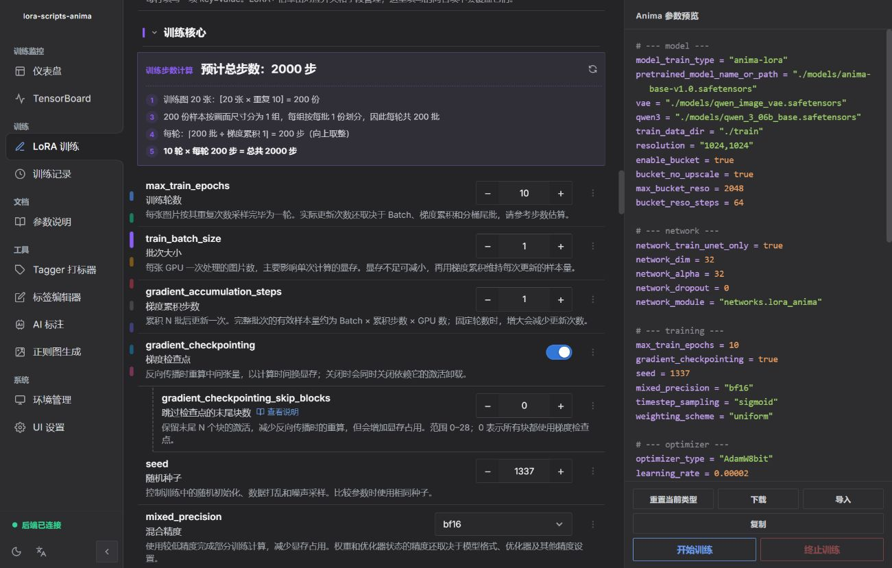

| 预览采样与提示词设置 | 从训练集标签编排预览提示词 |
| --- | --- |
| 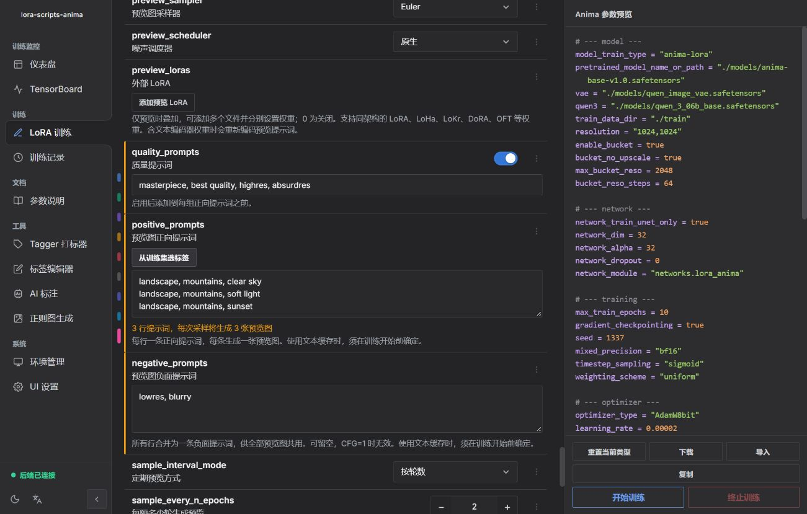 | 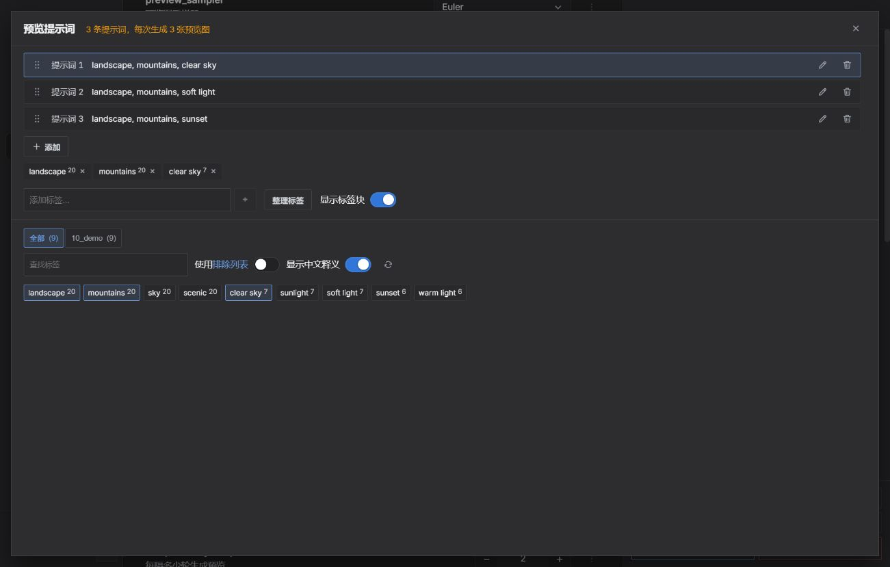 |

### 训练监控、样本对比与训练集诊断

在 **训练监控 → 仪表盘** 跟踪训练进度、步速与 Loss 趋势，随时执行暂停、即时保存或手动采样；按批次浏览并固定不同阶段的预览图进行对比，或通过训练集诊断筛查残差持续偏高的异常图片（图中样本与诊断数据为演示数据）。

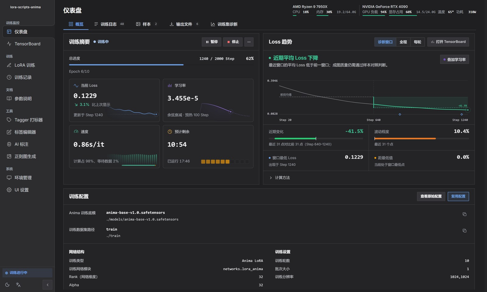

| 训练样本浏览与生成信息 | 不同训练阶段的样本固定对比 |
| --- | --- |
| 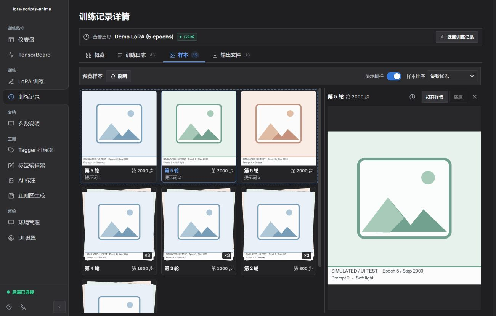 | 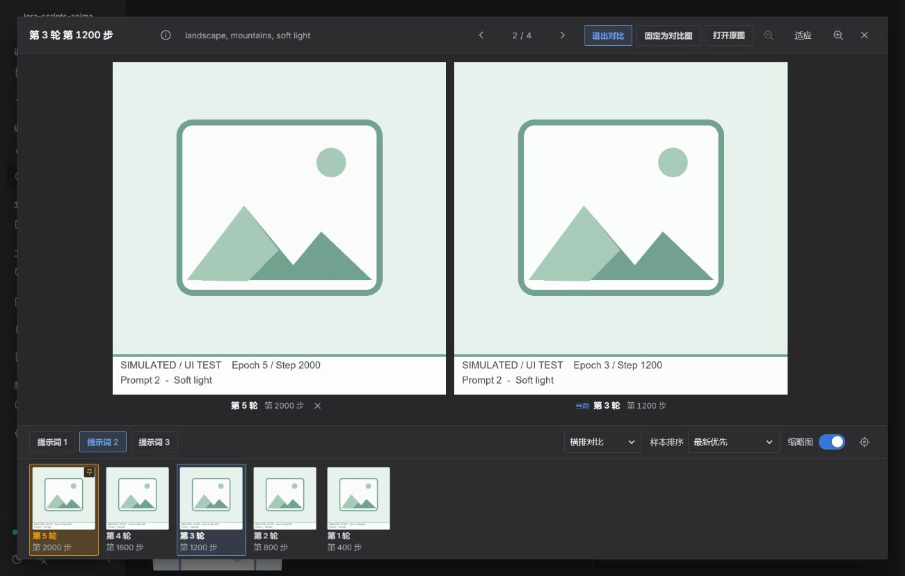 |

| 训练集诊断总览（散点分区与分组对比） | 单图分桶裁切与标注审片弹窗 |
| --- | --- |
| 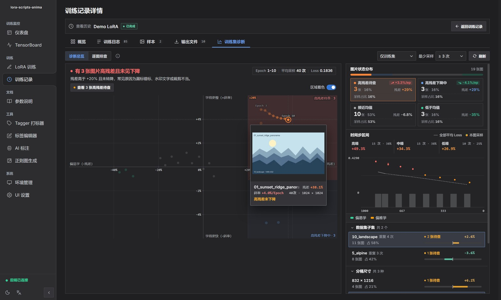 | 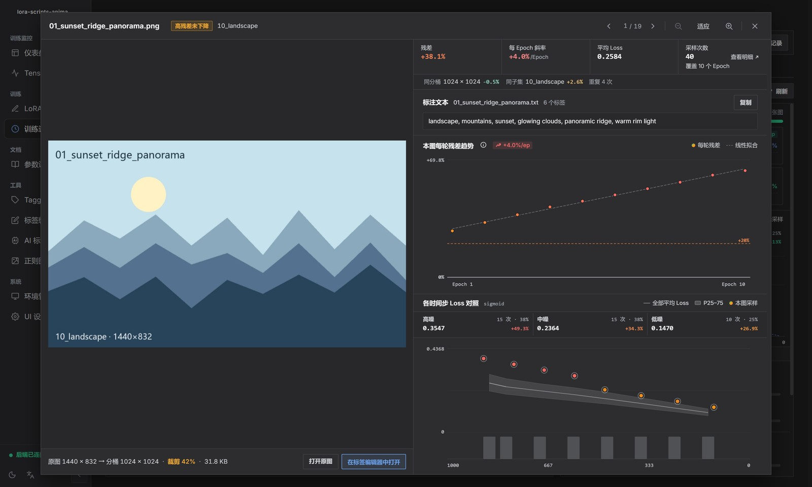 |

<a id="pre-training-previews"></a>

## 训练前预览

- **分桶与裁剪预览**：在数据集设置下点击 **「查看裁剪预览」**，训练前检查原图尺寸、分桶分配、裁切区域与放大情况。
- **时间步分布预览**：在 **时间步采样方式** 下点击 **「查看时间步分布」**，查看概率密度、Loss 权重与高 / 中 / 低噪区间占比，切换对比基础分布与整体训练分布的中位时间步。详见[时间步指南](docs/parameters/timesteps.zh-CN.md)。
- **学习率曲线预览**：在 **学习率调度器** 下点击 **「查看学习率曲线」**，按步读取预热、衰减与重启过程，切换查看 DiT 或文本编码器的生效学习率；选用自带调度的优化器（如 ScheduleFree、Automagic、EmoSens）时会提示无需外部调度。详见[优化器与学习率调度指南](docs/parameters/optimizers.zh-CN.md)。
- **矩阵结构与体积预览**：训练 Anima、MOSS-Image 或 Krea 2 时，在 **训练网络模块** 下点击 **「结构预览」**，按注意力、MLP 等模块查看矩阵分解形状、生效 Rank / Alpha、缩放、匹配层数、参数量及 **预计权重文件大小**。详见[矩阵结构与文件大小指南](docs/parameters/matrix-preview.zh-CN.md)。

| 时间步分布预览 | 学习率曲线预览 |
| --- | --- |
| 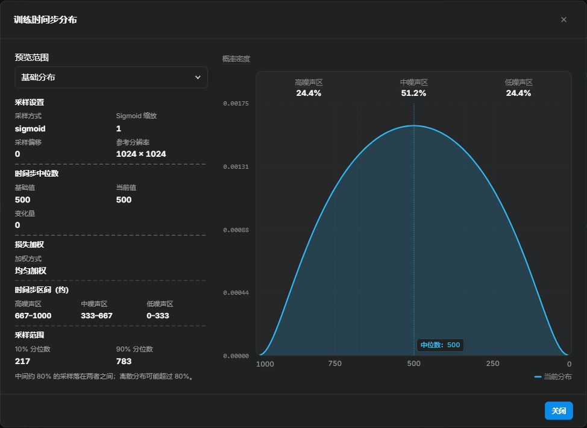 | 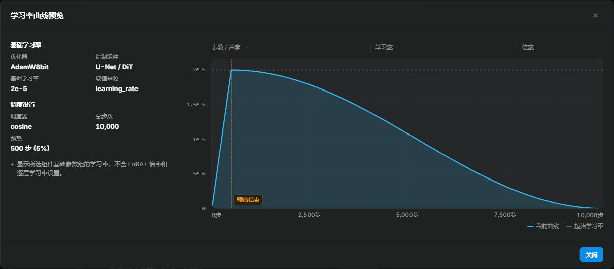 |

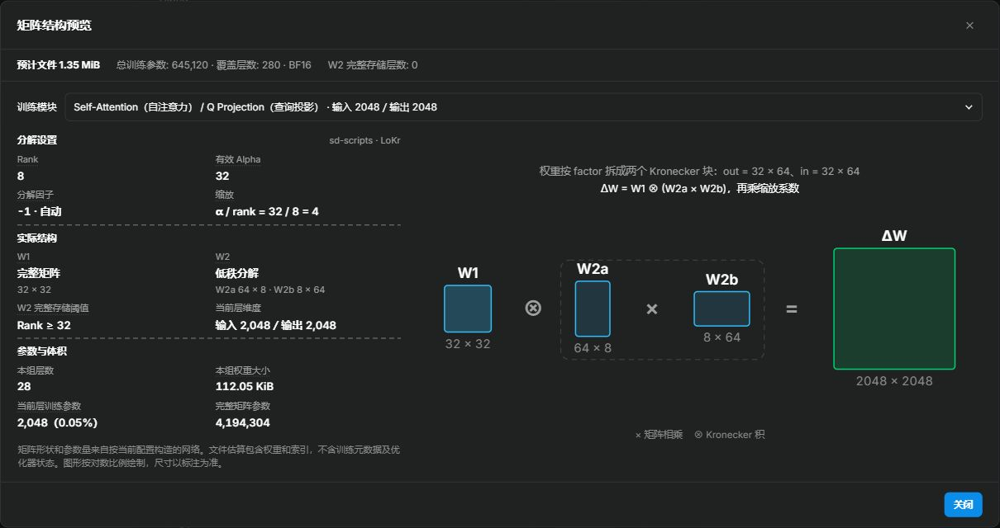

## 注意力与训练加速

- **Anima / MOSS-Image**：`attn_mode` 默认使用 `torch`（PyTorch SDPA，按当前安装的 PyTorch 版本与输入自动选择内核）。在 **环境管理 → 运行环境** 安装独立 FlashAttention 2 或 xformers 后，可将 `attn_mode` 设为 `flash` 或 `xformers`（安装器自动匹配 Python、PyTorch、CUDA 与系统平台，仅安装扩展包，不改动现有 PyTorch）。MOSS-Image 另可在同页安装并启用 **MOSS 文本加速（FLA + Conv1D）**。
- **Krea 2**：注意力实现默认使用 `SDPA`，也可切换为 `FlashAttention` 或 `xFormers`（使用 `xFormers` 时需启用拆分注意力）。
- **SDXL**：可在性能优化中按环境启用 `sdpa` 或 `xformers`。

## 训练参数指南

内置参数文档位于 `docs/parameters/`（也可直接在界面侧栏 **参数说明** 或表单字段旁点开阅读）：

- [网络参数指南](docs/parameters/network-parameters.zh-CN.md)：LoRA / LoHa / LoKr 算法选型、Rank / Alpha、DoRA、MOSS 文本投影层与 Krea 2 目标模块
- [LoRA+ 指南](docs/parameters/lora-plus.zh-CN.md)：上下矩阵分设学习率的原理、推荐倍率、优化器兼容性与效果判断
- [AdaLN 调制层指南](docs/parameters/adaln.zh-CN.md)：调制层作用、原生网络与 LyCORIS 默认包含范围差异及适用场景
- [矩阵结构与文件大小指南](docs/parameters/matrix-preview.zh-CN.md)：逐模块矩阵形状、参数量对齐方法、支持边界与保存体积估算
- [优化器与学习率调度指南](docs/parameters/optimizers.zh-CN.md)：6 大分组快速选型、各底模初始学习率、调度器对比与专属参数
- [时间步指南](docs/parameters/timesteps.zh-CN.md)：流匹配时间步采样、高/中/低噪学习目标、Loss 权重与子集采样偏移
- [显存与速度实测指南](docs/parameters/memory-optimization.zh-CN.md)：不同显存档位推荐配置、梯度检查点跳过块数、ConvRot INT8 与块交换实测
- [训练集诊断指南](docs/parameters/dataset-diagnostics.zh-CN.md)：逐样本残差与斜率 6 态判定、区域着色筛选与异常图片排查流程

## 日常更新与远程访问

### 后续更新

更新前请先关闭训练器。Windows 用户双击 **`update.bat`**，更新完成后运行 `start.bat`；Linux 或手动更新在项目根目录执行 `git pull --ff-only`。更新仅快进当前分支，不会覆盖 `config/`、`models/`、`train/`、`output/` 等用户目录；遇到源码本地修改、暂存改动或分支分叉时会自动停止。

<details>
<summary>旧版配置保留与跨目录升级说明</summary>

默认配置模板位于 `tools/defaults/`，启动时仅补建缺失文件，不会覆盖已有配置。旧版曾纳入跟踪的采样提示词与 Accelerate 配置在升级时会先自动备份并原样保留。若早期下载的旧目录没有 `update.bat`，可在 PowerShell 运行 `& "新ZIP目录\update.bat" "--bootstrap-root=旧项目目录绝对路径"` 直接完成迁移，无需替换旧环境。

</details>

### 远程访问与慢速连接

通过 SSH 远程访问时只需转发 GUI 端口；在 GUI 地址末尾加上 `/tensorboard/` 即可打开内置 TensorBoard（如 `http://127.0.0.1:12333/tensorboard/`，本地转发端口不同时请替换为对应端口；启动异常可查看 `logs/tensorboard.log`）。

若远程加载预览图拖慢实时状态更新，可在 **UI 设置 → 慢速远程连接兼容** 中开启逐张加载缩略图。未手动更改时，若浏览器报告低速网络或省流量模式，该项将默认开启。

## 启动参数与目录结构

可在启动脚本后附加参数（例如 `.\start.bat --listen` 或 `bash start.sh --port 12345`）：

<details>
<summary>查看全部启动参数</summary>

| 参数名称 | 适用范围 | 类型 | 默认值 | 说明 |
|---------|----------|------|--------|------|
| `--host` | 后端服务 | str | `"127.0.0.1"` | Web 服务监听主机名 |
| `--port` | 后端服务 | int | `12333` | Web 服务监听端口（占用时回退至 `30000–30020`） |
| `--listen` | 后端服务 | bool | `false` | 监听 `0.0.0.0`，允许局域网或外部访问 |
| `--skip-prepare-environment` | 后端服务 | bool | `false` | 跳过启动时的运行环境依赖检查与修复 |
| `--skip-prepare-onnxruntime` | 后端服务 | bool | `false` | 仅跳过 `onnxruntime-gpu` 的安装检查 |
| `--disable-tensorboard` | 后端服务 | bool | `false` | 不随 GUI 启动内置 TensorBoard |
| `--tensorboard-port` | 后端服务 | int | `0` | 内部 TensorBoard 端口，`0` 为自动分配（通过 `/tensorboard/` 访问） |
| `--dev` | 后端服务 | bool | `false` | 开发者模式（启用 CORS 与热重载） |
| `--quiet` / `-q` | 启动脚本 | bool | `false` | 免交互自动创建 `venv` 并安装依赖；默认跳过可选的 Git 修复提示 |
| `--setup-git` | Windows 启动器 | bool | `false` | 非交互执行推荐的 Git 安装与 ZIP 仓库初始化 |
| `--skip-git-setup` | Windows 启动器 | bool | `false` | 本次启动跳过 Git 安装与仓库初始化提示 |

</details>

### 常用用户目录

- `models/` — 基础模型、VAE、文本编码器与预览加速 LoRA 默认存放目录
- `train/` — 训练数据集（图片与同名标注文件）默认目录
- `output/` — 训练产出的权重、续训存档、采样预览与运行记录
- `config/` — 自动保存的表单草稿、预设与本地配置
- `logs/` — 应用日志（`anima.log`）与 `tensorboard.log`

<details>
<summary>查看完整项目与源码目录树</summary>

```text
lora-scripts-anima/
├── models/ · train/ · output/  ← 模型、训练集与训练输出目录（受保护用户数据）
├── config/ · logs/             ← 本地配置草稿与运行日志
├── vendor/
│   ├── sd-scripts/             ← Anima / SDXL / MOSS-Image 训练引擎（固定上游快照）
│   ├── musubi-tuner/           ← Krea 2 训练核心（固定上游快照）
│   ├── lycoris/                ← LyCORIS 适配器后端（固定上游快照）
│   ├── emo_optimizer/          ← EmoSens v3.9.3 自适应优化器
│   ├── automagic_optimizer/    ← Automagic3 / Automagic4 自适应优化器
│   └── lora_muon/              ← LoRA-Muon 实验性优化器
├── backend/                    ← FastAPI 后端
│   ├── server/                 ← 应用装配、HTTP 路由、静态资源与代理
│   ├── core/                   ← 实时任务协调与安装任务生命周期
│   ├── training/               ← 字段注册表、配置校验、数据集估算、缓存与进程执行
│   ├── monitor/                ← 训练监控、样本对比、历史记录与训练集诊断
│   ├── tageditor/              ← 标签编辑器后端
│   ├── tagger/                 ← 自动打标（WD / CL / Camie / PixAI）与 AI 标注接口
│   ├── regularization/         ← 正则图生成、采样与任务恢复
│   └── gui.py                  ← GUI 服务入口（由启动脚本调用）
├── frontend/                   ← Alpine.js SPA 前端
│   ├── js/                     ← 按模块组织的脚本（training / monitor / environment / tagger / tag-editor / tag-dictionary / regularization / docs / shared）
│   ├── templates/              ← 按需加载的工作区 HTML 模板
│   └── css/ · i18n/ · assets/   ← 样式、三语词条与静态资源
├── docs/                       ← 内置参数指南（docs/parameters/）与界面截图
├── tools/                      ← 启动引导、加速器安装与运行时工具（开发脚本位于 tools/dev/）
├── tests/                      ← 后端回归与前端交互测试
├── start.bat / start.sh        ← Windows / Linux 一键启动脚本
├── update.bat                  ← Windows 一键快进更新脚本
└── requirements.txt            ← 全项目统一依赖清单（后端与双训练引擎共用，PyTorch 由启动器单独安装）
```

</details>

## 致谢

- [kohya-ss/sd-scripts](https://github.com/kohya-ss/sd-scripts) — Anima / SDXL / MOSS-Image 训练引擎
- [kohya-ss/musubi-tuner](https://github.com/kohya-ss/musubi-tuner) — Krea 2 训练核心
- [KohakuBlueleaf/LyCORIS](https://github.com/KohakuBlueleaf/LyCORIS) — LoCon / LoHa / LoKr 训练算法与适配器支持
- [Akegarasu/lora-scripts](https://github.com/Akegarasu/lora-scripts) — 早期设计参考

## 许可证

本项目以 [MIT 许可证](LICENSE) 发布。`vendor/` 目录下的第三方组件各自保留其原始许可证（Apache-2.0 / MIT）。
