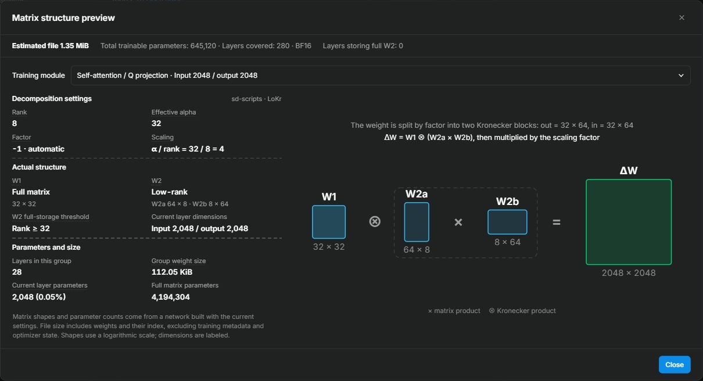

# Matrix Structure and File Size

When configuring **Anima**, **MOSS-Image**, or **Krea 2** runs, click **Structure preview** beside **Training network module** to open the **Matrix structure preview** dialog. It builds the adapter network on fake tensors in memory—without loading base-model weights or starting training—and shows the resulting tensor shapes, scaling factors, and **Estimated file size**.

## Reading the preview and tuning settings

Supported model types and network modules:

| Model type | Supported networks |
| --- | --- |
| Anima | Native LoRA / LoHa / LoKr; LyCORIS LoCon / LoHa / LoKr |
| MOSS-Image | Native LoRA / LoHa / LoKr |
| Krea 2 | Native LoRA; LyCORIS LoCon / LoHa / LoKr |

Use three readouts in the dialog to guide [network parameter](network-parameters.en-US.md) choices:

1. **Match parameter budgets across algorithms (Total trainable parameters / Estimated file size)**
   - Algorithms differ sharply in size at the same Rank (for example, LoHa has roughly twice as many trainable parameters as standard LoRA). Before comparing LoRA, LoHa, and LoKr image quality, check **Total trainable parameters** at the top and adjust Rank or `lokr_factor` so both runs use a comparable parameter budget.
2. **Spot LoKr full-matrix transitions (W2 full-storage threshold / Layers storing full W2)**
   - Under LoKr, inspect **W2 full-storage threshold** (`max(outK, inN) / 2`) per module group and **Layers storing full W2** in the summary bar. Once Rank reaches a layer's threshold (or **Full Matrix** is on), `W2` switches from low-rank factors to a dense matrix—causing a step jump in file size after which raising Rank adds no further `W2` parameters in that layer.
   - Check **Effective alpha** and **Scaling** alongside it: when both `W1` and `W2` are full matrices, scale is fixed at `1` with `rs_lora` off and `√Rank` with `rs_lora` on.
3. **Confirm target scope and regex matches (Layers covered / Training module selector)**
   - Module groups group layers by architectural role (with fused QKV and fused MLP expansion/gate projections shown at their combined dimensions):
   - **Anima** (28-block Anima-Preview): Native default covers `280` layers; enabling [Train AdaLN layers](adaln.en-US.md) expands coverage to `448` layers (`400 → 640` layers on 40-block Anima-2.9B).
   - **MOSS-Image**: Covers `252` Linear modules across 42 main blocks by default; enabling [Train text projection and refiners](network-parameters.en-US.md#moss-text-embedder) brings total layers to `263` (`+11` modules, while the frozen Qwen text encoder stays excluded).
   - **Krea 2**: Reflects the active [target selector](network-parameters.en-US.md#krea-targets)—`264` (All Linear), `224` (Main Attention + MLP), `140` (Main Attention), or the exact match count of your custom regexes.

## File-size estimation and unsupported cases

**Estimated file size** sums all tensors saved in the adapter (both trainable matrices and saved scalars/vectors such as `alpha` or DoRA magnitudes) at the chosen save precision (`2` bytes per element for `fp16` / `bf16`, `4` bytes for `float`), plus the `.safetensors` JSON tensor-index header.

- **Excluded from the estimate**: Embedded training metadata strings, base-model weights, optimizer states, latent/text disk caches, and sample preview images are outside this figure; saved `.safetensors` files are typically a few kilobytes larger due to metadata.
- **Four cases where preview/estimation is unavailable** (the UI hides the preview or shows **Estimate unavailable**):
  1. **SDXL** model types;
  2. **Infer LoRA rank from existing weights** (`dim_from_weights`) is enabled, since per-layer ranks are unknown until external weights are read at launch;
  3. Save format is set to a format other than `safetensors` (such as `pt` or `ckpt`);
  4. Non-`Linear` target modules (such as Conv2d layers) are selected on the linear preview path, or custom regex filters match zero trainable modules.
