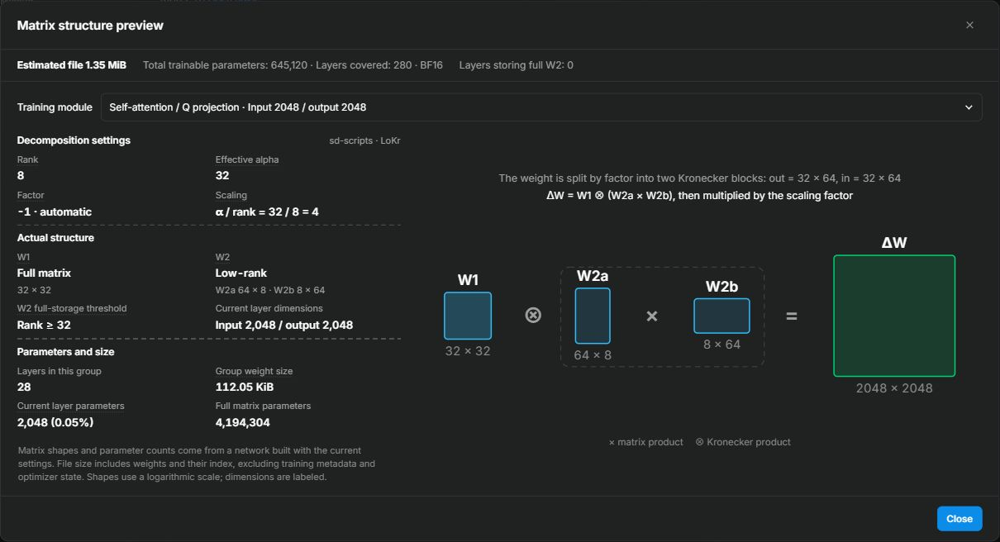

# Matrix Structure and File Size

For Anima, MOSS-Image, or Krea 2 training, open **Structure preview** under **Training network module** to inspect the adapter matrices constructed by the current settings. The entry shows the estimated weight-file size for comparing ranks, algorithms, and training scopes.

<!-- doc-anchor: overview -->
## Inspect actual modules

The preview uses the training network constructors with fake tensors, without loading base-model weights or starting training.

| Training profile | Supported networks |
| --- | --- |
| Anima | Native LoRA / LoHa / LoKr; LyCORIS LoCon / LoHa / LoKr |
| MOSS-Image | Native LoRA / LoHa / LoKr |
| Krea 2 | Native LoRA; LyCORIS LoCon / LoHa / LoKr |

All three native MOSS-Image algorithms include the attention and MLP projections in its 42 main blocks by default, totaling 252 adapter modules. Enabling **Train text projection and refiners** adds 11 modules from the DiT text input projection and two text refiner blocks. The frozen Qwen text encoder is excluded. Rank overrides and exclusion patterns can change the module count.

Fused QKV and MLP expansion/gate projections use their combined dimensions. LoHa shows the element-wise product of two low-rank products. LoKr shows the Kronecker factors and whether W2 uses low-rank or full-matrix storage, based on factor and rank.

| Preview item | Meaning |
| --- | --- |
| Input and output dimensions | Number of features entering and leaving the original layer |
| Saved matrix shapes | Shapes of the tensors trained and saved by the adapter |
| Rank, Alpha, and scale | Values used after construction, including per-layer overrides and algorithm-specific adjustments |
| Parameter count | Number of trainable values in the adapter, useful for comparing configuration sizes |
| File size | Estimated adapter weight-file size at the selected save precision |

<!-- doc-anchor: file-size -->
## How file size is estimated

The estimate counts the tensors actually saved by the adapter at the selected save precision, then adds the safetensors tensor-index header. `fp16` / `bf16` use 2 bytes per element and `float` uses 4. Saved non-trainable tensors such as alpha are included.

The estimate covers only the adapter weight file. The base model, optimizer state, training caches, and previews consume additional storage or VRAM. It uses safetensors packaging. Training metadata and other save formats add their own packaging overhead; check the saved file for its final size.

To compare settings, hold the algorithm and scope fixed while changing rank, or hold rank fixed while comparing scopes. LoKr changes its file-size growth pattern when it switches from low-rank factors to full matrices. Check the resulting shapes and estimate after each change.

Unsupported configurations and construction failures display an estimation error.
