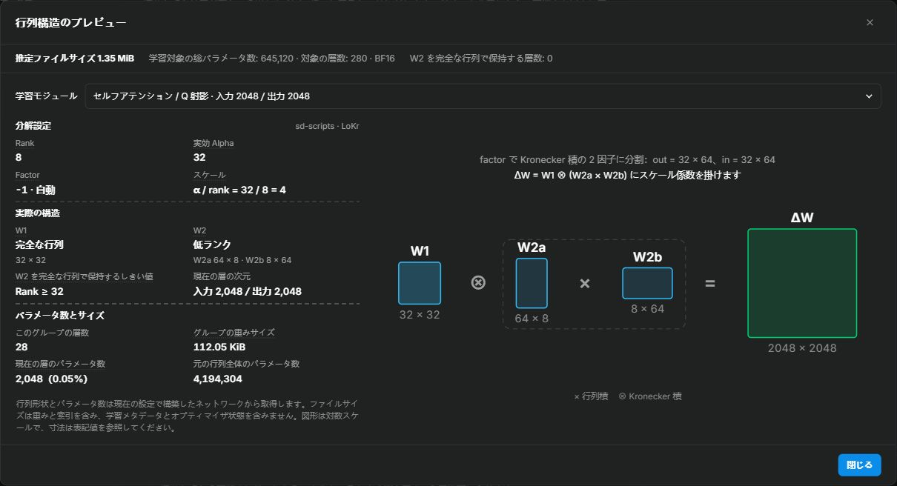

# 行列構造とファイルサイズ

Anima、MOSS-Image、Krea 2 の学習では、**学習ネットワーク**の下の **構造プレビュー**から、現在の設定で構築するアダプタの行列を確認できます。入口には重みファイルの推定サイズも表示し、ランク・アルゴリズム・学習範囲を比較できます。

<!-- doc-anchor: overview -->
## 実際のモジュールを確認

プレビューは仮想テンソルで学習ネットワークを構築し、ベースモデルの重みを読み込まずに表示します。

| 学習プロファイル | 対応ネットワーク |
| --- | --- |
| Anima | ネイティブ LoRA / LoHa / LoKr、LyCORIS LoCon / LoHa / LoKr |
| MOSS-Image | ネイティブ LoRA / LoHa / LoKr |
| Krea 2 | ネイティブ LoRA、LyCORIS LoCon / LoHa / LoKr |

MOSS-Image の 3 つのネイティブ方式では、既定で 42 個のメインブロックの Attention と MLP 射影、計 252 個のアダプタモジュールを集計します。「テキスト投影層と Refiner を学習」を有効にすると、DiT 内のテキスト入力射影と 2 個の Refiner ブロックから 11 個のモジュールが加わります。凍結した Qwen テキストエンコーダは集計範囲外です。ランクの上書きや除外パターンにより対象数は変わります。

統合された QKV 射影や MLP の拡張・ゲート射影は、統合行列の次元で表示します。LoHa は 2 組の低ランク積の要素積を表示します。LoKr は factor と rank に基づく Kronecker 因子と、W2 の低ランク・完全行列のモードを表示します。

| 表示項目 | 意味 |
| --- | --- |
| 入出力次元 | 元の層に入る特徴数と出る特徴数 |
| 保存する行列の形状 | アダプタが学習・保存するテンソルの形状 |
| Rank・Alpha・スケール | 層別の上書きやアルゴリズム内部の調整を反映した、構築後の値 |
| パラメータ数 | アダプタ内の学習可能な値の個数。設定の規模の比較に使えます |
| ファイルサイズ | 選択した保存精度でのアダプタ重みファイルの推定サイズ |

<!-- doc-anchor: file-size -->
## ファイルサイズの推定方法

アダプタが実際に保存するテンソルを指定の保存精度で数え、safetensors のテンソル索引ヘッダーを加えます。`fp16` / `bf16` は 1 要素 2 バイト、`float` は 4 バイトです。alpha などの学習対象外の保存テンソルも含みます。

見積もりの対象はアダプタの重みファイルです。ベースモデル、オプティマイザの状態、学習キャッシュ、プレビュー画像は、別途ストレージや VRAM を使います。現在は safetensors 形式で計算しています。学習メタデータや他の保存形式による付加情報もあるため、最終サイズは保存したファイルで確認してください。

比較する場合はアルゴリズムと範囲を固定してランクを変えるか、ランクを固定して範囲を変えます。LoKr は因子が低ランクから完全な行列へ切り替わると、サイズの増え方が変わります。設定変更ごとに形状と推定値を確認してください。

未対応の設定や構築の失敗では、推定エラーを表示します。
