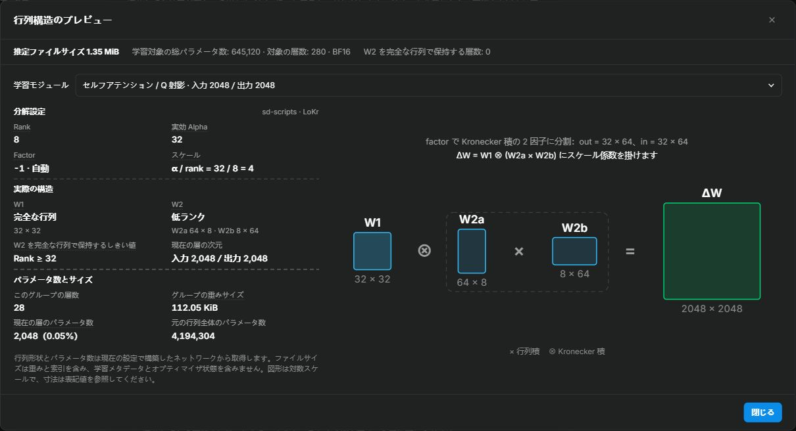

# 行列構造とファイルサイズ

**Anima**・**MOSS-Image**・**Krea 2** の学習設定では、「学習ネットワーク」横の**構造プレビュー**ボタンから「行列構造のプレビュー」ダイアログを開けます。ベースモデルの重みを読み込まずにメモリ上の仮想テンソルでアダプタを構築し、保存されるテンソル形状・実効スケール・**推定ファイルサイズ**をその場で確認できます。

## プレビューの見方と設定調整への活かし方

対応するモデル種別とネットワーク方式は次のとおりです。

| モデル種別 | 対応ネットワーク |
| --- | --- |
| Anima | ネイティブ LoRA / LoHa / LoKr、LyCORIS LoCon / LoHa / LoKr |
| MOSS-Image | ネイティブ LoRA / LoHa / LoKr |
| Krea 2 | ネイティブ LoRA、LyCORIS LoCon / LoHa / LoKr |

[ネットワーク設定](network-parameters.ja-JP.md)を調整する際は、特に次の 3 点を確認してください。

1. **方式間でパラメータ規模をそろえる（学習対象の総パラメータ数 / 推定ファイルサイズ）**
   - 同じ Rank でも方式によって規模が大きく変わります（たとえば LoHa のパラメータ数は標準 LoRA の約 2 倍）。LoRA・LoHa・LoKr の画質を比較する前に、上部の**学習対象の総パラメータ数**を見て Rank や `lokr_factor` を調整し、パラメータ規模をそろえてから比較してください。
2. **LoKr の完全行列化ポイントを見極める（W2 の完全行列しきい値 / W2 を完全な行列で保持する層数）**
   - LoKr では各モジュールグループの **W2 の完全行列しきい値**（`max(outK, inN) / 2`）と上部の **W2 を完全な行列で保持する層数**を確認します。層の Rank がしきい値に達すると（または `Full Matrix` がオンのとき）、`W2` は低ランク分解されず完全な行列として保存されるためサイズが段階的に増え、それ以上 Rank を上げてもその層の `W2` パラメータ数は増えません。
   - あわせて**実効 Alpha** と**スケール**も確認してください。`W1`・`W2` の両方が完全な行列になると、スケールは `rs_lora` オフで `1`、オンで `√Rank` になります。
3. **学習範囲スイッチや正規表現のヒット数を確認する（対象の層数 / 学習モジュール選択）**
   - モジュール一覧は `Self-Attention（自己注意）`、`QKV Projection（クエリ・キー・バリューの統合射影）`、`Expansion + Gate（次元拡張・ゲートの統合層）` のように構造に対応する名称で表示されます（統合射影は結合後の入出力次元で表示）：
   - **Anima**（28 ブロックの Anima-Preview の例）：ネイティブ既定は `280` 層、[AdaLN 層も学習](adaln.ja-JP.md)をオンにすると `448` 層へ増えます（40 ブロックの Anima-2.9B では `400 → 640` 層）。
   - **MOSS-Image**：42 個のメインブロックで既定 `252` 層、[テキスト投影層と Refiner](network-parameters.ja-JP.md#moss-text-embedder) をオンにすると `263` 層（`+11` 層、凍結された Qwen テキストエンコーダは集計外）になります。
   - **Krea 2**：[学習対象層](network-parameters.ja-JP.md#krea-targets)の選択に応じて、`264` 層（全 Linear）、`224` 層（バックボーン Attention + MLP）、`140` 層（バックボーン Attention）、またはカスタム正規表現の一致層数が表示されます。

## ファイルサイズの推定仕様と未対応条件

**推定ファイルサイズ**は、アダプタが実際に保存する全テンソル（学習対象の重みに加え、保存される `alpha` や DoRA の大きさパラメータなどを含む）を選択中の保存精度で集計し（`fp16` / `bf16` は 1 要素 `2` バイト、`float` は `4` バイト）、`.safetensors` のテンソル索引ヘッダを加算した値です。

- **推定に含まれないもの**：学習メタデータの文字列、ベースモデル重み、オプティマイザ状態、Latent / テキストのディスクキャッシュ、サンプル画像は含まれません（実際の保存ファイルはメタデータ分だけ数 KB〜数十 KB 大きくなります）。
- **プレビュー・サイズ推定に未対応の 4 条件**（画面では非表示または「推定できません」と表示されます）：
  1. モデル種別が **SDXL** の場合；
  2. **既存の重みから LoRA のランクを取得**（`dim_from_weights`）がオンの場合（起動時に外部ファイルを読み込むまで層ごとの Rank が確定しないため）；
  3. 保存形式が `safetensors` 以外（`pt`・`ckpt` など）の場合；
  4. 非 `Linear` 層（畳み込み層など）が対象に含まれる場合、またはカスタム正規表現に一致する学習対象モジュールが 0 件の場合。
