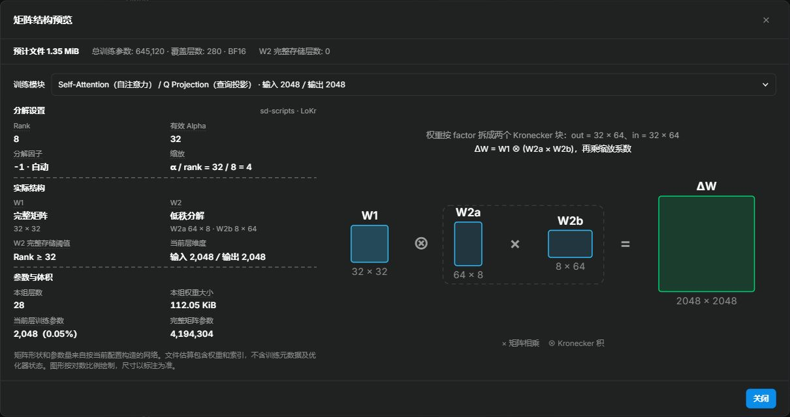

# 矩阵结构与文件大小

Anima、MOSS-Image 或 Krea 2 训练中，在“训练网络模块”下点击“结构预览”，可查看当前配置构造出的适配器矩阵。入口旁显示预计权重文件大小，可用于比较 rank、算法和训练范围对文件大小的影响。

<!-- doc-anchor: overview -->
## 查看实际模块

预览使用训练时的网络构造器和虚拟张量，无需加载底模权重或启动训练。

| 训练类型 | 支持的网络 |
| --- | --- |
| Anima | 原生 LoRA / LoHa / LoKr，LyCORIS LoCon / LoHa / LoKr |
| MOSS-Image | 原生 LoRA / LoHa / LoKr |
| Krea 2 | 原生 LoRA，LyCORIS LoCon / LoHa / LoKr |

MOSS-Image 的三种原生算法默认统计 42 个主干块中的注意力投影与 MLP，共 252 个适配器模块。开启“训练文本投影与细化层”后，DiT 内的文本输入投影和两个文本细化块增加 11 个模块。冻结的 Qwen 文本编码器排除在统计范围外。正则指定 rank 或排除模块后，以实际构造数量为准。

合并的 QKV、MLP 升维与门控投影按合并矩阵展示。LoHa 展示两组低秩乘积的逐元素乘法；LoKr 按 factor 和 rank 展示 Kronecker 因子，以及 W2 的低秩或完整矩阵模式。

| 预览内容 | 说明 |
| --- | --- |
| 输入与输出维度 | 原层接收和输出的特征数量 |
| 保存的矩阵形状 | 适配器实际训练和保存的张量形状 |
| rank、Alpha 与缩放 | 当前模块构造后使用的值，包含逐层覆盖与算法内部调整 |
| 参数量 | 适配器包含多少可训练数值，用于比较配置规模 |
| 文件大小 | 当前保存精度下，适配器权重文件的预计大小 |

<!-- doc-anchor: file-size -->
## 文件大小如何估算

估算遍历适配器实际保存的张量，按保存精度计算数据大小，再加上 safetensors 的张量索引头。`fp16` / `bf16` 每个元素占 2 字节，`float` 占 4 字节；保存的 alpha 等非训练张量也会计入。

估算范围仅包含适配器权重文件。底模、优化器状态、训练缓存和预览图另行占用存储或显存。当前按 safetensors 封装计算；训练元数据和其他保存格式会产生额外封装体积，最终大小以实际文件为准。

比较配置时，固定算法和训练范围，只改变 rank；或固定 rank，只改变训练范围。LoKr 从低秩分解切换为完整矩阵时，文件大小会改变增长规律，因此修改后应重新查看矩阵形状和估算值。

不支持的配置或构造失败会显示估算失败。
