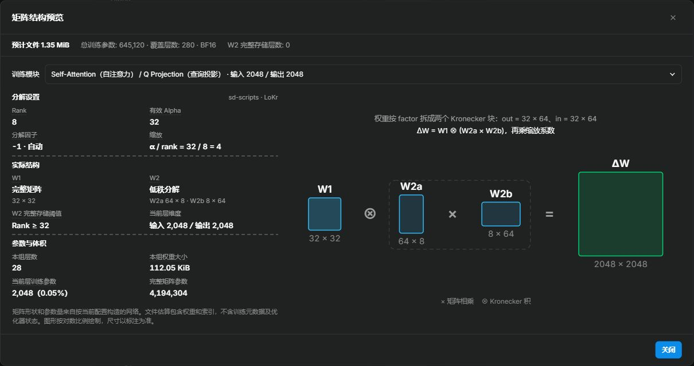

# 矩阵结构与文件大小

配置 **Anima**、**MOSS-Image** 或 **Krea 2** 训练时，点击“训练网络模块”旁的**结构预览**按钮即可打开“矩阵结构预览”弹窗，无需加载底模权重或启动训练即可查看当前参数实际构造出的适配器张量形状、缩放系数与**预计文件大小**。

## 如何看懂结构预览并指导调参

预览在内存中用虚拟张量调用真实训练网络构造器，支持的训练类型与网络如下：

| 训练类型 | 支持预览的网络 |
| --- | --- |
| Anima | 原生 LoRA / LoHa / LoKr，LyCORIS LoCon / LoHa / LoKr |
| MOSS-Image | 原生 LoRA / LoHa / LoKr |
| Krea 2 | 原生 LoRA，LyCORIS LoCon / LoHa / LoKr |

调整[网络参数](network-parameters.zh-CN.md)时，重点对照弹窗中的三组指标：

1. **跨算法对齐参数规模（总训练参数 / 预计文件大小）**
   - 相同 Rank 下不同算法的参数规模差异很大（例如 LoHa 的参数量约为标准 LoRA 的 2 倍）。横向比较 LoRA、LoHa、LoKr 画质前，先观察顶部的**总训练参数**，通过调整 Rank 或 `lokr_factor` 将各组总参数量拉到相近水平，避免把容量差异误判为算法优劣。
2. **识别 LoKr 因子的完整矩阵切换点（W2 完整存储阈值 / W2 完整存储层数）**
   - 在 LoKr 下切换不同模块分组时，关注 **W2 完整存储阈值**（`max(outK, inN) / 2`）与顶部的 **W2 完整存储层数**。当某层的 Rank 达到该阈值（或开启了 `Full Matrix`）时，`W2` 不再做低秩分解而直接存为完整矩阵，文件体积会出现跳变，此后继续调高 Rank 不会再增加该层 `W2` 的参数量。
   - 同时核对**有效 Alpha** 与**缩放**：当 `W1`、`W2` 均为完整矩阵且未开启 `rs_lora` 时，缩放系数固定为 `1`；开启 `rs_lora` 时变为 `√Rank`。
3. **核对模块开关与正则筛选的命中范围（覆盖层数 / 训练模块下拉框）**
   - 模块分组采用 `Self-Attention（自注意力）`、`QKV Projection（合并查询、键、值投影）`、`Expansion + Gate（合并升维与门控）` 等与模型结构对应的名称（合并投影按合并后的输入/输出维度展示）：
   - **Anima**（以 28 块 Anima-Preview 为例）：原生默认覆盖 `280` 层；开启[训练 AdaLN 调制层](adaln.zh-CN.md)后增至 `448` 层（40 块 Anima-2.9B 为 `400 → 640` 层）。
   - **MOSS-Image**：42 个主干块默认覆盖 `252` 个线性模块；开启[训练文本投影与细化层](network-parameters.zh-CN.md#moss-text-embedder)后增至 `263` 层（`+11` 层，冻结的 Qwen 文本编码器不计入）。
   - **Krea 2**：按[训练目标层](network-parameters.zh-CN.md#krea-targets)预设分别显示 `264` 层（全部 Linear）、`224` 层（主干 Attention + MLP）、`140` 层（主干 Attention）或自定义正则表达式的实际命中层数。

## 文件大小估算口径与支持边界

**预计文件大小**遍历适配器实际保存的全部张量（含可训练权重及保存的 `alpha`、DoRA 幅度等张量），按所选保存精度累加字节数（`fp16` / `bf16` 每元素 `2` 字节，`float` 每元素 `4` 字节），再加上 `.safetensors` 的张量索引头。

- **不包含的部分**：训练写入的字符串元数据（如配置摘要）、底模权重、优化器状态、Latent / 文本磁盘缓存及采样预览图均不计入该数值，最终落盘文件会比估算值略大几 KB 至数十 KB。
- **暂不支持预览与估算的 4 种情况**（界面会隐藏预览或提示“暂无法估算”）：
  1. **SDXL** 训练类型；
  2. 开启了**从已有权重推断 LoRA Rank**（`dim_from_weights` 需在启动时读取外部权重文件，配置阶段无法静态推导各层 Rank）；
  3. 模型保存格式选择了非 `safetensors`（如 `pt`、`ckpt`）；
  4. 当前配置选中了非 `Linear` 目标层（如包含卷积层的预设在纯线性估算路径中不支持），或自定义筛选规则未命中任何可训练模块。
