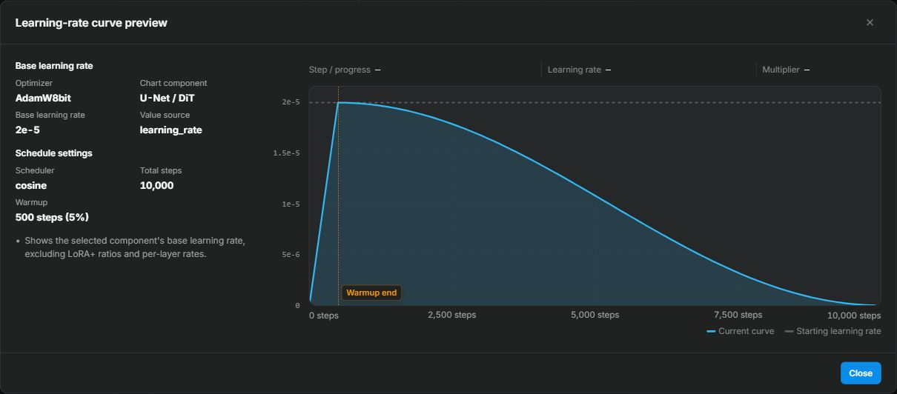

# Optimizer Selection and Parameter Guide

## Quick selection

An optimizer controls how gradients update trainable weights, directly shaping convergence speed, optimizer-state VRAM usage, and update stability. This guide covers all four model types: Anima, SDXL, MOSS-Image, and Krea 2.

- **First run or clean baseline**: use `AdamW8bit` with the selected model type's default learning rate and scheduler.
- **Tight optimizer-state VRAM**: start with an `8bit` variant; if memory still overflows, compare `PagedAdamW8bit` or factorized `CAME`.
- **Isolated loss spikes or low-precision weight drift**: keep data and learning rate fixed and compare [`StableAdamW`](#stableadamw-options).
- **Less manual step-size sweeping**: compare [`Prodigy`](#prodigy-options) or [`ProdigyPlusScheduleFree`](#prodigyplus-options) and scale step size via `d_coef`.

| Tuning goal | Candidates to compare | What to inspect |
| --- | --- | --- |
| Establish a reliable baseline | `AdamW8bit` | Checkpoint samples across stages, peak VRAM, and time per step |
| Reduce optimizer-state memory | `AdamW8bit`, `CAME`; `PagedAdamW8bit` when VRAM still overflows | Peak VRAM and any step-time slowdown from CPU/GPU paging |
| Suppress update spikes or low-precision rounding drift | `StableAdamW` | Spike reduction in gradient norms and sample consistency across checkpoints |
| Estimate step size automatically or run without an external schedule | `Prodigy`, `ProdigyPlusScheduleFree`, `AdamWScheduleFree` | Growth of `D` in logs and the earliest checkpoint that captures target features |
| Test orthogonalized or subspace-preconditioned updates | `Muon`, `LoRA-Muon`, `LoRA-RITE`, `SOAP` | Early convergence speed, extra compute per step, and overfitting onset |

## Available optimizers and starting learning rates

The tables below list all 22 optimizers organized by the UI dropdown's six groups, along with project starting learning rates (applied automatically only to unedited default values) and key constraints. Memory notes refer to optimizer state only; peak VRAM also depends on resolution, rank, batch size, caching, and preview generation.

**1. AdamW and storage variants**

| Optimizer | Mechanism and role | Anima start LR | Other model types | Key constraints and notes |
| --- | --- | ---: | --- | --- |
| `AdamW8bit` | Everyday default; quantizes large state tensors to 8-bit and keeps small ones in FP32 | `2e-5` | SDXL / MOSS / Krea 2: `1e-4` | `amsgrad` unsupported; threshold set by [`min_8bit_size`](#min-8bit-size) |
| `AdamW` | Unquantized baseline reference | `2e-5` | SDXL / MOSS / Krea 2: `1e-4` | Higher state VRAM than 8-bit; supports [`fused`](#adamw-fused) and [`foreach`](#foreach) |
| `PagedAdamW8bit` | Pages 8-bit optimizer state to system RAM when GPU memory fills up | `2e-5` | SDXL / MOSS / Krea 2: `1e-4` | Same update math as `AdamW8bit`; active paging adds CPU/GPU transfer overhead |

**2. Built-in stabilization**

| Optimizer | Mechanism and role | Anima start LR | Other model types | Key constraints and notes |
| --- | --- | ---: | --- | --- |
| `StableAdamW` | AdamW with internal update RMS clipping and Kahan compensated summation | `2e-5` | SDXL / MOSS / Krea 2: `1e-4` | Uses more state VRAM than `AdamW8bit`; project default `weight_decay=0` |
| `CAME` | Row/column-factorized second moments with residual-confidence scaling and RMS clipping | `1.5e-5` | SDXL / MOSS: `1e-4`; Krea 2: `2e-4` | Uses three betas; good low-state-memory comparison against `AdamW8bit` |

**3. Lookahead-difference and sign updates**

| Optimizer | Mechanism and role | Anima start LR | Other model types | Key constraints and notes |
| --- | --- | ---: | --- | --- |
| `Adan` | Nesterov momentum tracking both gradients and consecutive gradient differences | `1e-5` | SDXL / MOSS: `5e-5`; Krea 2: `1e-4` | Uses three betas; larger effective step size, so Anima starts at half of AdamW |
| `Lion` / `Lion8bit` / `PagedLion8bit` | Sign-momentum updates keeping only first-moment state | `5e-6` | SDXL / MOSS: `2e-5`; Krea 2: `1e-4` | Usable LR range is roughly 3–10× smaller than AdamW; sweep independently |

**4. Dual-timescale gradient memory**

| Optimizer | Mechanism and role | Anima start LR | Other model types | Key constraints and notes |
| --- | --- | ---: | --- | --- |
| `AdEMAMix` / `AdEMAMix8bit` | Combines fast and slow exponential moving averages for short- and long-term trends | `2e-5` | SDXL / MOSS / Krea 2: `1e-4` | Uses three betas; blank ramp durations automatically use estimated total steps |

**5. Internal LR estimation and scheduling**

| Optimizer | Mechanism and role | Anima start LR | Other model types | Key constraints and notes |
| --- | --- | ---: | --- | --- |
| `Prodigy` | D-adaptation automatic step-size scale estimation (`D`) | `1.0` (locked) | SDXL / MOSS / Krea 2: `1.0` (locked) | Locks `learning_rate=1.0` across all model types (tune [`d_coef`](#prodigy-options) instead); switches default scheduler to `cosine`; incompatible with [LoRA+](#loraplus) |
| `ProdigyPlusScheduleFree` | Automatic `D` estimation with Schedule-Free weight averaging | `1.0` (locked) | SDXL / MOSS / Krea 2: `1.0` (locked) | Locks `learning_rate=1.0` and external scheduler to `constant`; locks `max_grad_norm=0` while internal scaling is active; incompatible with LoRA+ |
| `AdamWScheduleFree` | Replaces external LR decay schedules with iterate averaging | `1e-4` | SDXL / MOSS: `3e-4`; Krea 2: `0.0025` | Locks external scheduler to `constant`; configure warmup via [`warmup_steps`](#schedulefree-warmup) |
| `AdaFactor` | Factorized low-memory state; uses step-based relative step sizes by default | Auto (manual `2e-5`) | SDXL / MOSS / Krea 2: Auto (manual `1e-4`) | Locks `max_grad_norm=0`; turn off both `relative_step` and `warmup_init` to use manual LR, external schedulers, or LoRA+ |
| `Automagic3` / `Automagic4` | Per-group sign-agreement LR adaptation; v4 also scales down high-sensitivity elements | `2e-5` | SDXL / MOSS / Krea 2: `2e-5` | Experimental; locks scheduler to `constant` and keeps trainable weights in FP32; `fused=True` requires 1 GPU, accumulation `1`, `max_grad_norm=0`, and no `fp16` |
| `EmoSens` | Loss-driven global automatic LR control with convergence notifications | `0.1` | MOSS / Krea 2: `0.1`; SDXL: `1.0` | Experimental; requires 1 GPU, accumulation `1`, and no `fp16`; locks scheduler to `constant`; ignores component LRs and incompatible with LoRA+ |

**6. Matrix-structure updates**

| Optimizer | Mechanism and role | Anima start LR | Other model types | Key constraints and notes |
| --- | --- | ---: | --- | --- |
| `Muon` | Newton-Schulz momentum orthogonalization on 2D matrices | `2e-5` | MOSS / Krea 2: `1e-4` (SDXL unsupported) | 2D parameters only; disable `use_scalar` and `train_norm` under LyCORIS |
| `LoRA-Muon` | Paired `lora_down` / `lora_up` spectral descent on the low-rank manifold | `0.02` | Krea 2: `0.1` (SDXL / MOSS unsupported) | Supports Anima native LoRA, Krea 2 native LoRA, and **Krea 2 LoCon** (`use_scalar` and DoRA off); incompatible with LoRA+ |
| `LoRA-RITE` | Scale-invariant low-rank preconditioning across equivalent A/B factor pairs | `1e-4` | Krea 2: `1e-4` (SDXL / MOSS unsupported) | Same network support as `LoRA-Muon`; uses internal clipping and locks `max_grad_norm=0`; incompatible with LoRA+ |
| `SOAP` | Runs Adam-style updates in a rotated gradient-covariance eigenbasis | `2e-5` | SDXL / MOSS / Krea 2: `1e-4` | Preconditioner matrices add VRAM and compute; caps preconditioned axis size at `256` and defaults `weight_decay=0` |

> **Choosing among the top three**: start with `AdamW8bit`. Compare `CAME` when optimizer-state VRAM is tight, or `StableAdamW` at the same learning rate when update spikes or `full_bf16` rounding errors appear. See [Common parameters](#parameters) and [Optimizer-specific options](#specific-options) below for full tuning details.

## Common optimization and schedule parameters

### Learning rate (learning_rate)

Too low a learning rate leaves facial features, outfits, or style traits underfit; too high a rate triggers loss spikes, color blowout, or early memorization of training poses and backgrounds. After switching optimizers or network scaling, start from the [table above](#optimizer-type) and compare checkpoints across epochs with fixed prompts and seeds.

- **Component overrides**: `unet_lr` (DiT / U-Net) and `text_encoder_lr` fall back to `learning_rate` when blank, and override their respective parameter groups when populated. Krea 2 uses dedicated `krea_*` fields for weight decay, betas, and eps with the same semantics described below.
- **`network_alpha / network_dim` scaling**: this ratio scales the forward output of the LoRA branch. MOSS-Image defaults to `rank=16, alpha=1` at `1e-4`, whereas Anima and Krea 2 default to `rank=32, alpha=32` (scale `1.0`). Lower the learning rate when migrating an upstream `alpha=1` recipe to `alpha=dim`.
- **Lion weight decay**: Lion's starting rate is roughly 1/3 to 1/10 of AdamW's. This trainer keeps its own `weight_decay` default (`0`); raise `weight_decay` by roughly 3–10× only if reproducing the original Lion paper recipe.

### Learning rate scheduler and warmup (lr_scheduler / lr_warmup_steps)

Default schedulers for new configs: `cosine_with_restarts` on SDXL, and `constant` on Anima, MOSS-Image, and Krea 2. When testing warmup, start with `constant_with_warmup` or `cosine` and keep warmup within `5%` of total optimizer steps (Krea 2 and `warmup_stable_decay` also accept fractional ratios in `[0, 1)`).

**Optimizer-owned scheduling and automatic rules:**

- **Locked to `constant` with `0` external warmup**: `AdamWScheduleFree`, `ProdigyPlusScheduleFree`, `Automagic3`, `Automagic4`, `EmoSens`, and `AdaFactor` when `relative_step=True`.
- **Prodigy schedule pairing**: selecting `Prodigy` switches an unedited scheduler to `cosine`. Avoid `cosine_with_restarts` with `Prodigy` (restarts disturb `D` estimation); setting nonzero `lr_warmup_steps` automatically enables `safeguard_warmup=True` on sd-scripts.

| Scheduler | Curve behavior and when to use | Dedicated controls and notes |
| --- | --- | --- |
| `constant` / `constant_with_warmup` | Holds the base rate flat (after optional warmup); ideal for short runs where you pick the best saved checkpoint | Krea 2 rejects nonzero warmup on `constant`; switch to `constant_with_warmup` instead |
| `cosine` | Smooth single-cycle cosine decay to `0`; standard choice when total steps are fixed and you want gentle late-stage settling | No extra fields |
| `cosine_with_min_lr` | Cosine decay with a floor to prevent near-zero updates at the end | `lr_scheduler_min_lr_ratio` (`0–1` floor) and `lr_scheduler_num_cycles` |
| `cosine_with_restarts` | Periodic cosine restarts controlled by `lr_scheduler_num_cycles` (`1` matches single cosine) | Sudden upward jumps at restarts; avoid with adaptive step-size optimizers |
| `warmup_stable_decay` (WSD) | Warmup → flat plateau → late decay; balances full-speed mid-run learning with clean convergence | `lr_warmup_steps` + `lr_decay_steps` must fit within total steps; `warmup_type` (default `linear`) and `decay_type` (default `cosine`) accept `linear`, `cosine`, `1-sqrt`; `lr_scheduler_min_lr_ratio` sets both warmup start and decay floor |
| `piecewise_constant` | Stepwise multiplier changes at exact cumulative step boundaries | `step_rules` uses `multiplier:end_step,...,final_multiplier` (e.g. `1:1000,0.5:1600,0.1` for 100% at 0–999, 50% at 1000–1599, 10% from 1600+); locks `lr_warmup_steps=0` |
| `linear` / `polynomial` | Linear or power-law decay after warmup (`polynomial` ends at `1e-7` on sd-scripts) | `lr_scheduler_power` sets the exponent (default `1.0`) |
| `inverse_sqrt` | Gradual `1 / √(1 + Δstep / timescale)` decay suited to long fine-tuning runs | `lr_scheduler_timescale` defaults to `10000` |
| `rex` (Krea 2 only) | Warms up from the minimum floor to the base rate, then decays along a reciprocal REX curve | `lr_scheduler_min_lr_ratio` defaults to `0.01` (1% of base) when blank; requires a known total step count |

Click **View learning-rate curve** below the scheduler field to inspect warmup spans, decay bends, and start/halfway/end readouts. When training multiple components (DiT + text encoder, or Krea 2 LoRA+ Down/Up groups), switch components in the preview sidebar.

### Gradient clipping threshold (max_grad_norm)

Labeled **Gradient clipping threshold** in the form. Standard optimizers default to `1.0` (global L2 norm clipping against isolated gradient spikes); `0` disables clipping. Excessively small positive thresholds suppress normal learning.

**Optimizer-specific locks and defaults:**

- **Locked to `0`** (uses internal clipping or avoids double scaling): `AdaFactor`, `LoRA-RITE`, and `ProdigyPlusScheduleFree` whenever `use_stableadamw=True` (default) or `eps=None`. Enabling `Automagic` `fused=True` also requires `0`.
- **Auto-set to `0` if unedited** (remains editable): `Prodigy` (external clipping can dampen `D` growth) and `LoRA-Muon` on Anima / Krea 2.
- **Active as usual**: `AdamW` family, `StableAdamW`, `CAME`, `Lion` family, `Adan`, `AdEMAMix`, `AdamWScheduleFree`, `SOAP`, `EmoSens`, and non-fused `Automagic`.

### Weight decay (weight_decay)

Weight decay shrinks trainable weights to restrain unbounded growth. Excessive values hinder feature fitting; `0` disables decay. Project starting values fall into two groups:

- **Default `0.01`**: `AdamW`, `AdamW8bit`, `PagedAdamW8bit`, `Adan`, `AdEMAMix`, `AdEMAMix8bit`, `EmoSens`.
- **Default `0`**: `StableAdamW`, `CAME`, `Lion` family, `Prodigy`, `ProdigyPlusScheduleFree`, `AdamWScheduleFree`, `AdaFactor`, `Automagic3/4`, `Muon` (overrides PyTorch's `0.1`), `LoRA-Muon`, `LoRA-RITE`, `SOAP` (overrides library `0.01`).

Keep the project default for character LoRAs first; match `weight_decay` across runs when isolating pure algorithm differences (such as `AdamW8bit` vs `StableAdamW`).

### Momentum coefficients (betas)

`betas` set the exponential smoothing windows for gradient statistics: values closer to `1` retain longer history and react more slowly; lower values track recent gradients faster. Keep defaults unless diagnosing a specific issue:

| Optimizers | Default `betas` | Statistics controlled |
| --- | --- | --- |
| `AdamW` family, `Prodigy`, `AdamWScheduleFree`, `LoRA-RITE` | `0.9, 0.999` | First-moment gradient mean and second-moment squared-gradient mean |
| `StableAdamW`, `Lion` family, `ProdigyPlusScheduleFree` | `0.9, 0.99` | Update interpolation/EMA pair on Lion; first and second moments on the others |
| `EmoSens` | `0.9, 0.995` | First- and second-moment gradient averages |
| `SOAP` | `0.95, 0.95` | Rotated-space moments (second value also drives preconditioner EMA when `shampoo_beta` is blank) |
| `Adan` | `0.98, 0.92, 0.99` | Gradient EMA, gradient-difference EMA, and lookahead squared-gradient EMA |
| `CAME`, `AdEMAMix` family | `0.9, 0.999, 0.9999` | CAME: first moment, factored second moment, residual confidence; AdEMAMix: fast EMA, second moment, slow EMA |

### Numerical stabilizer (eps)

`eps` prevents division by tiny denominators. Keep defaults unless investigating reproducible NaNs:

- **Default `1e-8`**: `AdamW` family, `StableAdamW`, `Prodigy`, `ProdigyPlusScheduleFree`, `AdamWScheduleFree`, `EmoSens`, `Adan`, `AdEMAMix` family, `SOAP`.
- **Special defaults**: `Muon` uses `1e-7` (orthogonalization floor); `LoRA-RITE` uses `1e-6` (root epsilon, squared internally); `Automagic3/4` uses `1e-30`; `ProdigyPlusScheduleFree` accepts `None` to switch to scale-invariant Adam-atan2 updates (locking `max_grad_norm=0`). `AdaFactor` and `CAME` expose separate stabilizer fields.

### Minimum 8-bit tensor size (min_8bit_size)

Available for `AdamW8bit`, `PagedAdamW8bit`, `Lion8bit`, and `PagedLion8bit` (default `4096`). Tensors with fewer than `4096` elements keep FP32 state; larger tensors use 8-bit quantization. Raise to `16384` to test whether tiny low-rank tensors suffer quantization drift.

### Batched tensor updates (foreach)

Available for `AdamW`, `StableAdamW`, `CAME`, `Adan`, `AdamWScheduleFree`, and Krea 2's `Lion`:

- **Auto** (`auto`, default): follows each optimizer's built-in default.
- **Enabled** (`true`): batches multi-tensor operations to cut GPU kernel launch overhead; faster per step, with slightly higher transient peak VRAM.
- **Disabled** (`false`): updates one tensor at a time to save peak VRAM; cannot be enabled alongside `AdamW` `fused=True`.

### AdamW fused updates (fused)

Available for `AdamW`. **Enabled** (`true`) dispatches a fused CUDA optimizer kernel to reduce launch overhead, and conflicts with `foreach=True` or custom `differentiable=True` (blocked automatically in the UI). **Auto** (`auto`) preserves PyTorch defaults and explicit custom arguments.

### LoRA+ compatibility

LoRA+ works with most optimizers except **`Prodigy`, `ProdigyPlusScheduleFree`, `EmoSens`, `LoRA-RITE`, and `LoRA-Muon`** (whose global step adaptation or A/B factor pairing conflicts with split group rates; the UI disables and locks LoRA+ automatically).

- `AdaFactor` requires turning off both [`relative_step` and `warmup_init`](#adafactor-options).
- `Automagic3 / Automagic4` require every group's multiplied starting rate to stay within `[min_lr, max_lr]`. See the [LoRA+ guide](lora-plus.en-US.md#optimizer-compatibility) for ratio recommendations.

## Optimizer-specific options

### StableAdamW options

- **Kahan summation** (`kahan_sum`, on by default): compensates for low-precision rounding drift during weight addition. Primarily benefits `full_bf16` runs where trainable LoRA weights themselves are BF16 (`mixed_precision=bf16` alone keeps LoRA weights in FP32).
- **Decoupled weight decay** (`weight_decouple`, on by default): applies standard AdamW decoupled decay; keep enabled even when `weight_decay=0`.

### CAME options

- **Internal clip threshold** (`clip_threshold`, default `1.0`): clips the RMS of internal updates independently of global `max_grad_norm`; lower values tighten clipping when spikes recur.
- **Decay and stabilizers**: `weight_decouple` (on) and `fixed_decay` (off) configure decay scaling; `ams_bound` (off) tracks maximum historical residual variance; `eps1` (`1e-30`) and `eps2` (`1e-16`) stabilize squared gradients and residuals. Leave these at defaults for standard runs.

### Adan options

Adan combines current gradients with consecutive gradient differences for faster lookahead updates, giving a larger effective step size than AdamW: start at `1e-5` on Anima, `5e-5` on SDXL / MOSS-Image, and `1e-4` on Krea 2. `weight_decouple` is enabled by default (`1 − lr × weight_decay` before updates); Adan's internal `max_grad_norm` stays `0` while clipping is handled by the form's [Gradient clipping threshold](#gradient-clipping).

### AdEMAMix options

AdEMAMix pairs a fast EMA (`β1=0.9`) with a very slow EMA (`β3=0.9999`) scaled by mixing weight `alpha` (unrelated to network Alpha).

| Parameter | Default | Role and tuning direction |
| --- | --- | --- |
| `alpha` | `5.0` | Multiplier on the slow momentum term; higher values emphasize long-term trends, `0` disables the slow term |
| `t_alpha` | Blank (auto-uses estimated total steps) | Warmup ramp steps for `alpha` from `0` to target; `0` applies full `alpha` immediately |
| `t_beta3` | Blank (auto-uses estimated total steps) | Ramp steps transitioning slow decay from `β1` to `β3`; shorten manually if short runs end before slow momentum engages |

`AdEMAMix8bit` quantizes all three state tensors (for tensors `≥ 4096` elements) to 1 byte per element while keeping the same LR scale.

### Prodigy options

Prodigy estimates step-size scale `D` online. **Across every model type (both sd-scripts and Krea 2), the UI and validator lock `learning_rate` (and component LRs) to `1.0`**; adjust adaptive step strength through `d_coef` instead:

- **`d_coef`** (default `1.0`): step-size estimate multiplier. Try `1.2–2.0` if convergence lags, or `0.5–0.8` if early checkpoints overfit or oscillate.
- **`d0`** (default `1e-6`): initial `D` estimate before adaptation ramps up; rarely needs changes.
- **`safeguard_warmup`** (sd-scripts only, off by default): prevents premature `D` inflation during external warmup; enabled automatically when `lr_warmup_steps > 0`.

### ProdigyPlusScheduleFree options

Combines Prodigy step-size estimation with Schedule-Free iterate averaging (used automatically during evaluation and checkpoint saving), locking `learning_rate=1.0` and external `lr_scheduler=constant`.

**Primary controls:**

- **`d_coef`** (default `1.0`) and **`d0`** (default `1e-6`): same role as `Prodigy`; tune `d_coef` first when scaling adaptive step size.
- **`schedulefree_c`** (default `0`): `0` uses standard cumulative averaging; positive integers enable windowed averaging where larger values reflect recent updates faster and smaller values smooth more heavily.
- **`prodigy_steps`** (default `0`): freezes `D` and frees estimation buffers after the specified step (`0` estimates throughout training).
- **`d_limiter`** (on by default): caps per-step `D` growth to roughly `19%` at `d_coef=1` to prevent early step blowups.

**Diagnostic and experimental switches (keep defaults for routine runs):**

| Parameter | Default | When to change |
| --- | --- | --- |
| `use_stableadamw` (`prodigyplus_use_stableadamw` in UI) | On | Clips update RMS and locks `max_grad_norm=0`; disable only when diagnosing suppressed step sizes |
| `factored` / `factored_fp32` | On / On | Row/column second-moment approximation in FP32 to save VRAM; disable `factored` when investigating NaNs or stalled `D` |
| `split_groups` / `split_groups_mean` | On / Off | Estimates `D` per parameter group (e.g. DiT vs text encoder) by default; `split_groups_mean` shares their harmonic mean |
| `weight_decay_by_lr` | On | Scales decay by the adaptive step size; reassess `weight_decay` if toggled |
| `use_bias_correction` | Off | RAdam-style bias correction and auto-warmup; slows `D` growth—turn back off if `D` stalls |
| `use_speed` / `use_cautious` / `use_orthograd` | Off | Experimental: SPEED directional peak estimator (warns with nonzero decay), sign-aligned masking, and weight-orthogonal projection |

BF16 stochastic rounding follows the library default without a separate form toggle; `use_grams`, `use_adopt`, `use_focus`, and `beta3` can be supplied via custom `optimizer_args` (`fused_back_pass` is unsupported).

### AdamWScheduleFree warmup (warmup_steps)

`AdamWScheduleFree` ignores external `lr_warmup_steps` and uses internal `warmup_steps` (`schedulefree_warmup_steps` / `krea_schedulefree_warmup_steps`), defaulting to `0`. Set to `3%–5%` of total steps if early gradient norms oscillate sharply.

### AdaFactor options

`AdaFactor` replaces full second-moment matrices with row/column factors and defaults to automatic relative step sizes (`max_grad_norm` is always locked to `0` in favor of internal `clip_threshold`):

- **Relative-step mode** (default `relative_step=True`, `scale_parameter=True`, `warmup_init=False`): derives step size from step count and parameter RMS, ignoring entered `learning_rate` and external schedulers.
- **Manual learning-rate mode**: disable **both `relative_step` and `warmup_init`** (disabling `relative_step` auto-clears `scale_parameter` and `warmup_init`) to unlock manual `learning_rate` (`2e-5` on Anima, `1e-4` elsewhere), external schedulers, and LoRA+.
- **`clip_threshold`** (`1.0`) and **`eps`** (`1e-30, 1e-3`): internal RMS clip and stabilizer pair; keep defaults.

### Automagic3 / Automagic4 parameters

Experimental adaptive optimizers from AI Toolkit ([Automagic3](https://github.com/ostris/ai-toolkit/blob/c2864bba48a6f94ab1171d9df47b1335f8306355/toolkit/optimizers/automagic3.py) / [Automagic4](https://github.com/ostris/ai-toolkit/blob/534d462ff622e334e1a65b42884d96d98315d75a/toolkit/optimizers/automagic4.py)). Both raise a group's learning rate when recent updates agree in sign and lower it when signs alternate; Automagic4 also dampens updates to high-sensitivity elements (measuring baseline statistics on step 1 and updating weights from step 2 onward).

| Parameter | Default | Accepted range | Role and tuning guidance |
| --- | ---: | --- | --- |
| `learning_rate` | `2e-5` | Positive within `[min_lr, max_lr]` | Starting rate for new runs (component overrides and LoRA+ multiplied rates must also fit within the bounds) |
| `min_lr` / `max_lr` | `1e-8` / `2e-4` | `0 < min_lr ≤ max_lr` | Adaptive LR floor and ceiling; raise `max_lr` if TensorBoard curves pin against the ceiling while underfitting |
| `polarity_history` | `8` | Integer `2–64` | Recent update window used to score sign agreement; larger windows smooth changes at higher VRAM cost |
| `clip_threshold` | `1.0` | `> 0` | Internal RMS and per-element clip limit; lower values clip more aggressively |
| `sensitivity_quantile` | `0.9` | v4 only; `(0, 1]` | Group sensitivity reference quantile; lower values dampen a larger share of sensitive weights |
| `step_target` | `0.1` | v4 only; `(0, 2)` | Neutral direction-flip point; higher values bias the controller toward raising LR |
| `fused` | `False` | Boolean | Updates each parameter during backpropagation and frees its gradient immediately to save VRAM |
| `beta2` / `eps` / `weight_decay` | `0.999` / `1e-30` / `0` | Standard bounds | Squared-gradient smoothing, division floor, and weight shrinkage |

**Execution and resume constraints**: external scheduler is locked to `constant`, and trainable parameters stay in FP32 (`full_bf16` is auto-disabled while BF16 mixed-precision compute remains available). `fused=True` requires **1 GPU, gradient accumulation `1`, `max_grad_norm=0`, and `mixed_precision` set to `bf16` or `no`**. Resuming with optimizer state restores saved adaptive rates and sign history.

### EmoSens v3.9.3 options

EmoSens adapts a single global learning rate from training loss dynamics ([upstream guide](https://github.com/muooon/EmoSens) / [v3.9.3 source](https://github.com/muooon/EmoSens/blob/e2c7bb3293baeb339a2d4a21f21ccbdc0260d3be/optimizer/emosens.py)). `learning_rate` acts as a multiplier: **`0.1` for Transformer / DiT LoRA (Anima, MOSS-Image, Krea 2)** (internal LR ceiling `3e-4`) and **`1.0` for U-Net LoRA (SDXL)** (ceiling `3e-3`, capped at `3e-3` above `1.0`).

- **`stopcoef`** (default `0.04`): convergence hint threshold. Triggers when training settles and recent average loss is `≤ stopcoef`; higher values trigger earlier, `0` disables.
- **`notify`** (on by default): prints `[READY TO STOP]` in logs so you can inspect nearby checkpoints and decide when to stop.
- **`use_shadow`** (off by default): keeps an extra shadow copy of weights to blend against sudden loss jumps, increasing VRAM usage.
- **Restrictions**: requires **1 GPU, gradient accumulation locked to `1`, and `bf16` or `no` mixed precision**; locks external scheduler to `constant`; applies one unified LR across all trained parameters (ignores `unet_lr`/`text_encoder_lr` differences and disables LoRA+). Keep multiplier, `notify`, and `use_shadow` unchanged when resuming.

### Muon options

Muon applies Newton-Schulz polynomial orthogonalization to 2D momentum matrices (`lora_down` and `lora_up` separately), storing a single momentum state while adding small matrix multiplications per step. Supported on **Anima, MOSS-Image, and Krea 2** (unsupported on 4D Conv kernels in SDXL).

- **2D parameter constraint**: under `lycoris.kohya`, disable `use_scalar` and `train_norm` (both introduce 1D/scalar tensors and are blocked by validation).
- **Scale and decay**: default `adjust_lr_fn=match_rms_adamw` scales updates by matrix dimensions to match AdamW RMS, letting Anima start at `2e-5` and MOSS / Krea 2 at `1e-4` (switching to `original` requires retuning to a much higher LR). `weight_decay` defaults to `0` (overriding PyTorch's `0.1`).
- **Momentum and NS iterations**: `momentum=0.95` (`[0, 1)`), `nesterov=True`, `ns_steps=5`, `ns_coefficients=3.4445, -4.775, 2.0315`, `eps=1e-7`. Keep `ns_steps` and coefficients at defaults for normal runs and vary only LR or decay.

### LoRA-Muon options

Plain Muon updates `lora_down` and `lora_up` independently, making optimization sensitive to uneven factor magnitudes. LoRA-Muon updates each `down/up` pair jointly—preconditioning directions with the opposite factor's Gram inverse square root before orthogonalization. Compare it against `AdamW8bit` or `Muon` when testing faster early feature lock-in or scale-balanced low-rank updates.

**Tuning signals**: start Anima at `0.02` and Krea 2 at `0.1` (note that a populated `unet_lr` overrides `learning_rate` on the backbone). Rapid pose lock-in, oversaturated color blocks, or sharp loss jumps within the first few hundred steps indicate an excessive rate—step down by `0.5×` increments. Recalibrate LR whenever `network_alpha / network_dim` changes.

| Parameter | Default | Accepted range | Role and recommendation |
| --- | ---: | --- | --- |
| `learning_rate` / `weight_decay` | Anima `0.02`, Krea 2 `0.1` / `0` | `≥ 0`, with `lr × wd < 1` | Composed update budget and split decoupled decay; tune `learning_rate` first and keep `max_grad_norm` at `0` |
| `momentum` | `0.9` | `0 ≤ m < 1` | First-moment gradient EMA coefficient |
| `ns_steps` / `inv_sqrt_steps` | `8` / `7` | Integer `1–8` / `1–7` | Matrix-sign and Gram inverse-root iteration counts; keep defaults |
| `msign_eps` / `inv_sqrt_eps` / `inv_sqrt_gamma` | `1e-20` / `1e-5` / `1.001` | `≥ 0` / `≥ 0` / `> 0` | Matrix-sign floor, Gram regularization floor, and inverse-root damping |
| `gauge_rebalance` (`alpha` / `interval` / `power_steps`) | `False` (`1.0` / `1` / `2`) | Toggle + controls | Periodically equalizes `down/up` spectral norms; enable for separate comparisons if long runs show factor imbalance |

**Compatibility limits**: supports **Anima native `networks.lora_anima`, Krea 2 native `networks.lora_krea2`, and Krea 2 `lycoris.kohya` LoCon (`use_scalar` and DoRA off)**; unsupported on Anima LoCon, SDXL, MOSS-Image, LoHa/LoKr, and [LoRA+](#loraplus). Internal matrix math and momentum stay in FP32 automatically, and standard external schedulers apply.

### LoRA-RITE options

LoRA-RITE removes factor-scale distortion and preconditions low-rank updates so equivalent A/B factorizations produce consistent updates. Network support matches `LoRA-Muon`: **Anima native LoRA, Krea 2 native LoRA, and Krea 2 LoCon (`use_scalar` and DoRA off)**; incompatible with LoRA+.

- **Learning rate**: start Anima and Krea 2 at `1e-4` and sweep `5e-5–2e-4`.
- **`clip_unmagnified_grad`** (default `1.0`): clips unmagnified internal gradient norms (`0` disables); global `max_grad_norm` is locked to `0`.
- **`betas`** (`0.9, 0.999`) and **`eps`** (`1e-6`, squared internally): keep defaults.

### SOAP options

SOAP periodically updates a gradient-covariance eigenbasis and runs Adam updates in that rotated space (building preconditioner state on step 1 and updating weights from step 2). Start at `2e-5` on Anima and `1e-4` on other model types—avoid the library's `3e-3` full-model default.

| Parameter | Default | Role and memory/compute tradeoff |
| --- | --- | --- |
| `max_precondition_dim` | `256` | Largest tensor axis included in matrix preconditioning (overrides library `10000`); longer axes fall back to elementwise scaling. In FP32, a 512-dim axis costs ~2 MiB and 1024-dim costs ~8 MiB per pair |
| `precondition_frequency` | `10` | Optimizer steps between eigenbasis updates; higher values save compute, lower values adapt faster |
| `shampoo_beta` | Blank (uses 2nd beta) | Preconditioner EMA factor; default `betas=(0.95, 0.95)` |
| `normalize_gradient` / `correct_bias` / `precondition_1d` | Off / On / Off | RMS-normalizes updates, corrects zero-init bias, or preconditions 1D tensors (`train_norm`) within `max_precondition_dim` |

Project `weight_decay` defaults to `0` (written explicitly to override library `0.01`), and global `max_grad_norm` applies normally.

## Troubleshooting and controlled comparisons

| Observed symptom | Check first (data & setup) | Optimizer / LR action |
| --- | --- | --- |
| 1–5 image dataset memorizes pose or background early | Duplicate compositions; whether captions describe pose/background variations | Lower `AdamW8bit` LR (e.g. Anima `1e-5–1.5e-5`), save checkpoints more often, and pick an earlier epoch |
| Flat loss with weak likeness or poor prompt response | Trigger word, captions, preview prompt/CFG, and effective step count | Once data is verified, nudge LR up by `1.5×–2×` or extend total steps |
| Mixed-quality images cause isolated loss/gradient spikes | Locate blurred crops, extreme aspect ratios, or noisy captions in the spiking batch | Clean bad samples, then compare [`StableAdamW`](#stableadamw-options) or tighten `max_grad_norm` |
| `NaN / Inf` during training | Order-of-magnitude LR typos, precision flags, corrupted images, or broken resume state | Fix the root cause first rather than masking persistent divergence with aggressive clipping |
| Optimizer state triggers VRAM OOM | Resolution, batch size, latent/text caching, and preview memory | Move from full precision to `AdamW8bit` / `CAME`, then `PagedAdamW8bit` or `AdaFactor` |

**Controlled A/B rules**: follow the [controlled comparison procedure](timesteps.en-US.md#comparison-method). Initialize each optimizer fresh from the same base checkpoint, keeping dataset, captions, effective batch size (`batch size × accumulation × GPUs`), total update steps, and preview seeds identical. For optimizers on different LR scales (`AdamW8bit` vs `Lion`, `LoRA-Muon`, or `Prodigy`), find a working LR for each first and compare their best checkpoints at equal training budgets.

## Frequently asked questions

**Why did the learning rate change automatically when I switched model type or optimizer?**

Automatic recommendations update values that are still at their schema default or a previous automatic recommendation; manual edits and imported values stay untouched. Switching to `Prodigy` or `ProdigyPlusScheduleFree` is the exception: every model type locks `learning_rate` to `1.0`.

**Why is Prodigy's learning rate locked to `1.0` on Anima, SDXL, MOSS-Image, and Krea 2?**

`Prodigy` uses D-adaptation, where `learning_rate` is only a base scaling factor. Both the sd-scripts and Krea 2 runtimes lock it to `1.0` so leftover rates like `1e-4` cannot stall training; scale the adaptive step size with [`d_coef`](#prodigy-options) instead.

**Why is `weight_decay` set to `0` in generated configs for `StableAdamW` and `SOAP`?**

Both upstream packages default to `0.01`, so this trainer explicitly writes `0` to match its LoRA baseline. Match `weight_decay` manually when running strict single-variable comparisons against `AdamW8bit` (`0.01`).

## Evidence and references

Defaults, auto-value rules, and argument contracts live in `backend/training/fields/optimizer_metadata.py`, `backend/training/config/optimizer_contracts.py`, `backend/training/fields/field_registry.py`, and `backend/training/fields/krea2_fields.py`; `LoRA-Muon` provenance is documented in `vendor/lora_muon/SOURCE.md`. Upstream references:

- [Anima model card](https://huggingface.co/circlestone-labs/Anima/blob/f7382c4bf9d7ffe4ceea593a0adbb470c56dd79b/README.md) · [sd-scripts Anima training docs](https://github.com/kohya-ss/sd-scripts/blob/37a1cbbc5725ed2a3575506e7bd2001c9908ac92/docs/anima_train_network.md)
- [pytorch-optimizer](https://github.com/kozistr/pytorch_optimizer/tree/3d08fa02cb6617d4d12365ca0f7d643b72e8cbe8) · [bitsandbytes optimizers](https://github.com/bitsandbytes-foundation/bitsandbytes/tree/a2b90e6eae31a958e6b4d85edf2cfb2b91e9ce29) · [Transformers schedulers](https://github.com/huggingface/transformers/blob/71c6f699ac9b3f8fc42a6a3e9dc59034c349a678/src/transformers/optimization.py)
- [CAME paper](https://arxiv.org/abs/2307.02047) & [repo](https://github.com/yangluo7/CAME/tree/e77c5c022eaf71f1efb82a1433032cdcd5c52610) · [Lion paper](https://arxiv.org/abs/2302.06675) & [repo](https://github.com/google/automl/tree/6a54c8741e7c3265d4547c4f35f47a0391122dc5/lion)
- [Prodigy paper](https://arxiv.org/abs/2306.06101) · [Schedule-Free paper](https://arxiv.org/abs/2405.15682) & [repo](https://github.com/facebookresearch/schedule_free/tree/70785b53e778d0e872c0bbb75ff4ee54ee10c291)
- [Adan paper](https://arxiv.org/abs/2208.06677) · [AdEMAMix paper](https://arxiv.org/abs/2409.03137) · [LoRA+ paper](https://arxiv.org/abs/2402.12354)
- [LoRA-RITE paper](https://arxiv.org/abs/2410.20625) & [repo](https://github.com/gkevinyen5418/LoRA-RITE/tree/d4186b6fedb39300d23c00ce0334db09719da9fc) · [LoRA-Muon paper](https://arxiv.org/abs/2606.12921)
