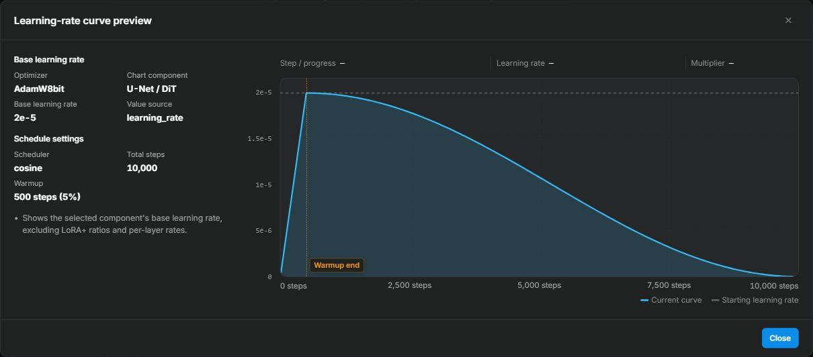

# Optimizer Selection and Parameter Guide

<!-- doc-anchor: quick-choice -->
## Choosing an optimizer

An optimizer updates model parameters from gradients. It mainly affects learning speed, memory use, and stability. This guide covers Anima, SDXL, MOSS-Image, and Krea 2, with defaults and compatibility specified by profile.

Start with AdamW8bit. Compare StableAdamW for update spikes, or a Paged variant when optimizer state does not fit in VRAM. After switching, use the learning-rate table below to choose a starting value.

| Main goal | Options to compare | What to inspect |
| --- | --- | --- |
| Establish a general baseline | AdamW8bit | Total steps, checkpoint stage, previews, peak VRAM, and time per step |
| Reduce optimizer-state memory | 8-bit; Paged variants when needed | Peak memory and transfer overhead |
| Handle update spikes or low-precision rounding | StableAdamW | Spikes in update logs and generated results from several checkpoints |
| Compare factored statistics and update clipping | CAME | Stability, speed, and generated results |
| Reduce manual step-size tuning | Prodigy family | Changes in D and the first checkpoint that adequately captures the target features |
| Compare matrix update methods | Muon, SOAP | Learning speed and additional computation |
| Compare methods designed for LoRA factors | LoRA-Muon, LoRA-RITE | Factor-pair compatibility and separately tuned learning rates |

<!-- doc-anchor: optimizer-type -->
## Available optimizers

| Optimizer | Primary purpose | Restrictions |
| --- | --- | --- |
| AdamW | AdamW baseline with unquantized state | State follows the training parameter dtype; default FP32 state uses more memory than the 8-bit variant |
| AdamW8bit | Everyday default | Small tensors keep FP32 state by design |
| PagedAdamW8bit | When the regular 8-bit optimizer still does not fit | Uses AdamW8bit updates with paged state; paging adds CPU/GPU transfers |
| StableAdamW | Update spikes, low-precision LoRA weights | State uses the training parameter dtype; internal clipping limits update magnitude |
| Lion | Sign-based momentum updates for comparison | Works with a different LR range; tune it separately |
| Lion8bit | Lion with less state VRAM | Needs its own LR sweep |
| PagedLion8bit | Lion8bit that also needs paging | Paging changes where momentum state is stored; active paging adds CPU/GPU transfers |
| Prodigy | Optimizer-estimated update scale | Base LR must be `1.0`; not supported with LoRA+ here |
| ProdigyPlusScheduleFree | Automatic step-size estimation and internal scheduling | External scheduler and warmup are ignored; compare against an established baseline |
| Automagic3 | Experimental adaptive scheme | Keeps trainable parameters in FP32. Only fused updates require gradient accumulation of 1, global gradient clipping of 0, no fp16 mixed precision, and a single GPU |
| AdaFactor | Very tight optimizer memory | Relative-step mode takes over the LR and restricts LoRA+ |
| CAME | Compare factorized state, residual-confidence scaling, and internal RMS clipping | Uses three betas; stores second moments by row and column for factorable tensors |
| AdamWScheduleFree | Testing AdamW without an external scheduler | Uses internal warmup, default `warmup_steps=0`; evaluation and saving use averaged weights |
| EmoSens | Experimental optimizer | Requires gradient accumulation of 1; fp16 mixed precision and multi-GPU are not supported; LoRA+ not supported |
| Muon | Momentum orthogonalization for two-dimensional LoRA matrices | Supports Anima, MOSS-Image, and Krea 2; uses PyTorch's native implementation and requires two-dimensional parameters |
| LoRA-Muon | Spectral low-rank optimization designed for standard LoRA factor pairs | Supports Anima native LoRA, Krea 2 native LoRA, and Krea 2 LoCon; requires complete factor pairs and separately tuned learning rates |
| Adan | Updates that incorporate changes between gradients | The project starts at half the AdamW learning rate; uses three betas |
| AdEMAMix | Use short- and long-term gradient averages together | alpha controls the long-term contribution; ramp lengths set when it reaches the target weight |
| AdEMAMix8bit | AdEMAMix when optimizer-state memory is tight | Differs from the full-precision version mainly in state quantization |
| LoRA-RITE | Trying an update rule designed for LoRA's structure | Supports Anima native LoRA, Krea 2 native LoRA, and Krea 2 LoCon; uses internal clipping and locks `max_grad_norm` to `0` |
| SOAP | Adam-style updates in a rotated coordinate system | Preconditioning adds memory and computation; the project caps preconditioned dimensions at `256` by default |

Memory notes above refer only to optimizer state. Peak usage also depends on resolution, rank, batch size, cache, and preview generation.

<!-- doc-anchor: stable-comparison -->
## AdamW8bit, CAME, StableAdamW: how they differ

**AdamW8bit** stores larger state tensors in 8-bit and smaller ones in FP32.

**CAME** uses factorized state, residual-confidence scaling, and internal RMS clipping. Record state memory, update behavior, and generated results when comparing it.

**StableAdamW limits unusually large updates.** It supports standard schedulers, warmup, `max_grad_norm`, and LoRA+. Anima starts at `lr=2e-5`, `betas=(0.9, 0.99)`, `eps=1e-8`, and `weight_decay=0`; SDXL starts at `1e-4`. It uses more state memory than AdamW8bit and is mainly useful for update stability problems.

<!-- doc-anchor: parameters -->
## Parameter reference

<!-- doc-anchor: learning-rate -->
### Learning rate

Learning rate sets the overall update scale. With the optimizer and other settings fixed, raising it enlarges the terms controlled by the learning rate; lowering it reduces them. Internally adaptive optimizers also compute their own step size. Use generated results from several checkpoints to find a usable range.

The table lists project starting values for Anima. Each optimizer uses its own update scale and needs separate learning-rate tuning.

| Optimizer | Anima starting LR | Usage |
| --- | ---: | --- |
| AdamW / AdamW8bit / PagedAdamW8bit | `2e-5` | Official Anima rank-32 baseline; 8-bit and paged builds keep the same LR semantics |
| StableAdamW | `2e-5` | Same scale as AdamW first; isolate the stabilized updates |
| Muon (`match_rms_adamw`) | `2e-5` | Scales by matrix size to bring update RMS into AdamW's range |
| LoRA-Muon | `0.02` | Experimental start; tune independently. Constructor default: `0.1` |
| CAME | `1.5e-5` | Starts at `0.75`× the AdamW baseline |
| Adan | `1e-5` | Starts at `0.5`× AdamW; compare convergence separately |
| AdEMAMix / AdEMAMix8bit | `2e-5` | The paper keeps Adam-scale learning rates; 8-bit keeps the same LR semantics |
| LoRA-RITE | `1e-4` | Uses a different update scale from Adam; tune separately |
| SOAP | `2e-5` | Start comparisons from the AdamW baseline |
| Lion / Lion8bit / PagedLion8bit | `5e-6` | Lion's guidance is roughly `3`–`10`× smaller than AdamW |
| AdamWScheduleFree | `1e-4` | Schedule-Free guidance often `1`–`10`× higher than the base optimizer; treated as experimental on Anima |
| Prodigy / ProdigyPlus | `1.0` | D-adaptation scale; not comparable to `2e-5` |
| AdaFactor relative step | Controlled by the optimizer; entered LR does not control updates | With both `relative_step` and `warmup_init` off, Anima manual mode starts at `2e-5` |
| Automagic3 / EmoSens | `1e-4` / Transformer LoRA `0.1`, U-Net LoRA `1.0` | Starting value and multiplier, respectively, for internally adjusted learning rates |

Lion's `5e-6` follows the guidance of roughly 1/3 to 1/10 of AdamW's learning rate. This project keeps its own weight-decay defaults. To reproduce the official recipe, also increase weight decay by roughly 3–10×.

Other profiles use their own starting configurations:

| Profile | Baseline learning rate | Other starting recommendations |
| --- | --- | --- |
| SDXL | AdamW/StableAdamW `1e-4` | CAME `1e-4`; Lion `2e-5`; AdamWScheduleFree `3e-4` |
| MOSS-Image | `1e-4` with `rank=16, alpha=1` | Muon also starts at `1e-4` |
| Krea 2 | AdamW8bit `1e-4` | CAME `2e-4`; Lion `1e-4`; AdamWScheduleFree `0.0025`; LoRA-Muon `0.1`; LoRA-RITE `1e-4`; EmoSens multiplier `0.1` |

Krea 2 uses its corresponding `krea_*` fields for weight decay, betas, and eps. Shared optimizer parameters follow the descriptions below.

`network_alpha / network_dim` scales the LoRA branch. The upstream sd-scripts `1e-4` example uses `alpha=1`; retune the learning rate when switching to this project's `rank=32, alpha=32`.

When a character locks in, colors bleed, or prompt adherence drops too early, lower the learning rate or reduce training steps. When the model underlearns, confirm the trigger word and useful step count before nudging the LR up. Lion's usable LR range is different from AdamW's; test it on its own.

With `relative_step` enabled, AdaFactor computes the update step size from the update count. The entered learning rate initializes the scheduler proxy's display; it does not control updates, and the external scheduler does not apply. `scale_parameter` separately controls multiplication by the parameter RMS. Turn off both `relative_step` and `warmup_init` to use manual learning rates, an external scheduler, or LoRA+.

<!-- doc-anchor: scheduler-warmup -->
### LR scheduler and warmup

AdamW, AdamW8bit, StableAdamW, Lion, CAME, Muon, and LoRA-Muon use the external scheduler. New Anima configurations default to `constant`. To test warmup, use `constant_with_warmup` and initially keep warmup within `5%` of total optimizer steps.

With `num_cycles=1`, `cosine_with_restarts` runs one decay cycle. Values above `1` enable periodic restarts.

AdamWScheduleFree and ProdigyPlus manage their own schedule, so the UI forces the external scheduler to constant. AdamWScheduleFree's internal warmup is separate from `lr_warmup_steps`; ProdigyPlusScheduleFree exposes no comparable warmup setting.

`warmup_stable_decay` (WSD) runs warmup → constant → final decay:

- `lr_warmup_steps` and `lr_decay_steps` accept integer counts or fractions in `[0,1)`. Their sum must fit the total budget; the stable phase uses the remainder, and phases of length `0` are skipped.
- `warmup_type` defaults to `linear` and `decay_type` to `cosine`; both support `linear`, `cosine`, and `1-sqrt`. With `1-sqrt`, warmup starts slowly and accelerates, while decay starts quickly and slows down.
- The minimum LR ratio sets the warmup start and decay end. Cycles affect cosine decay only; `1` gives a single downward curve.

The `piecewise_constant` `step_rules` format is `multiplier:cumulative_end_step,...,final_multiplier`. For example, `1:1000,0.5:1600,0.1` uses the base rate at steps 0–999, 50% at 1000–1599, and 10% from step 1600 onward. Boundaries must be increasing positive integers; multipliers must be finite and non-negative and may exceed `1`. The last item contains only a multiplier.

This scheduler fixes `lr_warmup_steps` at `0`. On the sd-scripts path, boundaries use scheduler steps, which the preview converts to training steps for multiple processes. Staircases with boundaries require a total-step estimate.

Open **View learning-rate curve** under the schedule field to inspect warmup, decay, and restarts. The sidebar shows the selected component's base rate, warmup, and rates at the start, midpoint, and end of training. When more than one component is available, switch between their curves, for example when training both DiT and the text encoder or using Krea 2 LoRA+. The preview shows an estimation notice while total steps are unknown. The curve represents scheduler output; adaptive optimizers calculate their internal step sizes during training.

| Setting | Main purpose | Risk when taken too far |
| --- | --- | --- |
| Momentum-related coefficients | Smooth short-term gradient fluctuations and use recent or long-term trends | Retaining history too long can slow adaptation |
| Weight decay | Limit continued growth of trainable weights | Excessive decay can prevent adequate fitting |
| Gradient clipping | Reduce occasional unusually large gradients | A very low threshold suppresses ordinary updates too |
| Numerical stability terms | Prevent excessive scaling from very small denominators | Large values alter adaptive scaling |

Leave these settings at their defaults when training is stable. Tune learning rate and duration first.

<!-- doc-anchor: betas -->
### Momentum parameters (betas)

Keep the defaults unless you have a reason to change them:

- AdamW family: `0.9, 0.999`
- StableAdamW, Lion: `0.9, 0.99`
- CAME: `0.9, 0.999, 0.9999`

Higher betas retain history longer and respond more slowly; lower values follow recent gradients more closely. The statistics controlled by each beta vary by optimizer; see the individual sections.

<!-- doc-anchor: eps -->
### Numerical stabilizer (eps)

`eps` prevents very small denominators from amplifying updates. StableAdamW defaults to `1e-8`; PyTorch Muon to `1e-7`. Leave it unchanged unless investigating reproducible numerical errors.

<!-- doc-anchor: weight-decay -->
### Weight decay

For the optimizers covered here, this trainer starts AdamW, AdamW8bit, and PagedAdamW8bit at `weight_decay=0.01`, and CAME, StableAdamW, Muon, and LoRA-Muon at `weight_decay=0`. PyTorch Muon itself defaults to `0.1`; this trainer explicitly overrides it to `0` as a LoRA starting point, and the field remains editable.

Higher weight decay shrinks weights more strongly and can prevent target features from being learned. Lower values relax that constraint; `0` disables it. Start character LoRAs with the project default, then vary decay separately when comparing regularization strength.

<!-- doc-anchor: foreach -->
### Batched tensor updates (foreach)

Available for AdamW, StableAdamW, CAME, Adan, AdamWScheduleFree, and Krea 2's Lion.

- **Auto** (default): use the optimizer's default strategy. AdamWScheduleFree uses its native default; other optimizers receive `None`.
- **Enabled** (`True`): allow batched updates to reduce GPU call overhead. Usually faster, but may increase peak VRAM usage.
- **Disabled** (`False`): update tensors individually, useful when VRAM is tight or comparing implementations.

Auto does not avoid OOM based on remaining VRAM. AdamW cannot use `foreach=True` and `fused=True` together. Native configs pass this through `optimizer_args`, for example `"foreach=False"`.

<!-- doc-anchor: muon-options -->
### Muon options

Muon accumulates gradient momentum and approximately orthogonalizes updates for two-dimensional matrices. It processes `lora_down` and `lora_up` separately. Use it to compare how matrix-based updates affect learning speed and results.

MOSS-Image's native `networks.lora_generic`, `networks.loha`, and `networks.lokr` use two-dimensional trainable parameters for the DiT and optional text embedder. They support Muon, including LoRA+ and standard schedulers. Selecting Muon sets an unedited learning rate to `1e-4`, paired with MOSS defaults of `rank=16, alpha=1`, `adjust_lr_fn=match_rms_adamw`, and `weight_decay=0`. Evaluate these starting values through training comparisons.

Muon only supports two-dimensional parameters. With `lycoris.kohya`, disable `use_scalar` and `train_norm`, which introduce scalar or one-dimensional parameters. This restriction is checked for form values, imported configurations, and custom `network_args`.

Muon keeps one momentum state per parameter, compared with full-precision AdamW's two states, but adds matrix multiplications at each step. Record peak VRAM and time per step when comparing them.

#### Update scale

- **Learning rate** (`learning_rate`, Anima default `2e-5`): controls the overall scale of the orthogonalized update. The form starts here with `match_rms_adamw` scaling. Retune after changing the scaling rule.
- **Learning-rate scaling** (`adjust_lr_fn`, default `match_rms_adamw`): scales updates by matrix size so an AdamW learning rate is a useful starting point. Retune the rate after changing this rule.
- **Weight decay** (`weight_decay`, default `0`): shrinks LoRA factors during updates; `0` disables it. PyTorch defaults to `0.1`, but the trainer uses the form's value.

#### Momentum

- **Momentum coefficient** (`momentum`, default `0.95`): must satisfy `0 ≤ momentum < 1`. Higher values retain a larger share of historical momentum and give the current gradient a smaller share. A value of `1` stops gradient updates and is rejected.
- **Nesterov momentum** (`nesterov`, enabled by default): controls how the current gradient and momentum history are combined before orthogonalization. Switching it changes the optimization path.

#### Orthogonalization

- **Iterations** (`ns_steps`, default `5`): controls the computation spent on a finite polynomial approximation. The coefficients also determine the result; keep `5` for ordinary training.
- **Iteration coefficients** (`ns_coefficients`, default `3.4445, -4.775, 2.0315`): define the Newton-Schulz polynomial. Changing them changes the approximation algorithm; verify its numerical results together with the iteration count.
- **Numerical stabilizer** (`eps`, default `1e-7`): sets a floor on the orthogonalization denominator to prevent division by zero. Adjust when investigating NaNs or abnormal amplification in this calculation.

For a first comparison, swap AdamW8bit for Muon and keep data, rank, alpha, scheduler, step count, and learning rate unchanged. Once the run is stable, test LR or weight decay separately. Changing the NS coefficients and iteration count together makes the result difficult to interpret; adjust one at a time.

<!-- doc-anchor: lora-muon-options -->
### LoRA-Muon options

A LoRA acts through the product of two factors. Scaling one factor up and the other down by the same amount preserves that product. Ordinary Muon updates the factors separately, so this distribution of scale can affect optimization.

LoRA-Muon updates the factors as a pair, computing update directions from the weight change they jointly represent. Tune its learning rate independently.

#### Parameter reference

Learning rate and global gradient clipping use training fields; weight decay uses its corresponding form field. Other parameters are passed through `optimizer_args`.

| Parameter | Default | Accepted values | Effect and recommendation |
| --- | ---: | --- | --- |
| `learning_rate` | Anima `0.02`; Krea 2 `0.1` | Finite number `≥ 0` | Controls the overall update scale; tune this first |
| `weight_decay` | `0` | Finite number `≥ 0`; also requires `learning_rate * weight_decay < 1` | Uses the paper's split decoupled decay rule. Keep it at `0` unless a controlled comparison supports changing it |
| `momentum` | `0.9` | `0 ≤ momentum < 1` | Exponential moving average of gradients. Higher values retain more of the previous average and give less weight to the current gradient |
| `ns_steps` | `8` | Integer `1–8` | Number of Polar Express / Newton–Schulz matrix-sign iterations. Lower values reduce compute but give a coarser approximation |
| `inv_sqrt_steps` | `7` | Integer `1–7` | Iterations on the regular Gram inverse-root path. Fewer iterations reduce matrix computation and change the approximation; the cold-start guard and eigendecomposition fallback do not use this count |
| `msign_eps` | `1e-20` | Finite number `≥ 0` | Added to the matrix-sign normalization denominator to prevent division by zero |
| `inv_sqrt_eps` | `1e-5` | Finite number `≥ 0` | Used for Gram regularization, the cold-start threshold, and the eigenvalue floor. Changing it alters factor-scale correction |
| `inv_sqrt_gamma` | `1.001` | Finite number `> 0` | Damping used by the inverse-root iteration. Leave it unchanged unless investigating a numerical problem |
| `gauge_rebalance` | `false` | `true` / `false` | Periodically balances the factor scales to improve numerical conditioning |
| `gauge_rebalance_alpha` | `1.0` | `0 < alpha ≤ 1` | Damping exponent for rebalancing. Values closer to `1` apply a more complete adjustment. Relevant only when rebalancing is enabled |
| `gauge_rebalance_interval` | `1` | Integer `≥ 1` | Number of optimizer steps between rebalancing operations |
| `gauge_power_steps` | `2` | Integer `≥ 1` | Number of power iterations used to estimate factor spectral norms |
| `max_grad_norm` | Recommended `0` | `≥ 0` | Global L2 gradient clipping before `optimizer.step`; `0` disables it |

Tune `learning_rate` first and keep the other defaults. If the two factors have very different scales, enable `gauge_rebalance` for a separate comparison.

Start Anima at `0.02` or Krea 2 at `0.1` and compare multiplicative increases or decreases. Use short runs to check loss spikes and feature-learning speed, then narrow the range.

For Anima backbone LoRA, a populated `unet_lr` overrides `learning_rate` for that parameter group. Modules matched by `reg_lrs` also use their own learning rate. Check these overrides before tuning so a change to the overall learning rate actually reaches the intended modules.

#### Related network settings and compatibility

`network_dim` and `network_alpha` are independent network settings:

- `network_dim` sets the LoRA rank.
- `network_alpha / network_dim` sets the forward scale of the LoRA branch; equal values give scale `1`.
- The optimizer does not explicitly compensate for this forward scale. Keep `alpha / dim` fixed when comparing ranks, and recalibrate the learning rate after changing that ratio.
- Each module must provide a complete `lora_down` and `lora_up` pair with matching rank dimensions.

To reduce parameters, momentum state, and Gram-matrix computation, manually select `dim=16, alpha=16`. Rank/Alpha still defaults to `32/32`.

The current implementation has the following compatibility limits:

- Supports Anima's `networks.lora_anima`, Krea 2's `networks.lora_krea2`, and Krea 2 LyCORIS LoCon. Krea 2 LoCon requires `use_scalar` and DoRA off.
- It is incompatible with LoRA+ because split parameter groups break complete `lora_down → lora_up` pairing.
- Structures such as LoKr and LoHa are unsupported.
- It supports Linear LoRA and Conv LoRA whose up projection is 1×1. The current Anima DiT backbone uses Linear layers and does not use convolutional LoRA.
- Matrix operations for FP16/BF16 parameters are performed in FP32 and written back to the original parameter dtype; no separate `dtype` option is required.
- First moments remain in FP32. Optimizer-state restoration transfers them directly from the checkpoint to the working dtype and current parameter device, avoiding an intermediate FP16/BF16 cast.
- Standard sd-scripts learning-rate schedulers remain supported. LoRA-Muon does not take ownership of the scheduler or warmup.

#### Calculation details

| Term | Meaning here |
| --- | --- |
| Factor pairing | Processing the down and up matrices of the same LoRA together |
| Gram matrix | Describing the size and correlation of directions within a factor |
| Whitening | Using statistics from the other factor to adjust directional scales in the current update |
| Matrix-sign direction | Transforming singular-value scales while retaining the main matrix directions |
| Factor rebalancing | Keeping equivalent factors from having very different magnitudes, as a numerical-conditioning measure |

#### How an update is computed

1. Compute an exponential moving average of the gradient for each LoRA factor.
2. Compute an inverse square root of the opposite factor's Gram matrix and use it to rescale the current factor's directions. This rescaling is referred to as whitening.
3. Apply the matrix-sign operation to the whitened momentum, followed by the second Gram inverse-root factor required by the update.
4. Use the learning rate `η` as the overall first-order weight-space update budget and split that budget evenly between the two factor directions.

The paper calls `η` the trust-region radius. It bounds the spectral norm of the first-order composed weight update.

<!-- doc-anchor: adan-options -->
### Adan options

Adan tracks both gradients and changes between consecutive gradients. For Anima, start at `1e-5` and tune against learning speed, loss stability, and the best checkpoint.

- **Betas** (default `0.98, 0.92, 0.99`): control the gradient average, the average difference between consecutive gradients, and the squared statistics of `g + β2 × (g − previous gradient)`, respectively.
- **Epsilon** (default `1e-8`): same semantics as AdamW.
- **Weight decay** (`weight_decay`, default `0.01`) and **decoupled decay** (`weight_decouple`, on by default): when enabled, weights shrink by `1 − lr × weight_decay` before the update. When disabled, weights are divided by `1 + lr × weight_decay` after the update. With `weight_decay=0`, neither mode applies decay.
- Adan's own `max_grad_norm` argument stays `0` here; gradient clipping is handled by the `max_grad_norm` field (labeled global gradient clipping threshold in the UI).

<!-- doc-anchor: ademamix-options -->
### AdEMAMix options

AdEMAMix maintains short- and long-term gradient averages. Beta1 and Beta3 set their decay rates; Alpha sets the multiplier for long-term momentum in the update.

| Parameter | What it controls | Effect of increasing it |
| --- | --- | --- |
| `alpha` | Weight of the long-term trend | Gives that trend more influence without extending its decay time |
| Third beta | Retention of long-term history | Values closer to 1 retain history longer and respond more slowly |
| `t_alpha` | Steps used to ramp up the long-term weight | Reaches the target weight later |
| `t_beta3` | Steps used to change the history-retention coefficient | Reaches the target long-term memory length later |

This optimizer's `alpha` is a mixing weight, separate from network Alpha. Start short runs with the defaults; shorten the ramps if the long-term trend enters too late.

`alpha` defaults to `5.0`; `0` removes the slow average from the update. `t_alpha` and `t_beta3` are empty by default and use the estimated total steps at launch, unless the corresponding value is already supplied in custom optimizer arguments. Set either to `0` to disable its ramp, or a positive integer to set the ramp duration. Alpha starts at 0, and β3 starts at β1.

- **Betas** (default `0.9, 0.999, 0.9999`): control the short-term gradient average, squared-gradient average, and long-term gradient average. **Epsilon** defaults to `1e-8`. **Weight decay** defaults to `0.01` and scales with the learning rate.
- For tensors meeting the quantization threshold, the 8-bit variant reduces values in all three states from 4 bytes to 1 byte each, plus quantization scales and related data. Quantization applies only to optimizer state; model weights and other training tensors still consume VRAM. By default, tensors smaller than 4096 elements keep FP32 state.

<!-- doc-anchor: lorarite-options -->
### LoRA-RITE options

LoRA-RITE uses gradients with factor scaling removed and low-rank matrix preconditioning to reduce sensitivity to equivalent A/B representations. Start Anima at `1e-4` and compare with AdamW8bit.

- **Learning rate** (Anima default `1e-4`): initially compare values within `5e-5`–`2e-4`. Keep the data, rank, and step count fixed, then compare checkpoints using the same prompts and seeds.
- **Betas**: default `0.9, 0.999`.
- **Epsilon** (default `1e-6`): note the semantics — this is a root epsilon, squared internally before use; do not carry over the Adam-style `1e-8`.
- **Gradient clip threshold** (`clip_unmagnified_grad`, default `1.0`): limits the gradient norm after removing the scaling induced by the LoRA factors. Lower positive values impose a stronger limit; `0` disables clipping. The UI locks `max_grad_norm` to `0` because this optimizer uses its own clipping rule.
- Supports Anima native LoRA, Krea 2 native LoRA, and Krea 2 LoCon. Krea 2 LoCon requires `use_scalar` and DoRA off. LoRA+ is incompatible because grouped learning rates break the A/B pairing assumption.
- With a zero-initialized up matrix, the first few steps mostly update up, and down joins later.

<!-- doc-anchor: soap-options -->
### SOAP options

SOAP uses correlations between gradient directions to choose a coordinate basis, applies Adam-style updates in that basis, then transforms the update back.

| Parameter | Default | Effect and tuning |
| --- | --- | --- |
| `max_precondition_dim` | `256` | Largest axis included in matrix preconditioning. Higher limits cost more memory and compute; lower limits leave more axes with elementwise scaling only |
| `precondition_frequency` | `10` | Steps between basis updates. Higher values save compute; lower values follow gradient changes sooner. `1` updates every step |
| `shampoo_beta` | Empty; uses the second beta | Higher values retain history longer and respond more slowly |
| `normalize_gradient` | Off | Normalizes the whole update tensor by its RMS |
| `correct_bias` | On | Corrects bias in averages initialized at zero |
| `precondition_1d` | Off | Preconditions one-dimensional parameters within the size limit, such as normalization weights enabled by `train_norm` |

- **Learning rate** (Anima default `2e-5`): start from the AdamW baseline. The library default `3e-3` is a whole-model training scale and should not be carried over.
- **Betas** (default `0.95, 0.95`): two values. The second one also drives the preconditioner's moving average unless you set that separately. It differs from AdamW's `0.9, 0.999`, so a comparison against AdamW also changes the history length of the second-moment state.
- **Epsilon** (default `1e-8`): added after the square root of the squared-gradient state, same semantics as AdamW.
- **Weight decay** (default `0`): the library default is `0.01`; this project keeps its own `0` and writes it into the config explicitly. The implementation always uses decoupled, non-fixed decay, so there is no switch for it.
- **Gradient clipping**: SOAP has no internal clipping, so the `max_grad_norm` field (global gradient clipping threshold) applies as usual. Its default of `1.0` matches sd-scripts' own default, so it is not written to the config, and nothing is locked for SOAP.
- Statistics and basis matrices use memory proportional to axis length squared. In FP32, the pair uses about 2 MiB for a 512-dimensional axis and 8 MiB for 1024. The project's default limit is `256`; longer axes do not get these matrices.
- SOAP builds the preconditioner state on step one and starts updating weights on step two.

<!-- doc-anchor: prodigyplus-options -->
### ProdigyPlus options

The Prodigy family estimates step size during training. Its learning-rate field acts as a multiplier and defaults to `1.0`.

| Value | Meaning | Default and guidance |
| --- | --- | --- |
| `D` | Estimated step-size scale | Updated during training; inspect it in the logs |
| Learning-rate field | Multiplier used in step-size calculation | `1.0`; keep the default |
| `d0` | Initial step-size estimate | `1e-6`; sets where D estimation begins |
| `d_coef` | Scale applied to step-size estimation | `1.0`; tune this first when adjusting automatic step size. Higher values raise the estimate |

ProdigyPlusScheduleFree also maintains averaged weights for evaluation and saving. Averaging reduces reliance on the very last training state, but newly learned changes can take time to appear in the saved result.

`schedulefree_c` defaults to `0` and selects the averaging rule:

| Value | Behavior |
| --- | --- |
| `0` | Uses the original averaging rule |
| Positive | Uses adjustable averaging; higher values respond faster to recent updates, lower values produce smoother averages |

Before reading a curve, check whether it records group learning rate, `D × lr`, or actual update magnitude. Evaluate it alongside generated samples from several training stages.

- **D growth limiter** (`d_limiter`, on by default): with `d_coef=1`, limits D growth to about `19%` per step. Disabling removes this cap. SPEED uses its own limiter and ignores this switch.
- **Steps before D freezes** (`prodigy_steps`, default `0`): after this many steps `D` freezes at its current value and the estimation buffers are released. For the case where `D` has been verified and the second half should not change it; `0` keeps estimating throughout.
- **Bias correction and automatic warmup** (`use_bias_correction`, off by default): selects a RAdam variant with bias correction and automatic warmup, slowing adjustment of `D`. If `D` stops growing after enabling it, compare with it off.
- **SPEED estimator** (`use_speed`, off by default): raises `D` when directional progress reaches a historical peak, uses less state, and tolerates overall gradient rescaling. It is experimental; upstream warns when it is combined with nonzero weight decay.
- **Cautious updates** (`use_cautious`, off by default): removes update components that disagree with the current gradient. This implementation masks the update directly, without a first-moment state. Enable it for a separate comparison of directional filtering.
- **Orthogonal gradient updates** (`use_orthograd`, off by default): uses only the gradient component orthogonal to the current weight direction. Enable it when testing this constraint.

- **Estimate D per parameter group** (`split_groups`, on by default): each group estimates step size independently, such as separate text-encoder and DiT groups. Disabling it gives all groups one shared estimate.
- **Share an averaged D across groups** (`split_groups_mean`, off by default): requires `split_groups`. Uses the harmonic mean of group estimates, multiplied by each group's learning rate. Test it when a shared adaptive scale is desired. Small estimates pull the mean down; with this option off, each group estimates and uses its own `D`.
- **Factor second moments** (`factored`, on by default): approximates full second moments with row and column statistics to save memory. Compare full statistics by disabling it when investigating NaNs or stalled `D` growth.
- **Keep factored statistics in FP32** (`factored_fp32`, on by default): stores row and column statistics in FP32 when enabled, or in the gradient dtype when disabled. Both modes use the same state storage with FP32 gradients.
- **Scale weight decay with the learning rate** (`weight_decay_by_lr`, on by default): multiplies decay by the adaptive step size when enabled; otherwise applies the full decay coefficient each step. The modes use different numerical scales, so reassess weight_decay after switching.
- **Internal update scaling** (`use_stableadamw`, exposed as `prodigyplus_use_stableadamw`, on by default): limits updates by their RMS. This option, or `eps=None` for Adam-atan2, locks global gradient clipping to `0`. Compare it disabled when investigating abnormal adaptive step sizes.
- **Advanced options** (custom `optimizer_args`): `use_grams` and `use_adopt` are experimental update variants; `use_focus` targets noise at large step sizes and disables `factored` and Adam-atan2; `beta3` controls the moving average used to estimate `D` and defaults to √β2; `stochastic_rounding` affects BF16 weights only.

<!-- doc-anchor: gradient-clipping -->
### Global gradient clipping (max_grad_norm)

`max_grad_norm=1` is the common starting value; `0` disables clipping. Lower positive thresholds clip more strongly; higher thresholds allow larger gradients. StableAdamW supports it. LoRA-Muon recommends `0`; LoRA-RITE locks it to `0` and uses internal clipping.

<!-- doc-anchor: min-8bit-size -->
### Minimum 8-bit tensor size (min_8bit_size)

Default `4096`; tensors stay FP32 below this size.

Higher thresholds keep more state in FP32 and use more VRAM; lower thresholds quantize more tensors. Test `16384` for small-tensor numerical issues in low-rank runs. This controls optimizer-state precision only.

<!-- doc-anchor: stableadamw-options -->
### StableAdamW-only options

`kahan_sum=True` uses compensated summation to reduce rounding error, primarily for FP16/BF16 trainable LoRA weights. Selecting only `mixed_precision=bf16` leaves those weights in FP32; `full_bf16` converts them to BF16.

`weight_decouple=True` runs the AdamW-style decoupled decay. With `weight_decay=0` this switch has no effect, but keep it on so the setting behaves correctly if you later raise weight decay.

<!-- doc-anchor: came-clipping -->
### CAME's internal clipping

`came_clip_threshold` defaults to `1.0` and is passed as the optimizer's `clip_threshold`. It clips the RMS of internal updates. Lower thresholds clip more strongly; higher thresholds relax clipping. It is separate from global `max_grad_norm`; adjust it when spikes recur.

<!-- doc-anchor: schedulefree-warmup -->
### Schedule-Free warmup

AdamWScheduleFree uses internal `warmup_steps`; external `lr_warmup_steps` is inactive. The project defaults to `0`, disabling warmup. Test a short internal warmup if early updates are unstable. Higher values extend the learning-rate ramp.

<!-- doc-anchor: stochastic-rounding -->
### Stochastic rounding

Stochastic rounding reduces the drift from low-precision updates that consistently round in the same direction. ProdigyPlus uses the library default; this trainer provides no separate switch.

<!-- doc-anchor: automagic-lr -->
### Automagic3 parameters

Automagic3 adjusts each parameter group's learning rate by pooling its recent update directions. Consistent directions push the rate upward, while strictly alternating directions push it downward. The pooled result determines the adjustment. `learning_rate` sets the starting point for a new run.

The table lists this trainer's initial settings. Values entered manually or loaded from a configuration may be retained.

| Parameter | Initial value | Range | Purpose |
| --- | --- | --- | --- |
| `learning_rate` | `1e-4` | Finite and positive, within the bounds | Starting learning rate for a new run |
| `min_lr` | `1e-8` | Finite and positive; no greater than `max_lr` | Lower bound for automatic learning-rate adjustment |
| `max_lr` | `1e3` | Finite and positive; no less than `min_lr` | Upper bound for automatic adjustment; the default is a numerical safeguard, and lowering it limits growth |
| `beta2` | `0.999` | `0 ≤ beta2 < 1` | Smooths squared-gradient statistics; values closer to 1 retain history longer |
| `clip_threshold` | `1.0` | Finite and positive | Limits the internal update's root mean square and individual components; lower values apply stronger clipping |
| `polarity_history` | `8` | Integer from `2` to `64` | Number of recent parameter updates used to track directions and adjust the learning rate |
| `fused` | `False` | Boolean | Updates parameters during backpropagation and releases their gradients |
| `eps` | `1e-30` | Finite and positive | Stabilizes squared-gradient statistics to prevent division by zero |
| `weight_decay` | `0` | Finite and nonnegative | Shrinks trainable weights; `0` disables weight decay |

`min_lr`, `max_lr`, `beta2`, `clip_threshold`, `polarity_history`, and `fused` correspond to the interface's `automagic_*` fields and are exported through `optimizer_args`. The shared `eps` and `weight_decay` fields also use `optimizer_args`; `learning_rate` remains a top-level setting. Every parameter group must start within `min_lr ≤ starting learning rate ≤ max_lr`, including component overrides and rates produced by LoRA+ multipliers.

#### History length and internal clipping

`polarity_history=8` records the last 8 actual parameter updates. Parameters continue updating at the current learning rate while the window fills. Once full, the pooled history can adjust subsequent rates. Longer windows respond more slowly and use more GPU memory. Changing the window length when resuming resets the sign history.

In normal mode, `max_grad_norm` can clip gradients first. Automagic3 then clips the root mean square (RMS) of its internal update and each component, adds any nonzero weight-decay term, and finally multiplies by the current adaptive learning rate.

#### Updates during backpropagation

The project default is `fused=False`: parameters are updated at the normal optimizer step, with gradient accumulation and global gradient clipping available. With `fused=True`, each parameter is updated as its gradient becomes available, and that gradient is released so fewer gradients are held at once. This mode requires one GPU, gradient accumulation of `1`, `max_grad_norm=0`, and `mixed_precision` set to `bf16` or `no`. Internal `clip_threshold` clipping remains active in both modes.

This project keeps trainable parameters in FP32 and disables `full_bf16`. BF16 mixed-precision computation remains available. The optimizer controls the learning rate in both modes; the external scheduler is fixed to `constant`, with external warmup set to `0`.

### EmoSens v3.9.3

EmoSens adjusts the learning rate automatically as loss changes. Enter a multiplier in `learning_rate`. Following upstream's architecture categories, start with `0.1` for Transformer / DiT LoRA (such as Anima and MOSS-Image) or `1.0` for U-Net LoRA (such as SDXL). The actual rate changes during training and is shown in the training logs.

These LoRA multipliers follow [upstream guidance](https://github.com/muooon/EmoSens). Adjust them for your dataset and generated results.

**Common settings**

- **Stop-signal threshold** `stopcoef`: defaults to `0.04`. Suggests considering a stop when training has settled and recent average loss is at or below this value. Higher values make the hint easier to trigger. Values above `1` are allowed; `0` disables triggering.
- **Show convergence hints** `notify`: on by default. The log message `[READY TO STOP]` suggests considering a stop; it does not end training. Compare nearby saved models before deciding whether to stop. Turning this switch off only hides the message and does not affect training.
- **Enable shadow weights** `use_shadow`: off by default. Keeps an extra copy of the weights and blends it with the current weights when loss changes suddenly, using more GPU memory.

Other defaults match upstream: `betas=(0.9, 0.995)`, `eps=1e-8`, and `weight_decay=0.01`.

**Limitations**

Use one GPU, gradient accumulation of `1`, and mixed precision `bf16` or `no`. EmoSens computes its learning rate from training loss; this training path does not support gradient accumulation, FP16 loss scaling, or synchronization of multi-GPU estimates.

The form locks the scheduler and warmup settings; you do not need to configure them. Global gradient clipping is still available. EmoSens uses one learning rate for all trained parameters, so LoRA+ is unsupported and separate U-Net / DiT or text encoder rates do not change their actual rates. To train just one component, use the corresponding training switch.

**Learning-rate ceiling and resuming training**

In the [current v3.9.3 implementation](https://github.com/muooon/EmoSens/blob/e2c7bb3293baeb339a2d4a21f21ccbdc0260d3be/optimizer/emosens.py), multipliers `0.1` and `1.0` have automatic learning-rate ceilings of `3e-4` and `3e-3`. Above a multiplier of `1`, the ceiling stays at `3e-3`.

When resuming, keep the original learning-rate multiplier, convergence-hint setting, and shadow-weight setting. The saved state does not fully restore these settings. Resuming a state from an older version also uses the new ceiling rule.

<!-- doc-anchor: loraplus -->
### LoRA+

LoRA+ works with most optimizers, including Muon and Automagic3. The exceptions are Prodigy, ProdigyPlus, EmoSens, LoRA-RITE, and LoRA-Muon (LoRA+'s grouped learning rates are incompatible with LoRA-RITE's A/B pairing and LoRA-Muon's joint update path); AdaFactor requires both `relative_step` and `warmup_init` off.

Recheck the LoRA+ ratio after switching optimizers. Automagic3 also requires the multiplied rate to stay between `min_lr` and `max_lr`. See Optimizers and schedulers in the LoRA+ guide for the full rules.

<!-- doc-anchor: scenarios -->
## What to check for each dataset type

<!-- doc-anchor: one-image -->
### A lone illustration

For Anima, start AdamW8bit at `1e-5`–`2e-5` and save checkpoints frequently. SDXL follows its own baseline. A single image can bind identity to its pose and composition; evaluate new views and expressions and compare earlier checkpoints.

<!-- doc-anchor: few-shot -->
### 2–5 images, few-shot

Establish an AdamW8bit baseline and save frequently. Check how often poses, backgrounds, and outfits repeat across images.

<!-- doc-anchor: galgame -->
### Galgame expression sets

Caption the expression, outfit, and pose of each illustration. If expression counts are uneven, check sampling counts by expression. Use new pose and background prompts to test whether identity is tied to the fixed composition.

<!-- doc-anchor: dmm-mixed -->
### DMM cards, effects, companion characters mixed

Caption or remove companion characters, text, watermarks, and effects, and distinguish outfits and forms.

<!-- doc-anchor: mixed-quality -->
### Mixed-quality inputs

Clean up blurred images, compressed screenshots, duplicate crops, and highly similar consecutive frames. Put retained sources in separate subsets and check their repeat counts.

<!-- doc-anchor: outfits-forms -->
### Multiple outfits and forms

Caption outfits and forms separately and check sampling counts for each subset. Generate with different outfit and form prompts, checking identity retention, outfit control, and color leakage between forms.

<!-- doc-anchor: style-lora -->
### Style LoRAs

Use training images with varied subjects and compositions, and caption their content. Evaluate subjects absent from the dataset, checking whether linework, colors, and shape treatment carry over.

<!-- doc-anchor: vram -->
### When memory is tight

Use an 8-bit optimizer when optimizer state does not fit; compare a Paged variant if it still does not fit. Active paging adds CPU/GPU state transfers. `min_8bit_size=4096` keeps smaller tensors' state in 32-bit.

<!-- doc-anchor: starting-configs -->
## Starting configurations for comparisons

| Use | Optimizer and parameters | Other settings |
| --- | --- | --- |
| Anima general baseline | AdamW8bit, LR from the table above, `weight_decay=0.01` | constant scheduler, `max_grad_norm=1`, default rank/alpha, DiT only |
| Anima factorized-state comparison | CAME, LR from the table above, otherwise defaults | constant, `max_grad_norm=1`; record state memory and time per step |
| Anima gradient-spike comparison | StableAdamW, LR from the table above, keep project stability defaults | Kahan on, constant, `max_grad_norm=1` |
| Anima LoRA-Muon experiment | LoRA-Muon, LR from the table above, otherwise defaults | constant, `max_grad_norm=0`; rank/Alpha still default to `32/32`. Enter `16/16` manually if desired; fix rank/Alpha and vary only LR |
| Anima Lion experiment | Lion or Lion8bit, LR from the table above | constant; set weight decay for the comparison's purpose |

When generated results begin repeating training poses, backgrounds, or outfits, compare earlier checkpoints. Use total update count to judge changes in training length:

| Condition | Effect of reducing repeats |
| --- | --- |
| Fixed epoch count | Reduces image sampling count; recalculate updates from batches, accumulation, and bucket tails |
| Fixed total step count | Leaves total updates unchanged; changes epoch size, shuffle cycle, and relative subset sampling counts |
| Repeats reduced for one subset only | Lowers its sampling weight relative to other subsets; with just one subset, no between-subset ratio changes |

For a complete accumulation window, effective batch size is batch size × accumulation steps × GPU count. Keep batch and accumulation settings fixed in comparisons to avoid changing bucket tails and sample combinations.

<!-- doc-anchor: troubleshooting -->
## Troubleshooting by symptom

| Symptom | Check first | Optimizer action worth trying |
| --- | --- | --- |
| Loss plateaus but previews are poor | Data, captions, preview prompt, checkpoint timing | Complete the checks on the left, then compare learning rate and training length |
| Isolated, reproducible loss or gradient spikes | The batch, its images, the LR | Compare StableAdamW, or adjust the global gradient clipping threshold separately |
| NaN / Inf appears | Stop immediately; check LR, precision settings, bad data, and resume points | Only after those are ruled out, compare StableAdamW; do not mask a persistent problem with clipping |
| Optimizer state overflows memory | Check memory used by state, resolution, batch, and previews separately | Use 8-bit first, paged only if still tight |
| Pose, background, or outfit memorized quickly | Steps, repeats, LR, data duplication | Compare earlier checkpoints, shorten training, and check duplicate images and fixed compositions |
| Character traits never quite get learned | Trigger word, captions, useful steps, rank, targets | After checking those, raise the LR a bit |

<!-- doc-anchor: ab-testing -->
## Controlled comparisons

See the [controlled comparison steps](timesteps.en-US.md#comparison-method) for the general procedure. When comparing optimizers, also fix captions, the base model, VAE, batch settings, and generation sampler settings. Starting from each optimizer's learning rate in the table above, find a usable range and record gradient norm, peak VRAM, and training time. Compare fidelity, costume control, pose/background binding, and prompt response.

Start comparison runs from the same base model and initialize each optimizer's state separately.

Prodigy, Muon, and LoRA-Muon use different update scales. Compare them with individually tuned rates and the same training budget; the result compares complete configurations.

<!-- doc-anchor: faq -->
## Frequently asked questions

**Why is the learning rate replaced after I switch model type or optimizer?**

Ordinary recommendations update values whose source is default or automatic; manual and imported values are preserved. Switching to a mode that locks the learning rate, such as Prodigy or ProdigyPlus, sets it to the required `1.0`.

**Why is the Prodigy learning rate locked to `1.0`?**

Prodigy is a D-adaptation-style adaptive optimizer that uses the learning rate as a scaling baseline. The sd-scripts documentation recommends setting it near `1.0`, so the UI locks it and explains why.

**Why is StableAdamW's weight decay `0` in the generated configuration?**

The package default is `0.01`; the trainer explicitly overrides it to `0`. AdamW8bit still defaults to `0.01`. Use matching decay values when isolating optimizer differences.

<!-- doc-anchor: evidence -->
## Evidence and references

Project defaults and compatibility are defined in `backend/training/fields/optimizer_metadata.py`, `optimizer_contracts.py`, and `field_registry.py`. Algorithm details follow the implementations loaded from vendor and the venv. LoRA-Muon's source is documented in `vendor/lora_muon/SOURCE.md`. The papers explain the algorithms; pinned code links are retained as references:

- [Anima model card at a fixed commit](https://huggingface.co/circlestone-labs/Anima/blob/f7382c4bf9d7ffe4ceea593a0adbb470c56dd79b/README.md)
- [sd-scripts Anima training docs at a fixed commit](https://github.com/kohya-ss/sd-scripts/blob/37a1cbbc5725ed2a3575506e7bd2001c9908ac92/docs/anima_train_network.md)
- [CAME official implementation and notes at a fixed commit](https://github.com/yangluo7/CAME/tree/e77c5c022eaf71f1efb82a1433032cdcd5c52610)
- [Lion official implementation and notes at a fixed commit](https://github.com/google/automl/tree/6a54c8741e7c3265d4547c4f35f47a0391122dc5/lion)
- [Schedule-Free official implementation and notes at a fixed commit](https://github.com/facebookresearch/schedule_free/tree/70785b53e778d0e872c0bbb75ff4ee54ee10c291)
- [Transformers cosine restart scheduler implementation at a fixed commit](https://github.com/huggingface/transformers/blob/71c6f699ac9b3f8fc42a6a3e9dc59034c349a678/src/transformers/optimization.py)
- [CAME: Confidence-guided Adaptive Memory Efficient Optimization](https://arxiv.org/abs/2307.02047)
- [Symbolic Discovery of Optimization Algorithms (Lion)](https://arxiv.org/abs/2302.06675)
- [Prodigy: An Expeditiously Adaptive Parameter-Free Learner](https://arxiv.org/abs/2306.06101)
- [The Road Less Scheduled](https://arxiv.org/abs/2405.15682)
- [LoRA+: Efficient Low-Rank Adaptation of Large Models](https://arxiv.org/abs/2402.12354)
- [Adan: Adaptive Nesterov Momentum Algorithm for Faster Optimizing Deep Models](https://arxiv.org/abs/2208.06677)
- [The AdEMAMix Optimizer: Better, Faster, Older](https://arxiv.org/abs/2409.03137)
- [LoRA Done RITE: Robust Invariant Transformation Equilibration for LoRA Optimization](https://arxiv.org/abs/2410.20625)
- [LoRA-RITE official implementation at a fixed commit](https://github.com/gkevinyen5418/LoRA-RITE/tree/d4186b6fedb39300d23c00ce0334db09719da9fc)
- [LoRA-Muon: Spectral Steepest Descent on the Low-Rank Manifold](https://arxiv.org/abs/2606.12921)
- [pytorch-optimizer implementation at a fixed commit](https://github.com/kozistr/pytorch_optimizer/tree/3d08fa02cb6617d4d12365ca0f7d643b72e8cbe8)
- [bitsandbytes optimizer implementation at a fixed commit](https://github.com/bitsandbytes-foundation/bitsandbytes/tree/a2b90e6eae31a958e6b4d85edf2cfb2b91e9ce29)
