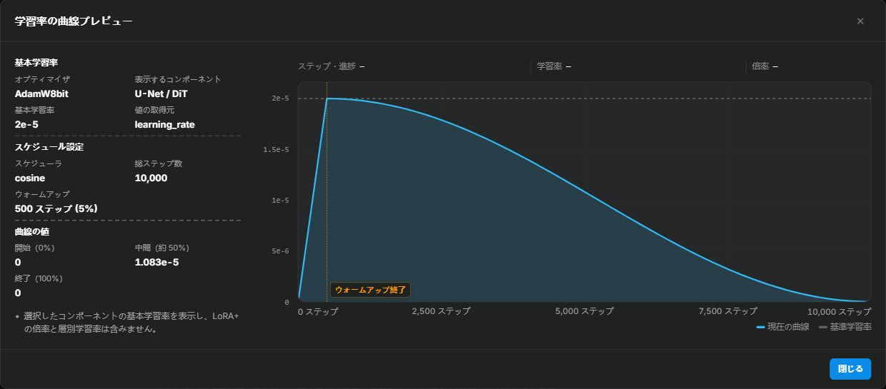

# オプティマイザの選び方と設定

<!-- doc-anchor: quick-choice -->
## オプティマイザを選ぶ

オプティマイザは勾配を使ってモデルのパラメータを更新し、主に学習速度、メモリ使用量、安定性に影響します。本文は Anima、SDXL、MOSS-Image、Krea 2 を扱い、既定値と対応範囲をプロファイル別に示します。

最初は AdamW8bit を使ってください。更新が急増する場合は StableAdamW、オプティマイザの状態が VRAM に収まらない場合は Paged 版と比較します。切り替えたら、下の学習率表で開始値を確認してください。

| 目的 | 比較候補 | 確認する点 |
| --- | --- | --- |
| 基準を作る | AdamW8bit | 総ステップ数、保存時点、プレビュー、ピーク VRAM、1 ステップの時間 |
| 状態のメモリを減らす | 8-bit 版、必要なら Paged 版 | ピークメモリと転送の負荷 |
| 更新の急増や低精度の丸めに対応する | StableAdamW | 更新ログの急増と、複数のチェックポイントの生成結果 |
| 状態の因子分解と更新クリッピングを試す | CAME | 安定性、速度、生成結果 |
| 更新幅の手動調整を減らす | Prodigy 系 | D の変化と、対象の特徴を十分に再現した最初のチェックポイント |
| 行列の更新方式を比較する | Muon、SOAP | 学習速度と追加の計算負荷 |
| LoRA の因子に合わせた方式を試す | LoRA-Muon、LoRA-RITE | 因子ペアへの対応と、個別に調整した学習率 |

<!-- doc-anchor: optimizer-type -->
## 使用できるオプティマイザ

| オプティマイザ | 主な用途 | 制約・注意点 |
| --- | --- | --- |
| AdamW | 状態を量子化しない AdamW の基準 | 状態は学習対象パラメータと同じ精度。既定の FP32 状態は 8-bit 版より VRAM を使う |
| AdamW8bit | 通常の既定値 | 小さなテンソルは仕様上、状態を FP32 で保持する |
| PagedAdamW8bit | 通常の 8-bit 版でも VRAM が不足する場合 | AdamW8bit の更新に、状態のページングを追加する。ページング中は CPU/GPU 転送が増える |
| StableAdamW | 更新の急増、低精度の LoRA 重み | 状態は学習対象パラメータと同じ精度。内部クリッピングで更新幅を制限 |
| Lion | 勾配の符号とモメンタムを使う方式の比較 | 学習率の範囲が異なるため、個別に調整する |
| Lion8bit | Lion の状態メモリを減らす | 独自の学習率比較が必要 |
| PagedLion8bit | Lion8bit でもページングが必要な場合 | モメンタム状態の保存先を切り替える。ページング中は CPU/GPU 転送が増える |
| Prodigy | 更新幅の自動推定 | 基本学習率は `1.0`。本ツールでは LoRA+ 非対応 |
| ProdigyPlusScheduleFree | 更新幅の自動推定と内部スケジュール | 外部スケジューラとウォームアップは無効。基準となる結果と比較する |
| Automagic3 | 実験的な適応方式 | 学習対象パラメータを FP32 で保持。融合更新だけは勾配累積 1、全体の勾配クリッピング 0、fp16 混合精度なし、単一 GPU が必要 |
| AdaFactor | 状態メモリを極力抑える | 相対ステップモードが学習率を管理し、LoRA+ に制約がある |
| CAME | 状態の因子分解、残差の信頼度による尺度調整、内部 RMS クリッピングを比較する | 3 つの beta を使い、因子分解できるテンソルの二次モーメントを行・列で保存する |
| AdamWScheduleFree | 外部スケジューラなしの AdamW を試す | 内部ウォームアップを使い、既定値は `warmup_steps=0`。評価・保存には平均重みを使う |
| EmoSens | 実験的な方式 | 勾配累積は 1 のみ。fp16 混合精度、複数 GPU、LoRA+ は非対応 |
| Muon | 2 次元 LoRA 行列のモメンタムを直交化する | Anima、MOSS-Image、Krea 2 に対応。PyTorch の実装を使い、2 次元パラメータが必要 |
| LoRA-Muon | 標準 LoRA の因子ペアに合わせた低ランクのスペクトル最適化 | Anima のネイティブ LoRA、Krea 2 のネイティブ LoRA と LoCon に対応。完全な因子ペアと独自の学習率調整が必要 |
| Adan | 勾配間の変化も使う更新 | 本ツールの開始学習率は AdamW の半分。3 つの beta を使う |
| AdEMAMix | 短期と長期の勾配平均を併用する | alpha は長期モメンタムの寄与、立ち上げ期間は目標の重みに達する時点を決める |
| AdEMAMix8bit | AdEMAMix の状態メモリを減らす | 全精度版との主な違いは状態の量子化 |
| LoRA-RITE | LoRA の構造に合わせた更新を試す | Anima のネイティブ LoRA、Krea 2 のネイティブ LoRA と LoCon に対応。内部クリッピングを使い、`max_grad_norm` は `0` に固定 |
| SOAP | 回転した座標系で Adam 型の更新を行う | 前処理のメモリと計算が増える。本ツールの前処理次元の上限は既定で `256` |

上のメモリ比較は、オプティマイザの状態だけについての説明です。ピーク使用量には解像度、rank、バッチサイズ、キャッシュ、生成プレビューも影響します。

<!-- doc-anchor: stable-comparison -->
## AdamW8bit・CAME・StableAdamW の違い

**AdamW8bit** は、大きな状態テンソルを 8-bit、小さなものを FP32 で保存します。

**CAME** は、因子分解した状態、残差の信頼度による尺度調整、内部 RMS クリッピングを使います。比較では状態メモリ、更新の動作、生成結果を記録してください。

**StableAdamW は異常に大きな更新を抑えます。** 通常のスケジューラ、ウォームアップ、`max_grad_norm`、LoRA+ に対応します。Anima の開始値は `lr=2e-5`、`betas=(0.9, 0.99)`、`eps=1e-8`、`weight_decay=0`、SDXL の学習率は `1e-4` です。状態メモリは AdamW8bit より多く、主に更新の不安定さへの対策として使います。

<!-- doc-anchor: parameters -->
## パラメータ一覧

<!-- doc-anchor: learning-rate -->
### 学習率

学習率は更新全体の尺度を決めます。オプティマイザと他の設定が同じなら、上げると学習率が作用する更新項が大きくなり、下げると小さくなります。内部で自動調整する方式は、独自のステップサイズも計算します。複数の保存時点の生成結果で使える範囲を確認してください。

下の表は Anima の開始値です。更新の尺度は方式ごとに異なるため、学習率を個別に調整します。

| オプティマイザ | Anima の開始学習率 | 意味 |
| --- | ---: | --- |
| AdamW / AdamW8bit / PagedAdamW8bit | `2e-5` | Anima 公式の rank 32 の基準。8-bit・Paged 版も同じ学習率の意味を持つ |
| StableAdamW | `2e-5` | まず AdamW と揃え、更新安定化の違いを確認する |
| Muon (`match_rms_adamw`) | `2e-5` | 行列サイズに応じて更新 RMS を AdamW の範囲に合わせる |
| LoRA-Muon | `0.02` | 実験的な開始値。個別に調整する。コンストラクタの既定値は `0.1` |
| CAME | `1.5e-5` | AdamW の `0.75` 倍から開始 |
| Adan | `1e-5` | AdamW の `0.5` 倍から開始し、収束を比較する |
| AdEMAMix / AdEMAMix8bit | `2e-5` | 論文は Adam と同程度の学習率を使う。8-bit 版も同じ意味 |
| LoRA-RITE | `1e-4` | Adam と尺度が異なるため、個別に調整する |
| SOAP | `2e-5` | AdamW の基準から比較する |
| Lion / Lion8bit / PagedLion8bit | `5e-6` | 論文の目安は AdamW の約 `1/3`〜`1/10` |
| AdamWScheduleFree | `1e-4` | Schedule-Free の目安は元の方式の `1`〜`10` 倍。Anima では実験的な値 |
| Prodigy / ProdigyPlus | `1.0` | D 適応の倍率で、`2e-5` とは直接比較できない |
| AdaFactor 相対ステップ | オプティマイザが管理。入力した学習率は更新に使わない | `relative_step` と `warmup_init` を両方オフにした Anima の手動設定は `2e-5` から開始 |
| Automagic3 / EmoSens | `1e-4` / Transformer LoRA `0.1`、U-Net LoRA `1.0` | 自動調整する学習率の開始値と倍率 |

Lion の `5e-6` は、学習率を AdamW の約 1/3〜1/10 にする推奨に従い、重み減衰は本ツールの既定値を使います。公式の配合を再現する際は、重み減衰も約 3〜10 倍にしてください。

他のプロファイルは、それぞれの開始設定を使います。

| プロファイル | 基準の学習率 | その他の開始推奨値 |
| --- | --- | --- |
| SDXL | AdamW/StableAdamW `1e-4` | CAME `1e-4`、Lion `2e-5`、AdamWScheduleFree `3e-4` |
| MOSS-Image | `rank=16, alpha=1` で `1e-4` | Muon も `1e-4` から開始 |
| Krea 2 | AdamW8bit `1e-4` | CAME `2e-4`、Lion `1e-4`、AdamWScheduleFree `0.0025`、LoRA-Muon `0.1`、LoRA-RITE `1e-4`、EmoSens の倍率 `0.1` |

Krea 2 の重み減衰、betas、eps は、対応する `krea_*` 項目で設定します。共通のオプティマイザ設定は、以下の説明を参照してください。

`network_alpha / network_dim` は LoRA 枝の倍率です。上流 sd-scripts の `1e-4` の例は `alpha=1` を使います。本ツールの `rank=32, alpha=32` へ変える際は、学習率を再調整してください。

早い段階でキャラクターが固定化し、色が混ざり、プロンプトへの追従が低下する場合は、学習率かステップ数を下げます。学習不足なら、トリガーワードと有効なステップ数を確認してから少し上げます。Lion は AdamW と使える範囲が異なるため、独立して試してください。

AdaFactor は `relative_step` がオンの場合、更新ステップ数からステップサイズを計算します。入力した学習率はスケジューラ代理の初期表示に使うだけで、更新を制御せず、外部スケジューラも適用しません。`scale_parameter` は、さらにパラメータの RMS を掛けるかどうかを指定します。手動の学習率・外部スケジューラ・LoRA+ を使うには、`relative_step` と `warmup_init` の両方をオフにしてください。

<!-- doc-anchor: scheduler-warmup -->
### 学習率スケジューラとウォームアップ

AdamW、AdamW8bit、StableAdamW、Lion、CAME、Muon、LoRA-Muon は外部スケジューラを使います。新しい Anima 設定は `constant` が既定値です。ウォームアップを試す場合は `constant_with_warmup` を使い、最初は総更新ステップ数の `5%` 以内にしてください。

`cosine_with_restarts` は `num_cycles=1` で 1 回の減衰を行い、`1` より大きい値で周期的に再スタートします。

AdamWScheduleFree と ProdigyPlus は内部でスケジュールを管理するため、UI は外部スケジューラを constant に固定します。AdamWScheduleFree の内部ウォームアップは `lr_warmup_steps` と別です。ProdigyPlusScheduleFree には同等の設定項目がありません。

`warmup_stable_decay`（WSD）は「ウォームアップ → 一定 → 最終区間で減衰」の順に動作します。

- `lr_warmup_steps` と `lr_decay_steps` は整数ステップ数または `[0,1)` の割合で指定します。合計は総ステップ数以内とし、一定区間は残りのステップです。長さ `0` の区間は省略します。
- `warmup_type` の既定値は `linear`、`decay_type` は `cosine` で、どちらも `linear`、`cosine`、`1-sqrt` に対応します。`1-sqrt` の上昇は前半が遅く後半が速く、減衰は前半が速く後半が遅くなります。
- 最低学習率比は上昇の始点と減衰の終点を決めます。周期数は cosine 減衰のみを制御し、`1` は単方向の下降です。

`piecewise_constant` の `step_rules` は `倍率:累積終了ステップ,...,最終倍率` の形式です。例：`1:1000,0.5:1600,0.1` は 0～999 ステップで基本値、1000～1599 で 50%、1600 以降で 10% を使います。終了ステップは単調増加する正の整数、倍率は有限の非負数で、`1` より大きい値も使えます。最後は倍率だけを指定します。

このスケジューラは `lr_warmup_steps` を `0` に固定します。sd-scripts 経路のルールはスケジューラステップで解釈し、複数プロセスの場合はプレビューで学習ステップへ換算します。切り替え点がある曲線には総ステップ数の見積もりが必要です。

スケジュール項目の **学習率の曲線を表示** を開くと、ウォームアップ、減衰、再スタートを確認できます。サイドバーには選択中の学習対象の実効学習率とウォームアップステップ数が表示されます。DiT とテキストエンコーダの両方を学習する場合は、対象を切り替えて確認してください。総ステップ数が未確定なら推定の注記を表示します。曲線はスケジューラの出力を示し、内部の適応ステップサイズは学習中にオプティマイザが計算します。

| 設定 | 主な目的 | 過度に調整した場合 |
| --- | --- | --- |
| モメンタム関連の係数 | 短期の変動を抑え、最近または長期の傾向を使う | 履歴を長く残しすぎると適応が遅れる |
| 重み減衰 | 学習する重みの増加を抑える | 強すぎると必要な特徴を学習できない |
| 勾配クリッピング | 一時的に大きな勾配を抑える | しきい値が低すぎると通常の更新も抑える |
| 数値安定性の項目 | 小さすぎる分母による増幅を防ぐ | 大きい値は適応的な倍率そのものを変える |

安定している場合は既定値を使い、先に学習率と学習時間を調整してください。

<!-- doc-anchor: betas -->
### モメンタム係数（betas）

変更する理由がなければ、既定値を使ってください。

- AdamW 系：`0.9, 0.999`
- StableAdamW、Lion：`0.9, 0.99`
- CAME：`0.9, 0.999, 0.9999`

大きい値は履歴を長く残し、反応が遅くなります。小さい値は最近の勾配を重視します。各 beta が制御する統計は方式ごとに異なるため、個別の説明も確認してください。

<!-- doc-anchor: eps -->
### 数値安定化項（eps）

`eps` は小さすぎる分母による更新の増幅を防ぎます。StableAdamW は `1e-8`、PyTorch Muon は `1e-7` が既定値です。再現する数値エラーを調べる場合を除き、変更しないでください。

<!-- doc-anchor: weight-decay -->
### 重み減衰

本ツールの開始値は、AdamW、AdamW8bit、PagedAdamW8bit が `weight_decay=0.01`、CAME、StableAdamW、Muon、LoRA-Muon が `weight_decay=0` です。PyTorch Muon 自体の既定値は `0.1` ですが、本ツールは LoRA の開始値として `0` を明示的に渡します。UI で編集できます。

大きい値は重みを強く縮め、必要な特徴の学習を妨げる場合があります。小さい値は制約を弱め、`0` は無効にします。キャラクター LoRA は本ツールの既定値から始め、正則化の強さを比較する場合に減衰だけを変えてください。

<!-- doc-anchor: muon-options -->
### Muon の設定

Muon は勾配のモメンタムを蓄積し、2 次元行列の更新を近似的に直交化します。`lora_down` と `lora_up` を別々に処理します。行列に基づく更新が学習速度と結果に与える影響を比較できます。

MOSS-Image のネイティブ `networks.lora_generic`・`networks.loha`・`networks.lokr` は、DiT と任意の text embedder に 2 次元の学習パラメータを使います。Muon を利用でき、LoRA+ と通常のスケジューラにも対応します。Muon 選択時、未編集の学習率は `1e-4` となり、MOSS の既定値 `rank=16, alpha=1`、`adjust_lr_fn=match_rms_adamw`、`weight_decay=0` と組み合わせます。これらの開始値は学習比較で評価してください。

Muon は 2 次元のパラメータのみ対応しています。`lycoris.kohya` では、スカラーや 1 次元パラメータを追加する `use_scalar` と `train_norm` を無効にしてください。フォーム、インポートした設定、カスタム `network_args` のいずれも検証します。

全精度 AdamW がパラメータごとに 2 つの状態を持つのに対し、Muon はモメンタム状態を 1 つ持ちます。ただし、各ステップで行列積が増えます。ピーク VRAM と 1 ステップの時間も記録してください。

#### 更新の大きさ

- **学習率**（`learning_rate`、Anima の既定値 `2e-5`）：直交化した更新全体の尺度を決めます。フォームは既定の `match_rms_adamw` 補正でこの値から始めます。補正規則を変えたら、学習率を再調整してください。
- **学習率の補正**（`adjust_lr_fn`、既定値 `match_rms_adamw`）：行列サイズで更新を補正します。変更したら学習率を再調整してください。
- **重み減衰**（`weight_decay`、既定値 `0`）：更新時に LoRA 因子を縮めます。`0` は無効です。PyTorch の既定値は `0.1` ですが、本ツールはフォームの値を使います。

#### モメンタム

- **係数**（`momentum`、既定値 `0.95`）：`0 ≤ momentum < 1` が必要です。大きいほど過去のモメンタムを多く残し、現在の勾配を取り込む割合が小さくなります。`1` では勾配による更新が停止するため、使用できません。
- **Nesterov モメンタム**（`nesterov`、既定で有効）：直交化前の勾配と履歴の組み合わせ方を指定し、切り替えると最適化の経路が変わります。

#### 直交化

- **反復回数**（`ns_steps`、既定値 `5`）：有限回の多項式近似に使う計算量を指定します。近似結果は係数にも依存するため、通常は `5` を使います。
- **反復係数**（`ns_coefficients`、既定値 `3.4445, -4.775, 2.0315`）：Newton–Schulz 反復の多項式を定めます。変更すると近似アルゴリズムが変わるため、反復回数と合わせて数値結果を確認してください。
- **数値安定化項**（`eps`、既定値 `1e-7`）：直交化の正規化分母に下限を設け、ゼロ除算を防ぎます。この計算の NaN や異常な増幅を調べる際に調整します。

最初の比較では、データ、rank、alpha、スケジューラ、ステップ数、学習率を揃え、AdamW8bit だけを Muon に変えます。安定したら学習率か重み減衰を 1 つずつ試してください。NS 係数と反復回数も同時に変えないでください。

<!-- doc-anchor: lora-muon-options -->
### LoRA-Muon の設定

LoRA は 2 つの因子の積として作用します。一方を大きくし、もう一方を同じ比率で小さくしても積は変わりません。通常の Muon は因子を個別に更新するため、この尺度の配分に影響されます。

LoRA-Muon は因子をペアで更新し、両者が表す重みの変化から更新方向を計算します。学習率は個別に調整してください。

#### パラメータ一覧

学習率と全体の勾配クリッピングは学習設定、重み減衰は対応する画面の項目を使います。その他は `optimizer_args` で渡します。

| パラメータ | 既定値 | 許容値 | 効果と使い方 |
| --- | ---: | --- | --- |
| `learning_rate` | Anima `0.02`、Krea 2 `0.1` | 有限値 `≥ 0` | 全体の更新量。最初に調整する |
| `weight_decay` | `0` | 有限値 `≥ 0`、かつ `learning_rate * weight_decay < 1` | 論文の分割した分離型減衰。比較で効果を確認するまでは `0` |
| `momentum` | `0.9` | `0 ≤ momentum < 1` | 勾配の指数移動平均。大きいほど以前の平均を多く保持し、現在の勾配の重みを小さくする |
| `ns_steps` | `8` | 整数 `1–8` | Polar Express / Newton–Schulz の行列符号反復。減らすと計算が軽くなり、近似が粗くなる |
| `inv_sqrt_steps` | `7` | 整数 `1–7` | 通常の Gram 逆平方根計算の反復回数。減らすと行列計算が減り、近似結果も変わる。初期状態の保護と固有値分解へのフォールバックでは使わない |
| `msign_eps` | `1e-20` | 有限値 `≥ 0` | 行列符号の正規化分母に加え、ゼロ除算を防ぐ |
| `inv_sqrt_eps` | `1e-5` | 有限値 `≥ 0` | Gram 行列の正則化、初期状態のしきい値、固有値の下限に使う。変更すると因子の尺度補正が変わる |
| `inv_sqrt_gamma` | `1.001` | 有限値 `> 0` | 逆平方根反復の減衰。数値問題を調べる場合を除き、変更しない |
| `gauge_rebalance` | `false` | `true` / `false` | 因子の大きさを定期的に揃え、数値条件を改善する |
| `gauge_rebalance_alpha` | `1.0` | `0 < alpha ≤ 1` | 再調整の減衰指数。`1` に近いほど強く調整する。有効化時のみ作用 |
| `gauge_rebalance_interval` | `1` | 整数 `≥ 1` | 再調整の間隔（更新ステップ数） |
| `gauge_power_steps` | `2` | 整数 `≥ 1` | 因子のスペクトルノルムを推定するべき乗反復回数 |
| `max_grad_norm` | 推奨値 `0` | `≥ 0` | `optimizer.step` 前の全体の L2 勾配クリッピング。`0` で無効 |

まず `learning_rate` を調整し、他は既定値を使います。両因子の尺度に大きな差がある場合は、`gauge_rebalance` を有効にして個別に比較できます。

Anima は `0.02`、Krea 2 は `0.1` から始め、倍率で増減した学習率を比較します。短い学習で損失の急増と特徴の学習速度を確認し、範囲を絞ってください。

Anima の本体 LoRA では、`unet_lr` が入力されていると、そのグループは `learning_rate` より優先して使います。`reg_lrs` に一致するモジュールも独自の値を使います。全体の学習率変更が対象に届くか、先に確認してください。

#### ネットワーク設定と互換性

`network_dim` と `network_alpha` は個別に指定できるネットワーク設定です。

- `network_dim` は LoRA の rank です。
- `network_alpha / network_dim` は順伝播での LoRA 枝の倍率です。同じ値なら倍率は `1` です。
- オプティマイザはこの倍率を明示的に補正しません。rank の比較では `alpha / dim` を揃え、比率を変えたら学習率を再調整してください。
- 各モジュールには、rank 次元が一致する完全な `lora_down` と `lora_up` のペアが必要です。

パラメータ数、モメンタム状態、Gram 行列の計算を減らすには、手動で `dim=16, alpha=16` を選べます。Rank / Alpha の既定値は引き続き `32/32` です。

現在の対応範囲：

- Anima の `networks.lora_anima`、Krea 2 の `networks.lora_krea2` と LyCORIS LoCon に対応します。Krea 2 LoCon は `use_scalar` と DoRA をオフにしてください。
- LoRA+ は非対応。グループ分割で完全な `lora_down → lora_up` のペアが崩れるためです。
- LoKr、LoHa などの構造は非対応です。
- Linear LoRA と、up 側の射影が 1×1 の Conv LoRA に対応します。現在の Anima DiT 主幹は Linear 層を使い、畳み込み LoRA は使いません。
- FP16／BF16 パラメータの行列演算は FP32 で行い、元の型へ書き戻します。別の `dtype` 設定は不要です。
- 一次モーメントは FP32 を保ちます。状態の復元時はチェックポイントから計算用の型と現在のデバイスへ直接移し、中間の FP16／BF16 変換を避けます。
- sd-scripts の通常の学習率スケジューラに対応。スケジューラとウォームアップを内部管理しません。

#### 計算で使う用語

| 用語 | この方式での意味 |
| --- | --- |
| 因子のペア処理 | 同じ LoRA の down 行列と up 行列を一緒に処理する |
| Gram 行列 | 因子内の方向の大きさと相関を表す |
| ホワイトニング | 相手側の因子の統計を使い、現在の更新の方向ごとの尺度を調整する |
| 行列符号の方向 | 主な行列方向を保ちながら特異値の尺度を変換する |
| 因子の再調整 | 等価な因子の大きさが極端に違わないよう、数値条件を整える |

#### 1 回の更新

1. 各因子の勾配の指数移動平均を計算します。
2. 相手側の Gram 行列の逆平方根を使い、現在の因子の方向別の尺度を調整します（ホワイトニング）。
3. 調整したモメンタムに行列符号演算を適用し、更新に必要な 2 つ目の Gram 逆平方根を掛けます。
4. 学習率 `η` を合成した重みの一次の更新幅として扱い、2 つの因子の方向に等分します。

論文では `η` を信頼領域の半径と呼び、合成した重みの一次更新のスペクトルノルムを制限します。

<!-- doc-anchor: adan-options -->
### Adan の設定

Adan は勾配と、連続する勾配間の変化を追跡します。Anima は `1e-5` から始め、学習速度、損失の安定性、最良のチェックポイントで調整します。

- **Betas**（`0.98, 0.92, 0.99`）：順に勾配平均、隣接するステップ間の勾配差の平均、`g + β2 × (g − 前ステップの勾配)` の二乗統計を制御します。
- **Epsilon**（`1e-8`）：AdamW と同じ意味です。
- **重み減衰**（`weight_decay=0.01`）と **分離型減衰**（`weight_decouple`、既定で有効）：有効時は更新前に `1 − lr × weight_decay` を掛け、無効時は更新後に `1 + lr × weight_decay` で割ります。`weight_decay=0` では、どちらも減衰を加えません。
- Adan 内部の `max_grad_norm` 引数は `0` です。クリッピングは UI の全体の勾配クリッピングしきい値（`max_grad_norm`）で行います。

<!-- doc-anchor: ademamix-options -->
### AdEMAMix の設定

AdEMAMix は短期と長期の勾配移動平均を保持します。Beta1 と Beta3 は履歴の減衰速度、Alpha は更新に加える長期モメンタムの倍率を決めます。

| パラメータ | 役割 | 大きくした場合 |
| --- | --- | --- |
| `alpha` | 長期傾向の重み | 記憶期間を変えず、その影響を強める |
| 3 つ目の beta | 長期履歴の保持 | 1 に近いほど長く保持し、反応が遅くなる |
| `t_alpha` | 長期の重みを立ち上げる期間 | 目標の重みに届くのが遅くなる |
| `t_beta3` | 履歴保持係数を変える期間 | 目標の記憶期間に届くのが遅くなる |

この `alpha` は混合の重みで、ネットワークの Alpha とは別です。短い学習もまず既定値で始め、長期傾向が作用するのが遅すぎる場合に立ち上げ期間を短くします。

`alpha` の既定値は `5.0`、`0` は遅い平均を更新から除きます。`t_alpha` と `t_beta3` は既定で空欄です。カスタム引数に指定がなければ、開始時の推定総ステップ数を使います。`0` は立ち上げなし、正の整数は立ち上げ期間です。alpha は 0、β3 は β1 から始まります。

- **Betas**（`0.9, 0.999, 0.9999`）：短期勾配平均、二乗勾配平均、長期勾配平均。**Epsilon** は `1e-8`、**重み減衰**は `0.01` で、学習率に応じて適用します。
- 量子化のしきい値以上のテンソルでは、8-bit 版は 3 つの状態の数値を 1 個 4 バイトから 1 バイトにし、別途量子化の尺度などを保持します。量子化はオプティマイザの状態に作用し、モデル重みと他の学習テンソルも VRAM を使います。既定では 4096 要素未満のテンソルの状態は FP32 です。

<!-- doc-anchor: lorarite-options -->
### LoRA-RITE の設定

因子の尺度を除いた勾配と低ランク行列の前処理により、等価な A/B 表現への依存を減らします。Anima は `1e-4` から始め、AdamW8bit と比較します。

- **学習率**（`1e-4`）：まず `5e-5`〜`2e-4` で比較します。データ・ランク・ステップ数を固定し、同じプロンプトとシードで各チェックポイントを比較してください。
- **Betas**：既定値は `0.9, 0.999` です。
- **Epsilon**（`1e-6`）：内部で二乗して使う「平方根側の epsilon」です。Adam 型の `1e-8` を流用しないでください。
- **勾配クリッピングしきい値**（`clip_unmagnified_grad=1.0`）：LoRA 因子による倍率を除いた勾配のノルムを制限します。正の値が小さいほど強く制限し、`0` で無効にします。独自のクリッピングを使うため、UI の `max_grad_norm` は `0` に固定されます。
- Anima のネイティブ LoRA、Krea 2 のネイティブ LoRA と LoCon に対応します。Krea 2 LoCon は `use_scalar` と DoRA をオフにしてください。LoRA+ はグループ別学習率が A/B ペアの前提を崩すため非対応です。
- up 行列のゼロ初期化では、最初は主に up が更新され、その後 down も更新されます。

<!-- doc-anchor: soap-options -->
### SOAP の設定

SOAP は勾配方向の相関から座標系を選び、その中で Adam 型の更新を行って元の座標系へ戻します。

| パラメータ | 既定値 | 効果と調整 |
| --- | --- | --- |
| `max_precondition_dim` | `256` | 前処理する軸の上限。上げるとメモリと計算が増え、下げると要素ごとの倍率だけを使う軸が増える |
| `precondition_frequency` | `10` | 座標系を更新する間隔。大きいと軽く、小さいと変化を早く追う。`1` は毎ステップ |
| `shampoo_beta` | 空欄（2 つ目の beta を使う） | 大きいと履歴を長く保持し、反応が遅くなる |
| `normalize_gradient` | 無効 | 更新テンソル全体を RMS で正規化する |
| `correct_bias` | 有効 | ゼロから始まる平均の偏りを補正する |
| `precondition_1d` | 無効 | `train_norm` で学習する正規化層の重みなど、上限内の 1 次元パラメータも前処理する |

- **学習率**（Anima `2e-5`）：AdamW の基準から始めます。ライブラリの `3e-3` はモデル全体の学習向けで、流用しないでください。
- **Betas**（`0.95, 0.95`）：別に指定しなければ、2 つ目は前処理の移動平均にも使います。AdamW の `0.9, 0.999` との比較は、二次モーメントの記憶期間も変わります。
- **Epsilon**（`1e-8`）：二乗勾配状態の平方根の後に加えます。AdamW と同じ意味です。
- **重み減衰**（`0`）：ライブラリの `0.01` を上書きし、設定へ明示的に書きます。常に学習率に応じた分離型減衰を使い、切り替え項目はありません。
- **勾配クリッピング**：内部にはありません。全体の `max_grad_norm` が通常どおり使えます。既定の `1.0` は sd-scripts と同じで、設定には書き出しません。固定される項目もありません。
- 統計量と基底行列は軸長の二乗に比例するメモリを使います。FP32 の 512 次元軸では 2 行列で約 2 MiB、1024 では約 8 MiB です。本ツールの既定の上限は `256` で、それを超える軸にはこれらの行列を作りません。
- 1 ステップ目に前処理の状態を作り、2 ステップ目から重みを更新します。

<!-- doc-anchor: prodigyplus-options -->
### ProdigyPlus の設定

Prodigy 系は学習中に更新幅を推定します。学習率欄はその倍率で、既定値は `1.0` です。

| 値 | 意味 | 既定値と使い方 |
| --- | --- | --- |
| `D` | 更新幅の推定尺度 | 学習中に更新。ログで確認する |
| 学習率欄 | 更新幅の計算に使う倍率 | `1.0` を維持する |
| `d0` | 初期推定値 | `1e-6`。D 推定の開始値 |
| `d_coef` | 推定に掛ける倍率 | `1.0`。自動更新幅を調整する際に先に試す。大きいと推定値が上がる |

ProdigyPlusScheduleFree は評価・保存用の平均重みも保持します。最後の状態だけに依存しにくくなりますが、新しく学習した変化が保存結果へ反映されるまで時間が掛かる場合があります。

`schedulefree_c` は既定値 `0` で、平均化規則を選びます。

| 値 | 動作 |
| --- | --- |
| `0` | 元の平均化規則を使う |
| 正の値 | 調整可能な平均化を使う。大きいほど最近の更新を早く反映し、小さいほど滑らかになる |

曲線が記録するのがグループ学習率、`D × lr`、実際の更新量のどれかを確認し、複数段階の生成画像と合わせて評価してください。

- **D の増加制限**（`d_limiter`、既定で有効）：`d_coef=1` では、1 ステップの D の増加を最大約 `19%` に制限します。オフではこの上限を外します。SPEED は独自の制限を使い、この設定を読みません。
- **D を固定するまでのステップ数**（`prodigy_steps=0`）：指定回数後に D を固定し、推定バッファを解放します。D が妥当と確認でき、後半は変えたくない場合に使います。`0` は最後まで推定します。
- **バイアス補正と自動ウォームアップ**（`use_bias_correction`、既定で無効）：RAdam 型を選び、D の調整が遅くなります。有効化後に D が増えなくなったら、無効と比較してください。
- **SPEED 推定**（`use_speed`、既定で無効）：方向に沿った進行が過去の最大値に達したときに D を引き上げます。状態が少なく、勾配全体の倍率変化に対応します。実験的な機能で、ゼロ以外の重み減衰と併用すると上流実装が警告を出します。
- **Cautious 更新**（`use_cautious`、既定で無効）：現在の勾配と向きが異なる更新成分を除きます。この実装は一次モーメントを持たず、更新を直接マスクします。方向の選別を独立して比較する場合に使います。
- **直交勾配更新**（`use_orthograd`、既定で無効）：現在の重み方向に直交する勾配成分だけを使います。この制約を試す場合に有効化します。
- **グループ別の D 推定**（`split_groups`、既定で有効）：各群が独立にステップサイズを推定します。例えばテキストエンコーダと DiT を別々に推定します。オフでは共通の推定値を使います。
- **平均 D の共有**（`split_groups_mean`、既定で無効）：`split_groups` が必要です。推定値の調和平均に各グループの学習率を掛けます。小さい推定値が平均を引き下げます。無効なら各グループが独自の D を使います。
- **二次モーメントの因子分解**（`factored`、既定で有効）：行と列の統計で近似し、メモリを減らします。NaN や D の停滞を調べる際は、無効にして完全な統計と比較します。
- **因子分解した統計を FP32 で保持**（`factored_fp32`、既定で有効）：オンでは行・列の統計を FP32、オフでは勾配と同じ精度で保存します。勾配が FP32 なら、両設定の状態保存量は同じです。
- **学習率に応じた重み減衰**（`weight_decay_by_lr`、既定で有効）：オンでは減衰係数に自動推定ステップサイズを掛け、オフでは各ステップで係数をそのまま使います。数値の尺度が異なるため、切り替えたら weight_decay を再確認してください。
- **内部更新の補正**（`use_stableadamw`、UI では `prodigyplus_use_stableadamw`、既定で有効）：RMS で更新を制限します。この機能または Adam-atan2 の `eps=None` は、全体の勾配クリッピングを `0` に固定します。適応更新幅の異常を調べる際は無効と比較します。
- **詳細設定**（カスタム `optimizer_args`）：`use_grams` と `use_adopt` は実験的な更新方式です。`use_focus` は大きい更新幅のノイズに対応し、`factored` と Adam-atan2 を無効にします。`beta3` は D 推定用の移動平均を制御し、既定値は √β2 です。`stochastic_rounding` は BF16 重みだけに作用します。

<!-- doc-anchor: gradient-clipping -->
### 全体の勾配クリッピング（max_grad_norm）

通常の開始値は `max_grad_norm=1`、`0` は無効です。正の値が小さいほど強く抑え、大きいほど大きな勾配を許容します。StableAdamW に対応します。LoRA-Muon は `0` を推奨し、LoRA-RITE は `0` に固定して内部クリッピングを使います。

<!-- doc-anchor: min-8bit-size -->
### 8-bit 化する最小テンソルサイズ（min_8bit_size）

既定値は `4096`。これより小さいテンソルの状態は FP32 です。

上げると FP32 の状態と VRAM 使用量が増え、下げると量子化するテンソルが増えます。低ランク学習で小さいテンソルの数値問題を調べる場合は `16384` と比較してください。この項目はオプティマイザの状態精度だけを制御します。

<!-- doc-anchor: stableadamw-options -->
### StableAdamW 専用設定

`kahan_sum=True` は補償付き加算で丸め誤差を減らします。主に学習対象の LoRA 重みが FP16/BF16 の場合に作用します。`mixed_precision=bf16` だけなら LoRA 重みは FP32 のままで、`full_bf16` を有効にすると BF16 に変わります。

`weight_decouple=True` は AdamW 型の分離型減衰を使います。`weight_decay=0` では作用しませんが、後から減衰を上げた場合に備えて有効のままにしてください。

<!-- doc-anchor: came-clipping -->
### CAME の内部クリッピング

`came_clip_threshold` の既定値は `1.0` で、`clip_threshold` として渡されます。内部更新の RMS を抑え、低いほど強く、高いほど弱く制限します。全体の `max_grad_norm` とは別です。更新の急増が繰り返される場合に調整してください。

<!-- doc-anchor: schedulefree-warmup -->
### Schedule-Free のウォームアップ

AdamWScheduleFree は内部の `warmup_steps` を使い、外部の `lr_warmup_steps` は無効です。本ツールの既定値 `0` はウォームアップなしです。初期の更新が不安定なら短い内部ウォームアップを試してください。大きいほど学習率の立ち上げが長くなります。

<!-- doc-anchor: stochastic-rounding -->
### 確率的丸め

低精度の更新が同じ方向に丸められ続けることによる偏りを減らします。ProdigyPlus はライブラリの既定値を使い、本ツールに独立した切り替え項目はありません。

<!-- doc-anchor: automagic-lr -->
### Automagic3 の開始学習率と上下限

`learning_rate` は制御器の開始値で、その後は各群が更新方向の履歴から学習率を調整します。[採用中の上流コード](https://github.com/ostris/ai-toolkit/blob/c2864bba48a6f94ab1171d9df47b1335f8306355/toolkit/optimizers/automagic3.py)は、既定の `max_lr=1e3` を数値保護の上限としています。上昇を制限するには `max_lr` を下げ、下降は `min_lr` で制限します。

本プロジェクトでは、個別学習率や LoRA+ 倍率を含む各群の開始値が `[min_lr, max_lr]` の範囲内である必要があります。外部スケジューラとウォームアップはこの自動調整に使いません。

### EmoSens v3.9.3

EmoSens は損失の変化に応じて学習率を自動調整します。`learning_rate` には倍率を指定します。上流のアーキテクチャ分類に従い、Transformer / DiT LoRA（Anima、MOSS-Image など）は `0.1`、U-Net LoRA（SDXL など）は `1.0` から始めます。実際の学習率は変動し、学習ログで確認できます。

上記の LoRA 倍率は[上流の推奨](https://github.com/muooon/EmoSens)に従います。データセットと生成結果に応じて調整してください。

**主な設定**

- **終了の目安となるしきい値** `stopcoef`：既定値は `0.04`。学習が落ち着き、最近の平均損失がこの値以下になると終了の検討を促します。大きいほど通知されやすくなります。`1` より大きい値も使え、`0` は通知条件を無効にします。
- **収束の通知** `notify`：既定で有効。ログの `[READY TO STOP]` は終了の目安で、自動終了しません。前後の保存モデルを比較して判断してください。無効化は表示だけに作用し、学習は変えません。
- **シャドウ重み** `use_shadow`：既定で無効。重みの追加コピーを持ち、損失の急変時に現在の重みと混ぜるため、GPU メモリが増えます。

その他は上流と同じ `betas=(0.9, 0.995)`、`eps=1e-8`、`weight_decay=0.01` です。

**制約**

GPU は 1 基、勾配累積は `1`、混合精度は `bf16` または `no` を使ってください。EmoSens は学習損失から学習率を計算します。現在の学習経路は、勾配累積、FP16 の損失スケーリング、複数 GPU の推定値同期に対応していません。

フォームはスケジューラとウォームアップを固定するため、設定は不要です。全体の勾配クリッピングは使えます。全パラメータに同じ学習率を使うため、LoRA+ は非対応です。U-Net／DiT とテキストエンコーダの個別学習率も実際の値を変えません。片方だけを学習する場合は、対応する学習対象の切り替えを使います。

**学習率の上限と再開**

[現在の v3.9.3 実装](https://github.com/muooon/EmoSens/blob/e2c7bb3293baeb339a2d4a21f21ccbdc0260d3be/optimizer/emosens.py)では、倍率 `0.1` と `1.0` の自動学習率の上限は `3e-4` と `3e-3` です。倍率が `1` を超えた場合も上限は `3e-3` を維持します。

再開時は、元の倍率、収束通知、シャドウ重みの設定を維持してください。保存状態からは完全に復元されません。旧バージョンの状態を再開した場合も、新しい上限規則を使います。

<!-- doc-anchor: loraplus -->
### LoRA+

Muon、Automagic3 を含む多くの方式で使えます。Prodigy、ProdigyPlus、EmoSens、LoRA-RITE、LoRA-Muon は非対応です。LoRA+ のグループ別学習率は、LoRA-RITE の A/B ペアと LoRA-Muon の共同更新に適合しません。AdaFactor は `relative_step` と `warmup_init` の両方をオフにする必要があります。

切り替え後は LoRA+ の倍率を再確認してください。Automagic3 では倍率適用後も `min_lr`〜`max_lr` に収まる必要があります。詳細は LoRA+ ガイドの「オプティマイザとスケジューラ」を参照してください。

<!-- doc-anchor: scenarios -->
## データセットごとに確認すること

<!-- doc-anchor: one-image -->
### イラスト 1 枚

Anima は AdamW8bit、`1e-5`〜`2e-5` から始め、こまめに保存してください。SDXL は独自の基準を使います。1 枚の画像はポーズや構図と結び付きやすいため、新しい視点や表情で評価し、早いチェックポイントも比較します。

<!-- doc-anchor: few-shot -->
### 2〜5 枚の少数画像

AdamW8bit で基準を作り、保存間隔を短くします。画像全体でポーズ、背景、衣装が繰り返される割合を確認してください。

<!-- doc-anchor: galgame -->
### 美少女ゲームの表情差分

各立ち絵の表情、衣装、ポーズを記述します。表情ごとの枚数に偏りがある場合は、表情別にサンプリング回数を確認してください。新しいポーズと背景のプロンプトを使い、キャラクターの同一性が固定構図に結び付いていないかを調べます。

<!-- doc-anchor: dmm-mixed -->
### DMM のカード・エフェクト・別キャラクターの混在

別キャラクター、文字、透かし、エフェクトを記述するか取り除き、衣装や形態を区別します。

<!-- doc-anchor: mixed-quality -->
### 品質が混在する画像

ぼけた画像、圧縮されたスクリーンショット、重複した切り抜き、よく似た連続フレームを整理します。残す画像は出典ごとにサブセットを分け、リピート回数を確認してください。

<!-- doc-anchor: outfits-forms -->
### 複数の衣装・形態

衣装と形態を別々に記述し、各サブセットのサンプリング回数を確認します。異なる衣装・形態のプロンプトで生成し、同一性の維持、衣装の制御、形態間の色の混ざりを確認してください。

<!-- doc-anchor: style-lora -->
### 画風 LoRA

被写体と構図の異なる学習画像を使い、内容の特徴を記述します。評価では学習データにない被写体を生成し、線、配色、造形が維持されるかを確認してください。

<!-- doc-anchor: vram -->
### VRAM が不足する場合

オプティマイザの状態が VRAM に収まらない場合は 8-bit 版を使い、それでも不足するなら Paged 版と比較します。ページング中は CPU/GPU 間の状態転送が増えます。`min_8bit_size=4096` は、それより小さなテンソルの状態を 32-bit で保持する設定です。

<!-- doc-anchor: starting-configs -->
## 比較用の開始設定

| 用途 | オプティマイザと設定 | その他 |
| --- | --- | --- |
| Anima の基準 | AdamW8bit、上表の学習率、`weight_decay=0.01` | constant、`max_grad_norm=1`、既定の rank/alpha、DiT のみ |
| Anima の因子分解した状態の比較 | CAME、上表の学習率、その他は既定値 | constant、`max_grad_norm=1`、状態メモリと 1 ステップの時間を記録 |
| Anima の勾配急増対策の比較 | StableAdamW、上表の学習率、安定性項目は本ツールの既定値 | Kahan 有効、constant、`max_grad_norm=1` |
| Anima の LoRA-Muon 実験 | LoRA-Muon、上表の学習率、その他は既定値 | constant、`max_grad_norm=0`。Rank / Alpha の既定値は `32/32` のまま。`16/16` は手動で指定し、Rank / Alpha を固定して学習率だけを比較 |
| Anima の Lion 実験 | Lion または Lion8bit、上表の学習率 | constant。重み減衰は比較の目的に合わせて指定 |

生成結果に学習画像のポーズ、背景、衣装が繰り返し現れ始めたら、早い時点のチェックポイントと比較してください。学習の短縮は総更新回数で判断します。

| 条件 | リピート回数を減らした効果 |
| --- | --- |
| エポック数が固定 | 画像のサンプリング回数が減る。更新回数はバッチ、累積、バケット末尾の端数から再計算する |
| 総ステップ数が固定 | 総更新回数は変わらない。1 エポックのデータ量、並べ替えの周期、サブセットの相対的なサンプリング回数が変わる |
| 一部のサブセットだけ減らす | 他のサブセットに対するサンプリング比重が下がる。サブセットが 1 つだけなら、サブセット間の比率は変わらない |

完全な累積区間の実効バッチサイズは、バッチサイズ × 勾配累積数 × GPU 数です。比較ではバッチと累積を固定し、バケット末尾や画像の組み合わせを変えないようにします。

<!-- doc-anchor: troubleshooting -->
## 症状別の確認

| 症状 | 先に確認する点 | 試す変更 |
| --- | --- | --- |
| 損失は横ばいだが画像が悪い | データ、キャプション、生成プロンプト、保存時点 | 左の確認を終えてから学習率と学習期間を比較 |
| 一時的な損失・勾配の急増が再現する | 対象のバッチ、画像、学習率 | StableAdamW と比較するか、全体の勾配クリッピングのしきい値だけを調整する |
| NaN / Inf | すぐに停止し、学習率、精度、不正なデータ、再開地点を確認 | 原因を除いてから StableAdamW と比較。継続する問題をクリッピングで隠さない |
| 状態メモリが不足する | 状態、解像度、バッチ、プレビューの使用量を個別に確認 | まず 8-bit、それでも不足するなら Paged |
| ポーズ・背景・衣装をすぐに記憶する | ステップ、リピート、学習率、重複画像 | 早いチェックポイントを比較し、学習を短縮する。重複画像と固定構図の割合を確認する |
| キャラクターの特徴が弱い | トリガーワード、キャプション、有効ステップ数、rank、学習対象 | 確認後に学習率を少し上げる |

<!-- doc-anchor: ab-testing -->
## 条件を揃えた比較

1. データセット、キャプション、シード、ベースモデル、VAE、rank/alpha、バッチ、総ステップ数を固定します。
2. 生成プロンプト、サンプラー設定、生成シードを固定します。
3. 上表から始め、方式ごとに使える学習率の範囲を探します。他の条件を固定し、学習率だけを変えます。
4. 同じステップのチェックポイントを比較し、勾配ノルム、ピーク VRAM、所要時間を記録します。
5. 再現度、衣装の制御、ポーズ・背景の固定化、プロンプトへの反応を評価し、損失は補助指標にします。

比較は同じベースモデルから始め、各オプティマイザの状態を個別に初期化してください。

Prodigy、Muon、LoRA-Muon は更新の尺度が異なります。学習率を個別に調整し、同じ学習予算で比較してください。この比較は設定一式の比較になります。

<!-- doc-anchor: faq -->
## よくある質問

**モデル種別やオプティマイザを変えると、学習率が変わるのはなぜですか？**

通常の推奨値は、現在の値が既定または自動設定の場合に更新し、手動値と読み込んだ値を維持します。Prodigy、ProdigyPlus など学習率を固定する方式へ切り替えると、規定の `1.0` を設定します。

**Prodigy の学習率が `1.0` に固定されるのはなぜですか？**

Prodigy は学習率を倍率の基準として使う、D 適応型の方式です。sd-scripts が `1.0` 付近を推奨するため、UI で固定し、理由を表示します。

**生成設定で StableAdamW の重み減衰が `0` になるのはなぜですか？**

パッケージの `0.01` を、本ツールが明示的に `0` へ上書きします。AdamW8bit は `0.01` のままです。方式だけの違いを比べる場合は、減衰も揃えてください。

<!-- doc-anchor: evidence -->
## 実装と参考資料

既定値と互換性は `backend/training/fields/optimizer_metadata.py`、`optimizer_contracts.py`、`field_registry.py` に定義されています。方式の詳細は vendor と venv から読み込む実装に従います。LoRA-Muon の出典は `vendor/lora_muon/SOURCE.md` にあります。論文は方式の説明、リビジョンを固定したコードは実装の参照用です。

- [Anima モデルカード](https://huggingface.co/circlestone-labs/Anima/blob/f7382c4bf9d7ffe4ceea593a0adbb470c56dd79b/README.md)
- [sd-scripts の Anima 学習ガイド](https://github.com/kohya-ss/sd-scripts/blob/37a1cbbc5725ed2a3575506e7bd2001c9908ac92/docs/anima_train_network.md)
- [CAME 公式実装と説明](https://github.com/yangluo7/CAME/tree/e77c5c022eaf71f1efb82a1433032cdcd5c52610)
- [Lion 公式実装と説明](https://github.com/google/automl/tree/6a54c8741e7c3265d4547c4f35f47a0391122dc5/lion)
- [Schedule-Free 公式実装と説明](https://github.com/facebookresearch/schedule_free/tree/70785b53e778d0e872c0bbb75ff4ee54ee10c291)
- [Transformers の cosine 再スタート実装](https://github.com/huggingface/transformers/blob/71c6f699ac9b3f8fc42a6a3e9dc59034c349a678/src/transformers/optimization.py)
- [CAME: Confidence-guided Adaptive Memory Efficient Optimization](https://arxiv.org/abs/2307.02047)
- [Symbolic Discovery of Optimization Algorithms (Lion)](https://arxiv.org/abs/2302.06675)
- [Prodigy: An Expeditiously Adaptive Parameter-Free Learner](https://arxiv.org/abs/2306.06101)
- [The Road Less Scheduled](https://arxiv.org/abs/2405.15682)
- [LoRA+: Efficient Low-Rank Adaptation of Large Models](https://arxiv.org/abs/2402.12354)
- [Adan: Adaptive Nesterov Momentum Algorithm for Faster Optimizing Deep Models](https://arxiv.org/abs/2208.06677)
- [The AdEMAMix Optimizer: Better, Faster, Older](https://arxiv.org/abs/2409.03137)
- [LoRA Done RITE: Robust Invariant Transformation Equilibration for LoRA Optimization](https://arxiv.org/abs/2410.20625)
- [LoRA-RITE 公式実装](https://github.com/gkevinyen5418/LoRA-RITE/tree/d4186b6fedb39300d23c00ce0334db09719da9fc)
- [LoRA-Muon: Spectral Steepest Descent on the Low-Rank Manifold](https://arxiv.org/abs/2606.12921)
- [pytorch-optimizer の実装](https://github.com/kozistr/pytorch_optimizer/tree/3d08fa02cb6617d4d12365ca0f7d643b72e8cbe8)
- [bitsandbytes の実装](https://github.com/bitsandbytes-foundation/bitsandbytes/tree/a2b90e6eae31a958e6b4d85edf2cfb2b91e9ce29)
