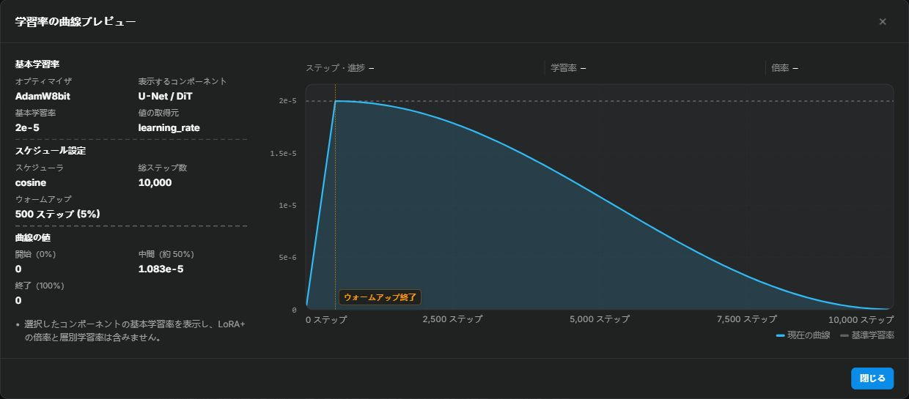

# オプティマイザの選び方と設定

## クイック選択

オプティマイザは勾配から学習対象の重みを更新し、収束速度、状態用の VRAM 使用量、更新の安定性を左右します。本ガイドは Anima、SDXL、MOSS-Image、Krea 2 の 4 つのモデル種別を対象とします。

- **初回の学習・基準作り**：`AdamW8bit` と各モデル種別の既定の学習率・スケジューラから始めます。
- **状態メモリ（VRAM）の節約**：まず `8bit` 版を使い、それでも収まらない場合は `PagedAdamW8bit` または二次統計を分解する `CAME` と比較します。
- **一時的な損失の急増・低精度重みの誤差対策**：データと学習率を固定し、[`StableAdamW`](#stableadamw-options) と比較します。
- **ステップ幅の手動調整を減らす**：[`Prodigy`](#prodigy-options) または [`ProdigyPlusScheduleFree`](#prodigyplus-options) を試し、強さは `d_coef` で調整します。

| 目的 | 比較候補 | 確認する指標 |
| --- | --- | --- |
| 汎用的な基準を作る | `AdamW8bit` | 各段階のチェックポイントの生成画像、ピーク VRAM、1 ステップの時間 |
| 状態用の VRAM を減らす | `AdamW8bit`、`CAME`。さらに厳しい場合は `PagedAdamW8bit` | ピーク VRAM と、ページング発生時のステップ時間の増加 |
| 更新の急増や低精度の丸め誤差を抑える | `StableAdamW` | 勾配ノルムの急増の有無と、複数チェックポイントの安定性 |
| ステップ幅の自動推定・外部スケジュール不要 | `Prodigy`、`ProdigyPlusScheduleFree`、`AdamWScheduleFree` | ログ上の `D` の推移と、対象の特徴が十分に現れる最初の保存時点 |
| 行列の直交化・部分空間プリコンディショニングを試す | `Muon`、`LoRA-Muon`、`LoRA-RITE`、`SOAP` | 初期の収束速度、1 ステップあたりの追加計算時間、過学習の始まり |

## 使用できるオプティマイザと開始学習率

下の表は、画面のドロップダウンと同じ 6 グループ順で全 22 種のオプティマイザ、各モデル種別の開始学習率（未編集の既定値にのみ自動適用）、および主な制約をまとめたものです。メモリの説明はオプティマイザ状態のみを指し、実際のピーク VRAM には解像度、Rank、バッチサイズ、キャッシュ、プレビュー生成も影響します。

**1. AdamW と保存方式の派生**

| オプティマイザ | 仕組みと用途 | Anima 開始 LR | 他のモデル種別の開始 LR | 主な制約・補足 |
| --- | --- | ---: | --- | --- |
| `AdamW8bit` | 通常の既定値。大きな状態テンソルを 8-bit 化し、小テンソルは FP32 で保持 | `2e-5` | SDXL / MOSS / Krea 2：`1e-4` | `amsgrad` 非対応。境界は [`min_8bit_size`](#min-8bit-size) で調整 |
| `AdamW` | 状態を量子化しない基準比較用 | `2e-5` | SDXL / MOSS / Krea 2：`1e-4` | FP32 状態のため 8-bit 版より VRAM が増える。[`fused`](#adamw-fused)・[`foreach`](#foreach) 対応 |
| `PagedAdamW8bit` | VRAM 不足時に 8-bit 状態をメインメモリへページング退避 | `2e-5` | SDXL / MOSS / Krea 2：`1e-4` | 更新計算は `AdamW8bit` と同一。退避発生時は CPU/GPU 転送が増える |

**2. 内部の安定化**

| オプティマイザ | 仕組みと用途 | Anima 開始 LR | 他のモデル種別の開始 LR | 主な制約・補足 |
| --- | --- | ---: | --- | --- |
| `StableAdamW` | AdamW に内部更新の RMS クリッピングと Kahan 補償加算を追加 | `2e-5` | SDXL / MOSS / Krea 2：`1e-4` | 状態 VRAM は `AdamW8bit` より多い。本ツールの既定 `weight_decay=0` |
| `CAME` | 行・列に分解した二次統計、残差信頼度スケーリング、内部 RMS クリッピング | `1.5e-5` | SDXL / MOSS：`1e-4`、Krea 2：`2e-4` | 3 つの beta を使用。省メモリ条件での `AdamW8bit` との比較に適する |

**3. 先読み差分・符号による更新**

| オプティマイザ | 仕組みと用途 | Anima 開始 LR | 他のモデル種別の開始 LR | 主な制約・補足 |
| --- | --- | ---: | --- | --- |
| `Adan` | 勾配と隣接ステップ間の勾配差分を併用する Nesterov モメンタム | `1e-5` | SDXL / MOSS：`5e-5`、Krea 2：`1e-4` | 3 つの beta を使用。実効更新幅が大きいため Anima は AdamW の半分から開始 |
| `Lion` / `Lion8bit` / `PagedLion8bit` | 一次モメンタムのみを保持する符号ベースの更新 | `5e-6` | SDXL / MOSS：`2e-5`、Krea 2：`1e-4` | 適正な学習率が AdamW の約 1/3〜1/10 と小さいため個別に調整する |

**4. 短期・長期の勾配履歴**

| オプティマイザ | 仕組みと用途 | Anima 開始 LR | 他のモデル種別の開始 LR | 主な制約・補足 |
| --- | --- | ---: | --- | --- |
| `AdEMAMix` / `AdEMAMix8bit` | 短期と長期の指数移動平均を重ね、直近の勾配と長期傾向を併用 | `2e-5` | SDXL / MOSS / Krea 2：`1e-4` | 3 つの beta を使用。立ち上げ期間が空欄なら推定総ステップ数を自動設定 |

**5. 内部の学習率推定・スケジュール**

| オプティマイザ | 仕組みと用途 | Anima 開始 LR | 他のモデル種別の開始 LR | 主な制約・補足 |
| --- | --- | ---: | --- | --- |
| `Prodigy` | D-adaptation でステップ幅の尺度 `D` を自動推定 | `1.0`（固定） | SDXL / MOSS / Krea 2：`1.0`（固定） | 全モデル種別で `learning_rate=1.0` に固定（倍率調整は [`d_coef`](#prodigy-options)）。既定スケジューラは `cosine` へ自動変更。[LoRA+](#loraplus) 非対応 |
| `ProdigyPlusScheduleFree` | `D` の自動推定と Schedule-Free 平均重みを統合 | `1.0`（固定） | SDXL / MOSS / Krea 2：`1.0`（固定） | `learning_rate=1.0` と外部スケジューラ `constant` に固定。内部補正が有効な間は `max_grad_norm=0` に固定。LoRA+ 非対応 |
| `AdamWScheduleFree` | 重みの移動平均で外部の減衰スケジュールを代替する AdamW | `1e-4` | SDXL / MOSS：`3e-4`、Krea 2：`0.0025` | 外部スケジューラは `constant` に固定。ウォームアップは内部の [`warmup_steps`](#schedulefree-warmup) で設定 |
| `AdaFactor` | 分解状態でメモリを節約し、既定では更新回数から相対ステップ幅を計算 | 自動管理（手動 `2e-5`） | SDXL / MOSS / Krea 2：自動管理（手動 `1e-4`） | `max_grad_norm=0` に固定。手動 LR・外部スケジューラ・LoRA+ を使うには `relative_step` と `warmup_init` を両方オフにする |
| `Automagic3` / `Automagic4` | 更新符号の一致率からグループ学習率を自動調整。v4 は高感度要素の更新も縮小 | `2e-5` | SDXL / MOSS / Krea 2：`2e-5` | 実験段階。外部スケジューラは `constant` 固定、学習重みは FP32 維持。`fused=True` は GPU 1 枚・累積 `1`・`max_grad_norm=0`・`fp16` 無効が必須 |
| `EmoSens` | 損失の推移から全体の学習率を自動調整し、収束目安を通知 | `0.1` | MOSS / Krea 2：`0.1`、SDXL：`1.0` | 実験段階。GPU 1 枚・勾配累積 `1`・`fp16` 無効が必須。外部スケジューラは `constant` 固定。個別 LR と LoRA+ 非対応 |

**6. 行列構造を使う更新**

| オプティマイザ | 仕組みと用途 | Anima 開始 LR | 他のモデル種別の開始 LR | 主な制約・補足 |
| --- | --- | ---: | --- | --- |
| `Muon` | 2 次元行列のモメンタムを Newton-Schulz 反復で直交化 | `2e-5` | MOSS / Krea 2：`1e-4`（SDXL 非対応） | 2 次元パラメータ専用。LyCORIS では `use_scalar` と `train_norm` をオフにする |
| `LoRA-Muon` | `lora_down` / `lora_up` をペアにして低ランク多様体上でスペクトル更新 | `0.02` | Krea 2：`0.1`（SDXL / MOSS 非対応） | Anima ネイティブ LoRA、Krea 2 ネイティブ LoRA、**Krea 2 の LoCon**（`use_scalar` と DoRA オフ）のみ対応。LoRA+ 非対応 |
| `LoRA-RITE` | 等価な A/B 因子表現の尺度差を打ち消す低ランクプリコンディショニング | `1e-4` | Krea 2：`1e-4`（SDXL / MOSS 非対応） | 対応ネットワークは `LoRA-Muon` と同じ。内部クリッピングを使い `max_grad_norm=0` に固定。LoRA+ 非対応 |
| `SOAP` | 勾配共分散の固有基底で回転した座標系で Adam 型更新を実行 | `2e-5` | SDXL / MOSS / Krea 2：`1e-4` | プリコンディショナの行列でメモリと計算が増加。本ツールは対象軸の上限を `256`、`weight_decay=0` に設定 |

> **主要な 3 方式の使い分け**：基本は `AdamW8bit` を使います。状態メモリが厳しい場合は `CAME`、更新の急増や `full_bf16` の丸め誤差が問題になる場合は同じ学習率で `StableAdamW` と比較してください。詳細は[共通パラメータ](#parameters)と[専用パラメータ](#specific-options)を参照してください。

## 共通パラメータと学習率スケジュール

### 学習率（learning_rate）

学習率が低すぎると顔立ちや衣装の特徴が十分に定着せず、高すぎると損失の発散、色飽和、早い段階でのポーズ・背景の固定化が起きます。オプティマイザやネットワーク倍率を変えたら[上表の開始値](#optimizer-type)から始め、プロンプトとシードを揃えて複数のチェックポイントを比較してください。

- **コンポーネント別の学習率**：`unet_lr`（DiT / U-Net）と `text_encoder_lr` は空欄なら `learning_rate` を使い、入力すると該当グループを上書きします。Krea 2 の重み減衰・`betas`・`eps` は対応する `krea_*` 欄で設定します。
- **`network_alpha / network_dim` との関係**：この比率は順伝播の LoRA 倍率を決めます。MOSS-Image の既定は `rank=16, alpha=1`（`1e-4`）、Anima と Krea 2 は `rank=32, alpha=32`（倍率 `1.0`）です。上流の `alpha=1` 設定を `alpha=dim` へ移す場合は学習率を下げて再調整してください。
- **Lion の重み減衰**：Lion の開始学習率は AdamW の約 1/3〜1/10 です。本ツールは既定の `weight_decay=0` を維持しますが、元論文の設定を再現する場合は `weight_decay` を約 3〜10 倍に引き上げてください。

### 学習率スケジューラとウォームアップ（lr_scheduler / lr_warmup_steps）

新規設定の既定スケジューラは、SDXL が `cosine_with_restarts`、Anima・MOSS-Image・Krea 2 が `constant` です。ウォームアップを試す場合は `constant_with_warmup` または `cosine` を使い、最初は総更新ステップ数の `5%` 以内に抑えます（Krea 2 と `warmup_stable_decay` では `[0, 1)` の割合指定も可能です）。

**オプティマイザによるスケジュール固定と自動切り替え：**

- **外部スケジューラが `constant`・ウォームアップ `0` に固定される方式**：`AdamWScheduleFree`、`ProdigyPlusScheduleFree`、`Automagic3`、`Automagic4`、`EmoSens`、および `relative_step=True` の `AdaFactor`。
- **Prodigy の推奨スケジュール**：`Prodigy` を選ぶと、未編集のスケジューラは自動で `cosine` に切り替わります。`cosine_with_restarts` は再スタートが `D` の推定を乱すため避けてください。sd-scripts で外部ウォームアップを設定すると `safeguard_warmup=True` が自動で有効になります。

| スケジューラ | 曲線の特徴と使いどころ | 専用項目・注意点 |
| --- | --- | --- |
| `constant` / `constant_with_warmup` | 学習率を一定に維持。短時間の学習でこまめに保存し最良のエポックを選ぶ運用向き | Krea 2 の `constant` はウォームアップ不可。必要な場合は `constant_with_warmup` を選択 |
| `cosine` | ウォームアップ後、余弦曲線で `0` まで滑らかに減衰。総ステップ数が決まっており終盤を落ち着かせたい場合の定番 | 追加項目なし |
| `cosine_with_min_lr` | 下限を維持する余弦減衰。終盤の学習停止を防ぎたい場合に使用 | `lr_scheduler_min_lr_ratio`（下限比 `0〜1`）、`lr_scheduler_num_cycles` |
| `cosine_with_restarts` | `lr_scheduler_num_cycles` 回に分けて周期的に再スタート（`1` は通常の余弦減衰と同じ） | 再スタート時に学習率が跳ね上がるため自動ステップ幅方式には不向き |
| `warmup_stable_decay`（WSD） | ウォームアップ → 一定区間 → 終盤減衰。中盤の学習速度と終盤の収束を両立 | `lr_warmup_steps` と `lr_decay_steps` の合計は総ステップ数以内。`warmup_type`（既定 `linear`）・`decay_type`（既定 `cosine`）とも `linear` / `cosine` / `1-sqrt` に対応。`lr_scheduler_min_lr_ratio` が始点と終点を決定 |
| `piecewise_constant` | 指定した累積ステップごとに倍率を段階切り替え | `step_rules` に `倍率:終了ステップ,...,最終倍率` を入力（例：`1:1000,0.5:1600,0.1`）。`lr_warmup_steps` は `0` 固定 |
| `linear` / `polynomial` | 直線またはべき乗曲線で減衰（sd-scripts の `polynomial` 終点は `1e-7`） | `lr_scheduler_power` で指数を指定（既定 `1.0`） |
| `inverse_sqrt` | `1 / √(1 + Δstep / timescale)` で緩やかに減衰。長時間の微調整向き | `lr_scheduler_timescale` の既定値は `10000` |
| `rex`（Krea 2 専用） | 下限から基本値へウォームアップ後、REX 逆数曲線で終盤にかけて下限へ収束 | `lr_scheduler_min_lr_ratio` 空欄時は `0.01`（基本値の 1%）。総ステップ数の確定が必要 |

スケジューラ欄の下にある **学習率の曲線を表示** を押すと、ウォームアップ範囲や開始・中間・終了時点の学習率を確認できます。DiT とテキストエンコーダを併用する場合や Krea 2 の LoRA+ 有効時は、サイドバーで対象を切り替えて比較できます。

### 勾配クリッピングのしきい値（max_grad_norm）

画面の項目名は **勾配クリッピングのしきい値** です。通常のオプティマイザは既定値 `1.0`（全体の L2 ノルムで突発的な大勾配を制限）を使い、`0` で無効にします。正のしきい値を下げすぎると通常の更新まで抑えられます。

**オプティマイザ別の固定・初期値規則：**

- **`0` に読み取り専用固定**（内部クリッピングとの二重適用を防止）：`AdaFactor`、`LoRA-RITE`、および内部補正（既定の `use_stableadamw=True` または `eps=None`）が有効な `ProdigyPlusScheduleFree`。また `Automagic` の `fused=True` 使用時も `0` が必須です。
- **未編集時に自動で `0` を設定**（手動変更は可能）：`Prodigy`（外部クリッピングが `D` 推定を抑える場合があるため）および Anima / Krea 2 の `LoRA-Muon`。
- **通常どおり有効**：`AdamW` 系、`StableAdamW`、`CAME`、`Lion` 系、`Adan`、`AdEMAMix`、`AdamWScheduleFree`、`SOAP`、`EmoSens`、および `fused=False` の `Automagic`。

### 重み減衰（weight_decay）

学習対象の重みが過大になるのを抑えます。強すぎると特徴の学習を妨げ、`0` で無効になります。本ツールの開始値は次の 2 通りです。

- **既定 `0.01`**：`AdamW`、`AdamW8bit`、`PagedAdamW8bit`、`Adan`、`AdEMAMix`、`AdEMAMix8bit`、`EmoSens`。
- **既定 `0`**：`StableAdamW`、`CAME`、`Lion` 系、`Prodigy`、`ProdigyPlusScheduleFree`、`AdamWScheduleFree`、`AdaFactor`、`Automagic3/4`、`Muon`（PyTorch 既定の `0.1` を上書き）、`LoRA-Muon`、`LoRA-RITE`、`SOAP`（ライブラリ既定の `0.01` を上書き）。

キャラクター LoRA はまず既定値で試し、オプティマイザ単体の差を比較する際は `weight_decay` を同じ値に揃えてください。

### モメンタム係数（betas）

勾配統計の移動平均期間を決めます。`1` に近いほど過去の履歴を長く残して反応が穏やかになり、下げると直近の勾配に素早く追従します。特別な理由がなければ既定値のまま使用します。

| オプティマイザ | 既定の `betas` | 各係数が制御する統計 |
| --- | --- | --- |
| `AdamW` 系、`Prodigy`、`AdamWScheduleFree`、`LoRA-RITE` | `0.9, 0.999` | 一次勾配平均、二次二乗勾配平均 |
| `StableAdamW`、`Lion` 系、`ProdigyPlusScheduleFree` | `0.9, 0.99` | Lion は更新補間と EMA の 2 係数、他は一次・二次モーメント |
| `EmoSens` | `0.9, 0.995` | 一次・二次勾配統計 |
| `SOAP` | `0.95, 0.95` | 回転空間の一次・二次統計（`shampoo_beta` 空欄時は第 2 値がプリコンディショナの EMA も兼務） |
| `Adan` | `0.98, 0.92, 0.99` | 勾配平均、隣接ステップ勾配差の平均、先読み二乗統計 |
| `CAME`、`AdEMAMix` 系 | `0.9, 0.999, 0.9999` | CAME：一次・分解二次・残差信頼度。AdEMAMix：短期平均・二次統計・長期平均 |

### 数値安定化項（eps）

極小の分母によるゼロ除算や異常な増幅を防ぎます。再現する数値異常を調べる場合以外は既定値を維持してください。

- **既定 `1e-8`**：`AdamW` 系、`StableAdamW`、`Prodigy`、`ProdigyPlusScheduleFree`、`AdamWScheduleFree`、`EmoSens`、`Adan`、`AdEMAMix` 系、`SOAP`。
- **固有の既定値・仕様**：`Muon` は `1e-7`、`LoRA-RITE` は `1e-6`（内部で二乗して適用）、`Automagic3/4` は `1e-30` です。`ProdigyPlusScheduleFree` では `None` を入力すると尺度不変の Adam-atan2 更新へ切り替わります（`max_grad_norm=0` に固定）。`AdaFactor` と `CAME` は専用欄を使います。

### 8-bit 化する最小テンソルサイズ（min_8bit_size）

`AdamW8bit`、`PagedAdamW8bit`、`Lion8bit`、`PagedLion8bit` で使用します（既定 `4096`）。要素数が `4096` 未満の小テンソルは FP32 状態を維持し、それ以上を 8-bit 量子化します。低ランク学習で小テンソルの丸め誤差を疑う場合は `16384` と比較できます。

### テンソルの一括更新（foreach）

`AdamW`、`StableAdamW`、`CAME`、`Adan`、`AdamWScheduleFree`、および Krea 2 の `Lion` で使用できます。

- **自動**（`auto`、既定）：各オプティマイザの本来の既定動作に従います。
- **有効**（`true`）：複数テンソルをまとめて処理し GPU カーネル呼び出しを減らします。高速化しやすい反面、更新時のピーク VRAM がわずかに増えます。
- **無効**（`false`）：テンソルを 1 つずつ更新してピーク VRAM を抑えます。`AdamW` の `fused=True` とは併用できません。

### AdamW の融合更新（fused）

`AdamW` 専用です。**有効**（`true`）は融合カーネルで更新処理をまとめますが、`foreach=True` や `differentiable=True` とは併用できません（画面で競合を自動防止します）。**自動**（`auto`）は PyTorch の既定選択とカスタム引数の指定を保持します。

### LoRA+ との互換性

**`Prodigy`、`ProdigyPlusScheduleFree`、`EmoSens`、`LoRA-RITE`、`LoRA-Muon`** を除く各オプティマイザで LoRA+ を併用できます（上記 5 方式ではグループ別倍率が全体ステップ推定や A/B ペア前提と競合するため、自動で無効・固定されます）。

- `AdaFactor` で使う場合は [`relative_step` と `warmup_init`](#adafactor-options) を両方オフにします。
- `Automagic3 / Automagic4` では倍率適用後の開始学習率も `[min_lr, max_lr]` 内に収める必要があります。推奨倍率は [LoRA+ ガイド](lora-plus.ja-JP.md#optimizer-compatibility)を参照してください。

## オプティマイザ別の専用パラメータ

### StableAdamW 専用設定

- **Kahan 補償加算**（`kahan_sum`、既定でオン）：低精度の重み更新で生じる丸め誤差を補います。主に `full_bf16` 有効時（LoRA 重み自体が BF16 の場合）に効果を発揮します（`mixed_precision=bf16` のみなら LoRA 重みは FP32 です）。
- **分離型重み減衰**（`weight_decouple`、既定でオン）：AdamW 形式の分離減衰を行います。既定のまま維持してください。

### CAME の設定

- **内部クリッピングしきい値**（`clip_threshold`、既定 `1.0`）：全体の `max_grad_norm` とは別に内部更新の RMS を制限します。急増が続く場合に値を下げて制限を強めます。
- **減衰・安定化項目**：`weight_decouple`（オン）、`fixed_decay`（オフ）、`ams_bound`（オフ）、`eps1`（`1e-30`）、`eps2`（`1e-16`）は通常既定値のまま使います。

### Adan の設定

現在の勾配と隣接ステップ間の勾配差を組み合わせて更新するため、AdamW より実効ステップ幅が大きくなります。Anima は `1e-5`、SDXL / MOSS-Image は `5e-5`、Krea 2 は `1e-4` から開始します。`weight_decouple` は既定でオンです。Adan 内部の `max_grad_norm` 引数は `0` に保たれ、クリッピングは画面の[勾配クリッピングのしきい値](#gradient-clipping)が一括管理します。

### AdEMAMix の設定

短期移動平均（`β1=0.9`）と長期移動平均（`β3=0.9999`）を保持し、混合係数 `alpha` で長期成分を更新へ加えます（ネットワークの Alpha とは無関係です）。

| パラメータ | 既定値 | 役割と調整の目安 |
| --- | --- | --- |
| `alpha` | `5.0` | 長期モメンタムの混合倍率。大きくすると長期傾向を強め、`0` で長期項を除外 |
| `t_alpha` | 空欄（推定総ステップ数を自動適用） | `alpha` を `0` から目標値まで立ち上げるステップ数。`0` で最初から最大値を適用 |
| `t_beta3` | 空欄（推定総ステップ数を自動適用） | 長期減衰率を `β1` から `β3` へ移行するステップ数。短期学習で効きが遅い場合に短縮 |

`AdEMAMix8bit` は `4096` 要素以上のテンソルの 3 状態を 8-bit 化して VRAM を削減します。学習率の尺度は通常版と同じです。

### Prodigy の設定

学習中にステップ幅の尺度 `D` を推定します。**sd-scripts と Krea 2 のすべてのモデル種別で `learning_rate`（およびコンポーネント別 LR）は `1.0` に読み取り専用固定されるため**、自動ステップ幅の強弱は `d_coef` で調整します。

- **`d_coef`**（既定 `1.0`）：推定ステップ幅への倍率です。学習が遅い場合は `1.2〜2.0`、早期の過学習や発散が出る場合は `0.5〜0.8` を比較します。
- **`d0`**（既定 `1e-6`）：`D` 推定の初期値です。通常は変更不要で、ログで `D` の上昇を確認できます。
- **`safeguard_warmup`**（sd-scripts のみ、既定オフ）：ウォームアップ中の過大な `D` 上昇を防ぎます。`lr_warmup_steps > 0` のときは自動でオンになります。

### ProdigyPlusScheduleFree の設定

`Prodigy` のステップ幅推定と Schedule-Free の平均重み（評価・保存時に自動使用）を組み合わせた方式で、`learning_rate=1.0` と外部スケジューラ `constant` に固定されます。

**主に調整する項目：**

- **`d_coef`**（既定 `1.0`）・**`d0`**（既定 `1e-6`）：`Prodigy` と同じです。更新幅の調整は `d_coef` を優先します。
- **`schedulefree_c`**（既定 `0`）：`0` は標準の累積平均、正の整数はウィンドウ平均を使い、大きいほど最近の更新を早く保存重みへ反映します。
- **`prodigy_steps`**（既定 `0`）：指定ステップ到達後に `D` を固定して推定バッファを解放します（`0` は最後まで推定）。
- **`d_limiter`**（既定オン）：`d_coef=1` のとき 1 ステップあたりの `D` 増加を最大約 `19%` に抑えます。

**問題切り分け・実験用の項目（通常は既定値のままで構いません）：**

| パラメータ | 既定 | 変更する場面 |
| --- | --- | --- |
| `use_stableadamw`（画面表示は `prodigyplus_use_stableadamw`） | オン | 更新 RMS を制限し `max_grad_norm=0` に固定。ステップ幅の異常を調べる際のみオフと比較 |
| `factored` / `factored_fp32` | オン / オン | 二次統計を行・列へ分解し FP32 で保持して省メモリ化。NaN や `D` の停滞時は `factored` オフと比較 |
| `split_groups` / `split_groups_mean` | オン / オフ | 既定では DiT とテキストエンコーダなどグループ別に `D` を推定。`split_groups_mean` オンで調和平均を共有 |
| `weight_decay_by_lr` | オン | 減衰係数に自動ステップ幅を乗算。切り替えた場合は `weight_decay` を再確認 |
| `use_bias_correction` | オフ | RAdam 型のバイアス補正と自動ウォームアップ。`D` の伸びが止まる場合はオフへ戻す |
| `use_speed` / `use_cautious` / `use_orthograd` | オフ | 実験項目：SPEED 推定（非ゼロ減衰時は上流警告あり）、同方向マスク、重み直交勾配投影 |

BF16 重みへの確率的丸めはライブラリの既定動作に従います。`use_grams`、`use_adopt`、`use_focus`、`beta3` はカスタム `optimizer_args` で指定できます（`fused_back_pass` は非対応）。

### AdamWScheduleFree のウォームアップ（warmup_steps）

外部の `lr_warmup_steps` は使われず、専用の `warmup_steps`（`schedulefree_warmup_steps` / `krea_schedulefree_warmup_steps`、既定 `0`）で内部ウォームアップを指定します。初期ステップが不安定な場合は総ステップ数の `3%〜5%` を試してください。

### AdaFactor の設定

二次統計を行・列分解して状態メモリを最小化し、既定では自動相対ステップで動作します（`max_grad_norm` は常に `0` 固定で、内部の `clip_threshold` を使用）。

- **自動相対ステップ**（既定：`relative_step=True`、`scale_parameter=True`、`warmup_init=False`）：更新回数とパラメータ RMS からステップ幅を算出するため、入力した `learning_rate` と外部スケジューラは更新に使われません。
- **手動学習率モード**：**`relative_step` と `warmup_init` を両方オフ**にすると（`relative_step` オフ時に `scale_parameter` と `warmup_init` も連動オフ）、手動の学習率（Anima `2e-5`、他 `1e-4`）・外部スケジューラ・LoRA+ が利用可能になります。
- **`clip_threshold`**（`1.0`）・**`eps`**（`1e-30, 1e-3`）：既定値のまま使用します。

### Automagic3 / Automagic4 のパラメータ

AI Toolkit 由来の実験的な適応オプティマイザです（[Automagic3](https://github.com/ostris/ai-toolkit/blob/c2864bba48a6f94ab1171d9df47b1335f8306355/toolkit/optimizers/automagic3.py) / [Automagic4](https://github.com/ostris/ai-toolkit/blob/534d462ff622e334e1a65b42884d96d98315d75a/toolkit/optimizers/automagic4.py)）。直近の更新方向が揃えばグループ学習率を上げ、反転が続けば下げます。Automagic4 はさらに二乗勾配から要素ごとの感度を推定して高感度要素の更新を抑えます（1 ステップ目は統計測定のみ、2 ステップ目から重みを更新）。

| パラメータ | 初期値 | 許容範囲 | 役割と調整の目安 |
| --- | ---: | --- | --- |
| `learning_rate` | `2e-5` | `[min_lr, max_lr]` 内の正数 | 新規学習の開始学習率（個別 LR や LoRA+ 倍率適用後の値も上下限内に収める） |
| `min_lr` / `max_lr` | `1e-8` / `2e-4` | `0 < min_lr ≤ max_lr` | 自動調整の下限・上限。TensorBoard 曲線が `max_lr` に張り付き学習不足なら上限を引き上げ |
| `polarity_history` | `8` | 整数 `2〜64` | 方向一致の集計に使う直近更新回数。増やすと滑らかになるが VRAM 使用量が増加 |
| `clip_threshold` | `1.0` | `> 0` | 内部 RMS・要素別クリッピングのしきい値。小さいほど強く制限 |
| `sensitivity_quantile` | `0.9` | v4 のみ。`(0, 1]` | グループ感度の基準分位数。下げるとより多くの高感度要素の更新を縮小 |
| `step_target` | `0.1` | v4 のみ。`(0, 2)` | 方向反転率の中立点。上げるほど学習率が上昇しやすくなる |
| `fused` | `False` | 真偽値 | 逆伝播中に勾配が確定した順で即座に重みを更新し、勾配メモリを解放 |
| `beta2` / `eps` / `weight_decay` | `0.999` / `1e-30` / `0` | 通常範囲 | 二乗勾配の平滑化、ゼロ除算防止、重み減衰 |

**実行・再開時の制約**：外部スケジューラは `constant` 固定で、学習対象パラメータは FP32 で保持されます（`full_bf16` は自動オフ、BF16 混合精度計算は利用可）。`fused=True` には **GPU 1 枚、勾配累積 `1`、`max_grad_norm=0`、`mixed_precision` が `bf16` または `no`** であることが必要です。状態付き再開では保存された適応学習率と符号履歴を引き継ぎます。

### EmoSens v3.9.3 の設定

損失の変化から全体の学習率を自動調整します（[上流ガイド](https://github.com/muooon/EmoSens) / [v3.9.3 実装](https://github.com/muooon/EmoSens/blob/e2c7bb3293baeb339a2d4a21f21ccbdc0260d3be/optimizer/emosens.py)）。`learning_rate` には倍率を指定し、**Transformer / DiT LoRA（Anima、MOSS-Image、Krea 2）は `0.1`**（自動上限 `3e-4`）、**U-Net LoRA（SDXL）は `1.0`**（自動上限 `3e-3`、`1.0` 超でも上限は `3e-3`）から始めます。

- **`stopcoef`**（既定 `0.04`）：収束通知のしきい値。学習が落ち着き直近の平均損失が `stopcoef` 以下になると通知します（`0` で無効）。
- **`notify`**（既定オン）：条件達成時にログへ `[READY TO STOP]` を出力します。前後のチェックポイントを比較して停止時期を判断してください。
- **`use_shadow`**（既定オフ）：重みの予備コピーを保持し損失急変時に混合します（VRAM 使用量が増加）。
- **制約**：**GPU 1 枚、勾配累積 `1` 固定、混合精度は `bf16` または `no`** が必須です。外部スケジューラは `constant` 固定で、全パラメータに共通の学習率を使うため個別 LR（`unet_lr` / `text_encoder_lr`）や LoRA+ は効きません。再開時は元の倍率・`notify`・`use_shadow` を維持してください。

### Muon の設定

2 次元行列の一次モメンタムを Newton-Schulz 多項式反復で近似直交化し、`lora_down` と `lora_up` を個別に更新します。状態は 1 組で済みますが、各ステップで行列積が増えます。**Anima、MOSS-Image、Krea 2** に対応します（4 次元畳み込みを含む SDXL は非対応）。

- **2 次元パラメータ制約**：`lycoris.kohya` では 1 次元係数や正規化重みを追加する `use_scalar` と `train_norm` を必ずオフにしてください。
- **尺度補正と減衰**：既定の `adjust_lr_fn=match_rms_adamw` が行列サイズに応じて更新 RMS を AdamW 相当へ揃えるため、Anima `2e-5`、MOSS / Krea 2 `1e-4` からそのまま比較できます（`original` へ変えた場合は学習率の再探索が必要）。`weight_decay` は既定 `0` です。
- **モメンタムと反復**：`momentum=0.95`（`[0, 1)`）、`nesterov=True`、`ns_steps=5`、`ns_coefficients=3.4445, -4.775, 2.0315`、`eps=1e-7`。通常は反復設定を変えず、学習率または減衰のみを調整します。

### LoRA-Muon の設定

通常の Muon は `lora_down` と `lora_up` を別々に更新するため、両因子の大きさの偏りに影響されます。LoRA-Muon は同じ層の `down/up` をペアとして扱い、相手側因子の Gram 逆平方根で方向ごとの尺度を揃えてから直交化更新を行います。初期の特徴立ち上がりや因子バランスを `AdamW8bit` / `Muon` と比較したい場合に適しています。

**調整の目安と過学習の兆候**：Anima は `0.02`、Krea 2 は `0.1` から開始します（`unet_lr` に入力がある場合は本体グループで優先されるため確認してください）。数百ステップ以内に損失が激しく跳ねる、学習画像のポーズがすぐ固定される、色が飽和する場合は学習率が高すぎるため `0.5` 倍刻みで下げます。`network_alpha / network_dim` の比率を変えた場合も再調整が必要です。

| パラメータ | 既定値 | 許容範囲 | 役割と推奨 |
| --- | ---: | --- | --- |
| `learning_rate` / `weight_decay` | Anima `0.02`、Krea 2 `0.1` / `0` | `≥ 0`、かつ `lr × wd < 1` | 合成重みの更新幅と論文の分割型減衰。まず `learning_rate` のみ調整し、`max_grad_norm` は `0` 推奨 |
| `momentum` | `0.9` | `0 ≤ m < 1` | 勾配の一次指数移動平均係数 |
| `ns_steps` / `inv_sqrt_steps` | `8` / `7` | 整数 `1〜8` / `1〜7` | 行列符号と Gram 逆平方根の反復回数。通常は既定値を維持 |
| `msign_eps` / `inv_sqrt_eps` / `inv_sqrt_gamma` | `1e-20` / `1e-5` / `1.001` | `≥ 0` / `≥ 0` / `> 0` | 正規化下限、Gram 正則化下限、逆平方根の減衰係数 |
| `gauge_rebalance`（`alpha` / `interval` / `power_steps`） | `False`（`1.0` / `1` / `2`） | 切り替えと詳細 | 定期的に `down/up` のスペクトルノルムを均等化。長期学習で因子の偏りを検証する場合に有効化 |

**対応範囲と制約**：**Anima の `networks.lora_anima`、Krea 2 の `networks.lora_krea2`、および Krea 2 の `lycoris.kohya` LoCon（`use_scalar` と DoRA オフ）**のみ対応します。Anima の LoCon、SDXL、MOSS-Image、LoHa/LoKr、[LoRA+](#loraplus) は非対応です。内部の行列演算とモメンタム状態は自動で FP32 を維持し、通常の外部スケジューラが使えます。

### LoRA-RITE の設定

因子のスケールを除いた勾配と低ランク行列のプリコンディショニングにより、等価な A/B 因子表現によらず一貫した更新を行います。対応範囲は `LoRA-Muon` と同じく **Anima ネイティブ LoRA、Krea 2 ネイティブ LoRA、Krea 2 の LoCon（`use_scalar` と DoRA オフ）**で、LoRA+ は非対応です。

- **学習率**：Anima・Krea 2 とも `1e-4` から始め、`5e-5〜2e-4` の範囲でチェックポイントを比較します。
- **`clip_unmagnified_grad`**（既定 `1.0`）：スケール除去後の内部勾配ノルムを制限します（`0` で無効）。画面の `max_grad_norm` は自動で `0` に固定されます。
- **`betas`**（`0.9, 0.999`）・**`eps`**（`1e-6`、内部で二乗して使用）：既定値のまま使います。

### SOAP の設定

一定ステップごとに勾配方向の共分散から固有基底（プリコンディショナ）を更新し、回転した座標系で Adam 型の更新を行って元の空間へ戻します（1 ステップ目にプリコンディショニング状態を作成し、2 ステップ目から重みを更新）。Anima は `2e-5`、他のモデル種別は `1e-4` から始めます（ライブラリ既定の `3e-3` はモデル全体学習向けのため流用しないでください）。

| パラメータ | 既定値 | 役割とメモリ・計算量のトレードオフ |
| --- | --- | --- |
| `max_precondition_dim` | `256` | 行列プリコンディショニングを行う軸の最大長（ライブラリ既定 `10000` を上書き）。上限を超える軸は要素別スケーリングのみを行う。FP32 では 512 次元軸で約 2 MiB、1024 次元軸で約 8 MiB を消費 |
| `precondition_frequency` | `10` | 回転基底を再計算するステップ間隔。大きくすると計算が軽くなり、小さくすると勾配変化へ早く追従 |
| `shampoo_beta` | 空欄（第 2 beta を使用） | プリコンディショナ統計の移動平均係数。既定 `betas=(0.95, 0.95)` |
| `normalize_gradient` / `correct_bias` / `precondition_1d` | オフ / オン / オフ | 更新全体の RMS 正規化、ゼロ初期化バイアス補正、上限内の 1 次元パラメータ（`train_norm` など）へのプリコンディショニング |

本ツールの `weight_decay` 既定値は `0`（ライブラリの `0.01` を明示的に上書き）で、全体の `max_grad_norm` は通常どおり機能します。

## 症状別の対処と比較手順

| 症状 | 先に確認する点（データ・基本設定） | オプティマイザ・学習率の調整 |
| --- | --- | --- |
| 1〜5 枚の少数画像でポーズや背景がすぐ固定される | 同じ構図の重複割合、キャプションでのポーズ・背景の記述 | `AdamW8bit` で学習率を下げ（例：Anima `1e-5〜1.5e-5`）、保存間隔を短くして早い段階のモデルを選ぶ |
| 損失は安定しているのに特徴が弱い・反応が鈍い | トリガーワード、キャプション、プレビュー条件、有効ステップ数 | データと範囲を確認したうえで、学習率を `1.5〜2` 倍刻みで少し上げるかステップ数を延ばす |
| 画質のばらつきで一時的な損失・勾配の急増が再現する | 該当バッチのぼけ画像、極端な縦横比、ノイズの多いキャプション | 問題画像を整理したうえで [`StableAdamW`](#stableadamw-options) と比較するか、`max_grad_norm` を調整 |
| `NaN / Inf` が発生する | 学習率の桁間違い、精度設定、破損画像、不正な再開状態 | 先に原因を取り除く。継続的な数値発散をクリッピングだけで隠さない |
| 状態メモリで VRAM 不足になる | 解像度、バッチサイズ、キャッシュ、プレビューの消費量 | 全精度から `AdamW8bit` / `CAME` へ変更し、さらに厳しい場合は `PagedAdamW8bit` や `AdaFactor` を試す |

**条件を揃えた比較（A/B）の要点**：共通手順は[タイムステップガイドの比較手順](timesteps.ja-JP.md#comparison-method)を参照してください。オプティマイザを比較する際は同じベースモデルから各状態を新規に初期化し、データセット、キャプション、実効バッチサイズ（`バッチサイズ × 勾配累積 × GPU 数`）、総更新ステップ数、生成シードを揃えます。更新尺度が異なる方式（`AdamW8bit` と `Lion` / `LoRA-Muon` / `Prodigy` など）は、それぞれ適正な学習率を見つけてから同じ学習予算で最良のチェックポイントを比較します。

## よくある質問

**モデル種別やオプティマイザを切り替えると、学習率が自動で変わるのはなぜですか？**

現在の値が既定値または前回の自動推奨値のままになっている場合にのみ、切り替え先の推奨開始値へ自動更新されます。手動で入力した値や読み込んだ設定値は保持されます。ただし `Prodigy` と `ProdigyPlusScheduleFree` は例外で、すべてのモデル種別で `1.0` に固定されます。

**Anima・SDXL・MOSS-Image・Krea 2 のすべてで Prodigy の学習率が `1.0` に固定されるのはなぜですか？**

`Prodigy` は D-adaptation でステップ幅を自動推定し、`learning_rate` を基準倍率としてのみ扱います。`1e-4` のような通常の学習率がそのまま残って学習が進まなくなるのを防ぐため、本ツールは sd-scripts と Krea 2 の両経路で `1.0` に固定しています。自動ステップ幅の強さは [`d_coef`](#prodigy-options) で調整してください。

**生成された設定で `StableAdamW` と `SOAP` の `weight_decay` が `0` になるのはなぜですか？**

どちらもパッケージ側の既定値は `0.01` ですが、本ツールでは LoRA の基準に合わせて明示的に `0` を出力します。`AdamW8bit`（既定 `0.01`）と純粋な更新則の差だけを比較したい場合は、両方の `weight_decay` を同じ値に揃えてください。

## 実装と参考資料

既定値、自動推奨規則、引数契約は `backend/training/fields/optimizer_metadata.py`、`backend/training/config/optimizer_contracts.py`、`backend/training/fields/field_registry.py`、`backend/training/fields/krea2_fields.py` に定義されています。`LoRA-Muon` の出典は `vendor/lora_muon/SOURCE.md` を参照してください。主な上流実装と論文：

- [Anima 公式モデルカード](https://huggingface.co/circlestone-labs/Anima/blob/f7382c4bf9d7ffe4ceea593a0adbb470c56dd79b/README.md) · [sd-scripts Anima 学習ガイド](https://github.com/kohya-ss/sd-scripts/blob/37a1cbbc5725ed2a3575506e7bd2001c9908ac92/docs/anima_train_network.md)
- [pytorch-optimizer 実装](https://github.com/kozistr/pytorch_optimizer/tree/3d08fa02cb6617d4d12365ca0f7d643b72e8cbe8) · [bitsandbytes 実装](https://github.com/bitsandbytes-foundation/bitsandbytes/tree/a2b90e6eae31a958e6b4d85edf2cfb2b91e9ce29) · [Transformers スケジューラ実装](https://github.com/huggingface/transformers/blob/71c6f699ac9b3f8fc42a6a3e9dc59034c349a678/src/transformers/optimization.py)
- [CAME 論文](https://arxiv.org/abs/2307.02047)・[公式実装](https://github.com/yangluo7/CAME/tree/e77c5c022eaf71f1efb82a1433032cdcd5c52610) · [Lion 論文](https://arxiv.org/abs/2302.06675)・[公式実装](https://github.com/google/automl/tree/6a54c8741e7c3265d4547c4f35f47a0391122dc5/lion)
- [Prodigy 論文](https://arxiv.org/abs/2306.06101) · [Schedule-Free 論文](https://arxiv.org/abs/2405.15682)・[公式実装](https://github.com/facebookresearch/schedule_free/tree/70785b53e778d0e872c0bbb75ff4ee54ee10c291)
- [Adan 論文](https://arxiv.org/abs/2208.06677) · [AdEMAMix 論文](https://arxiv.org/abs/2409.03137) · [LoRA+ 論文](https://arxiv.org/abs/2402.12354)
- [LoRA-RITE 論文](https://arxiv.org/abs/2410.20625)・[公式実装](https://github.com/gkevinyen5418/LoRA-RITE/tree/d4186b6fedb39300d23c00ce0334db09719da9fc) · [LoRA-Muon 論文](https://arxiv.org/abs/2606.12921)
