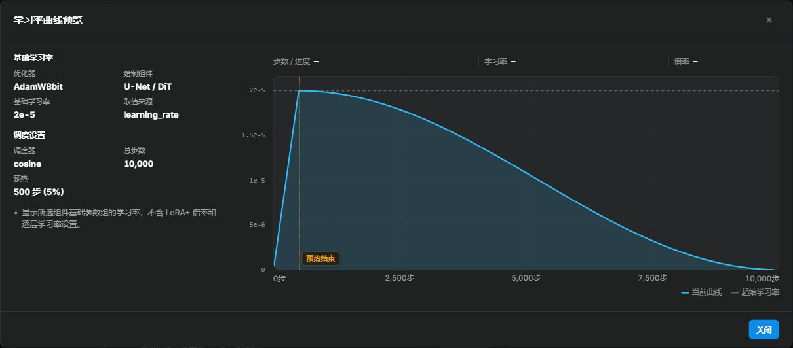

# 优化器选择与参数指南

## 快速选择

优化器决定根据梯度更新权重的步幅、方向平滑与状态显存占用。本指南覆盖 Anima、SDXL、MOSS-Image 和 Krea 2 四种训练类型。

- **初次训练或建立基准**：选择 `AdamW8bit`，配合各训练类型的默认学习率与调度器。
- **优化器状态显存不足**：先用 `8bit` 变体；仍超出显存时对比 `PagedAdamW8bit` 或分解二阶状态的 `CAME`。
- **Loss 偶发尖峰或低精度权重更新不稳**：固定数据与学习率，对比 [`StableAdamW`](#stableadamw-options)。
- **减少手动试错步长**：对比 [`Prodigy`](#prodigy-options) 或 [`ProdigyPlusScheduleFree`](#prodigyplus-options)，通过 `d_coef` 微调尺度。

| 调参目标 | 优先对比方案 | 重点观察指标 |
| --- | --- | --- |
| 建立通用基准 | `AdamW8bit` | 各阶段模型存档的生成画面、峰值显存、单步耗时 |
| 降低状态显存占用 | `AdamW8bit`、`CAME`；极限显存用 `PagedAdamW8bit` | 峰值显存与触发换页后的单步耗时变化 |
| 抑制更新尖峰或低精度舍入误差 | `StableAdamW` | 梯度范数尖峰是否消失、多阶段存档的画面稳定性 |
| 自动估计步长或免外部调度 | `Prodigy`、`ProdigyPlusScheduleFree`、`AdamWScheduleFree` | 日志中 `D` 的增长轨迹、目标特征成型的最早存档 |
| 验证矩阵正交化或子空间预条件 | `Muon`、`LoRA-Muon`、`LoRA-RITE`、`SOAP` | 早期收敛速度、单步额外算力开销、过拟合拐点 |

## 可用优化器与各核心初始学习率

下表按界面下拉框的 6 个分组列出全部 22 个优化器、四种训练类型的项目初始学习率（仅自动覆盖未手动修改的默认值）及核心限制。表中的显存说明仅指优化器状态，实际峰值显存还受分辨率、Rank、批次大小、缓存与预览采样影响。

**1. AdamW 及其存储变体**

| 优化器 | 机制与定位 | Anima 初始 LR | 其他核心初始 LR | 关键限制与说明 |
| --- | --- | ---: | --- | --- |
| `AdamW8bit` | 通用默认；大张量状态量化为 8-bit，小张量保留 FP32 | `2e-5` | SDXL / MOSS / Krea 2：`1e-4` | 禁用 `amsgrad`；阈值见 [`min_8bit_size`](#min-8bit-size) |
| `AdamW` | 未量化状态的基准对照 | `2e-5` | SDXL / MOSS / Krea 2：`1e-4` | FP32 状态显存高于 8-bit；支持 [`fused`](#adamw-fused) 与 [`foreach`](#foreach) |
| `PagedAdamW8bit` | 显存不足时将 8-bit 状态分页换出至系统内存 | `2e-5` | SDXL / MOSS / Krea 2：`1e-4` | 更新数学与 `AdamW8bit` 一致；换页会增加 CPU/GPU 传输耗时 |

**2. 内置稳定化机制**

| 优化器 | 机制与定位 | Anima 初始 LR | 其他核心初始 LR | 关键限制与说明 |
| --- | --- | ---: | --- | --- |
| `StableAdamW` | 在 AdamW 上增加内部更新 RMS 裁剪与 Kahan 补偿求和 | `2e-5` | SDXL / MOSS / Krea 2：`1e-4` | 状态显存高于 `AdamW8bit`；项目默认 `weight_decay=0` |
| `CAME` | 按行/列分解二阶状态，结合残差置信度缩放与内部 RMS 裁剪 | `1.5e-5` | SDXL / MOSS：`1e-4`；Krea 2：`2e-4` | 使用 3 个 beta；适合显存受限时与 `AdamW8bit` 对照 |

**3. 前瞻差分与符号更新**

| 优化器 | 机制与定位 | Anima 初始 LR | 其他核心初始 LR | 关键限制与说明 |
| --- | --- | ---: | --- | --- |
| `Adan` | 同时跟踪梯度与相邻步梯度差分的 Nesterov 动量 | `1e-5` | SDXL / MOSS：`5e-5`；Krea 2：`1e-4` | 使用 3 个 beta；有效步长偏大，Anima 按 AdamW 半值起步 |
| `Lion` / `Lion8bit` / `PagedLion8bit` | 符号动量更新，仅维护一阶动量状态 | `5e-6` | SDXL / MOSS：`2e-5`；Krea 2：`1e-4` | 可用学习率区间比 AdamW 小约 3～10 倍，需单独调参 |

**4. 双时间尺度梯度记忆**

| 优化器 | 机制与定位 | Anima 初始 LR | 其他核心初始 LR | 关键限制与说明 |
| --- | --- | ---: | --- | --- |
| `AdEMAMix` / `AdEMAMix8bit` | 叠加快速与慢速两组指数移动平均，兼顾近期梯度与长期趋势 | `2e-5` | SDXL / MOSS / Krea 2：`1e-4` | 使用 3 个 beta；渐增步数留空时自动按预估总步数填入 |

**5. 内部学习率估计与调度**

| 优化器 | 机制与定位 | Anima 初始 LR | 其他核心初始 LR | 关键限制与说明 |
| --- | --- | ---: | --- | --- |
| `Prodigy` | D-adaptation 自动估计步长尺度 `D` | `1.0`（锁定） | SDXL / MOSS / Krea 2：`1.0`（锁定） | 全训练类型均锁定 `learning_rate=1.0`，改用 `d_coef` 缩放；自动切 `cosine` 调度；不支持 [LoRA+](#loraplus) |
| `ProdigyPlusScheduleFree` | 自动估计步长 `D` 并内置平均权重调度 | `1.0`（锁定） | SDXL / MOSS / Krea 2：`1.0`（锁定） | 锁定 `learning_rate=1.0` 与外部调度 `constant`；默认开启内部缩放并锁定 `max_grad_norm=0`；不支持 LoRA+ |
| `AdamWScheduleFree` | 用权重平均替代外部衰减调度的 AdamW | `1e-4` | SDXL / MOSS：`3e-4`；Krea 2：`0.0025` | 外部调度锁定为 `constant`，预热改用内部 [`warmup_steps`](#schedulefree-warmup) |
| `AdaFactor` | 分解状态极省显存；默认按步数自动计算相对步长 | 自动接管（手动 `2e-5`） | SDXL / MOSS / Krea 2：自动接管（手动 `1e-4`） | `max_grad_norm` 锁定为 `0`；需同时关闭 `relative_step` 与 `warmup_init` 才可用手动 LR、外部调度与 LoRA+ |
| `Automagic3` / `Automagic4` | 按参数组梯度符号一致率自适应调节 LR；v4 另按敏感度缩小高敏元素更新 | `2e-5` | SDXL / MOSS / Krea 2：`2e-5` | 实验性；锁定外部调度 `constant` 并保持可训练参数 FP32；`fused=True` 要求单卡、累积为 `1`、`max_grad_norm=0`、禁用 `fp16` |
| `EmoSens` | 按 Loss 变化自动调节全局学习率并给出收敛提示 | `0.1` | MOSS / Krea 2：`0.1`；SDXL：`1.0` | 实验性；要求单卡、梯度累积 `1`、禁用 `fp16`；锁定外部调度 `constant`；不支持组件独立 LR 与 LoRA+ |

**6. 矩阵结构更新**

| 优化器 | 机制与定位 | Anima 初始 LR | 其他核心初始 LR | 关键限制与说明 |
| --- | --- | ---: | --- | --- |
| `Muon` | 对二维矩阵动量做 Newton-Schulz 正交化 | `2e-5` | MOSS / Krea 2：`1e-4`（SDXL 不支持） | 仅支持二维参数；LyCORIS 须关闭 `use_scalar` 与 `train_norm` |
| `LoRA-Muon` | 将 `lora_down` / `lora_up` 配对做低秩流形谱下降更新 | `0.02` | Krea 2：`0.1`（SDXL / MOSS 不支持） | 仅支持 Anima 原生 LoRA、Krea 2 原生 LoRA 与 **Krea 2 LoCon**（关 `use_scalar` 和 DoRA）；不支持 LoRA+ |
| `LoRA-RITE` | 消除等价 A/B 因子缩放差异的低秩预条件更新 | `1e-4` | Krea 2：`1e-4`（SDXL / MOSS 不支持） | 支持范围同 `LoRA-Muon`；内置裁剪并将 `max_grad_norm` 锁定为 `0`；不支持 LoRA+ |
| `SOAP` | 在梯度协方差特征基旋转坐标系内执行 Adam 更新 | `2e-5` | SDXL / MOSS / Krea 2：`1e-4` | 预条件矩阵增加显存与算力；项目默认最大预条件轴长 `256`、`weight_decay=0` |

> **常用三者取舍**：日常优先用 `AdamW8bit`。当显存非常吃紧时，可对比 `CAME`（记录峰值显存与单步耗时）。当训练日志出现偶发梯度尖峰或使用 `full_bf16` 低精度可训练权重时，保持相同学习率对比 `StableAdamW`。完整参数细节见下方[通用参数](#parameters)与[专用参数](#specific-options)。

## 通用优化与调度参数

### 学习率（learning_rate）

学习率过低会导致人物五官、服装结构欠拟合；过高会导致 Loss 震荡、色彩溢出或早期几个轮次迅速锁死训练图姿势与背景。更换优化器或调整网络缩放比例后，先从[上方初始学习率表](#optimizer-type)起步，并在固定提示词与种子下横向对比多个阶段的模型存档。

- **组件独立学习率覆盖关系**：`unet_lr`（DiT / U-Net）与 `text_encoder_lr` 留空时默认沿用总 `learning_rate`；填入数值后分别覆盖对应参数组。使用 Krea 2 时，权重衰减、`betas`、`eps` 等使用对应的 `krea_*` 字段（含义与下方同名小节一致）。
- **`network_alpha / network_dim` 的联动**：该比值决定 LoRA 分支的前向缩放。MOSS-Image 默认 `rank=16, alpha=1` 搭配 `1e-4`；Anima 与 Krea 2 默认 `rank=32, alpha=32`（缩放为 `1.0`）。若从上游 `alpha=1` 配方迁移到 `alpha=dim`，必须同步下调学习率。
- **Lion 的权重衰减比例**：Lion 的初始学习率约为 AdamW 的 1/3～1/10；本项目保留自身的权重衰减默认值，若需严格复现 Lion 论文配方，可将 `weight_decay` 相应放大 3～10 倍。

### 学习率调度器与预热（lr_scheduler / lr_warmup_steps）

新配置默认调度器：SDXL 为 `cosine_with_restarts`，Anima、MOSS-Image 和 Krea 2 为 `constant`。测试预热时建议从 `constant_with_warmup` 或 `cosine` 起步，预热步数先控制在总优化器步数的 `5%` 以内（Krea 2 与 `warmup_stable_decay` 的步数框还支持填 `[0, 1)` 的小数比例）。

**优化器对调度器的自动接管与联动：**

- **内部管理调度的优化器**：选择 `AdamWScheduleFree`、`ProdigyPlusScheduleFree`、`Automagic3`、`Automagic4`、`EmoSens`，或开启 `relative_step` 的 `AdaFactor` 时，界面会自动将外部 `lr_scheduler` 锁定为 `constant`、外部 `lr_warmup_steps` 锁定为 `0`。
- **Prodigy 调度建议**：切换到 `Prodigy` 时，未手动修改的调度器会自动设为 `cosine`。避免对 `Prodigy` 使用 `cosine_with_restarts`（周期重启会干扰 `D` 步长估计）；开启外部预热时后端会自动启用 `safeguard_warmup=True`。

| 调度器 | 曲线行为与适用场景 | 专用子参数与注意事项 |
| --- | --- | --- |
| `constant` / `constant_with_warmup` | 全程（或预热后）保持恒定学习率；适合短程训练并按固定间隔保存存档挑最佳轮次 | Krea 2 的 `constant` 不接受非零预热，需预热请选 `constant_with_warmup` |
| `cosine` | 预热后按单轮余弦平滑衰减至 `0`；适合总步数确定、希望末段平稳收敛的常规训练 | 无额外参数 |
| `cosine_with_min_lr` | 余弦衰减但保留最低学习率下限，防止末段彻底停更 | `lr_scheduler_min_lr_ratio`（终点比例 `0～1`）、`lr_scheduler_num_cycles` |
| `cosine_with_restarts` | 按 `lr_scheduler_num_cycles` 周期衰减并跳回峰值重启；`1` 时等同单轮余弦 | 重启瞬间学习率跳升，不适合自适应步长优化器 |
| `warmup_stable_decay`（WSD） | 预热 → 恒定平台期 → 末段衰减；兼顾中段充分学习与末段平稳收尾 | `lr_warmup_steps` + `lr_decay_steps` 之和不可超过总步数；`warmup_type`（默认 `linear`）与 `decay_type`（默认 `cosine`）均支持 `linear`、`cosine`、`1-sqrt`；`lr_scheduler_min_lr_ratio` 同时设定预热起点与衰减终点 |
| `piecewise_constant` | 按指定步数阶梯切换倍率 | `step_rules` 格式为 `倍率:累计结束步数,...,最后倍率`（如 `1:1000,0.5:1600,0.1` 表示 0–999 步 100%、1000–1599 步 50%、1600 步起 10%）；外部预热锁定为 `0` |
| `linear` / `polynomial` | 预热后按直线或幂函数衰减（sd-scripts 的 `polynomial` 终点为 `1e-7`） | `lr_scheduler_power` 控制多项式幂次（默认 `1.0`） |
| `inverse_sqrt` | 预热后按 `1 / √(1 + Δstep / timescale)` 缓慢衰减，适合长程微调 | `lr_scheduler_timescale` 默认 `10000` |
| `rex`（仅 Krea 2） | 从最低学习率预热至基准值，再按 REX 倒数曲线末段加速收敛回最低值 | `lr_scheduler_min_lr_ratio` 留空默认 `0.01`（基准值的 1%）；需已知总训练步数 |

在“学习率调度器”字段下点击**“查看学习率曲线”**，可实时检查预热区间、衰减拐点与开始/中途/结束三点读数；同时训练 DiT 与文本编码器或启用 Krea 2 LoRA+ 时，可在弹窗侧栏切换组件分别查看曲线。曲线展示外部调度器输出，优化器内部的自适应步长在训练中另行计算。

### 梯度裁剪阈值（max_grad_norm）

界面字段名为**“梯度裁剪阈值”**。常规优化器默认 `1.0`（按全局 L2 范数抑制偶发异常大梯度），设为 `0` 关闭裁剪。阈值过低会压制正常特征更新。

**各优化器的联动与锁定规则：**

- **强制锁定为 `0`**（改用优化器内部裁剪或防止双重缩放）：`AdaFactor`、`LoRA-RITE`，以及开启内部缩放（默认 `use_stableadamw=True` 或 `eps=None`）时的 `ProdigyPlusScheduleFree`；此外启用 `Automagic` 的 `fused=True` 时也必须为 `0`。
- **自动推荐设为 `0`**（仍可手动修改）：`Prodigy`（外部裁剪可能压低 `D` 估计）以及 Anima / Krea 2 下的 `LoRA-Muon`。
- **正常生效**：`AdamW` 系列、`StableAdamW`、`CAME`、`Lion` 系列、`Adan`、`AdEMAMix`、`AdamWScheduleFree`、`SOAP`、`EmoSens` 及 `fused=False` 的 `Automagic`。

### 权重衰减（weight_decay）

权重衰减持续收缩可训练权重幅度。数值过大会阻碍特征拟合；`0` 关闭衰减。项目按优化器特性提供两档初始值：

- **默认 `0.01`**：`AdamW`、`AdamW8bit`、`PagedAdamW8bit`、`Adan`、`AdEMAMix`、`AdEMAMix8bit`、`EmoSens`。
- **默认 `0`**：`StableAdamW`、`CAME`、`Lion` 系列、`Prodigy`、`ProdigyPlusScheduleFree`、`AdamWScheduleFree`、`AdaFactor`、`Automagic3/4`、`Muon`（显式覆盖 PyTorch 原生默认 `0.1`）、`LoRA-Muon`、`LoRA-RITE`、`SOAP`（显式覆盖库默认 `0.01`）。

人物 LoRA 建议先保留项目默认值；做跨优化器纯净算法对比时（如 `AdamW8bit` 对照 `StableAdamW`），请将两组的 `weight_decay` 设为同一数值。

### 动量系数（betas）

`betas` 控制历史梯度统计的平滑窗口：越接近 `1` 历史保留越久、响应越慢；调低则更快跟随近期梯度。无明确排障需求时保留各优化器默认值：

| 优化器 | 默认 `betas` | 各分量控制的统计量 |
| --- | --- | --- |
| `AdamW` 系列、`Prodigy`、`AdamWScheduleFree`、`LoRA-RITE` | `0.9, 0.999` | 一阶梯度均值、二阶梯度平方均值 |
| `StableAdamW`、`Lion` 系列、`ProdigyPlusScheduleFree` | `0.9, 0.99` | 一阶动量（Lion 为插值/更新双系数；其余为一阶/二阶矩） |
| `EmoSens` | `0.9, 0.995` | 一阶与二阶梯度统计 |
| `SOAP` | `0.95, 0.95` | 旋转空间一阶/二阶矩（未填 `shampoo_beta` 时第二项兼管预条件矩阵） |
| `Adan` | `0.98, 0.92, 0.99` | 梯度均值、相邻步梯度差分均值、前瞻组合梯度平方均值 |
| `CAME`、`AdEMAMix` 系列 | `0.9, 0.999, 0.9999` | CAME：一阶矩、二阶分解矩、残差置信度；AdEMAMix：快动量、二阶矩、慢动量 |

### 数值稳定项（eps）

`eps` 加在自适应归一化分母中防止除零放大。无复现的 NaN 或数值下溢时保持默认：

- **默认 `1e-8`**：`AdamW` 系列、`StableAdamW`、`Prodigy`、`ProdigyPlusScheduleFree`、`AdamWScheduleFree`、`EmoSens`、`Adan`、`AdEMAMix` 系列、`SOAP`。
- **特殊默认与语义**：`Muon` 默认 `1e-7`（正交化归一化下限）；`LoRA-RITE` 默认 `1e-6`（根 ε，内部平方后参与计算）；`Automagic3/4` 默认 `1e-30`（平方梯度下限）；`ProdigyPlusScheduleFree` 支持显式填入 `None` 切换为尺度不变的 Adam-atan2 更新（同时锁定 `max_grad_norm=0`）。`AdaFactor` 与 `CAME` 使用各自的专用稳定项字段。

### 8-bit 最小量化尺寸（min_8bit_size）

适用于 `AdamW8bit`、`PagedAdamW8bit`、`Lion8bit`、`PagedLion8bit`，默认 `4096`：元素数少于 `4096` 的小张量保留 FP32 优化器状态，更大张量才量化为 8-bit。低 Rank 训练若怀疑极小矩阵量化引入误差，可提高到 `16384` 对照；仅影响状态存储精度。

### 批量张量更新（foreach）

适用于 `AdamW`、`StableAdamW`、`CAME`、`Adan`、`AdamWScheduleFree` 及 Krea 2 的 `Lion`：

- **自动**（`auto`，默认）：沿用各优化器默认策略。
- **启用**（`true`）：合并多张量算子减少 GPU 内核启动开销，单步更快，但会小幅提高更新瞬间的峰值显存。
- **禁用**（`false`）：逐张量串行更新，显存吃紧时可显式设为禁用；`AdamW` 下不能与 `fused=True` 同时开启。

### AdamW 融合更新（fused）

仅 `AdamW` 可用。设为**启用**（`true`）时调用 PyTorch 融合内核合并更新步骤以降低调度开销，但不可与 `foreach=True` 或自定义参数 `differentiable=True` 同用（界面会自动拦截冲突项）。**自动**（`auto`）沿用 PyTorch 默认选择并保留自定义参数。

### LoRA+ 兼容性

除 **`Prodigy`、`ProdigyPlusScheduleFree`、`EmoSens`、`LoRA-RITE`、`LoRA-Muon`**（分组倍率会破坏全局自适应步长或 A/B 因子配对，界面会自动关闭并锁定 LoRA+）外，其余优化器均可搭配 LoRA+。

- `AdaFactor` 搭配 LoRA+ 时，必须同时关闭 [`relative_step` 与 `warmup_init`](#adafactor-options)。
- `Automagic3 / Automagic4` 搭配 LoRA+ 时，乘上倍率后的实际起始学习率仍须落在 `[min_lr, max_lr]` 范围内。完整倍率建议见 [LoRA+ 参数指南](lora-plus.zh-CN.md#optimizer-compatibility)。

## 各优化器专用参数

### StableAdamW 专用参数

- **Kahan 补偿求和**（`kahan_sum`，默认开启）：补偿低精度权重累加时的舍入截断误差，主要在开启 `full_bf16`（LoRA 可训练权重本身转为 BF16）时发挥作用；仅开 `mixed_precision=bf16` 时可训练权重仍为 FP32。
- **解耦权重衰减**（`weight_decouple`，默认开启）：执行标准 AdamW 解耦衰减；`weight_decay=0` 时无影响，建议保持开启。

### CAME 参数

- **内部裁剪阈值**（`clip_threshold`，默认 `1.0`）：裁剪内部更新张量的均方根（RMS），与外部 `max_grad_norm` 独立；调小限制更强，出现持续尖峰时再下调。
- **权重衰减与边界项**：`weight_decouple`（默认开启）与 `fixed_decay`（默认关闭）控制衰减形式；`ams_bound`（默认关闭）保留历史最大残差二阶矩；`eps1`（默认 `1e-30`）与 `eps2`（默认 `1e-16`）分别稳定梯度平方与残差统计，通常保持默认。

### Adan 参数

Adan 利用当前梯度与相邻步梯度差分的组合加速收敛，有效步长大于 AdamW：Anima 从 `1e-5` 起步，SDXL / MOSS-Image 从 `5e-5` 起步，Krea 2 从 `1e-4` 起步。`weight_decouple` 默认开启（更新前按 `1 − lr × weight_decay` 收缩权重）；优化器内置的裁剪参数固定为 `0`，统一由界面的[梯度裁剪阈值](#gradient-clipping)控制。

### AdEMAMix 参数

AdEMAMix 同时维护快速动量（`β1=0.9`）与长期慢速动量（`β3=0.9999`），通过混合权重 `alpha` 将长期趋势叠加进每步更新（此 `alpha` 与网络 Alpha 无关）。

| 参数 | 默认值 | 作用与调参方向 |
| --- | --- | --- |
| `alpha` | `5.0` | 慢速动量混入更新的倍率；调大增强长期方向权重，`0` 退化为无慢速项 |
| `t_alpha` | 留空（自动取预估总步数） | `alpha` 从 `0` 线性爬升到设定值的步数；填 `0` 关闭缓升立即满额生效 |
| `t_beta3` | 留空（自动取预估总步数） | 慢速衰减率从 `β1` 过渡到 `β3` 的步数；短训若嫌慢动量介入过晚可手动缩短 |

`AdEMAMix8bit` 将达到 `4096` 元素阈值的三组状态张量量化为 8-bit 以节省显存，学习率语义与全精度版一致。

### Prodigy 参数

Prodigy 在训练中动态估计步长尺度 `D`，**所有训练类型（含 sd-scripts 与 Krea 2）均将 `learning_rate`（及组件学习率）只读锁定为 `1.0`**，实际步长调整统一通过 `d_coef` 完成：

- **`d_coef`**（默认 `1.0`）：步长估计倍率。特征学习偏慢时试 `1.2～2.0`，过早过拟合或震荡时试 `0.5～0.8`。
- **`d0`**（默认 `1e-6`）：初始 `D` 起点，一般无需改动；日志中可观察 `D` 随步数爬升并趋稳的过程。
- **`safeguard_warmup`**（仅 sd-scripts，默认关闭）：防止外部预热期间过早放大 `D`；设置非零 `lr_warmup_steps` 时后端会自动开启。

### ProdigyPlusScheduleFree 参数

该优化器结合 Prodigy 步长估计与 Schedule-Free 平均权重（评估与保存模型时自动使用平滑权重），`learning_rate` 锁定为 `1.0`，外部调度器锁定为 `constant`。

**核心调节项（优先关注）：**

- **`d_coef`**（默认 `1.0`）与 **`d0`**（默认 `1e-6`）：含义同 `Prodigy`，调自动步长幅度优先改 `d_coef`。
- **`schedulefree_c`**（默认 `0`）：设为 `0` 使用标准全局平均；填正整数启用窗口化权重平均，数值越大越快反映近期学到的细节，越小平滑越强。
- **`prodigy_steps`**（默认 `0`）：到达指定步数后冻结 `D` 并释放估计缓存，适合确认前半程 `D` 收敛稳定后固定后半程步长；`0` 全程持续估计。
- **`d_limiter`**（默认开启）：`d_coef=1` 时限制单步 `D` 最大涨幅约 `19%`，防止早期步长暴冲。

**排障与实验开关（常规训练保持默认即可）：**

| 参数 | 默认 | 何时调整 |
| --- | --- | --- |
| `use_stableadamw`（界面为 `prodigyplus_use_stableadamw`） | 开启 | 按更新 RMS 限幅并将 `max_grad_norm` 锁定为 `0`；仅在排查步长异常压制时关闭对照 |
| `factored` / `factored_fp32` | 开启 / 开启 | 行列分解二阶矩节省显存并以 FP32 存储；遇 NaN 或 `D` 长期卡死不涨时可关闭 `factored` 测试完整二阶矩 |
| `split_groups` / `split_groups_mean` | 开启 / 关闭 | 默认各参数组（如 DiT 与文本编码器）独立估计 `D`；开启 `split_groups_mean` 改为共用各组 `D` 的调和平均值 |
| `weight_decay_by_lr` | 开启 | 让权重衰减乘上自适应步长；切换后数值量级变化，需重设 `weight_decay` |
| `use_bias_correction` | 关闭 | 启用 RAdam 式偏差校正与自动预热，会减缓 `D` 爬升；开启后若 `D` 不增长请关回 |
| `use_speed` / `use_cautious` / `use_orthograd` | 关闭 | 实验性变体：SPEED 方向峰值估计（非零衰减时上游会告警）、同向更新掩码、权重正交梯度投影 |

库内置 BF16 随机舍入按默认行为运行，无需额外开关；`use_grams`、`use_adopt`、`use_focus`、`beta3` 等可通过自定义 `optimizer_args` 传入（禁用 `fused_back_pass`）。

### AdamWScheduleFree 预热（warmup_steps）

`AdamWScheduleFree` 忽略外部 `lr_warmup_steps`，专用 `warmup_steps`（界面字段 `schedulefree_warmup_steps` / `krea_schedulefree_warmup_steps`）设置内部线性预热步数。项目默认 `0`；若开训初期梯度范数剧烈抖动，可填入总步数的 `3%～5%` 测试。

### AdaFactor 参数

`AdaFactor` 用行列分解替代完整二阶动量以极小化状态显存，默认运行在自动相对步长模式（`max_grad_norm` 全程锁定为 `0`，改用内部 `clip_threshold`）：

- **自动步长模式**（默认 `relative_step=True`、`scale_parameter=True`、`warmup_init=False`）：步长按更新步数和参数 RMS 自动计算，填写的 `learning_rate` 与外部调度器均不参与更新；开启 `warmup_init` 会拉长初期步长爬升。
- **手动学习率模式**：需**同时关闭 `relative_step` 与 `warmup_init`**（关闭 `relative_step` 时界面会自动联动关闭 `scale_parameter` 和 `warmup_init`），此后方可手动指定学习率（Anima 默认 `2e-5`，其他 `1e-4`）、启用外部调度器或搭配 LoRA+。
- **`clip_threshold`**（默认 `1.0`）与 **`eps`**（默认 `1e-30, 1e-3`，分别为梯度平方稳定项与参数尺度下限）：保持默认即可。

### Automagic3 / Automagic4 参数

集成自 AI Toolkit 的实验性自适应优化器（[Automagic3](https://github.com/ostris/ai-toolkit/blob/c2864bba48a6f94ab1171d9df47b1335f8306355/toolkit/optimizers/automagic3.py) / [Automagic4](https://github.com/ostris/ai-toolkit/blob/534d462ff622e334e1a65b42884d96d98315d75a/toolkit/optimizers/automagic4.py)）。两者均统计参数组近期更新方向的一致性动态升降学习率（持续同向推高、频繁反向压低）；Automagic4 进一步根据平方梯度估计元素敏感度，自动缩小高敏权重的更新幅度，并在第 1 步仅采集基准统计、第 2 步起更新权重。

| 参数 | 初始值 | 有效范围 | 作用与调参提示 |
| --- | ---: | --- | --- |
| `learning_rate` | `2e-5` | `[min_lr, max_lr]` 内正数 | 新训练的起始学习率（含组件独立 LR 与 LoRA+ 放大后的组学习率均须落在上下限内） |
| `min_lr` / `max_lr` | `1e-8` / `2e-4` | `0 < min_lr ≤ max_lr` | 自适应学习率下限与上限；若 TensorBoard 曲线长期顶满 `max_lr` 且欠拟合，可适当上调 `max_lr` |
| `polarity_history` | `8` | 整数 `2–64` | 记录最近多少步的更新方向；窗口填满后开始调 LR，调大更平滑但增加显存 |
| `clip_threshold` | `1.0` | `> 0` | 内部 RMS 与逐元素裁剪阈值；越小限制越强 |
| `sensitivity_quantile` | `0.9` | 仅 v4；`(0, 1]` | 组内敏感度分位阈值；调低会缩小更多高敏元素的更新幅度 |
| `step_target` | `0.1` | 仅 v4；`(0, 2)` | 方向翻转率中性点；调高使学习率更容易上升 |
| `fused` | `False` | 布尔值 | 开启后在反向传播梯度就绪时立即更新并释放梯度以省显存 |
| `beta2` / `eps` / `weight_decay` | `0.999` / `1e-30` / `0` | 常规范围 | 二阶统计平滑、除零保护与权重衰减 |

**运行与续训限制**：外部调度锁定为 `constant`；可训练参数强制保持 FP32（自动关闭 `full_bf16`，BF16 混合精度前向计算仍可用）。开启 `fused=True` 要求**单 GPU、梯度累积 `1`、`max_grad_norm=0`、禁用 `mixed_precision=fp16`**。带状态断点续训会恢复已学到的自适应学习率与方向历史（改上下限在下次调参步生效）。

### EmoSens v3.9.3 参数

EmoSens 根据训练 Loss 轨迹自动调节全局学习率（[上游说明](https://github.com/muooon/EmoSens) / [v3.9.3 实现](https://github.com/muooon/EmoSens/blob/e2c7bb3293baeb339a2d4a21f21ccbdc0260d3be/optimizer/emosens.py)）。`learning_rate` 作为倍率使用：**Transformer / DiT LoRA（Anima、MOSS-Image、Krea 2）默认 `0.1`**（自动学习率上限 `3e-4`），**U-Net LoRA（SDXL）默认 `1.0`**（自动上限 `3e-3`，倍率 `>1` 时上限维持 `3e-3`）。

- **`stopcoef`**（默认 `0.04`）：收敛提示阈值。训练趋稳且近期平均 Loss `≤ stopcoef` 时触发提示；调大更易触发，`0` 关闭判定。
- **`notify`**（默认开启）：满足条件时在日志输出 `[READY TO STOP]`，提示可对比附近模型存档决定是否手动停训。
- **`use_shadow`**（默认关闭）：额外驻留一份影子权重并在 Loss 突变时混合缓冲，会增加显存占用。
- **使用限制**：仅支持**单 GPU、梯度累积固定为 `1`、禁用 `mixed_precision=fp16`**；外部调度锁定为 `constant`；所有可训练参数共用同一实际学习率，不支持 LoRA+，填写 `unet_lr` / `text_encoder_lr` 不会产生分组差异。断点续训时请保持原倍率、`notify` 和 `use_shadow` 设置一致。

### Muon 参数

Muon 对二维矩阵的一阶动量执行 Newton-Schulz 多项式正交化，分别更新 `lora_down` 与 `lora_up`，仅维护单组动量状态但每步增加小矩阵乘法。支持 **Anima、MOSS-Image 与 Krea 2**（不支持含四维卷积核的 SDXL）。

- **二维参数限制**：搭配 `lycoris.kohya` 时必须关闭会引入一维/标量参数的 `use_scalar` 与 `train_norm`（界面与启动校验会自动拦截）。
- **幅度与缩放**：默认 `adjust_lr_fn=match_rms_adamw` 按矩阵尺寸把更新 RMS 对齐到 AdamW 量级，因此可直接从 Anima `2e-5`、MOSS / Krea 2 `1e-4` 起步；若改为 `original` 必须重新寻找数量级更大的学习率。`weight_decay` 项目默认 `0`（覆盖 PyTorch 默认 `0.1`）。
- **动量与正交化**：`momentum` 默认 `0.95`（`[0, 1)`）、`nesterov` 默认开启、`ns_steps` 默认 `5`、`ns_coefficients` 默认 `3.4445, -4.775, 2.0315`、`eps` 默认 `1e-7`。日常对比只需固定 `ns_steps=5` 与默认系数，单独调节学习率或衰减。

### LoRA-Muon 参数

普通 Muon 独立更新 `lora_down` 和 `lora_up`，当两侧因子数值尺度一太一小时会影响更新效率。LoRA-Muon 将同一层的 `down/up` 作为配对整体，通过对方因子的 Gram 统计校正方向尺度后再做矩阵正交化更新，在因子尺度不均或追求更快早期特征成型时可与 `AdamW8bit` / `Muon` 对照。

**调参体感与过拟合信号**：Anima 从 `0.02`、Krea 2 从 `0.1` 起步（若填写了 `unet_lr` 会覆盖主干组的 `learning_rate`）。若几百步内 Loss 剧烈跳变、预览画面迅速锁死训练图姿势或高饱和色块溢出，说明学习率偏高，按 `0.5×` 递减测试；网络 `network_alpha / network_dim` 比例改变后也须重新校准学习率。

| 参数 | 默认值 | 有效范围 | 作用与建议 |
| --- | ---: | --- | --- |
| `learning_rate` / `weight_decay` | Anima `0.02`、Krea 2 `0.1` / `0` | `≥ 0`，且 `lr × wd < 1` | 核心步幅预算与论文分拆式解耦衰减；优先只调 `learning_rate`，`max_grad_norm` 推荐 `0` |
| `momentum` | `0.9` | `0 ≤ m < 1` | 一阶梯度移动平均系数 |
| `ns_steps` / `inv_sqrt_steps` | `8` / `7` | 整数 `1–8` / `1–7` | 矩阵符号与 Gram 逆平方根迭代步数；调小省算力但近似变粗，日常保持默认 |
| `msign_eps` / `inv_sqrt_eps` / `inv_sqrt_gamma` | `1e-20` / `1e-5` / `1.001` | 非负 / 非负 / `> 0` | 矩阵符号除零保护、Gram 正则化下限与迭代阻尼；无数值异常勿改 |
| `gauge_rebalance`（及 `alpha` / `interval` / `power_steps`） | `False`（`1.0` / `1` / `2`） | 开关与子项 | 定期按谱范数平衡 `down/up` 两因子的数值大小；怀疑长训因子尺度严重失衡时再单独开启对照 |

**支持范围与硬性约束**：仅支持 **Anima 原生 `networks.lora_anima`、Krea 2 原生 `networks.lora_krea2` 以及 Krea 2 的 `lycoris.kohya` LoCon（须关闭 `use_scalar` 与 DoRA）**；不支持 Anima LoCon、SDXL、MOSS-Image、LoHa/LoKr 及 [LoRA+](#loraplus)。FP16/BF16 权重的内部矩阵运算与一阶动量自动保持 FP32，支持常规外部调度器。

### LoRA-RITE 参数

LoRA-RITE 通过消除因子缩放影响的梯度与低秩矩阵预条件，保证等价 A/B 分解下的更新一致性。支持范围与 `LoRA-Muon` 相同：**Anima 原生 LoRA、Krea 2 原生 LoRA 与 Krea 2 LoCon（关闭 `use_scalar` 与 DoRA）**，不支持 LoRA+。

- **学习率**：Anima 与 Krea 2 均从 `1e-4` 起步，建议在 `5e-5～2e-4` 区间对比存档。
- **`clip_unmagnified_grad`**（默认 `1.0`）：裁剪去缩放后的内部梯度范数（越小越严，`0` 不裁剪）；界面全局 `max_grad_norm` 自动锁定为 `0`。
- **`betas`** 默认 `0.9, 0.999`；**`eps`** 默认 `1e-6`（内部平方后使用），保持默认即可。

### SOAP 参数

SOAP 每隔若干步统计梯度协方差以更新旋转特征基，在去相关的旋转坐标系内执行 Adam 更新后再映回原空间（第 1 步建立预条件状态，第 2 步起更新权重）。Anima 从 `2e-5`、其他核心从 `1e-4` 起步（切勿照搬库面向全模型训练的 `3e-3`）。

| 参数 | 默认值 | 作用与显存/算力权衡 |
| --- | --- | --- |
| `max_precondition_dim` | `256` | 参与矩阵预条件的最大轴长（覆盖库默认 `10000`）；超过此长度的轴仅做逐元素缩放。FP32 下单轴两张矩阵在 512 维约占 2 MiB、1024 维约 8 MiB，调高会显著增加显存与特征分解耗时 |
| `precondition_frequency` | `10` | 重算旋转坐标系的步数间隔；调大省算力，调小更快追踪梯度方向变化 |
| `shampoo_beta` | 留空（跟随第 2 个 beta） | 预条件统计的移动平均系数；默认 `betas=(0.95, 0.95)` |
| `normalize_gradient` / `correct_bias` / `precondition_1d` | 关 / 开 / 关 | RMS 归一化更新张量、修正零初始化偏差、对上限内的一维参数（如 `train_norm`）建立预条件 |

项目默认 `weight_decay=0`（显式写入以覆盖库默认 `0.01`），外部 `max_grad_norm` 正常生效。

## 按现象排查与对照测试

| 观察现象 | 优先检查（非优化器因素） | 优化器与学习率调整方向 |
| --- | --- | --- |
| 1～5 张极少图迅速锁死姿势、背景或构图 | 重复构图占比、提示词是否写清背景与动作变化 | `AdamW8bit` 下调学习率（如 Anima `1e-5～1.5e-5`），缩短保存间隔挑早期存档 |
| Loss 平稳但生成画面人物不像或泛化差 | 触发词、标注质量、预览提示词/CFG、训练总步数 | 确认数据无误后，按 `1.5×～2×` 步进小幅上调学习率或延长步数 |
| 图片画质参差，出现孤立可复现的梯度/Loss 尖峰 | 定位对应批次中的模糊图、极端长宽比或脏标注 | 清理异常图后对比 [`StableAdamW`](#stableadamw-options)，或适当收紧 `max_grad_norm` |
| 训练出现 `NaN / Inf` | 学习率是否错填数量级、精度设置、损坏图像或异常断点状态 | 先修正配置与数据；切勿仅靠调低裁剪阈值掩盖持续性数值发散 |
| 优化器状态撑爆显存（OOM） | 分辨率、批次大小、缓存与采样预览显存开销 | 全精度改用 `AdamW8bit` / `CAME`；仍不足再换 `PagedAdamW8bit` 或 `AdaFactor` |

**规范对照测试（A/B）要点**：通用控制变量流程见[时间步指南的对照实验方法](timesteps.zh-CN.md#comparison-method)。跨优化器对比时，须从同一底模全新初始化各自优化器状态，固定数据集、标注、有效批次（`批次大小 × 梯度累积 × GPU 数`）、总更新步数与预览种子；对于更新尺度不同的优化器（如 `AdamW8bit` vs `Lion` / `LoRA-Muon` / `Prodigy`），应先各自调出可用学习率，再在相同训练预算下对比最佳模型存档的人物还原度、换装可控性与提示词响应。

## 常见问题

**为什么切换训练类型或优化器后，学习率自动变了？**

当学习率仍处于默认值或上一次自动推荐值时，切换训练类型或优化器会自动填入对应起点；你手动输入的值和导入配置的值会原样保留。切换到 `Prodigy` 或 `ProdigyPlusScheduleFree` 例外：所有训练类型都会将其强制锁定为 `1.0`。

**为什么 Prodigy 在 Anima、SDXL、MOSS-Image 和 Krea 2 下的学习率都被锁定为 `1.0`？**

`Prodigy` 属于 D-adaptation 自适应步长优化器，`learning_rate` 仅作基准缩放因子。本训练器在 sd-scripts 与 Krea 2 两条运行路径中均将其锁定为 `1.0` 以防止误填常规学习率（如 `1e-4`）导致完全学不动；如需微调自动步长强弱，请修改 [`d_coef`](#prodigy-options)。

**为什么 `StableAdamW` 和 `SOAP` 生成的配置里 `weight_decay` 是 `0`？**

两者上游库默认值为 `0.01`，本项目将其初始值显式设为 `0` 并写入配置以保持行为确定性。若需与 `AdamW8bit`（默认 `0.01`）严格隔离单一变量对比，请手动将两组的 `weight_decay` 统一。

## 依据与参考资料

项目默认值、自动填值与参数契约定义见 `backend/training/fields/optimizer_metadata.py`、`backend/training/config/optimizer_contracts.py`、`backend/training/fields/field_registry.py` 及 `backend/training/fields/krea2_fields.py`；`LoRA-Muon` 实现说明见 `vendor/lora_muon/SOURCE.md`。主要算法与上游参考：

- [Anima 官方模型卡](https://huggingface.co/circlestone-labs/Anima/blob/f7382c4bf9d7ffe4ceea593a0adbb470c56dd79b/README.md) · [sd-scripts Anima 训练文档](https://github.com/kohya-ss/sd-scripts/blob/37a1cbbc5725ed2a3575506e7bd2001c9908ac92/docs/anima_train_network.md)
- [pytorch-optimizer 实现](https://github.com/kozistr/pytorch_optimizer/tree/3d08fa02cb6617d4d12365ca0f7d643b72e8cbe8) · [bitsandbytes 优化器实现](https://github.com/bitsandbytes-foundation/bitsandbytes/tree/a2b90e6eae31a958e6b4d85edf2cfb2b91e9ce29) · [Transformers 调度器实现](https://github.com/huggingface/transformers/blob/71c6f699ac9b3f8fc42a6a3e9dc59034c349a678/src/transformers/optimization.py)
- [CAME 论文](https://arxiv.org/abs/2307.02047) 与 [官方实现](https://github.com/yangluo7/CAME/tree/e77c5c022eaf71f1efb82a1433032cdcd5c52610) · [Lion 论文](https://arxiv.org/abs/2302.06675) 与 [官方实现](https://github.com/google/automl/tree/6a54c8741e7c3265d4547c4f35f47a0391122dc5/lion)
- [Prodigy 论文](https://arxiv.org/abs/2306.06101) · [Schedule-Free 论文](https://arxiv.org/abs/2405.15682) 与 [官方实现](https://github.com/facebookresearch/schedule_free/tree/70785b53e778d0e872c0bbb75ff4ee54ee10c291)
- [Adan 论文](https://arxiv.org/abs/2208.06677) · [AdEMAMix 论文](https://arxiv.org/abs/2409.03137) · [LoRA+ 论文](https://arxiv.org/abs/2402.12354)
- [LoRA-RITE 论文](https://arxiv.org/abs/2410.20625) 与 [官方实现](https://github.com/gkevinyen5418/LoRA-RITE/tree/d4186b6fedb39300d23c00ce0334db09719da9fc) · [LoRA-Muon 论文](https://arxiv.org/abs/2606.12921)
