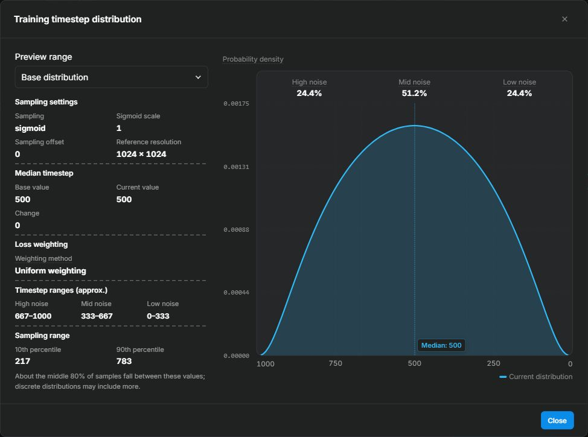

# Timesteps

## Core concepts and model-type defaults

During training, each image receives an independently sampled noise timestep that blends its VAE latent with random noise, teaching the model to predict the denoising direction at that stage. Different noise zones drive distinct visual features:

| Noise zone | UI timestep (approx.) | Input state | Primary visual features learned |
| --- | --- | --- | --- |
| High noise | `T ≈ 1000 → 667` | Noise-dominated, retaining only coarse low-frequency layout | Overall composition, silhouette proportions, and broad color/lighting blocks |
| Mid noise | `T ≈ 667 → 333` | Balanced mix of image structure and noise | Facial/body proportions, outfit part structure, and core style shapes |
| Low noise | `T ≈ 333 → 0` | Mostly clean image with light noise | Linework sharpness, surface texture, eyes, and small accessories |

**Timestep sampling** sets how frequently each noise level is drawn; **Loss weighting** scales the prediction error after a sample is drawn.

### Defaults by model type

Keep the selected model type's default distribution for an initial baseline, verifying dataset coverage, resolution, and learning rate before shifting sampling.

| Model type | Default sampling | Default distribution parameters | Default weighting and notes |
| --- | --- | --- | --- |
| Anima | `sigmoid` | `sigmoid_scale=1.0` | `uniform` (loss multiplier `1`; centered on mid noise while covering both ends) |
| MOSS-Image | `truncated_logit_normal` | `logit_mean=-1.09`, `logit_std=0.95`, `discrete_flow_shift=1.0`, `timestep_cutoff=0.95`, `timestep_uniform_ratio=0.01` | `uniform` (matches pre-training sampling; upstream also notes `shift + discrete_flow_shift=3` as a simple approximation) |
| Krea 2 | `shift` | `sigmoid_scale=1.0`, `discrete_flow_shift=2.5`, `min_timestep=0`, `max_timestep=1000` | `none` (loss multiplier `1`; moderately shifted toward mid-to-high noise) |
| SDXL | Uniform `0–999` | [`min_timestep`](#sdxl-range) / [`max_timestep`](#sdxl-range) blank | Unweighted by default; optionally enable [`min_snr_gamma`](#sdxl-loss) |

| Common tuning goal | Control to adjust | Starting guidance |
| --- | --- | --- |
| Bias overall training toward high noise (composition) or low noise (detail) | [`discrete_flow_shift`](#flow-shift) | `> 1` favors high noise; `< 1` favors low noise (Krea 2 defaults to `2.5`) |
| Spread samples toward both extremes or concentrate near the middle | [`sigmoid_scale`](#sigmoid-scale) | Default `1.0`; raise to spread out, lower to concentrate |
| Give full-body vs close-up subsets different noise emphasis | [`subset_timestep_offsets`](#subset-offsets) | `-0.5` to `+0.5` (supported in selected Anima / MOSS-Image modes) |
| Emphasize low- or mid-noise errors without changing sampling frequency | [`weighting_scheme`](#weighting) | `sigma_sqrt` (low-noise focus) or `cosmap` (mid-noise focus) |

### Three meanings of “steps”

| Term | Meaning | Typical parameter |
| --- | --- | --- |
| Training steps | Cumulative optimizer updates applied to LoRA weights (e.g. “step 500”) | `max_train_steps` / `max_train_epochs` |
| Training timestep | Noise level mixed into one training image (`0–1000` in UI, sampled per image) | `timestep_sampling` |
| Generation steps | Denoising iterations used by the sampler when rendering a preview or output image | `sample_steps` |

### Flow-matching noise mixing and target

Anima, MOSS-Image, and Krea 2 train with flow matching. Given clean image latent <var>x</var>, random noise <var>ε</var>, and normalized timestep <var>t</var> ∈ [0, 1] (shown as roughly `T = 1000t` in the UI), the noisy input and velocity target are:

  
Flow-matching input and velocity target

  
<var>x</var>t = (1 − <var>t</var>) · <var>x</var> + <var>t</var> · <var>ε</var> , <var>v</var> = <var>ε</var> − <var>x</var>

  
At <var>t</var> = 0.5 (<code>T ≈ 500</code>), image and noise contribute equally. The noise ratio <var>σ</var> in weighting formulas moves in the same direction as <var>t</var> (values near 1 approach pure noise).

## Distribution preview

Click **View timestep distribution** below the **Timestep sampling** field to inspect your theoretical sampling curve and switch among the base distribution, overall training distribution, and individual subsets. The horizontal axis follows denoising order from left to right: high noise `T ≈ 1000` on the left, low noise `T ≈ 0` on the right.

| Preview element | How to read it |
| --- | --- |
| Blue sampling-density curve <var>f</var>(<var>t</var>) | Greater area over an equal-width interval means more frequent sampling; hover to read exact values |
| High / Mid / Low noise shares | Expected percentage of samples in each third (rounding may total `99.9%` or `100.1%`) |
| Main sampling range (P10–P90) & median | Interval containing roughly `80%` of samples plus the median timestep marker |
| Loss-weight curve (log scale) | Multiplier applied to prediction error after sampling; flat at `1` under uniform weighting |
| Reference resolution | Dimensions used to evaluate resolution-derived shifts for [`flux_shift` / `krea2_shift`](#sampling) |

## When to adjust timesteps and troubleshooting

Confirm that source images and training resolution preserve fine detail, and that learning rate and step count are reasonable. Once verified, the four scenarios below benefit directly from timestep adjustments:

| Training scenario | Recommended adjustment | Mechanism and expected effect |
| --- | --- | --- |
| Loose global composition or drifting full-body proportions at `1024+` resolution | Switch to `shift` and raise [`discrete_flow_shift`](#flow-shift) (e.g. `1.5–3.0`), or use `flux_shift` / `krea2_shift` | High-resolution pixel redundancy makes mid timesteps easier to guess locally; shifting toward high noise enforces global structure learning |
| Mixing full-body illustrations with crisp facial/accessory close-ups | In [Per-subset sampling offsets](#subset-offsets), leave full-body subsets at `0` and set close-up subsets to `-0.15` to `-0.35` | Full-body images anchor mid/high-noise anatomy while close-ups sample low noise more often to sharpen facial and material details |
| Solid silhouette and identity, weak linework, fabric texture, or small ornaments | Keep sampling fixed and compare [`weighting_scheme=sigma_sqrt`](#weighting) | Amplifies low-noise error gradients without starving high-noise sampling (monitor gradient stability near `T≈0`) |
| Extreme-endpoint loss spikes, or wanting to focus budget on mid-noise subject structure | Compare [`weighting_scheme=cosmap`](#weighting) or lower [`sigmoid_scale`](#sigmoid-scale) slightly (e.g. `0.8`) | Downweights noisy extremes and concentrates updates on mid-noise structure formation |

> **When to leave timesteps unchanged**: if both global and local traits underfit, check trigger words, [learning rate](optimizers.en-US.md#learning-rate), and step count first; if training poses or backgrounds repeat early, prune duplicate compositions and evaluate earlier checkpoints; if a style LoRA shifts colors without capturing shapes, diversify subjects and compositions in the dataset.

## Timestep sampling (timestep_sampling)

`timestep_sampling` sets the base shape of the blue sampling-density curve:

| Option | Sampling behavior | Supported model types |
| --- | --- | --- |
| `sigmoid` | Maps `z ∼ N(0, 1)` via `sigmoid(s · z)` into `(0, 1)`, centered symmetrically on mid noise (~`24.4% / 51.2% / 24.4%` low/mid/high) | Anima, MOSS-Image, Krea 2 |
| `uniform` | Draws evenly across the entire timestep span, raising both high- and low-noise shares | Anima, MOSS-Image, Krea 2 |
| `shift` | Applies fixed nonlinear [`discrete_flow_shift`](#flow-shift) to `sigmoid` samples | Anima, MOSS-Image, Krea 2 |
| `sigma` | Draws from the scheduler's 1000-entry discrete noise table; pairs with [`logit_normal`](#logit-normal) or [`mode`](#mode) index densities | Anima, MOSS-Image, Krea 2 |
| `truncated_logit_normal` | Truncates and rescales logit-normal samples, mixes uniform samples, and maps onto the discrete grid (MOSS-Image default) | Anima, MOSS-Image |
| `flux_shift` / `krea2_shift` | Computes high-noise shift automatically from each bucket's latent token count (ignores fixed `discrete_flow_shift`) | `flux_shift`: Anima/MOSS; `krea2_shift`: Krea 2 |
| `logsnr` | Samples LogSNR from a normal distribution and converts it to timesteps | Krea 2 |

  
Base sigmoid sampling

  
<var>z</var> ∼ N(0, 1) , <var>t</var> = sigmoid(<var>s</var> · <var>z</var>)

  
<var>s</var> is <code>sigmoid_scale</code> (default 1.0). In <code>sigma</code> mode, Anima/MOSS shifts the discrete noise table by <code>discrete_flow_shift</code>, whereas Krea 2 uses an unshifted evenly spaced table.

### truncated_logit_normal: truncation and uniform mixing

Available for Anima and MOSS-Image. Draws from `logit_mean` and `logit_std`, truncates at the upper cutoff, rescales across the full noise span, and maps onto the 1000-point grid:

- **`timestep_cutoff`**: `(0, 1]`, default `0.95`; rescaling after truncation preserves full high-noise coverage.
- **`timestep_uniform_ratio`**: `[0, 1]`, default `0.01` (`1%` uniform grid samples; `1` makes all samples uniform).
- Reads `logit_mean` and `logit_std` (`> 0`) directly without needing `weighting_scheme=logit_normal`, and supports `discrete_flow_shift`, subset offsets, and `sigma_sqrt` / `cosmap` loss weights. Avoid tiny cutoffs or extreme mean/std values that saturate inverse-CDF precision onto boundary grid cells.

### logsnr: log signal-to-noise ratio sampling

Available for Krea 2. Higher LogSNR corresponds to stronger image signal and lower noise:

  
Krea 2 logsnr sampling

  
LogSNR ∼ N(<var>μ</var>, <var>σ</var>) , <var>t</var> = sigmoid(−LogSNR / 2)

  
<var>μ</var> is <code>logit_mean</code> (default 0; higher favors low noise, lower favors high noise) and <var>σ</var> is <code>logit_std</code> (default 1; higher spreads the curve). Because this formula differs from <code>sigma + logit_normal</code>, recheck the distribution preview after switching.

## Distribution spread (sigmoid_scale)

`sigmoid_scale` (default `1.0`) applies to `sigmoid`, `shift`, `flux_shift`, and `krea2_shift`:

- **Lower (e.g. `0.6–0.8`)**: concentrates samples tighter around mid noise and trims both extremes.
- **Higher (e.g. `1.2–1.5`)**: increases both high-noise (silhouette/layout) and low-noise (fine texture) shares simultaneously. Adjust [`discrete_flow_shift`](#flow-shift) instead when biasing toward a single side.

## High/low-noise shift (discrete_flow_shift)

`discrete_flow_shift` (`> 0`) skews timesteps toward one end. Defaults to `1.0` on Anima / MOSS-Image (used in `shift`, `sigma`, and `truncated_logit_normal`) and `2.5` on Krea 2 (used in `shift` only):

- **`> 1`**: maps samples to higher timesteps, increasing high-noise share.
- **`= 1`**: leaves the base distribution unshifted.
- **`0 < s < 1`**: maps samples to lower timesteps, increasing low-noise share.

  
Fixed flow-shift transform

  
<var>t</var>shifted = (<var>s</var> · <var>t</var>) / (1 + (<var>s</var> − 1) · <var>t</var>)

  
<var>s</var> is <code>discrete_flow_shift</code>.

## Per-subset sampling offsets (subset_timestep_offsets)

Per-subset offsets tailor noise emphasis per folder: **negative offsets increase low-noise sampling (fine detail); positive offsets increase high-noise sampling (global layout)**. Supported on **Anima and MOSS-Image** with `sigmoid`, `shift`, `flux_shift`, `truncated_logit_normal`, and `sigma + logit_normal` (ignored by `uniform` and other `sigma` schemes).

**How to configure in the UI:**

1. Organize subfolders named `repeats_name` (such as `10_closeup` and `5_fullbody`) inside your training folder and select that directory in the form.
2. In the **Per-subset sampling offsets** list under Training Parameters, use each row's `− / input / +` stepper (`0.05` step) to enter an offset (start within `-0.5` to `+0.5`, adjusting one subset at a time).
3. Click a row's chart icon or **Compare distributions** in the header to inspect the base curve, individual subsets, and the sample-weighted overall training distribution.

Nonzero offsets persist in `training.yaml` exports and are written at launch into `dataset.toml` (`custom_attributes.timestep_sampling = { offset = ... }`), traveling per image inside mixed batches without affecting regularization images or validation loss.

**Where the offset enters the formula:**

- **`sigmoid` / `shift` / `flux_shift`**: `t = sigmoid(sigmoid_scale × (z + offset))` before any flow-shift remapping (`sigmoid_scale` scales both `z` and `offset`).
- **`sigma + logit_normal` / `truncated_logit_normal`**: applied as `logit_mean - offset`, preserving the convention that positive offsets favor higher noise.

## Sampling density and loss weighting (weighting_scheme)

`weighting_scheme` covers two distinct stages: `sigma_sqrt` and `cosmap` scale **post-sampling loss weights** across all flow-matching samplers, whereas `logit_normal` and `mode` reshape **noise-table index sampling density** exclusively when `timestep_sampling=sigma` (leaving the loss multiplier at `1`).

| Scheme | What it changes | Practical effect |
| --- | --- | --- |
| `uniform` (Anima/MOSS) / `none` (Krea 2) | Loss multiplier fixed at `1` | Baseline default; relies purely on the chosen sampling curve |
| `sigma_sqrt` | Raises loss weights at low noise | Sharpens low-noise detail supervision; weights climb steeply near `σ → 0`, so watch update stability |
| `cosmap` | Raises relative weights around mid noise | Dampens extreme high- and low-noise gradients in favor of mid-noise structure |
| `logit_normal` | `sigma` index sampling density | Active only when `timestep_sampling=sigma`; shaped by `logit_mean` / `logit_std` |
| `mode` | `sigma` index sampling density | Active only when `timestep_sampling=sigma`; shaped by `mode_scale` |

  
Loss-weight multipliers (σ is noise ratio)

  
<var>w</var>sigma_sqrt = 1 / <var>σ</var>2 , <var>w</var>cosmap = 2 / (<var>π</var> · (1 − 2<var>σ</var> + 2<var>σ</var>2))

### logit_normal, logit_mean, and logit_std

Controls discrete-table index density when `timestep_sampling=sigma` and `weighting_scheme=logit_normal` (inactive under `sigmoid + logit_normal`, where the preview displays an ignored-setting warning):

- **`logit_mean`**: `0` is symmetric; **higher values favor low noise, lower values favor high noise** (defaults to `0` on Anima / Krea 2, `-1.09` on MOSS-Image).
- **`logit_std`**: lower values concentrate samples; higher values spread toward the endpoints (defaults to `1.0` on Anima / Krea 2, `0.95` on MOSS-Image).
- These same two fields also drive Anima / MOSS-Image [`truncated_logit_normal`](#truncated-logit-normal) and Krea 2 [`logsnr`](#logsnr) directly.

### mode and mode_scale

Reshapes discrete index sampling when `timestep_sampling=sigma` and `weighting_scheme=mode` (loss multiplier `1`). `mode_scale=0` samples indices uniformly; raising it to the default `1.29` concentrates indices near the middle of the table (which is further shifted by `discrete_flow_shift` on Anima / MOSS-Image). Keep `1.29` initially.

## Parameter activation matrix and misconceptions

| Parameter | `sigmoid` | `uniform` | `shift` | `sigma` | `truncated_logit_normal` | `flux_shift` / `krea2_shift` | `logsnr` |
| --- | --- | --- | --- | --- | --- | --- | --- |
| `sigmoid_scale` | Used | Ignored | Used | Ignored | Ignored | Used | Ignored |
| `discrete_flow_shift` | Ignored | Ignored | Used | Anima/MOSS only | Used | Ignored | Ignored |
| `logit_mean` / `logit_std` | Ignored | Ignored | Ignored | `logit_normal` only | Used directly | Ignored | Used directly |
| `mode_scale` | Ignored | Ignored | Ignored | `mode` only | Ignored | Ignored | Ignored |
| `subset_timestep_offsets` | Used | Ignored | Used | Anima/MOSS + `logit_normal` | Used | `flux_shift` only | Ignored |
| `sigma_sqrt` / `cosmap` | Used | Used | Used | Used | Used | Used | Used |

### Common misconceptions

- **`sample_flow_shift` is preview-only**: `sample_flow_shift` in the Preview section adjusts inference preview generation and leaves training timestep sampling untouched.
- **Short-run sampling variance**: the preview plots exact analytical curves, whereas short runs reflect finite draws governed by `seed`, batch size, and GPU count.
- **Training vs inference samplers**: training timestep settings do not restrict which sampler or step count you choose during inference in ComfyUI or other frontends.

## Krea 2 timestep range and stratified buckets

Krea 2 provides range bounds and stratified bucket sampling alongside flow-matching controls:

- **`min_timestep` / `max_timestep`** (default `0` / `1000`, requiring `0 ≤ min < max ≤ 1000`): limits sampled noise timesteps directly under continuous samplers (`sigmoid`, `shift`, `uniform`, `flux_shift`, `krea2_shift`, `logsnr`); under `sigma`, limits scheduler table indices (Krea 2's sigma table runs in reverse, so higher indices correspond to lower noise).
- **Preserve timestep distribution shape** (`preserve_distribution_shape`, off by default, unused by `sigma`): when off, linearly rescales the distribution into `[min_timestep, max_timestep]`; when on, rejection-samples the original distribution and keeps only in-range values (shown as a truncated curve segment in the preview). Note: if a very narrow range exhausts retries before filling a batch, the trainer falls back to the unclipped distribution and may draw out-of-range timesteps.
- **Timestep sampling buckets** (`num_timestep_buckets`, blank/disabled by default, minimum `2`, unused by `sigma`): partitions cumulative probability into equal-mass strata and cycles through them, reducing small-batch sampling variance while preserving the overall distribution shape.

## SDXL timestep range and loss enhancements

SDXL samples classic diffusion timesteps (`0–999` uniformly by default) and exposes two range bounds:

- **`min_timestep`** (blank uses `0`): inclusive lower bound; raise to exclude the cleanest low-noise steps.
- **`max_timestep`** (blank uses `1000`): exclusive upper bound; lower to exclude pure-noise steps near `1000`.

### SDXL: Min-SNR, debiased estimation, and noise augmentation

**Min-SNR** (`min_snr_gamma`, blank or `0` disables; `5` is common) and **Debiased estimation loss** (`debiased_estimation_loss`) reweight losses after sampling and multiply when combined. With signal-to-noise ratio SNR and `S = min(SNR, 1000)`:

| SDXL prediction target | Min-SNR weight | Debiased weight |
| --- | --- | --- |
| Noise prediction (ε-prediction, default) | `min(SNR, γ) / SNR` | `1 / √S` |
| `v_parameterization` | `min(SNR, γ) / (SNR + 1)` | `1 / (S + 1)` |

**Noise offset** (`noise_offset`) and **Multiresolution noise** (`multires_noise_iterations` / `multires_noise_discount`) alter input noise to improve dynamic range and broad color areas: offset is added first, followed by normalized pyramid noise. Keep `v_parameterization`, `zero_terminal_snr`, and timestep bounds fixed when comparing these options.

## Controlled comparisons

1. **Baseline**: complete one reference run with your model type's default timestep settings.
2. **Fixed controls**: lock dataset, captions, `seed`, rank/alpha, optimizer, learning rate, and total update steps.
3. **Single variable**: change one parameter at a time (e.g. `discrete_flow_shift` from `1.0` to `2.0`, or a single close-up subset offset).
4. **Matched checkpoint review**: evaluate equal-step checkpoints with identical prompts, seeds, resolution, and LoRA weight across likeness, pose flexibility, fine detail, and background leakage—relying on generated images rather than raw loss magnitudes (which shift naturally when weights or sampling ranges change).

## Evidence and references

Analytical preview curves and parameter contracts live in `frontend/js/training/timestep-model.js`, `frontend/js/training/timestep-preview.js`, `backend/training/datasets/sd_dataset_config.py`, `backend/training/fields/field_registry.py`, and `backend/training/config/musubi_krea2.py`; runtime sampling and weighting implementations live in `vendor/sd-scripts/library/flux_train_utils.py`, `vendor/sd-scripts/library/anima_train_utils.py`, `vendor/sd-scripts/anima_train_network.py`, and `vendor/musubi-tuner/src/musubi_tuner/training/timesteps.py`. Further reading:

- [Anima model card](https://huggingface.co/circlestone-labs/Anima/blob/f7382c4bf9d7ffe4ceea593a0adbb470c56dd79b/README.md) · [MOSS-Image upstream training guide](https://github.com/kohya-ss/sd-scripts/blob/04ca541746b7667b27eab230db067579f682895e/docs/moss_image_train_network.md#72-training-settings--学習設定)
- [Scaling Rectified Flow Transformers for High-Resolution Image Synthesis (SD3)](https://arxiv.org/abs/2403.03206) · [Flow Matching for Generative Modeling](https://arxiv.org/abs/2210.02747)
- [sd-scripts SDXL loss weights](https://github.com/kohya-ss/sd-scripts/blob/04ca541746b7667b27eab230db067579f682895e/library/custom_train_functions.py) · [sd-scripts noise augmentation](https://github.com/kohya-ss/sd-scripts/blob/04ca541746b7667b27eab230db067579f682895e/library/loss.py)
