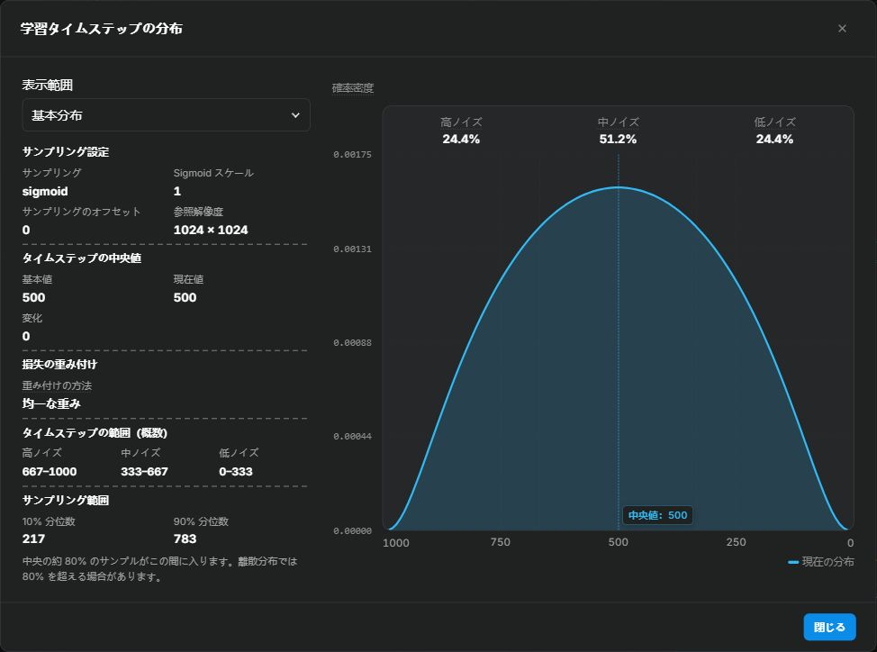

# タイムステップ

学習では、画像ごとにノイズのタイムステップを選び、その値に応じて画像の潜在表現とノイズを混ぜます。高いタイムステップはノイズを多く含み、低いタイムステップは元画像の情報を多く残します。

Anima、MOSS-Image、Krea 2 はフローマッチングを使い、正規化したタイムステップが混合係数を決めます。

| ノイズ量 | 入力に含まれる情報 |
| --- | --- |
| 高 | 元画像の情報が少なく、ノイズが多い |
| 中 | 画像とノイズの両方を多く含む |
| 低 | 元画像の情報が多く、ノイズが少ない |

キャラクターの同一性、全体構造、質感の学習には複数のノイズ区間が関わります。サンプリングを調整する前に、データ、解像度、学習範囲を確認してください。

タイムステップのサンプリングは各ノイズ量を使う頻度、損失の重み付けは抽出後の予測誤差の寄与を決めます。

<!-- doc-anchor: quick-start -->
## 基準となる設定

初回は選んだ学習プロファイルの既定分布を使ってください。

<!-- doc-anchor: defaults -->
### プロファイルの既定値

| 学習プロファイル | サンプリング | 分布パラメータ | `weighting_scheme` と作用 |
| --- | --- | --- | --- |
| Anima | `sigmoid` | `sigmoid_scale=1.0` | `uniform`：損失の倍率は 1 |
| MOSS-Image | `truncated_logit_normal` | `logit_mean=-1.09`, `logit_std=0.95`, `discrete_flow_shift=1.0`, `timestep_cutoff=0.95`, `timestep_uniform_ratio=0.01` | `uniform`：損失の倍率は 1 |
| Krea 2 | `shift` | `sigmoid_scale=1.0`, `discrete_flow_shift=2.5` | `none`：損失の倍率は 1 |

`uniform` と `none` は、どちらも損失の倍率を 1 にします。古いプリセットを読み込んだ場合は、フォームと分布プレビューに表示される値を確認してください。

MOSS-Image の新規設定は、0.95 での打ち切りと 1% の一様サンプルを含む truncated logit-normal で事前学習の抽出を再現します。既存設定の値は保持し、`sigma + logit_normal` も引き続き使えます。上流は簡単な近似として `shift + discrete_flow_shift=3` も示しています。

| 目的 | 調整する項目 | 既定値 |
| --- | --- | --- |
| 両端をより多くサンプリングする | `sigmoid_scale` | `1.0`。大きくすると両端に広がる |
| 高ノイズまたは低ノイズを増やす | `discrete_flow_shift` | Anima/MOSS は `1.0`、Krea 2 は `2.5`。`shift` と Anima/MOSS の `sigma`、`truncated_logit_normal` で有効 |
| サブセットごとにノイズ範囲を変える | `subset_timestep_offsets` | 未設定。Anima/MOSS の一部のモードのみ対応 |

<!-- doc-anchor: terminology -->
## 3 種類の「ステップ」

この学習ツールでは、異なる 3 つの意味で「ステップ」を使います。

| 名称 | 意味 | 主なパラメータ |
| --- | --- | --- |
| 学習ステップ数 | LoRA のパラメータを更新した回数 | `max_train_steps` |
| 学習タイムステップ | 現在の画像に加えるノイズ量 | `timestep_sampling` |
| 生成ステップ数 | サンプラーのノイズ除去ステップ数。1 ステップのモデル計算回数はサンプラーで異なる | `sample_steps` |

「学習ステップ 500」は、オプティマイザによる更新が 500 回行われたことを表します。本文の式は正規化した `t∈[0,1]` を使い、画面はおよそ `T=1000t` で表示します。`T≈500` は画像とノイズの混合係数がそれぞれ約半分です。1 回の更新でも、画像ごとにタイムステップが選ばれます。

<!-- doc-anchor: visualizer -->
## 分布プレビュー



上の画像は設定例です。高・中・低ノイズの割合をグラフ上部に表示します。学習タイムステップのサンプリング項目にある **タイムステップ分布を表示** を開くと、現在の設定を確認し、基本分布と学習全体の分布を切り替えられます。サイドバーには、サンプリング設定、基本分布と現在の分布の中央値、損失の重み付けが表示されます。曲線にカーソルを合わせると、その位置の値を確認できます。

| 表示要素 | 読み方 |
| --- | --- |
| サンプリング曲線 | 幅が同じ区間では、曲線の下の面積が大きいほど、そのノイズ範囲が多く選ばれる |
| 高・中・低ノイズの割合 | 各区間が総サンプリング回数に占める見込みの割合 |
| タイムステップ区間（概算） | 高・中・低ノイズ領域に対応するタイムステップの範囲 |
| サンプリング範囲（P10–P90） | 第 10 パーセンタイルから第 90 パーセンタイルまでの範囲で、サンプルの約 80% を含む |
| 損失重みの曲線 | 入力が選ばれた後、その予測誤差に掛ける倍率 |
| 参照解像度 | 現在のグラフで解像度に応じたシフトを計算する寸法 |

曲線ではサンプリング頻度と損失の重みを読み取れます。更新量と画質は学習ログとチェックポイントの生成画像で評価してください。離散的なノイズ表は連続分布で近似して表示します。

横軸は画像生成のノイズ除去順で、左端が最大ノイズ `T≈1000`、右端が低ノイズ `T≈0` です。学習では画像ごとにタイムステップを抽出します。

縦軸は確率密度 <var>f</var>(<var>t</var>) を表し、重みの曲線は対数目盛を使います。均一な重み付けでは、すべてのタイムステップに同じ倍率を掛けます。実際の損失は予測誤差によって変わります。

丸めにより、割合の合計が `99.9%` または `100.1%` になる場合があります。

<span id="dataset-guidance"></span>
<span id="scenarios"></span>

<!-- doc-anchor: diagnosis -->
## 学習結果に応じた調整

| 症状 | 先に確認する点 | 試す調整 |
| --- | --- | --- |
| シルエットや体の比率が弱い | 全身画像と必要な視点の有無 | データを補い、分布を固定して複数の学習段階のチェックポイントを比較する |
| 質感、線、装飾品が不足する | 元画像と学習解像度で細部が保たれるか | 前処理による細部の損失を確認し、分布を固定して解像度・学習範囲・ステップ数を調べる |
| 全体と細部の両方が弱い | 学習不足、学習対象の範囲が適切か | 分布を固定し、学習率、学習時間、学習範囲を確認する |
| 同じポーズや背景が繰り返される | 重複画像と過学習の兆候 | 分布を固定し、データと終了時点を確認する |
| 画風が色だけに反映され、形状に反映されない | 被写体と構図の多様性 | 被写体と構図を補ってからチェックポイントを比較する |

<!-- doc-anchor: sampling -->
## `timestep_sampling`：ノイズ量を選ぶ頻度

`timestep_sampling` は、青いサンプリング密度曲線の基本形状を決めます。

| 選択肢 | 動作 | 対応モデル |
| --- | --- | --- |
| `sigmoid` | 中ノイズを多く選び、両端も含む | Anima/MOSS、Krea 2 |
| `uniform` | 全範囲を均等に選ぶ | Anima/MOSS、Krea 2 |
| `shift` | sigmoid の抽出値に固定の非線形フローシフトを適用する | Anima/MOSS、Krea 2 |
| `sigma` | 学習スケジューラの離散ノイズ表から選ぶ | Anima/MOSS、Krea 2 |
| `truncated_logit_normal` | logit-normal を打ち切り・再スケールし、一様サンプルと混ぜて離散表に写す | Anima/MOSS |
| `flux_shift` | 現在の解像度から FLUX 式のシフトを計算する | Anima/MOSS |
| `krea2_shift` | 現在の解像度から Krea 2 式のシフトを計算する | Krea 2 |
| `logsnr` | LogSNR の分布をタイムステップに変換する | Krea 2 |

### `sigmoid`

`sigmoid_scale=1.0` でシフトがない場合、分布は左右対称で、中ノイズ付近に集中します。プレビューを等幅の 3 区間に分けると、低・中・高ノイズの割合は約 24.4%、51.2%、24.4% です。

標準正規分布から乱数を取り、`0–1` に変換します。

<div class="doc-equation" role="group" aria-label="sigmoid によるタイムステップのサンプリング式">
  <div class="doc-equation-kicker">Sigmoid サンプリング</div>
  <div class="doc-equation-expression"><var>z</var> ∼ N(0, 1)<br><var>t</var> = <span class="doc-math-fn">sigmoid</span>(<var>s</var> · <var>z</var><span class="doc-math-close">)</span></div>
  <p><var>s</var> は <code>sigmoid_scale</code> です。既定値は 1.0 です。</p>
</div>

### `uniform`

タイムステップの全範囲を均等に選びます。既定の sigmoid 分布より、低ノイズと高ノイズの両端を多く学習します。

### `shift`

sigmoid 分布に `discrete_flow_shift` を適用し、低ノイズ側または高ノイズ側へ重点を移します。

### `sigma`

学習スケジューラの離散ノイズ表から値を選びます。Anima/MOSS は `discrete_flow_shift` を表に適用します。現在の Krea 2 トレーナーはシフトなしの表を使い、この値を読みません。

`weighting_scheme=logit_normal` または `mode` は、表のインデックスを選ぶ頻度を変えます。それ以外はインデックスを均等に選びます。Anima/MOSS では表にシフトを適用すると、インデックスが均等でもタイムステップは不均等になります。Krea 2 のシフトなしの表は等間隔です。`sigma_sqrt` と `cosmap` は損失の重みだけを変えます。

### `flux_shift` と `krea2_shift`

潜在空間のグリッドサイズからシフトを計算します。グリッドの位置数が多いほど、高ノイズ側の割合が増えます。どちらも固定値 `discrete_flow_shift` は使いません。

バケットを有効にすると、解像度や縦横比の近い画像がまとめられます。各バケットは自分の潜在空間の寸法で分布を計算し、プレビューは現在の参照解像度の結果を表示します。

### `logsnr`

`logit_mean` の既定値は `0` です。大きくすると低ノイズ、小さくすると高ノイズが増えます。`logit_std` の既定値は `1` です。大きくすると分布が広がり、小さくすると集中します。`sigma + logit_normal` と名前は共通ですが、変換式が異なるため、値をそのまま流用できません。

SNR は信号とノイズの強度比で、LogSNR はその対数です。LogSNR が高いほど画像の信号が強く、ノイズが少なくなります。

Krea 2 の `logsnr` は、`logit_mean` と `logit_std` で定義した分布から LogSNR を選び、タイムステップに変換します。

<div class="doc-equation" role="group" aria-label="LogSNR からタイムステップへの変換式">
  <div class="doc-equation-kicker">Krea 2 の logsnr サンプリング</div>
  <div class="doc-equation-expression">LogSNR ∼ N(<var>μ</var>, <var>σ</var><span class="doc-math-close">)</span><br><var>t</var> = <span class="doc-math-fn">sigmoid</span>(−LogSNR / 2)</div>
  <p><var>μ</var> は <code>logit_mean</code>、<var>σ</var> は <code>logit_std</code> です。</p>
</div>

<!-- doc-anchor: sigmoid-scale -->
## `sigmoid_scale`：分布の広がり

既定値は `1.0` です。大きくすると両端、小さくすると中央付近のサンプルが増えます。

| 調整 | 分布の変化 | 学習への影響 |
| --- | --- | --- |
| 小さくする | 中ノイズ付近に集中する | 両端が減り、ノイズ除去の中間段階を重視する |
| 大きくする | 低ノイズと高ノイズが増える | 元画像の信号がごく少ない入力と、多く残る入力での更新が増える |

この表は追加シフトのない sigmoid 分布についての説明です。固定シフト、解像度によるシフト、サブセットのオフセットがある場合は、プレビューで最終的な割合を確認してください。

片側だけを増やすには、タイムステップのシフトを調整します。

<!-- doc-anchor: flow-shift -->
## `discrete_flow_shift`：高・低ノイズの割合を調整

既定値は Anima/MOSS が `1.0`、Krea 2 が `2.5` です。大きくすると高ノイズ、小さくすると低ノイズが増えます。`0` より大きい値を指定してください。Anima/MOSS は `shift` と `sigma`、Krea 2 は `shift` だけで使います。

| 値 | 変化の方向 | 基本分布からの変化 |
| --- | --- | --- |
| 1 より大きい | 高ノイズが増える | 同じ抽出値を、より高いタイムステップに変換する |
| 1 | 固定シフトなし | 基本分布 |
| 0 より大きく 1 より小さい | 低ノイズが増える | 同じ抽出値を、より低いタイムステップに変換する |

シフト値を <var>s</var> とすると、変換式は次のとおりです。

<div class="doc-equation" role="group" aria-label="discrete flow shift の式">
  <div class="doc-equation-kicker">固定フローシフト</div>
  <div class="doc-equation-expression"><var>t</var><sub>shifted</sub> = <span class="doc-frac"><span><var>s</var> · <var>t</var></span><span>1 + (<var>s</var> − 1) · <var>t</var></span></span></div>
  <p><var>s</var> は <code>discrete_flow_shift</code> です。</p>
</div>

`flux_shift` と `krea2_shift` は、解像度に応じた独自のシフトを使います。

<!-- doc-anchor: subset-offsets -->
## サブセット別のタイムステップオフセット

`subset_timestep_offsets` は、サブセットごとに独立したサンプリング偏移を指定します。sigmoid 変換前の正規乱数に加えるため、分布の形状とノイズの割合が変わります。**Anima/MOSS のみ**対応します。

サブセットは、数字とアンダースコアで始まるサブフォルダです（例：`10_group_a`、`3_group_b`）。先頭の数字はリピート回数です。サブセット名とオフセットの対応表を次の手順で入力します。

1. 数字とアンダースコアで始まるフォルダを作り、内容ごとに画像を分けます。
2. UI の対応表にフォルダ名とオフセットを入力します。
3. 分布プレビューで意図した変化を確認します。

対応表の例：

```json
{"10_group_a": -0.25, "3_group_b": 0.20}
```

学習開始時に、バックエンドが別の `dataset.toml` を書き出します。この項目はメインの学習設定には入りません。

```toml
[[datasets.subsets]]
image_dir = ".../10_group_a"
[datasets.subsets.custom_attributes]
timestep_sampling = { offset = -0.25 }
```

オフセットは各画像とともにバッチへ渡されます。`10_group_a` の画像は `-0.25`、`3_group_b` は `0.20` を使い、同じバッチに混在しても画像ごとの値を保ちます。正則化データには適用されません。

### 対応モードと推奨範囲

`sigmoid`、`shift`、`flux_shift`、`truncated_logit_normal`、`sigma + logit_normal` で有効です。`uniform` と他の `sigma` 方式では無効です。

まず `-0.5`～`+0.5` の範囲で調整してください。負の値は低ノイズ、正の値は高ノイズを増やします。すでに高ノイズへシフトしている場合、正の偏移は低ノイズをさらに減らします。分布プレビューで各サブセットのノイズ割合を確認してください。

プレビューでは、基本分布（全オフセットが 0）、全体の分布、各サブセットを確認できます。全体の分布はサンプル数で各サブセットを混合し、正則化サンプルを基本分布として含めます。1 つずつ調整し、既定値の学習結果と比較してください。オフセットは学習時のサンプリングだけに作用します。他の検証設定が同じなら、検証損失を比較できます。

### オフセットを加える位置

`sigmoid`、`shift`、`flux_shift` では正規乱数にオフセットを加え、`sigmoid_scale` を掛けてから `sigmoid` に通します。後の 2 方式はさらに全体を再変換します。

```text
timestep = sigmoid( sigmoid_scale × (random sample + offset) )
```

`0` は元の分布を保ちます。`sigmoid_scale` は乱数とオフセットの両方に掛かります。

`sigma + logit_normal` と `truncated_logit_normal` は `logit_mean - offset` として適用し、正の値を高ノイズ方向に保ちます。

<!-- doc-anchor: truncated-logit-normal -->
### `truncated_logit_normal`：打ち切りと一様混合

Anima/MOSS で使用できます。`logit_mean` と `logit_std` の logit-normal 分布を打ち切り、全ノイズ範囲へ再スケールし、1000 点の学習グリッドに写します。

- `timestep_cutoff`：範囲 `(0, 1]`、既定 `0.95`。再スケールにより高ノイズ端までカバーします。
- `timestep_uniform_ratio`：範囲 `[0, 1]`、既定 `0.01` は 1% の一様抽出。`1` は全件を一様抽出します。
- `logit_std` は正数が必要です。`discrete_flow_shift` は学習グリッドを変えます。
- `logit_mean/std` を直接読みます。`weighting_scheme=logit_normal` は不要です。`sigma_sqrt/cosmap` の損失重みは適用できます。

非常に小さい打ち切り閾値や極端な平均・標準偏差では、学習器の浮動小数点精度と逆累積分布の入力上限により、少数のグリッド点にサンプルが集中することがあります。プレビューはこの制限を考慮します。値を調整するときは分布を確認してください。

<!-- doc-anchor: weighting -->
## サンプリング頻度と損失の重み

`weighting_scheme` の作用はサンプリング経路で決まります。`sigma` の `logit_normal` と `mode` は抽出頻度、`sigma_sqrt` と `cosmap` は抽出後の損失重みを制御します。

| 方式 | 変わるもの | 意味 |
| --- | --- | --- |
| `uniform` / `none` | 追加の重み付けなし | 全タイムステップの損失重みは同じ。頻度はサンプリング方式で決まる |
| `sigma_sqrt` | 低ノイズの重みを増やす | 低ノイズの課題を重視する。ノイズが 0 に近いと重みが急増するため、更新の安定性を確認する |
| `cosmap` | 中ノイズの相対的な重みを増やす | 両端の重みを相対的に下げる。頻度は現在の抽出方式に従う |
| `logit_normal` | `sigma` のサンプリング頻度 | 損失の倍率は 1。`sigma` 経路でのみ有効 |
| `mode` | `sigma` のサンプリング頻度 | 損失の倍率は 1。`mode_scale` が分布を調整 |

初回は各プロファイルの既定値を使います。Anima/MOSS は `uniform`、Krea 2 は `none` です。低ノイズの誤差を重視したいなら `sigma_sqrt`、中ノイズを重視したいなら `cosmap` を比較します。

### `sigma_sqrt` と `cosmap` の重み

<div class="doc-equation" role="group" aria-label="sigma sqrt による損失重み付けの式">
  <div class="doc-equation-kicker">低ノイズを重視</div>
  <div class="doc-equation-expression"><var>w</var> = <span class="doc-frac"><span>1</span><span><var>σ</var><sup>2</sup></span></span></div>
  <p><var>σ</var> が 0 に近づくと、重みが急増します。</p>
</div>

<div class="doc-equation" role="group" aria-label="cosmap による損失重み付けの式">
  <div class="doc-equation-kicker">中ノイズを重視</div>
  <div class="doc-equation-expression"><var>w</var> = <span class="doc-frac"><span>2</span><span><var>π</var> · (1 − 2 · <var>σ</var> + 2 · <var>σ</var><sup>2</sup><span class="doc-math-close">)</span></span></span></div>
  <p>中ノイズの重みは両端より高くなります。この曲線はサンプリング頻度を変えません。</p>
</div>

<!-- doc-anchor: logit-normal -->
### `logit_normal`、`logit_mean`、`logit_std`

`weighting_scheme=logit_normal` は、`timestep_sampling=sigma` のときだけ有効です。

- `logit_mean=0` では表のインデックスが対称に分布します。大きくすると低ノイズ、小さくすると高ノイズが増えます。MOSS の既定値は `-1.09` です。
- `logit_std` は小さくすると集中し、大きくすると両端へ広がります。Anima の既定値は `1`、MOSS は `0.95` です。

Anima/MOSS ではスケジューラのシフトも最終的なノイズ量を変えます。Krea 2 の `sigma` の表にはシフトを適用しません。`sigmoid + logit_normal` では、後者は頻度にも重みにも作用しません。Krea 2 の `logsnr` はこの 2 つの値を直接読むため、該当する説明を参照してください。

<!-- doc-anchor: mode -->
### `mode` と `mode_scale`

`mode` は `timestep_sampling=sigma` のときに頻度を変え、損失の倍率は 1 です。

- `mode_scale=0`：ノイズ表のインデックスを均等に選びます。
- `0` から既定値 `1.29` へ大きくすると、表の中央付近に集中します。
- Anima/MOSS は `discrete_flow_shift` で表の中央が表すノイズ量も変わります。Krea 2 の `sigma` は `discrete_flow_shift` を無視しますが、`mode_scale` は使います。最初は `mode_scale=1.29` を使ってください。

<!-- doc-anchor: compatibility -->
## パラメータの有効範囲

| パラメータ | sigmoid | uniform | shift | sigma | flux/krea shift | logsnr |
| --- | --- | --- | --- | --- | --- | --- |
| `sigmoid_scale` | 有効 | 無効 | 有効 | 無効 | 有効 | 無効 |
| `discrete_flow_shift` | 無効 | 無効 | 有効 | Anima/MOSS のみ | 無効 | 無効 |
| `logit_mean/std` | 無効 | 無効 | 無効 | `logit_normal` の密度のみ | 無効 | 直接使用 |
| `mode_scale` | 無効 | 無効 | 無効 | `mode` の密度のみ | 無効 | 無効 |
| `subset_timestep_offsets` | 有効 | 無効 | 有効 | Anima/MOSS の `logit_normal` | `flux_shift` のみ | 無効 |
| `sigma_sqrt/cosmap` の重み | 有効 | 有効 | 有効 | 有効 | 有効 | 有効 |

`truncated_logit_normal` は `logit_mean/std`、`discrete_flow_shift`、サブセット偏移、2 つの打ち切り設定を使います。`sigmoid_scale` と `mode_scale` は無効です。

「無効」は現在の学習経路でその項目を使わないことを表します。フォームでは無効な項目を隠すか注記し、プレビューでも知らせます。

<!-- doc-anchor: sdxl-range -->
## SDXL の `min_timestep` と `max_timestep`

SDXL は、上記の Anima/MOSS／Krea 2 用フローマッチング設定を使いません。代わりに、範囲を指定する項目があります。

- `min_timestep`：許可する最小タイムステップ。空欄は `0`。
- `max_timestep`：上限。この値自体は含みません。空欄は `1000` で、既定範囲は `0–999`。
- `min_timestep` を上げると、ノイズの少ないサンプルを除外します。
- `max_timestep` を下げると、ノイズの多いサンプルを除外します。

この 2 項目は抽出を許可する範囲を狭めます。既定値は全範囲を使い、特定のノイズ端点を除外する際に調整します。

SDXL の `min_snr_gamma`、`v_parameterization`、`zero_terminal_snr` は、それぞれ損失の重み、予測対象、スケジューラの動作を制御します。

<!-- doc-anchor: common-mistakes -->
## よくある誤解

- `sample_flow_shift` は生成プレビュー用で、学習タイムステップを変えません。
- シードは抽出する乱数列を決め、プレビューは抽出式の理論分布を示します。バッチサイズと GPU 数は短い学習でのばらつきに影響します。
- 学習タイムステップは学習時に使う設定です。推論サンプラーは生成の目的に合わせて選べます。

<!-- doc-anchor: sdxl-loss -->
## SDXL：損失重みとノイズ追加の関係

Min-SNR と去偏推定は抽出後の損失重みに作用します。両方有効なら重みが乗算され、抽出頻度はタイムステップのサンプリング設定で決まります。

対象タイムステップの信号対雑音比を SNR とし、去偏推定には S = min(SNR, 1000) を使います。

| 予測対象 | Min-SNR の重み | 去偏推定の重み |
| --- | --- | --- |
| ノイズ予測 | min(SNR, γ) / SNR | 1 / √S |
| v-prediction | min(SNR, γ) / (SNR + 1) | 1 / (S + 1) |

`min_snr_gamma` が空欄または 0 なら Min-SNR は無効です。比較時は予測対象とタイムステップ範囲を固定してください。

ノイズオフセットと多解像度ノイズは入力ノイズを変えます。先にオフセットを加え、その後に低解像度ノイズを重ねて正規化します。両方有効にできます。反復数は上限で、いずれかの辺が 1 ピクセルになると早期終了します。割引係数は各層の寄与を調整します。

<span id="comparison-method"></span>
<!-- doc-anchor: testing -->
## 条件を揃えた比較

1. **基準**：選んだプロファイルの既定値で 1 回学習します。
2. **固定する条件**：データセット、シード、rank、alpha、学習率、総学習ステップ数を揃えます。
3. **変更は 1 つ**：例として、`sigmoid_scale` だけを `1.0` から `1.25` に変えます。
4. **比較条件**：同じ学習ステップのチェックポイントを使い、プロンプト、生成シード、解像度、推論時の LoRA 強度を揃えます。
5. **評価項目**：再現性、背景の混入、構図の固定化、プロンプトへの追従、学習画像にない被写体や構図への対応を確認します。

条件を揃えた生成画像と実際の用途を主な評価基準にし、学習損失は補助的な指標として使ってください。

<!-- doc-anchor: flow-matching -->
## タイムステップの仕組み

学習前に、VAE が画像を潜在表現へ変換します。モデルが扱うのはこの表現です。画像の潜在表現を <var>x</var>、ランダムノイズを <var>ε</var>、正規化したタイムステップを <var>t</var> とすると、ノイズを加えた入力は次のようになります。

<div class="doc-equation" role="group" aria-label="フローマッチングのノイズ付き入力の式">
  <div class="doc-equation-kicker">ノイズを加えた入力</div>
  <div class="doc-equation-expression"><var>x</var><sub>t</sub> = (1 − <var>t</var><span class="doc-math-close">)</span> · <var>x</var> + <var>t</var> · <var>ε</var></div>
  <p><var>t</var> が小さいほど元画像に近く、大きいほど純粋なノイズに近くなります。</p>
</div>

現在の Anima/MOSS と Krea 2 は、データからノイズへ向かう方向を予測するように学習します。

<div class="doc-equation doc-equation-compact" role="group" aria-label="フローマッチングの学習対象">
  <div class="doc-equation-kicker">予測対象</div>
  <div class="doc-equation-expression"><var>v</var> = <var>ε</var> − <var>x</var></div>
  <p>生成時は、学習した経路を逆にたどり、高ノイズから画像へ向かいます。</p>
</div>

学習コードでは、ノイズの混合比を <var>σ</var> とも表します。`sigma_sqrt` と `cosmap` の sigma はこの値です。ここで扱うフローマッチングでは、<var>σ</var> と <var>t</var> は同じ方向に変わり、`0` に近いとノイズが少なく、`1` に近いとほぼ純粋なノイズになります。UI では、この範囲をおよそ `0–1000` のタイムステップとして表示します。

<!-- doc-anchor: evidence -->
## 実装と参考資料

実装の参照先です。リンクはリビジョンを固定しています。

- [`library/flux_train_utils.py`](https://github.com/amenorira/lora-scripts-anima/blob/11d0f7a348721b8688240dada0e172980b20a3b7/vendor/sd-scripts/library/flux_train_utils.py)：`sigmoid`・`shift`・`flux_shift` の抽出、`sigma_sqrt`・`cosmap` の重み、固定シフトの変換。
- [`anima_train_network.py`](https://github.com/amenorira/lora-scripts-anima/blob/11d0f7a348721b8688240dada0e172980b20a3b7/vendor/sd-scripts/anima_train_network.py)：学習時にバッチの `custom_attributes` から画像ごとのオフセットを取得。
- [`backend/training/sd_dataset_config.py`](https://github.com/amenorira/lora-scripts-anima/blob/11d0f7a348721b8688240dada0e172980b20a3b7/backend/training/sd_dataset_config.py)：`backend/server/routes/training.py` と共にオフセットを検証し、`dataset.toml` を生成して学習コードへ渡す。
- [`library/anima_train_utils.py`](https://github.com/amenorira/lora-scripts-anima/blob/11d0f7a348721b8688240dada0e172980b20a3b7/vendor/sd-scripts/library/anima_train_utils.py)：Anima のサンプリングと損失重み付けの振り分け。
- [`training/timesteps.py`](https://github.com/amenorira/lora-scripts-anima/blob/11d0f7a348721b8688240dada0e172980b20a3b7/vendor/musubi-tuner/src/musubi_tuner/training/timesteps.py)：共通の密度と損失重みの式。
- [`training/trainer_base.py`](https://github.com/amenorira/lora-scripts-anima/blob/11d0f7a348721b8688240dada0e172980b20a3b7/vendor/musubi-tuner/src/musubi_tuner/training/trainer_base.py)：Krea 2 の `krea2_shift`・`logsnr` などの抽出。
- [`frontend/js/training-core.js`](https://github.com/amenorira/lora-scripts-anima/blob/11d0f7a348721b8688240dada0e172980b20a3b7/frontend/js/training-core.js)：確率密度の解析計算と損失重みの曲線。
- [Anima 公式モデルカード](https://huggingface.co/circlestone-labs/Anima/blob/f7382c4bf9d7ffe4ceea593a0adbb470c56dd79b/README.md)
- [Scaling Rectified Flow Transformers for High-Resolution Image Synthesis](https://arxiv.org/abs/2403.03206)
- [Flow Matching for Generative Modeling](https://arxiv.org/abs/2210.02747)

- [MOSS-Image の上流ガイド](https://github.com/kohya-ss/sd-scripts/blob/04ca541746b7667b27eab230db067579f682895e/docs/moss_image_train_network.md#72-training-settings--学習設定)
- [SDXL の損失重み](https://github.com/kohya-ss/sd-scripts/blob/04ca541746b7667b27eab230db067579f682895e/library/custom_train_functions.py)
- [ノイズ追加の順序](https://github.com/kohya-ss/sd-scripts/blob/04ca541746b7667b27eab230db067579f682895e/library/loss.py)
