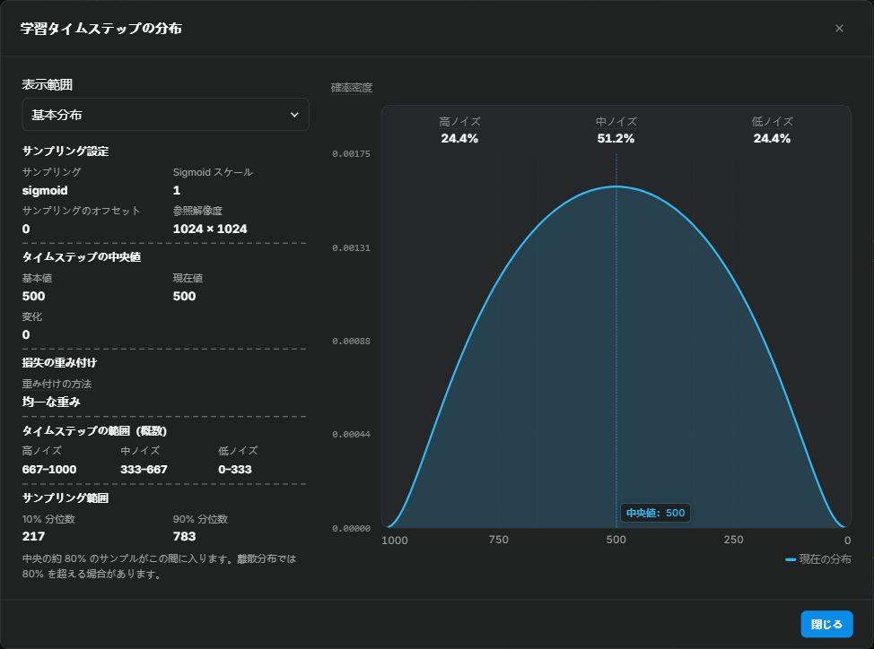

# タイムステップ

## 基本概念とモデル種別ごとの既定値

学習では、画像ごとに独立したノイズのタイムステップを抽出し、元画像の latent とランダムノイズを混合して各段階のノイズ除去方向を学習します。ノイズ域ごとに学習される視覚的特徴が異なります。

| ノイズ域 | 画面のタイムステップ（概算） | 入力画像の状態 | 主に学習される特徴 |
| --- | --- | --- | --- |
| 高ノイズ | `T ≈ 1000 → 667` | ノイズが支配的で大まかな低周波成分のみ残る | 全体の構図、シルエットと頭身比率、大きな配色・明暗の配置 |
| 中ノイズ | `T ≈ 667 → 333` | 元画像の構造とノイズがバランスよく混ざる | 顔立ち・体幹の構造、衣装パーツの位置関係、画風の骨格 |
| 低ノイズ | `T ≈ 333 → 0` | 元画像に近く、わずかなノイズのみ含む | 描線の鋭さ、肌や布地の質感、瞳や小さな装飾品などの細部 |

**タイムステップのサンプリング**は各ノイズ量が選ばれる頻度を決め、**損失の重み付け**は抽出されたサンプルの予測誤差に掛ける倍率を決めます。

### モデル種別ごとの既定設定

初回は選択したモデル種別の既定分布のまま学習し、データセット、解像度、学習率が適切であることを確認してから調整してください。

| モデル種別 | 既定のサンプリング | 既定の分布パラメータ | 既定の重み付け・補足 |
| --- | --- | --- | --- |
| Anima | `sigmoid` | `sigmoid_scale=1.0` | `uniform`（損失倍率は `1`。中ノイズを中心に両端もカバー） |
| MOSS-Image | `truncated_logit_normal` | `logit_mean=-1.09`, `logit_std=0.95`, `discrete_flow_shift=1.0`, `timestep_cutoff=0.95`, `timestep_uniform_ratio=0.01` | `uniform`（事前学習の分布を再現。上流では簡易近似として `shift + discrete_flow_shift=3` も案内） |
| Krea 2 | `shift` | `sigmoid_scale=1.0`, `discrete_flow_shift=2.5`, `min_timestep=0`, `max_timestep=1000` | `none`（損失倍率は `1`。中〜高ノイズ側へ適度にシフト） |
| SDXL | `0〜999` の一様抽出 | [`min_timestep`](#sdxl-range) / [`max_timestep`](#sdxl-range) 空欄 | 既定は等重み。必要に応じて [`min_snr_gamma`](#sdxl-loss) を併用 |

| 調整したい目的 | 優先して見る項目 | 開始の目安 |
| --- | --- | --- |
| 全体を高ノイズ（構図重視）または低ノイズ（細部重視）へ寄せる | [`discrete_flow_shift`](#flow-shift) | `> 1` で高ノイズ側、`< 1` で低ノイズ側（Krea 2 既定は `2.5`） |
| 両端のサンプリングを同時に増やす／中ノイズへ絞る | [`sigmoid_scale`](#sigmoid-scale) | 既定 `1.0`。上げると両端へ広がり、下げると中央へ集中 |
| 全身画像とアップ画像などサブセット別に重点を分ける | [`subset_timestep_offsets`](#subset-offsets) | `-0.5〜+0.5`（Anima / MOSS-Image の対応モードのみ） |
| 抽出頻度を変えずに低ノイズまたは中ノイズの誤差を重視する | [`weighting_scheme`](#weighting) | `sigma_sqrt`（低ノイズ重視）または `cosmap`（中ノイズ重視） |

### 3 種類の「ステップ」の違い

| 名称 | 意味 | 主なパラメータ |
| --- | --- | --- |
| 学習ステップ数 | オプティマイザが LoRA 重みを更新した累計回数（例：「500 ステップ目」） | `max_train_steps` / `max_train_epochs` |
| 学習タイムステップ | 1 枚の学習画像に加えるノイズ量（画面では `0〜1000` 表示、画像ごとに個別抽出） | `timestep_sampling` |
| 生成ステップ数 | プレビューや推論時にサンプラがノイズを除去する反復回数 | `sample_steps` |

### フローマッチングのノイズ混合と予測対象

Anima、MOSS-Image、Krea 2 はフローマッチングを採用しています。VAE で変換した元画像の latent を <var>x</var>、ランダムノイズを <var>ε</var>、正規化タイムステップを <var>t</var> ∈ [0, 1]（画面表示は概算で `T = 1000t`）とすると、入力と予測目標は次の式で表されます。

  
フローマッチングの入力と速度目標

  
<var>x</var>t = (1 − <var>t</var>) · <var>x</var> + <var>t</var> · <var>ε</var> ， <var>v</var> = <var>ε</var> − <var>x</var>

  
<var>t</var> = 0.5（<code>T ≈ 500</code>）では画像とノイズが半分ずつ混ざります。重み式のノイズ比 <var>σ</var> は <var>t</var> と同じ向きに変化し、1 に近いほど純粋なノイズへ近づきます。

## 分布プレビューの見方

フォームの **タイムステップのサンプリング**（Krea 2 では **タイムステップのサンプリング方法**）の下にある **タイムステップ分布を表示** を開くと、現在の設定による理論分布を確認し、基本分布・学習全体の分布・各サブセットを切り替えて比較できます。横軸は生成時のノイズ除去順に合わせて左端が高ノイズ `T ≈ 1000`、右端が低ノイズ `T ≈ 0` です。

| 表示要素 | 読み取り方 |
| --- | --- |
| 青いサンプリング密度曲線 <var>f</var>(<var>t</var>) | 同じ幅の区間では曲線下の面積が大きいほど頻繁に選ばれる。カーソルを合わせると数値を確認可能 |
| 高・中・低ノイズの割合 | 3 等分した各区間が総サンプリングに占める見込み比率（丸めにより合計が `99.9%` や `100.1%` になる場合あり） |
| 主なサンプリング区間（P10–P90）・中央値 | サンプルの約 `80%` が入る範囲と中央値の位置 |
| 損失の重み曲線（対数目盛） | 抽出後の予測誤差に掛ける倍率。均一な重みでは全域で `1` |
| 参照解像度 | [`flux_shift` / `krea2_shift`](#sampling) の解像度由来シフトを計算する基準サイズ |

## タイムステップを調整する場面と切り分け

調整の前に、元画像や学習解像度で細部が潰れていないこと、学習率とステップ数が適正であることを確認してください。そのうえで、次の 4 つの場面ではタイムステップ設定の変更が有効です。

| 具体的な場面 | 試す調整 | 仕組みと狙い |
| --- | --- | --- |
| `1024` 以上の高解像度学習で全体の構図や頭身バランスが崩れやすい | `shift` に切り替えて [`discrete_flow_shift`](#flow-shift) を上げる（例：`1.5〜3.0`）、または `flux_shift` / `krea2_shift` を使う | 高解像度ほど隣接画素の手掛かりが多く同じ `t` でも局所補完に偏りやすいため、高ノイズ側を増やして全体構造を学ばせる |
| 全身立ち絵と高精細な顔・装飾のアップ画像を混ぜて学習する | [サブセット別オフセット](#subset-offsets)で全身サブセットを `0` に保ち、アップのサブセットを `-0.15〜-0.35` にする | 全身画像で中〜高ノイズの構図と体型を学び、アップ画像を低ノイズ域へ寄せて顔立ちや質感を仕上げる |
| シルエットや同一性は安定しているが、描線や布地・小物の質感が甘い | サンプリングは維持したまま [`weighting_scheme=sigma_sqrt`](#weighting) と比較する | 高ノイズの抽出回数を減らさずに低ノイズ誤差の重みを強める（`T≈0` 付近の勾配変動に注意） |
| 両端の極端なタイムステップで損失が跳ねる／中ノイズの造形に集中したい | [`weighting_scheme=cosmap`](#weighting) を試すか、[`sigmoid_scale`](#sigmoid-scale) を `0.8` 前後へ少し下げる | 極端な高ノイズ・低ノイズの更新を抑え、主要構造が決まる中ノイズ域へ集中させる |

> **タイムステップを変えなくてよい場面**：全体も細部も一様に弱い場合はトリガーワード・[学習率](optimizers.ja-JP.md#learning-rate)・ステップ数を先に確認します。学習画像のポーズや背景がすぐ固定される場合は重複構図を減らして早い段階のチェックポイントを選び、画風 LoRA で色だけ変わり造形が乗らない場合は被写体と構図のバリエーションを補ってください。

## タイムステップのサンプリング（timestep_sampling）

`timestep_sampling` は青いサンプリング密度曲線の基本形状を決めます。

| 選択肢 | 動作 | 対応するモデル種別 |
| --- | --- | --- |
| `sigmoid` | 標準正規乱数を `sigmoid(s · z)` で `(0, 1)` に写し、中ノイズを中心に左右対称に抽出（既定の低・中・高ノイズ比は約 `24.4% / 51.2% / 24.4%`） | Anima、MOSS-Image、Krea 2 |
| `uniform` | 全範囲を均等に抽出し、高ノイズと低ノイズの両端を増やす | Anima、MOSS-Image、Krea 2 |
| `shift` | `sigmoid` の抽出値に固定の [`discrete_flow_shift`](#flow-shift) を適用 | Anima、MOSS-Image、Krea 2 |
| `sigma` | スケジューラの 1000 点離散ノイズ表から抽出。[`logit_normal`](#logit-normal) や [`mode`](#mode) で添字の抽出密度を変更可能 | Anima、MOSS-Image、Krea 2 |
| `truncated_logit_normal` | logit-normal を打ち切り・再スケールし、少量の一様抽出を混ぜて離散グリッドへ写す（MOSS-Image 既定） | Anima、MOSS-Image |
| `flux_shift` / `krea2_shift` | 各バケットの latent グリッドサイズから高ノイズシフトを自動算出（固定の `discrete_flow_shift` は不使用） | `flux_shift`：Anima/MOSS、`krea2_shift`：Krea 2 |
| `logsnr` | 正規分布から対数信号対雑音比（LogSNR）を抽出してタイムステップへ変換 | Krea 2 |

  
基本の Sigmoid サンプリング

  
<var>z</var> ∼ N(0, 1) ， <var>t</var> = sigmoid(<var>s</var> · <var>z</var>)

  
<var>s</var> は <code>sigmoid_scale</code>（既定 1.0）です。<code>sigma</code> 経路では、Anima/MOSS はノイズ表に <code>discrete_flow_shift</code> を適用し、Krea 2 のトレーナはシフトなしの等間隔表を使います。

### truncated_logit_normal：打ち切りと一様混合

Anima と MOSS-Image で使用できます。`logit_mean` と `logit_std` の分布を上限で打ち切って全ノイズ範囲へ再スケールし、1000 点の学習グリッドへ写します。

- **`timestep_cutoff`**：範囲 `(0, 1]`、既定 `0.95`。打ち切り後の再スケールにより高ノイズ端までカバーされます。
- **`timestep_uniform_ratio`**：範囲 `[0, 1]`、既定 `0.01`（`1%` の一様グリッド抽出を混合。`1` で全件一様抽出）。
- `logit_mean` と `logit_std`（正数必須）を直接読み取るため `weighting_scheme=logit_normal` の選択は不要です。`discrete_flow_shift`、サブセット別オフセット、`sigma_sqrt` / `cosmap` の損失重みとも併用できます。極端に小さい打ち切りしきい値や極端な平均・標準偏差は、浮動小数点精度と逆累積分布の上限に達して端のグリッド点へ集中するため避けてください。

### logsnr：対数信号対雑音比サンプリング

Krea 2 専用です。LogSNR が高いほど元画像の信号が強く低ノイズになります。

  
Krea 2 の logsnr サンプリング

  
LogSNR ∼ N(<var>μ</var>, <var>σ</var>) ， <var>t</var> = sigmoid(−LogSNR / 2)

  
<var>μ</var> は <code>logit_mean</code>（既定 0。上げると低ノイズ、下げると高ノイズが増加）、<var>σ</var> は <code>logit_std</code>（既定 1。上げると広がる）です。<code>sigma + logit_normal</code> とは変換式が異なるため、切り替え後は分布プレビューで確認してください。

## 分布の広がり（sigmoid_scale）

`sigmoid_scale`（既定 `1.0`）は `sigmoid`、`shift`、`flux_shift`、`krea2_shift` で有効です。

- **小さくする（例：`0.6〜0.8`）**：中ノイズ付近に集中し、両端の抽出が減ります。
- **大きくする（例：`1.2〜1.5`）**：高ノイズ（全体構図）と低ノイズ（微細な質感）の両端が同時に増えます。片側だけを増やしたい場合は [`discrete_flow_shift`](#flow-shift) を調整してください。

## 高・低ノイズのシフト（discrete_flow_shift）

`discrete_flow_shift`（`> 0`）は分布全体を片側へ寄せます。既定値は Anima / MOSS-Image が `1.0`（`shift`、`sigma`、`truncated_logit_normal` で有効）、Krea 2 が `2.5`（`shift` のみで有効）です。

- **`> 1`**：同じ抽出値をより高いタイムステップへ写し、高ノイズの割合を増やします。
- **`= 1`**：固定シフトを加えず基本分布を維持します。
- **`0 < s < 1`**：より低いタイムステップへ写し、低ノイズの割合を増やします。

  
固定フローシフト変換

  
<var>t</var>shifted = (<var>s</var> · <var>t</var>) / (1 + (<var>s</var> − 1) · <var>t</var>)

  
<var>s</var> は <code>discrete_flow_shift</code> です。

## サブセット別オフセット（subset_timestep_offsets）

サブセットごとにノイズのサンプリング重点を変えられます。**負の値は低ノイズ（細部重視）、正の値は高ノイズ（全体構造重視）を増やします**。**Anima と MOSS-Image** の `sigmoid`、`shift`、`flux_shift`、`truncated_logit_normal`、`sigma + logit_normal` で対応します（`uniform` と他の `sigma` 設定では無効）。

**画面での設定手順：**

1. 学習フォルダ内に `リピート数_名前`（例：`10_closeup`、`5_fullbody`）のサブフォルダを作って画像を分け、フォームで学習フォルダを選択します。
2. 学習パラメータ内の **サブセット別オフセット** 一覧に表示された各行で、`− / 入力欄 / +` ステッパ（`0.05` 刻み）を使ってオフセットを指定します（まず `-0.5〜+0.5` の範囲で 1 サブセットずつ調整）。
3. 各行のグラフボタンまたは右上の **分布を比較** を押し、基本分布・個別サブセット・サンプル数で重み付けした学習全体の分布を確認します。

`0` 以外のオフセットは `training.yaml` の保存・書き出しに含まれ、学習開始時に `dataset.toml` の `custom_attributes.timestep_sampling = { offset = ... }` として書き出されます。同一バッチ内で複数サブセットが混在しても画像ごとに適用され、正則化画像や検証損失には影響しません。

**モードごとのオフセット適用位置：**

- **`sigmoid` / `shift` / `flux_shift`**：`t = sigmoid(sigmoid_scale × (z + offset))` の後にシフト変換を行います（`sigmoid_scale` は乱数とオフセットの両方に掛かります）。
- **`sigma + logit_normal` / `truncated_logit_normal`**：内部で `logit_mean - offset` として適用されるため、正の値で高ノイズが増える向きに統一されています。

## サンプリング頻度と損失の重み付け（weighting_scheme）

`weighting_scheme` には 2 つの役割があります。`sigma_sqrt` と `cosmap` はすべてのフローマッチング抽出で**抽出後の損失倍率**を変え、`logit_normal` と `mode` は `timestep_sampling=sigma` のときにのみ**ノイズ表の添字を選ぶ頻度**を変えます（損失倍率は `1` のまま）。

| 方式 | 変化する対象 | 調整の意味 |
| --- | --- | --- |
| `uniform`（Anima/MOSS）/ `none`（Krea 2） | 損失倍率を `1` に固定 | 初回の既定値。サンプリング分布どおりの比率で学習 |
| `sigma_sqrt` | 低ノイズ側の損失重みを増幅 | 低ノイズの細部再現を重視。`σ → 0` で重みが急増するため更新の安定性に注意 |
| `cosmap` | 中ノイズ付近の相対重みを増加 | 両端の極端なノイズ域の重みを抑え、中盤の構造学習を安定化 |
| `logit_normal` | `sigma` 経路の抽出密度 | `timestep_sampling=sigma` のみ有効。`logit_mean` / `logit_std` で調整 |
| `mode` | `sigma` 経路の抽出密度 | `timestep_sampling=sigma` のみ有効。`mode_scale` で調整 |

  
損失重みの式（σ はノイズ比）

  
<var>w</var>sigma_sqrt = 1 / <var>σ</var>2 ， <var>w</var>cosmap = 2 / (<var>π</var> · (1 − 2<var>σ</var> + 2<var>σ</var>2))

### logit_normal、logit_mean、logit_std

`timestep_sampling=sigma` かつ `weighting_scheme=logit_normal` のときに離散表の抽出密度を制御します（`sigmoid + logit_normal` などでは作用せず、プレビューに注記が表示されます）。

- **`logit_mean`**：`0` で対称になり、**大きくすると低ノイズ、小さくすると高ノイズ**が増えます（Anima / Krea 2 既定 `0`、MOSS-Image 既定 `-1.09`）。
- **`logit_std`**：小さいほど集中し、大きいほど両端へ広がります（Anima / Krea 2 既定 `1.0`、MOSS-Image 既定 `0.95`）。
- 同じ 2 項目は Anima / MOSS-Image の [`truncated_logit_normal`](#truncated-logit-normal) と Krea 2 の [`logsnr`](#logsnr) でも直接使用されます。

### mode と mode_scale

`timestep_sampling=sigma` かつ `weighting_scheme=mode` のときに添字の抽出頻度を変えます（損失倍率は `1`）。`mode_scale=0` で均等抽出になり、既定の `1.29` へ上げるほど表の中央付近へ集中します（Anima / MOSS-Image では `discrete_flow_shift` による表自体のシフトも加わります）。初回は `1.29` を維持してください。

## パラメータの有効範囲とよくある誤解

| パラメータ | `sigmoid` | `uniform` | `shift` | `sigma` | `truncated_logit_normal` | `flux_shift` / `krea2_shift` | `logsnr` |
| --- | --- | --- | --- | --- | --- | --- | --- |
| `sigmoid_scale` | 有効 | 無効 | 有効 | 無効 | 無効 | 有効 | 無効 |
| `discrete_flow_shift` | 無効 | 無効 | 有効 | Anima/MOSS のみ | 有効 | 無効 | 無効 |
| `logit_mean` / `logit_std` | 無効 | 無効 | 無効 | `logit_normal` のみ | 直接使用 | 無効 | 直接使用 |
| `mode_scale` | 無効 | 無効 | 無効 | `mode` のみ | 無効 | 無効 | 無効 |
| `subset_timestep_offsets` | 有効 | 無効 | 有効 | Anima/MOSS + `logit_normal` | 有効 | `flux_shift` のみ | 無効 |
| `sigma_sqrt` / `cosmap` | 有効 | 有効 | 有効 | 有効 | 有効 | 有効 | 有効 |

### よくある誤解

- **`sample_flow_shift` はプレビュー生成専用**：プレビュー欄の `sample_flow_shift` は推論プレビューのスケジュール用であり、学習タイムステップの分布は変えません。
- **短期学習での抽出のばらつき**：プレビューは連続式の理論分布を示しますが、実際の短い学習では `seed`、バッチサイズ、GPU 枚数による有限サンプルの偏りが生じます。
- **学習設定と推論サンプラの独立性**：学習時のタイムステップ設定に関わらず、ComfyUI などの推論環境では用途に合わせて任意のサンプラとステップ数を選べます。

## Krea 2 のタイムステップ範囲と層化バケット

Krea 2 ではフローマッチング設定に加え、抽出範囲の制限と層化バケット抽出を指定できます。

- **`min_timestep` / `max_timestep`**（既定 `0` / `1000`、`0 ≤ min < max ≤ 1000` が必須）：直接抽出モード（`sigmoid`、`shift`、`uniform`、`flux_shift`、`krea2_shift`、`logsnr`）ではノイズのタイムステップ範囲を制限し、`sigma` モードではスケジューラ表の添字範囲を制限します（Krea 2 の表は逆順のため、添字が大きいほど低ノイズになります）。
- **タイムステップ分布形状を保持**（`preserve_distribution_shape`、既定オフ、`sigma` では不使用）：オフのときは元の分布を `[min_timestep, max_timestep]` 内へ縮尺変換します。オンのときは元の分布から再抽出して範囲内の値だけを残します（プレビューでは曲線を範囲で切り取った形状になります）。範囲が極端に狭く再試行してもバッチ分の値が揃わない場合は元の分布へ戻り、範囲外の値も抽出される点に注意してください。
- **タイムステップ抽出バケット数**（`num_timestep_buckets`、既定は空欄で無効、最小 `2`、`sigma` では不使用）：累積確率を指定数の区間に等分して順番に抽出し、選択した分布の全体形状を保ったまま小バッチ時の偏りを抑えます。

## SDXL のタイムステップ範囲と損失・ノイズ設定

SDXL は従来の拡散タイムステップ（既定では `0〜999` を一様抽出）を使い、次の 2 項目で抽出範囲を切り詰めます。

- **`min_timestep`**（空欄は `0`）：許可する最小タイムステップ。上げると元画像に最も近い低ノイズ領域を除外します。
- **`max_timestep`**（上限値自体は含まず、空欄は `1000`）：抽出の上限。下げると純ノイズに近い高ノイズ領域を除外します。

### SDXL：Min-SNR・不偏推定・ノイズ追加

**Min-SNR**（`min_snr_gamma`、空欄または `0` で無効、定番は `5`）と**不偏推定による損失**（`debiased_estimation_loss`）は抽出後の損失重みを調整し、併用時は倍率が乗算されます。信号対雑音比を SNR、`S = min(SNR, 1000)` とした重みは次のとおりです。

| SDXL の予測対象 | Min-SNR の重み | 不偏推定の重み |
| --- | --- | --- |
| ノイズ予測（ε-prediction、既定） | `min(SNR, γ) / SNR` | `1 / √S` |
| `v_parameterization` | `min(SNR, γ) / (SNR + 1)` | `1 / (S + 1)` |

**ノイズオフセット**（`noise_offset`）と**多解像度ノイズ**（`multires_noise_iterations` / `multires_noise_discount`）は入力ノイズ自体を加工して明暗差や大きな色面の再現を補います（併用時は先にオフセットを加え、次に低解像度ノイズを重ねて正規化）。比較時は `v_parameterization`、`zero_terminal_snr`、タイムステップ範囲を固定してください。

## 条件を揃えた比較手順

1. **基準の作成**：選択したモデル種別の既定のタイムステップ設定で 1 回学習します。
2. **条件の固定**：データセット、キャプション、`seed`、Rank / Alpha、オプティマイザ、学習率、総更新ステップ数を揃えます。
3. **1 項目ずつ変更**：例えば `discrete_flow_shift` だけを `1.0` から `2.0` に変えるか、アップ用サブセット 1 つのオフセットだけを変更します。
4. **同条件での評価**：同じステップ数のチェックポイントを使い、同一プロンプト・シード・解像度・LoRA 強度で再現度、構図の柔軟性、細部の鋭さ、背景の混入を比較します（重み付けや範囲を変えると損失の数値スケール自体が変わるため、生成画像を主基準にしてください）。

## 実装と参考資料

分布曲線の解析計算と設定契約は `frontend/js/training/timestep-model.js`、`frontend/js/training/timestep-preview.js`、`backend/training/datasets/sd_dataset_config.py`、`backend/training/fields/field_registry.py`、`backend/training/config/musubi_krea2.py` にあり、学習時の抽出と重み付けは `vendor/sd-scripts/library/flux_train_utils.py`、`vendor/sd-scripts/library/anima_train_utils.py`、`vendor/sd-scripts/anima_train_network.py`、`vendor/musubi-tuner/src/musubi_tuner/training/timesteps.py` で実装されています。主な参考資料：

- [Anima 公式モデルカード](https://huggingface.co/circlestone-labs/Anima/blob/f7382c4bf9d7ffe4ceea593a0adbb470c56dd79b/README.md) · [MOSS-Image 上流学習ガイド](https://github.com/kohya-ss/sd-scripts/blob/04ca541746b7667b27eab230db067579f682895e/docs/moss_image_train_network.md#72-training-settings--学習設定)
- [Scaling Rectified Flow Transformers for High-Resolution Image Synthesis (SD3)](https://arxiv.org/abs/2403.03206) · [Flow Matching for Generative Modeling](https://arxiv.org/abs/2210.02747)
- [sd-scripts SDXL 損失重み実装](https://github.com/kohya-ss/sd-scripts/blob/04ca541746b7667b27eab230db067579f682895e/library/custom_train_functions.py) · [sd-scripts ノイズ追加実装](https://github.com/kohya-ss/sd-scripts/blob/04ca541746b7667b27eab230db067579f682895e/library/loss.py)
