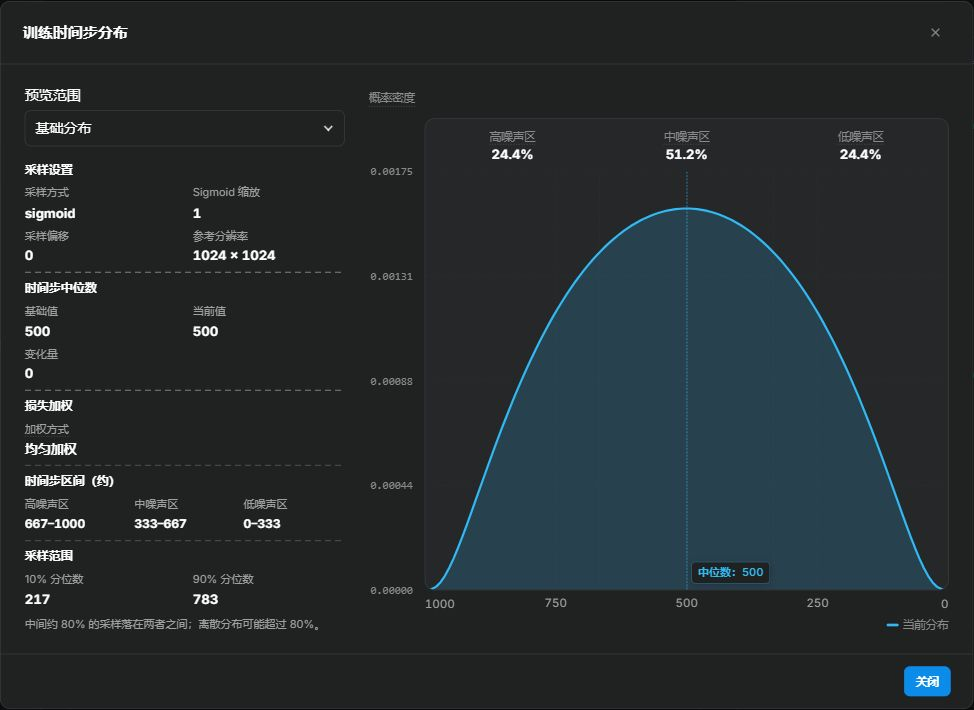

# 时间步

训练时，每张图片会抽取一个噪声时间步，再按该时间步混合原图潜变量与噪声。高时间步对应更多噪声，低时间步保留更多原图信息。

Anima、MOSS-Image 和 Krea 2 使用 flow matching，归一化时间步同时决定混合系数：

| 噪声范围 | 输入中的信息 |
| --- | --- |
| 高噪声 | 原图信息较少，噪声较多 |
| 中等噪声 | 原图和噪声均有较大占比 |
| 低噪声 | 原图信息较多，噪声较少 |

人物身份、整体结构和纹理的学习涉及多个噪声区间。调整采样方向前，先检查数据、分辨率和训练范围。

时间步采样决定各噪声强度出现的频率，损失加权决定抽样后预测误差的权重。

<!-- doc-anchor: quick-start -->
## 基础设置

初次训练保留当前训练类型的默认分布。

<!-- doc-anchor: defaults -->
### 当前训练类型的默认值

| 训练类型 | 默认采样方式 | 默认分布参数 | `weighting_scheme` 与作用 |
| --- | --- | --- | --- |
| Anima | `sigmoid` | `sigmoid_scale=1.0` | `uniform`：损失乘数为 1 |
| MOSS-Image | `truncated_logit_normal` | `logit_mean=-1.09`, `logit_std=0.95`, `discrete_flow_shift=1.0`, `timestep_cutoff=0.95`, `timestep_uniform_ratio=0.01` | `uniform`：损失乘数为 1 |
| Krea 2 | `shift` | `sigmoid_scale=1.0`、`discrete_flow_shift=2.5` | `none`：损失乘数为 1 |

`uniform` 和 `none` 的损失乘数均为 1。导入旧预设后，以界面显示的参数和分布图为准。

MOSS-Image 新配置使用截断 logit-normal 采样，包含 0.95 处截断和 1% 均匀样本混合，复现预训练采样。已有配置保留原值；旧的 `sigma + logit_normal` 仍可使用。上游另提供 `shift + discrete_flow_shift=3` 作为较简单的近似方案。

| 调整目标 | 优先查看的参数 | 默认选择 |
| --- | --- | --- |
| 同时增加高、低噪声采样 | `sigmoid_scale` | `1.0`；增大后分布向两端展开 |
| 整体偏向高噪声或低噪声 | `discrete_flow_shift` | Anima/MOSS `1.0`，Krea 2 `2.5`；在 `shift` 和 Anima/MOSS 的 `sigma`、`truncated_logit_normal` 下生效 |
| 为不同图片组分配不同噪声范围 | `subset_timestep_offsets` | 不设置；仅 Anima/MOSS 的指定模式支持 |

<!-- doc-anchor: terminology -->
## 三种“步”的区别

训练界面里有三种名字相近、含义完全不同的“步”：

| 名称 | 实际含义 | 常见参数 |
| --- | --- | --- |
| 训练步数 | LoRA 参数被更新了多少次 | `max_train_steps` |
| 训练时间步 | 当前图片被加入了多少噪声 | `timestep_sampling` |
| 生成采样步数 | 采样器的去噪步数；不同采样器每步的模型计算次数不同 | `sample_steps` |

例如，“训练到第 500 步”表示 LoRA 已更新 500 次。本文公式使用归一化时间步 `t∈[0,1]`，界面约按 `T=1000t` 显示；`T≈500` 对应原图与噪声的混合系数各约为一半。同一次更新中的图片会分别抽取噪声时间步。

<!-- doc-anchor: visualizer -->
## 分布预览说明



上图为示例配置的静态插图，高、中、低噪声占比显示在图框顶部。在训练表单的“训练时间步采样方式”下点击“查看时间步分布”，可按自己的参数查看实时预览，并切换基础分布与整体训练分布。侧栏列出采样设置、中位时间步的基准值与当前值，以及 Loss 加权方式；鼠标悬浮可读取曲线上对应位置的数值。

| 图中内容 | 怎样阅读 |
| --- | --- |
| 采样曲线 | 在相同宽度的区间内，曲线下的面积越大，该噪声范围越常被抽到 |
| 高、中、低噪声占比 | 各区间预计占总采样次数的比例 |
| 时间步区间（约） | 高、中、低噪声区对应的时间步范围 |
| 采样范围（P10–P90） | 第 10 至第 90 百分位数之间的范围，约包含 80% 的采样结果 |
| 损失权重曲线 | 样本被抽到后，它的预测误差还会乘上多大权重 |
| 当前参考分辨率 | 当前图表用于计算分辨率相关偏移的尺寸 |

曲线用于读取采样频率与损失权重。参数更新和生成质量需结合训练日志与检查点图像评估。离散噪声表以连续曲线近似展示。

横轴按生成时的去噪顺序排列：左侧为最大噪声时间步 `T≈1000`，右侧为低噪声时间步 `T≈0`。训练时每张图片独立抽取时间步。

纵轴展示概率密度 <var>f</var>(<var>t</var>)，权重折线使用对数刻度。均匀加权表示每个时间步的误差乘以相同权重，实际损失仍随预测误差变化。

百分比因四舍五入合计可为 `99.9%` 或 `100.1%`。

<span id="dataset-guidance"></span>
<span id="scenarios"></span>

<!-- doc-anchor: diagnosis -->
## 根据训练结果调整

| 观察到的情况 | 先确认 | 可测试的方向 |
| --- | --- | --- |
| 轮廓和全身比例不足 | 是否有足够的全身图与必要视角 | 先补足数据；保留当前分布，比较多个训练阶段的检查点 |
| 纹理、线条或小装饰不足 | 原图与训练分辨率是否保留这些细节 | 先确认细节未在预处理中丢失；固定分布后检查分辨率、训练范围与训练长度 |
| 局部与整体都未学充分 | 是否整体欠拟合，或训练范围设置不合适 | 先保留时间步分布，检查学习率、训练长度与训练范围 |
| 固定姿势或背景反复出现 | 数据是否重复，是否已经过拟合 | 保留当前分布，先检查数据与停止时机 |
| 画风只有配色，缺少形体特点 | 数据是否覆盖不同主体与构图 | 先补足主体和构图，再比较检查点 |

<!-- doc-anchor: sampling -->
## `timestep_sampling`：决定哪些时间步更常出现

`timestep_sampling` 决定蓝色采样密度曲线的基本形状，也就是训练更常抽到哪些噪声强度。

| 选项 | 它会怎样抽取时间步 | 可用训练类型 |
| --- | --- | --- |
| `sigmoid` | 以中噪声为主，同时保留两端 | Anima/MOSS、Krea 2 |
| `uniform` | 在完整范围内均匀抽取 | Anima/MOSS、Krea 2 |
| `shift` | 对 sigmoid 抽样结果应用固定 flow shift 非线性映射 | Anima/MOSS、Krea 2 |
| `sigma` | 按训练 scheduler 的离散噪声表抽取 | Anima/MOSS、Krea 2 |
| `truncated_logit_normal` | 截断 logit-normal 后重新缩放，混入均匀样本，再映射到离散噪声表 | Anima/MOSS |
| `flux_shift` | 根据当前分辨率计算 FLUX 风格的 shift | Anima/MOSS |
| `krea2_shift` | 根据当前分辨率计算 Krea 2 的 shift | Krea 2 |
| `logsnr` | 从 LogSNR 分布转换出时间步 | Krea 2 |

### `sigmoid`

默认 `sigmoid_scale=1.0` 且无偏移时，分布左右对称，集中在中噪声。按预览的三等分区间计算，低、中、高噪声占比约为 24.4%、51.2%、24.4%。

`sigmoid` 先抽取一个标准正态随机数，再把它映射到 `0～1`：

<div class="doc-equation" role="group" aria-label="Sigmoid 时间步采样公式">
  <div class="doc-equation-kicker">sigmoid 采样</div>
  <div class="doc-equation-expression"><var>z</var> ∼ N(0, 1)<br><var>t</var> = <span class="doc-math-fn">sigmoid</span>(<var>s</var> · <var>z</var><span class="doc-math-close">)</span></div>
  <p><var>s</var> 对应 <code>sigmoid_scale</code>。默认值为 1.0。</p>
</div>

### `uniform`

`uniform` 在完整时间范围内均匀抽取。和默认 sigmoid 相比，它会明显增加低噪声与高噪声两端的训练次数。

### `shift`

`shift` 在 sigmoid 分布上应用 `discrete_flow_shift`，适合将训练重点移向低噪声或高噪声。

### `sigma`

`sigma` 从训练 scheduler 的离散噪声表中选择时间步。Anima/MOSS 会将 `discrete_flow_shift` 应用到这张表；当前 Krea 2 训练器使用未偏移的表，不读取此值。

`weighting_scheme=logit_normal` 或 `mode` 会改变噪声表索引的抽样分布；其余选项均匀抽取索引。Anima/MOSS 的表应用偏移后，即使索引均匀，最终时间步也不均匀；Krea 2 的未偏移表则是等间隔的。`sigma_sqrt` 和 `cosmap` 只改变损失权重。

### `flux_shift` 与 `krea2_shift`

这两种方式根据当前 latent 网格大小计算 shift：网格中的位置越多，分布越偏向高噪声。它们不读取固定的 `discrete_flow_shift`。

开启 bucket 后，相近分辨率和宽高比的图片会分组训练。每个 bucket 按自己的 latent 尺寸计算分布；预览显示当前参考分辨率对应的结果。

### `logsnr`

`logit_mean` 默认 `0`，增大后偏向低噪声，减小后偏向高噪声。`logit_std` 默认 `1`，增大后分布更分散，减小后更集中。这两个参数也用于 `sigma + logit_normal`，但转换公式不同，数值不能直接互换。

SNR 表示信号与噪声的强度比，LogSNR 是它的对数形式。LogSNR 越高，代表原图信号越强、噪声越少。

Krea 2 的 `logsnr` 先根据 `logit_mean` 和 `logit_std` 生成 LogSNR，再转换成时间步：

<div class="doc-equation" role="group" aria-label="LogSNR 时间步转换公式">
  <div class="doc-equation-kicker">Krea 2 logsnr 采样</div>
  <div class="doc-equation-expression">LogSNR ∼ N(<var>μ</var>, <var>σ</var><span class="doc-math-close">)</span><br><var>t</var> = <span class="doc-math-fn">sigmoid</span>(−LogSNR / 2)</div>
  <p><var>μ</var> 对应 <code>logit_mean</code>，<var>σ</var> 对应 <code>logit_std</code>。</p>
</div>

<!-- doc-anchor: sigmoid-scale -->
## `sigmoid_scale`：控制分布向两端展开多少

`sigmoid_scale` 默认 `1.0`，控制分布的分散程度。需要同时增加两端采样时提高，需要集中在中间噪声时降低。

| 调整 | 分布怎样变化 | 对训练侧重点的含义 |
| --- | --- | --- |
| 调小 | 更多采样集中在中等噪声附近 | 减少两端训练，更集中地学习中间噪声下的预测任务 |
| 调大 | 低噪声和高噪声的采样比例同时增加 | 更多更新使用原图信号保留很少或保留很多的输入 |

上表描述没有额外偏移的 sigmoid 分布。叠加固定偏移、分辨率相关偏移或子集偏移后，应查看分布预览，确认高、中、低噪声的实际占比。

需要只偏向高噪声或低噪声时，调整时间步偏移。

<!-- doc-anchor: flow-shift -->
## `discrete_flow_shift`：调整高、低噪声占比

`discrete_flow_shift` 将采样重点移向一侧。Anima/MOSS 默认 `1.0`，Krea 2 默认 `2.5`。增大偏向高噪声，减小偏向低噪声；值必须大于 `0`。Anima/MOSS 在 `shift` 和 `sigma` 中使用，Krea 2 仅在 `shift` 中使用。

| `discrete_flow_shift` | 变化方向 | 相对基础分布的变化 |
| --- | --- | --- |
| 大于 1 | 更常抽到高噪声 | 同一抽样值映射到更大的时间步 |
| 等于 1 | 不施加固定偏移 | 保留基础分布 |
| 大于 0、小于 1 | 更常抽到低噪声 | 同一抽样值映射到更小的时间步 |

设 shift 为 <var>s</var>，它对时间步的变换为：

<div class="doc-equation" role="group" aria-label="Discrete flow shift 公式">
  <div class="doc-equation-kicker">固定 flow shift</div>
  <div class="doc-equation-expression"><var>t</var><sub>shifted</sub> = <span class="doc-frac"><span><var>s</var> · <var>t</var></span><span>1 + (<var>s</var> − 1) · <var>t</var></span></span></div>
  <p><var>s</var> 对应 <code>discrete_flow_shift</code>。</p>
</div>

`flux_shift` 和 `krea2_shift` 使用各自的分辨率相关偏移。

<!-- doc-anchor: subset-offsets -->
## 按子集设置时间步偏移

`subset_timestep_offsets` 为不同训练子集设置独立采样偏移。偏移加在 sigmoid 映射前的正态随机值上，因此改变分布的形状和噪声占比。仅 **Anima/MOSS** 支持。

训练目录中每个以“数字_”开头的子文件夹（例如 `10_group_a`、`3_group_b`）会被识别为一个子集，开头的数字是重复次数。按“子集名称 → 偏移值”填写，操作如下：

1. 在训练目录下建立以“数字_”开头的子集目录，并按内容把图片放入对应目录。
2. 在界面的“子集偏移”映射里填入子集目录名和偏移值。
3. 打开分布预览，确认分布变化符合预期。

映射的写法如下：

```json
{"10_group_a": -0.25, "3_group_b": 0.20}
```

启动训练时，后端会为它单独生成一份 `dataset.toml`；这个界面字段本身不写进主训练配置：

```toml
[[datasets.subsets]]
image_dir = ".../10_group_a"
[datasets.subsets.custom_attributes]
timestep_sampling = { offset = -0.25 }
```

训练时，偏移值会跟着每张图片进入 batch。来自 `10_group_a` 的图片使用 `-0.25`，来自 `3_group_b` 的图片使用 `0.20`；同一个 batch 混合多个子集时也不会互相覆盖。正则化数据不会应用这个设置。

### 支持的模式与推荐范围

子集偏移在 `sigmoid`、`shift`、`flux_shift`、`truncated_logit_normal` 和 `sigma + logit_normal` 中生效。`uniform` 和其他 `sigma` 方案忽略此值。

从 `-0.5～+0.5` 开始调整。负值增加低噪声采样，正值增加高噪声采样；已有高噪声 shift 时，正偏移会进一步减少低噪声样本。按分布预览确认各子集的噪声比例。

分布预览支持基础分布（所有偏移为 0）、整体训练分布和单个子集分布。整体分布按样本数混合各子集，并将正则化样本计入基础分布。一次调整一个子集，并保留默认配置作为对照。偏移只作用于训练采样；其他验证设置不变时，验证损失可直接比较。

### 偏移加在哪里

在 `sigmoid`、`shift` 和 `flux_shift` 中，偏移先加在正态随机值上，再乘以 `sigmoid_scale` 并经过 `sigmoid` 变换；后两者再做整体映射：

```text
时间步 = sigmoid( sigmoid_scale × (随机采样值 + 偏移) )
```

`0` 保持原分布。`sigmoid_scale` 同时缩放随机采样值和偏移量。

在 `sigma + logit_normal` 和 `truncated_logit_normal` 中，偏移按 `logit_mean - offset` 应用，因此正值仍增加高噪声采样。

<!-- doc-anchor: truncated-logit-normal -->
### `truncated_logit_normal`：截断与均匀混合

Anima/MOSS 可用。按 `logit_mean`、`logit_std` 生成 logit-normal 分布，截断后重新缩放到完整噪声范围，并映射到 1000 点训练网格。

- `timestep_cutoff`：范围 `(0, 1]`，默认 `0.95`。截断后会重新缩放，最终仍覆盖高噪声端。
- `timestep_uniform_ratio`：范围 `[0, 1]`，默认 `0.01`，即 1% 均匀网格样本；`1` 为全部均匀抽取。
- `logit_std` 须大于 `0`；`discrete_flow_shift` 会改变训练网格。
- `logit_mean/std` 直接控制此模式，无需选择 `weighting_scheme=logit_normal`。`sigma_sqrt/cosmap` 仍可增加损失权重。

极小的截断阈值或极端均值、标准差可能触及训练器的浮点精度和反累积分布输入上限，使样本集中在少数网格点。预览考虑了这一限制；调整时请检查分布。

<!-- doc-anchor: weighting -->
## 采样频率与 Loss 权重

`weighting_scheme` 的作用取决于采样路径：`sigma` 下的 `logit_normal`、`mode` 控制抽样频率，`sigma_sqrt`、`cosmap` 控制抽样后的损失权重。

| 方案 | 改变什么 | 含义 |
| --- | --- | --- |
| `uniform` / `none` | 不增加额外损失权重 | 各时间步按相同权重计算误差；采样频率仍由采样方式决定 |
| `sigma_sqrt` | 增大低噪声的损失权重 | 更重视低噪声任务，但接近零噪声时权重会快速增大，需要留意更新稳定性 |
| `cosmap` | 相对提高中等噪声的损失权重 | 相对降低两端的权重；采样频率沿用当前采样方式 |
| `logit_normal` | 改变 `sigma` 路径的采样频率 | 损失乘数为 1；仅在 `sigma` 路径生效 |
| `mode` | 改变 `sigma` 路径的采样频率 | 损失乘数为 1；分布由 `mode_scale` 控制 |

初次训练保留当前类型的默认值：Anima/MOSS 使用 `uniform`，Krea 2 使用 `none`。需要增加低噪声误差的影响时测试 `sigma_sqrt`，需要侧重中噪声时测试 `cosmap`。

### `sigma_sqrt` 与 `cosmap` 的精确权重

<div class="doc-equation" role="group" aria-label="Sigma sqrt Loss 权重公式">
  <div class="doc-equation-kicker">低噪声权重</div>
  <div class="doc-equation-expression"><var>w</var> = <span class="doc-frac"><span>1</span><span><var>σ</var><sup>2</sup></span></span></div>
  <p><var>σ</var> 越接近 0，权重增长越快。</p>
</div>

<div class="doc-equation" role="group" aria-label="Cosmap Loss 权重公式">
  <div class="doc-equation-kicker">中噪声权重</div>
  <div class="doc-equation-expression"><var>w</var> = <span class="doc-frac"><span>2</span><span><var>π</var> · (1 − 2 · <var>σ</var> + 2 · <var>σ</var><sup>2</sup><span class="doc-math-close">)</span></span></span></div>
  <p>中噪声的权重高于两端；这条曲线不改变抽样频率。</p>
</div>

<!-- doc-anchor: logit-normal -->
### `logit_normal`、`logit_mean` 与 `logit_std`

`weighting_scheme=logit_normal` 仅在 `timestep_sampling=sigma` 时生效。此时：

- `logit_mean=0` 时，噪声表索引的分布对称。增大偏向低噪声，减小偏向高噪声；MOSS 默认 `-1.09`。
- `logit_std` 越小越集中，越大越向两端展开。Anima 默认 `1`，MOSS 默认 `0.95`。

Anima/MOSS 的 scheduler 偏移也会改变最终噪声强度；Krea 2 的 `sigma` 表不做偏移。选择 `sigmoid + logit_normal` 时，后者不改变采样或损失权重。Krea 2 的 `logsnr` 直接读取这两个数值，见其采样说明。

<!-- doc-anchor: mode -->
### `mode` 与 `mode_scale`

`mode` 在 `timestep_sampling=sigma` 时改变抽样分布，损失乘数为 1。

- `mode_scale=0`：均匀抽取噪声表索引。
- 从 `0` 增至默认 `1.29`：索引向表的中段集中。
- Anima/MOSS 的 `discrete_flow_shift` 还会改变表中段对应的噪声强度；Krea 2 的 `sigma` 忽略 `discrete_flow_shift`，但仍使用 `mode_scale`。初次使用保留 `mode_scale=1.29`。

<!-- doc-anchor: compatibility -->
## 参数生效关系

| 参数 | sigmoid | uniform | shift | sigma | flux/krea shift | logsnr |
| --- | --- | --- | --- | --- | --- | --- |
| `sigmoid_scale` | 生效 | 忽略 | 生效 | 忽略 | 生效 | 忽略 |
| `discrete_flow_shift` | 忽略 | 忽略 | 生效 | 仅 Anima/MOSS | 忽略 | 忽略 |
| `logit_mean/std` | 忽略 | 忽略 | 忽略 | 仅影响 `logit_normal` 分布 | 忽略 | 直接生效 |
| `mode_scale` | 忽略 | 忽略 | 忽略 | 仅影响 `mode` 分布 | 忽略 | 忽略 |
| `subset_timestep_offsets` | 生效 | 忽略 | 生效 | Anima/MOSS 的 `logit_normal` 生效 | 仅 `flux_shift` 生效 | 忽略 |
| `sigma_sqrt/cosmap` 权重 | 生效 | 生效 | 生效 | 生效 | 生效 | 生效 |

`truncated_logit_normal` 使用 `logit_mean/std`、`discrete_flow_shift`、子集偏移及两个截断参数；忽略 `sigmoid_scale`、`mode_scale`。

“忽略”表示当前训练路径不读取该参数。界面会隐藏或标注无效字段，分布预览也会提示被忽略的设置。

<!-- doc-anchor: sdxl-range -->
## SDXL 的 `min_timestep` 与 `max_timestep`

SDXL 不使用前面介绍的 Anima/MOSS/Krea 2 流匹配采样选项，本训练器为 SDXL 提供两个独立的范围参数：

- `min_timestep`：允许抽取的最低噪声时间步，留空时使用 `0`。
- `max_timestep`：抽样范围的上限（不包含该值），留空时使用 `1000`，即默认抽取 `0～999`。
- 提高 `min_timestep`：排除最干净的低噪声样本。
- 降低 `max_timestep`：排除噪声最高的样本。

这两个参数裁剪允许抽取的时间步范围。默认使用完整范围；需要排除特定噪声端点时再调整。

SDXL 的 `min_snr_gamma`、`v_parameterization` 和 `zero_terminal_snr` 分别控制损失重加权、预测目标和 scheduler 行为。

<!-- doc-anchor: common-mistakes -->
## 常见误区

- `sample_flow_shift` 控制生成预览，不改变训练时间步分布。
- seed 决定实际抽样序列，预览显示采样公式的理论分布；batch size 和 GPU 数量会影响短训练的抽样波动。
- 训练时间步设置用于训练过程，推理采样器可按生成需求选择。

<!-- doc-anchor: sdxl-loss -->
## SDXL：损失权重与加噪的关系

Min-SNR 和去偏估计作用于抽样后的损失权重。两项同时开启时，权重按顺序相乘；抽样频率由时间步采样设置决定。

设当前时间步的信噪比为 SNR，去偏估计使用 S = min(SNR, 1000)：

| 预测目标 | Min-SNR 权重 | 去偏估计权重 |
| --- | --- | --- |
| 噪声预测 | min(SNR, γ) / SNR | 1 / √S |
| v-prediction | min(SNR, γ) / (SNR + 1) | 1 / (S + 1) |

`min_snr_gamma` 留空或 0 关闭 Min-SNR。对比这些选项时固定预测目标和时间步范围，否则无法单独判断权重变化的影响。

噪声偏移与多分辨率噪声改变的是输入噪声：先加噪声偏移，再叠加低分辨率噪声并归一化。两者可以同时开启。多分辨率迭代数是上限，某一边降到 1 像素时会提前结束；折扣系数控制各层贡献。

<span id="comparison-method"></span>
<!-- doc-anchor: testing -->
## 对照实验方法

1. **基准组：** 采用当前训练类型的默认值。
2. **固定条件：** 数据集、随机种子、rank、alpha、学习率和总训练步数保持一致。
3. **单一变量：** 每组实验仅改变一个参数，例如将 `sigmoid_scale` 从 `1.0` 改为 `1.25`。
4. **同条件对比：** 取相同训练步数处的检查点，并使用相同的提示词、生成种子、分辨率和推理 LoRA 权重。
5. **评估维度：** 身份或画风还原、背景泄漏、构图僵化、提示词服从度，以及在未见场景中的表现。

以固定条件下的多组生成图和实际使用目标为主要评估依据，训练损失作为辅助信息。

<!-- doc-anchor: flow-matching -->
## 时间步的工作原理

图片进入模型之前，会先由 VAE 压缩成 latent，也就是模型实际处理的图像特征。设原图 latent 为 <var>x</var>，随机噪声为 <var>ε</var>，归一化时间步为 <var>t</var>，加入噪声后的输入可以写成：

<div class="doc-equation" role="group" aria-label="Flow matching 加噪公式">
  <div class="doc-equation-kicker">加入噪声后的训练输入</div>
  <div class="doc-equation-expression"><var>x</var><sub>t</sub> = (1 − <var>t</var><span class="doc-math-close">)</span> · <var>x</var> + <var>t</var> · <var>ε</var></div>
  <p><var>t</var> 越小，输入越接近原图；<var>t</var> 越大，输入越接近纯噪声。</p>
</div>

当前 Anima/MOSS 和 Krea 2 的训练目标都是预测从原图指向噪声的流动方向：

<div class="doc-equation doc-equation-compact" role="group" aria-label="Flow matching 训练目标">
  <div class="doc-equation-kicker">模型需要预测的方向</div>
  <div class="doc-equation-expression"><var>v</var> = <var>ε</var> − <var>x</var></div>
  <p>生成图片时过程反过来：模型从高噪声出发，逐步走向清晰图像。</p>
</div>

训练代码里还常用 <var>σ</var> 表示噪声混合比例，`sigma_sqrt`、`cosmap` 这些权重名称里的 sigma 指的就是它。在本文讨论的流匹配路径中，它的方向与 <var>t</var> 一致：越接近 `0` 越干净，越接近 `1` 越接近纯噪声。界面会把这个范围显示为大约 `0～1000` 的时间步。

<!-- doc-anchor: evidence -->
## 依据与参考资料

实现入口如下，链接固定到对应提交：

- [`library/flux_train_utils.py`](https://github.com/amenorira/lora-scripts-anima/blob/11d0f7a348721b8688240dada0e172980b20a3b7/vendor/sd-scripts/library/flux_train_utils.py)：`sigmoid`、`shift`、`flux_shift` 采样，`sigma_sqrt`、`cosmap` 权重公式及固定偏移变换。
- [`anima_train_network.py`](https://github.com/amenorira/lora-scripts-anima/blob/11d0f7a348721b8688240dada0e172980b20a3b7/vendor/sd-scripts/anima_train_network.py)：从 batch 的 `custom_attributes` 读取逐样本子集偏移，仅在训练阶段应用。
- [`backend/training/sd_dataset_config.py`](https://github.com/amenorira/lora-scripts-anima/blob/11d0f7a348721b8688240dada0e172980b20a3b7/backend/training/sd_dataset_config.py)：与 `backend/server/routes/training.py` 一起校验子集偏移、生成 `dataset.toml` 并传给训练器。
- [`library/anima_train_utils.py`](https://github.com/amenorira/lora-scripts-anima/blob/11d0f7a348721b8688240dada0e172980b20a3b7/vendor/sd-scripts/library/anima_train_utils.py)：Anima 的采样与损失权重分发。
- [`training/timesteps.py`](https://github.com/amenorira/lora-scripts-anima/blob/11d0f7a348721b8688240dada0e172980b20a3b7/vendor/musubi-tuner/src/musubi_tuner/training/timesteps.py)：共享密度与损失权重公式。
- [`training/trainer_base.py`](https://github.com/amenorira/lora-scripts-anima/blob/11d0f7a348721b8688240dada0e172980b20a3b7/vendor/musubi-tuner/src/musubi_tuner/training/trainer_base.py)：Krea 2 的 `krea2_shift`、`logsnr` 等采样实现。
- [`frontend/js/training-core.js`](https://github.com/amenorira/lora-scripts-anima/blob/11d0f7a348721b8688240dada0e172980b20a3b7/frontend/js/training-core.js)：解析概率密度与损失权重曲线。
- [Anima 官方模型卡（固定提交）](https://huggingface.co/circlestone-labs/Anima/blob/f7382c4bf9d7ffe4ceea593a0adbb470c56dd79b/README.md)
- [Scaling Rectified Flow Transformers for High-Resolution Image Synthesis](https://arxiv.org/abs/2403.03206)
- [Flow Matching for Generative Modeling](https://arxiv.org/abs/2210.02747)

- [MOSS-Image 上游指南](https://github.com/kohya-ss/sd-scripts/blob/04ca541746b7667b27eab230db067579f682895e/docs/moss_image_train_network.md#72-training-settings--学習設定)
- [SDXL 损失权重](https://github.com/kohya-ss/sd-scripts/blob/04ca541746b7667b27eab230db067579f682895e/library/custom_train_functions.py)
- [噪声增强顺序](https://github.com/kohya-ss/sd-scripts/blob/04ca541746b7667b27eab230db067579f682895e/library/loss.py)
