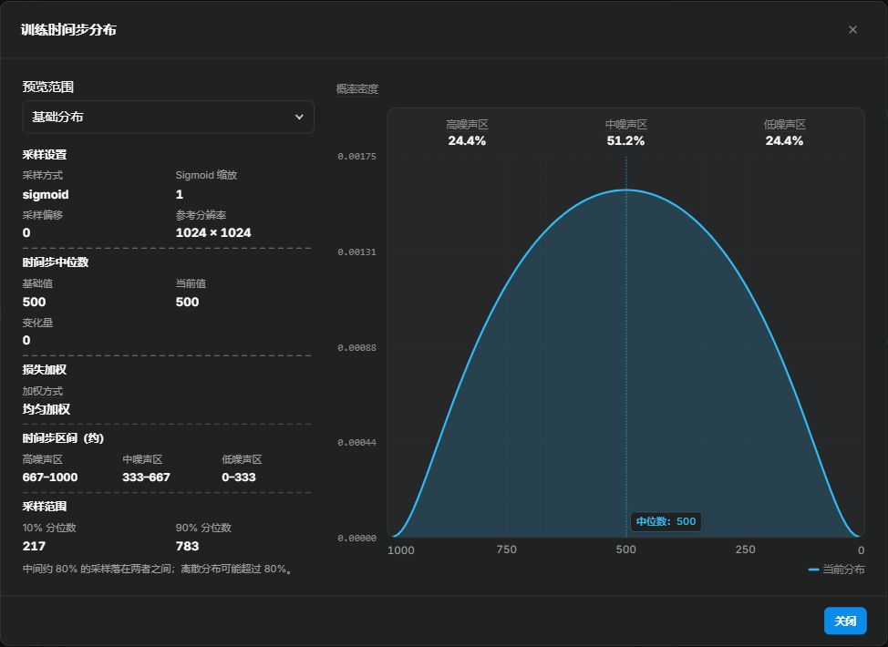

# 时间步

## 核心概念与各训练类型默认值

训练时，每张图片都会独立抽取一个噪声时间步，按该强度混合原图 Latent 与随机噪声，让模型学习对应阶段的去噪方向。不同噪声区间承担不同的画面学习重点：

| 噪声区间 | 界面时间步（约） | 输入图像状态 | 主要影响的画面特征 |
| --- | --- | --- | --- |
| 高噪声区 | `T ≈ 1000 → 667` | 噪声占主导，仅剩粗略低频信号 | 全局构图、人物剪影比例、大面积色块与光影布局 |
| 中噪声区 | `T ≈ 667 → 333` | 原图特征与噪声各占相当比例 | 主体五官与肢体结构、服装部件关系、核心画风造型 |
| 低噪声区 | `T ≈ 333 → 0` | 接近清晰原图，仅含少量噪声 | 线条锐度、材质纹理、瞳孔与小饰品等高频细节 |

**时间步采样方式**决定各噪声区间被抽到的频率；**Loss 加权方式**决定样本被抽中后预测误差乘上的权重。

### 各训练类型的默认配置

初次训练建议保留所选训练类型的默认分布，先确认数据集、分辨率与学习率合适后再做针对性偏移。

| 训练类型 | 默认采样方式 | 默认分布参数 | 默认加权与说明 |
| --- | --- | --- | --- |
| Anima | `sigmoid` | `sigmoid_scale=1.0` | `uniform`（Loss 乘数为 `1`，聚焦中噪声并兼顾两端） |
| MOSS-Image | `truncated_logit_normal` | `logit_mean=-1.09`、`logit_std=0.95`、`discrete_flow_shift=1.0`、`timestep_cutoff=0.95`、`timestep_uniform_ratio=0.01` | `uniform`（复现预训练采样；上游亦提供 `shift + discrete_flow_shift=3` 简化近似） |
| Krea 2 | `shift` | `sigmoid_scale=1.0`、`discrete_flow_shift=2.5`、`min_timestep=0`、`max_timestep=1000` | `none`（Loss 乘数为 `1`，整体适度偏向中高噪声） |
| SDXL | 均匀抽取 `0～999` | [`min_timestep`](#sdxl-range) / [`max_timestep`](#sdxl-range) 留空 | 默认无重加权；可按需开启 [`min_snr_gamma`](#sdxl-loss) |

| 常见调整目标 | 优先使用的参数 | 参考起点 |
| --- | --- | --- |
| 整体偏向高噪声（稳构图）或低噪声（修细节） | [`discrete_flow_shift`](#flow-shift) | `> 1` 偏高噪，`< 1` 偏低噪（Krea 2 默认 `2.5`） |
| 同时增加高、低两端采样或收窄到中段 | [`sigmoid_scale`](#sigmoid-scale) | 默认 `1.0`；调大向两端展开，调小向中段集中 |
| 为全身图、特写图等不同子集分配不同噪声侧重 | [`subset_timestep_offsets`](#subset-offsets) | `-0.5～+0.5`（仅 Anima / MOSS-Image 指定模式支持） |
| 不改抽样频率，仅放大低噪声或中噪声误差权重 | [`weighting_scheme`](#weighting) | `sigma_sqrt`（重低噪）或 `cosmap`（重中噪） |

### 三种“步”的区别

| 名称 | 实际含义 | 对应参数 |
| --- | --- | --- |
| 训练步数 | 优化器更新 LoRA 权重的累计次数（如“训练到第 500 步”） | `max_train_steps` / `max_train_epochs` |
| 训练时间步 | 单张训练图混入的噪声强度（界面按 `0～1000` 显示，同批次各图独立抽取） | `timestep_sampling` |
| 生成采样步数 | 预览或推理生成一张图执行的去噪迭代次数 | `sample_steps` |

### 流匹配加噪与预测目标

Anima、MOSS-Image 和 Krea 2 均采用流匹配（Flow Matching）。设 VAE 编码后的原图特征为 <var>x</var>，随机噪声为 <var>ε</var>，归一化时间步为 <var>t</var> ∈ [0, 1]（界面显示约 `T = 1000t`），加噪输入与模型预测目标为：

  
流匹配输入与速度目标

  
<var>x</var>t = (1 − <var>t</var>) · <var>x</var> + <var>t</var> · <var>ε</var> ， <var>v</var> = <var>ε</var> − <var>x</var>

  
<var>t</var> = 0.5（<code>T ≈ 500</code>）时原图与噪声各占一半；代码中常见的噪声比例 <var>σ</var> 在此路径下与 <var>t</var> 同向（越接近 1 噪声越多）。

## 分布预览说明

在训练表单的**“时间步采样方式”**字段下点击**“查看时间步分布”**，可实时查看当前配置生成的理论分布曲线，并在基础分布、整体训练分布与单个子集分布之间切换。横轴按生成去噪顺序从左到右排列：左侧为高噪声 `T ≈ 1000`，右侧为低噪声 `T ≈ 0`。

| 预览元素 | 如何判读 |
| --- | --- |
| 蓝色采样密度曲线 <var>f</var>(<var>t</var>) | 相同宽度区间内曲线下面积越大，该噪声范围越常被抽中；悬浮可读取精确密度 |
| 顶部高 / 中 / 低噪声区占比 | 三等分区间预计占总采样的百分比（四舍五入合计可能为 `99.9%` 或 `100.1%`） |
| 主要采样区间（P10–P90）与中位数 | 约 `80%` 样本落入的时间步范围及中位时间步位置 |
| Loss 权重折线（对数刻度） | 抽样后乘在预测误差上的额外倍率；均匀加权时各处倍率恒为 `1` |
| 参考分辨率 | 计算 [`flux_shift` / `krea2_shift`](#sampling) 分辨率推导偏移时所用的基准尺寸 |

## 调参场景判断与排查

调整时间步前，先确认训练集图片未因过低分辨率丢失细节，且学习率与总步数处于合理区间。在此前提下，下列四类场景适合主动调整时间步参数：

| 真实调参场景 | 推荐操作方向 | 原理与预期变化 |
| --- | --- | --- |
| `1024` 及更高分辨率训练时，大构图松散、全身比例易崩 | 将采样改为 `shift` 并上调 [`discrete_flow_shift`](#flow-shift)（如 `1.5～3.0`），或改用 `flux_shift` / `krea2_shift` | 高分辨率像素冗余使同时间步下图像更易被局部猜出；向高噪声偏移可迫使模型多学全局结构 |
| 全身立绘与高精度面部/饰品特写子集混训 | 在[`子集采样偏移`](#subset-offsets)中保持全身子集为 `0`，将特写子集设为 `-0.15～-0.35` | 让全身图负责中高噪构图与体型，特写图更多落在低噪区间精修五官与局部纹理 |
| 主体轮廓与身份已稳，但线条、织物或小饰品质感偏弱 | 保持当前采样分布不变，对比 [`weighting_scheme=sigma_sqrt`](#weighting) | 在不牺牲高噪采样次数的前提下放大低噪声预测误差权重（需留意低噪端梯度波动） |
| 两端极端时间步引发 Loss 尖峰，或希望集中算力学中段特征 | 对比 [`weighting_scheme=cosmap`](#weighting)，或将 [`sigmoid_scale`](#sigmoid-scale) 小幅降至 `0.8` | 压低极高噪与极低噪两端的更新干扰，聚焦主体造型成型的中噪声段 |

> **无需改动时间步的情况**：若人物全身与局部同时欠拟合，优先检查触发词、[学习率](optimizers.zh-CN.md#learning-rate)与训练步数；若很快复刻训练图固定姿势或背景，优先排查重复构图并选用更早的模型存档；画风只学到配色而缺造型时，优先补充多样化的主体与构图样本。

## 时间步采样方式（timestep_sampling）

`timestep_sampling` 决定蓝色采样密度曲线的基础形态：

| 选项 | 采样行为 | 支持的训练类型 |
| --- | --- | --- |
| `sigmoid` | 标准正态分布经 `sigmoid(s · z)` 映射至 `(0, 1)`，对称聚焦中噪声（默认低/中/高噪约 `24.4% / 51.2% / 24.4%`） | Anima、MOSS-Image、Krea 2 |
| `uniform` | 在完整时间步范围内等概率均匀抽取，显著提高高噪与低噪两端占比 | Anima、MOSS-Image、Krea 2 |
| `shift` | 先按 `sigmoid` 抽样，再施加固定 [`discrete_flow_shift`](#flow-shift) 非线性偏移 | Anima、MOSS-Image、Krea 2 |
| `sigma` | 从训练调度器的 1000 点离散噪声表抽取；可配合 [`logit_normal`](#logit-normal) 或 [`mode`](#mode) 改变索引密度 | Anima、MOSS-Image、Krea 2 |
| `truncated_logit_normal` | 截断 logit-normal 重缩放后混入少量均匀样本并映射到离散网格（MOSS-Image 默认） | Anima、MOSS-Image |
| `flux_shift` / `krea2_shift` | 按当前分桶 Latent 网格大小自动推导高噪偏移（像素越多越偏高噪，忽略固定 `discrete_flow_shift`） | `flux_shift`：Anima/MOSS；`krea2_shift`：Krea 2 |
| `logsnr` | 按正态分布抽取对数信噪比（LogSNR）再换算为时间步 | Krea 2 |

  
sigmoid 基础采样

  
<var>z</var> ∼ N(0, 1) ， <var>t</var> = sigmoid(<var>s</var> · <var>z</var>)

  
<var>s</var> 为 <code>sigmoid_scale</code>（默认 1.0）。<code>sigma</code> 路径在 Anima/MOSS 下会将 <code>discrete_flow_shift</code> 应用于噪声表，Krea 2 的 <code>sigma</code> 使用未偏移等距表。

### truncated_logit_normal：截断与均匀混合

仅 Anima 与 MOSS-Image 可用。按 `logit_mean` 和 `logit_std` 生成分布后在上限处截断并重新缩放到完整噪声范围，再混入均匀样本映射到 1000 点网格：

- **`timestep_cutoff`**：范围 `(0, 1]`，默认 `0.95`；截断后重缩放仍完整覆盖高噪声端。
- **`timestep_uniform_ratio`**：范围 `[0, 1]`，默认 `0.01`（混入 `1%` 均匀网格样本；设为 `1` 则退化为纯均匀抽样）。
- 直接读取 `logit_mean` 与 `logit_std`（要求 `logit_std > 0`），无需将 `weighting_scheme` 设为 `logit_normal`；仍可叠加 `discrete_flow_shift`、子集偏移及 `sigma_sqrt` / `cosmap` 权重。避免设置极小截断值或极端均值/标准差，以免触及浮点反函数上限导致样本堆积在边缘网格点。

### logsnr：对数信噪比采样

仅 Krea 2 可用。SNR 为原图信号与噪声的强度比，LogSNR 越高代表噪声越少：

  
Krea 2 logsnr 采样

  
LogSNR ∼ N(<var>μ</var>, <var>σ</var>) ， <var>t</var> = sigmoid(−LogSNR / 2)

  
<var>μ</var> 对应 <code>logit_mean</code>（默认 0，调大偏向低噪声，调小偏向高噪声）；<var>σ</var> 对应 <code>logit_std</code>（默认 1，调大向两端展开）。与 <code>sigma + logit_normal</code> 公式不同，切换后请通过分布预览重新核对曲线。

## 分布展开度（sigmoid_scale）

`sigmoid_scale`（默认 `1.0`）在 `sigmoid`、`shift`、`flux_shift`、`krea2_shift` 下生效，控制采样向两端展开的幅度：

- **调小（如 `0.6～0.8`）**：采样更集中在中等噪声附近，减少极高噪与极低噪样本。
- **调大（如 `1.2～1.5`）**：同时提高高噪声（全局轮廓）和低噪声（局部微细节）两端的采样比例。若只需单侧偏移，请改调 [`discrete_flow_shift`](#flow-shift)。

## 高低噪声偏移（discrete_flow_shift）

`discrete_flow_shift` 将时间步分布整体推向高噪或低噪一侧（须 `> 0`）。Anima / MOSS-Image 默认 `1.0`（在 `shift`、`sigma`、`truncated_logit_normal` 下生效）；Krea 2 默认 `2.5`（仅在 `shift` 下生效）：

- **`> 1`**：将同一基础抽样值映射到更大的时间步，增加高噪声采样占比。
- **`= 1`**：不施加固定偏移，保留原分布。
- **`0 < s < 1`**：映射到更小的时间步，增加低噪声采样占比。

  
固定 Flow Shift 变换

  
<var>t</var>shifted = (<var>s</var> · <var>t</var>) / (1 + (<var>s</var> − 1) · <var>t</var>)

  
<var>s</var> 对应 <code>discrete_flow_shift</code>。

## 子集采样偏移（subset_timestep_offsets）

子集采样偏移允许为不同内容或画质的训练子集分配各自的噪声侧重：**负值增加低噪声采样（侧重细节），正值增加高噪声采样（侧重整体结构）**。仅 **Anima 与 MOSS-Image** 在 `sigmoid`、`shift`、`flux_shift`、`truncated_logit_normal` 及 `sigma + logit_normal` 模式下支持（`uniform` 与其余 `sigma` 方案不生效）。

**界面操作步骤：**

1. 在训练目录下按 `重复次数_子集名`（如 `10_closeup`、`5_fullbody`）建立子文件夹放入图片，并在表单选择该训练目录。
2. 在训练参数区的**“子集采样偏移”**列表中，使用对应子集行的 `− / 输入框 / +` 步进器（步长 `0.05`）填入偏移值（建议从 `-0.5～+0.5` 起步，每次只调一个子集）。
3. 点击子集行右侧的图表按钮或标题栏的**“比较分布”**，切换查看基础分布、单子集分布与按样本量加权的整体训练分布。

非零偏移在保存/导出 `training.yaml` 时自动持久化，并在启动训练时按子集写入 `dataset.toml` 的 `custom_attributes.timestep_sampling = { offset = ... }`，随每张图片独立传入批次（混批互不覆盖；正则化图像保持 `0` 偏移；验证集 Loss 不受影响可直接横向对比）。

**各模式下的偏移计算位置：**

- **`sigmoid` / `shift` / `flux_shift`**：`t = sigmoid(sigmoid_scale × (z + offset))`（后两者再叠加各自的 shift 映射；`sigmoid_scale` 会同时放大偏移量）。
- **`sigma + logit_normal` / `truncated_logit_normal`**：内部按 `logit_mean - offset` 代入，因此保持“正偏移偏高噪、负偏移偏低噪”的统一方向。

## 采样频率与 Loss 加权（weighting_scheme）

`weighting_scheme` 分为两类机制：`sigma_sqrt` 与 `cosmap` 改变抽样后的 **Loss 误差乘数**（适用于所有流匹配采样方式）；`logit_normal` 与 `mode` 仅在 `timestep_sampling=sigma` 下改变**噪声表索引的抽样频率**（Loss 乘数仍为 `1`）。

| 选项 | 作用机制 | 调参含义 |
| --- | --- | --- |
| `uniform`（Anima/MOSS）/ `none`（Krea 2） | Loss 乘数恒为 `1` | 初次训练默认选择，完全按当前采样分布学习 |
| `sigma_sqrt` | 低噪端放大误差权重 | 强化低噪细节监督；`σ → 0` 时权重急剧增大，若梯度不稳可配合 `StableAdamW` 或裁剪 |
| `cosmap` | 凸起提高中噪声误差权重 | 压低极高噪与极低噪两端权重，稳定中段主体造型训练 |
| `logit_normal` | 改变 `sigma` 路径索引采样密度 | 仅 `timestep_sampling=sigma` 时生效，由 `logit_mean` / `logit_std` 控制 |
| `mode` | 改变 `sigma` 路径索引采样密度 | 仅 `timestep_sampling=sigma` 时生效，由 `mode_scale` 控制 |

  
Loss 权重公式（σ 为噪声比例）

  
<var>w</var>sigma_sqrt = 1 / <var>σ</var>2 ， <var>w</var>cosmap = 2 / (<var>π</var> · (1 − 2<var>σ</var> + 2<var>σ</var>2))

### logit_normal、logit_mean 与 logit_std

在 `timestep_sampling=sigma` 且 `weighting_scheme=logit_normal` 时控制离散表抽样密度（选择 `sigmoid + logit_normal` 等其他组合时不会生效，预览会给出忽略提示）：

- **`logit_mean`**：`0` 时索引对称；**调大偏向低噪声，调小偏向高噪声**（Anima / Krea 2 默认 `0`，MOSS-Image 默认 `-1.09`）。
- **`logit_std`**：越小越集中，越大越向两端展开（Anima / Krea 2 默认 `1.0`，MOSS-Image 默认 `0.95`）。
- 同名字段也直接用于 Anima / MOSS-Image 的 [`truncated_logit_normal`](#truncated-logit-normal) 与 Krea 2 的 [`logsnr`](#logsnr)。

### mode 与 mode_scale

仅在 `timestep_sampling=sigma` 且 `weighting_scheme=mode` 时改变索引抽样频率（Loss 乘数为 `1`）。`mode_scale=0` 为等概率抽取；增至默认 `1.29` 时向噪声表中段集中（Anima / MOSS-Image 下表本身还受 `discrete_flow_shift` 偏移影响）。初次测试保持 `1.29`。

## 参数生效矩阵与常见误区

| 参数 | `sigmoid` | `uniform` | `shift` | `sigma` | `truncated_logit_normal` | `flux_shift` / `krea2_shift` | `logsnr` |
| --- | --- | --- | --- | --- | --- | --- | --- |
| `sigmoid_scale` | 生效 | 忽略 | 生效 | 忽略 | 忽略 | 生效 | 忽略 |
| `discrete_flow_shift` | 忽略 | 忽略 | 生效 | 仅 Anima/MOSS | 生效 | 忽略 | 忽略 |
| `logit_mean` / `logit_std` | 忽略 | 忽略 | 忽略 | 仅 `logit_normal` | 直接生效 | 忽略 | 直接生效 |
| `mode_scale` | 忽略 | 忽略 | 忽略 | 仅 `mode` | 忽略 | 忽略 | 忽略 |
| `subset_timestep_offsets` | 生效 | 忽略 | 生效 | Anima/MOSS + `logit_normal` | 生效 | 仅 `flux_shift` | 忽略 |
| `sigma_sqrt` / `cosmap` | 生效 | 生效 | 生效 | 生效 | 生效 | 生效 | 生效 |

### 常见误区

- **`sample_flow_shift` 与训练无关**：预览区的 `sample_flow_shift` 仅控制生成预览图时的推理调度，不会改变训练时间步抽样。
- **短训随机波动**：分布预览展示连续理论分布，实际训练抽样受 `seed`、批次大小与多卡进程数影响。
- **训练与推理采样器解耦**：训练时间步分布不影响导出 LoRA 后在 ComfyUI 等推理端自由选择采样器与步数。

## Krea 2 时间步范围与分层抽样

Krea 2 除流匹配采样与加权外，还提供范围裁剪与分层抽样控制：

- **`min_timestep` / `max_timestep`**（默认 `0` / `1000`，须满足 `0 ≤ min < max ≤ 1000`）：在直接采样模式（`sigmoid`、`shift`、`uniform`、`flux_shift`、`krea2_shift`、`logsnr`）下限制允许抽取的噪声时间步；在 `sigma` 模式下限制调度表索引范围（Krea 2 噪声表按逆序排列，索引越大对应噪声越低）。
- **保留时间步分布形状**（`preserve_distribution_shape`，默认关闭，`sigma` 模式不使用）：关闭时将原采样分布线性压缩映射到 `[min_timestep, max_timestep]` 内；开启时从原分布重采样并仅保留落在该范围内的时间步（在分布预览中表现为截取原曲线片段）。注意：开启后若范围过窄导致多次重试仍凑不足单批样本，训练器会回退至原始分布并可能采到范围外的时间步。
- **时间步分层桶数**（`num_timestep_buckets`，默认留空关闭，最小填 `2`，`sigma` 模式不使用）：将累积采样概率等分为指定数量的区间并轮流从各桶抽样，在保持目标分布总体形状的同时降低小批次下的抽样方差。

## SDXL 时间步范围与损失增强

SDXL 使用传统扩散噪声时间步（默认均匀抽取 `0～999`），通过两个独立字段裁剪训练区间：

- **`min_timestep`**（留空为 `0`）：允许抽取的最小时间步；调高可排除最接近原图的极低噪样本。
- **`max_timestep`**（不含上限本身，留空为 `1000`）：抽样上限；调低可排除接近纯噪声的极高噪样本。

### SDXL：Min-SNR、去偏估计与噪声增强

**Min-SNR**（`min_snr_gamma`，留空或 `0` 关闭，常用 `5`）与**去偏估计 Loss**（`debiased_estimation_loss`）作用于抽样后的 Loss 权重；同时开启时两者乘数连乘。设信噪比为 SNR，记 `S = min(SNR, 1000)`：

| SDXL 预测目标 | Min-SNR 权重 | 去偏估计权重 |
| --- | --- | --- |
| 噪声预测（ε-prediction，默认） | `min(SNR, γ) / SNR` | `1 / √S` |
| `v_parameterization` | `min(SNR, γ) / (SNR + 1)` | `1 / (S + 1)` |

**噪声偏移**（`noise_offset`）与**多分辨率噪声**（`multires_noise_iterations` / `multires_noise_discount`）直接修改输入噪声以改善极亮/极暗对比度与低频色块：两者同开时先施加噪声偏移，再叠加金字塔低分辨率噪声并重新归一化。对比这些正则项时须固定 `v_parameterization`、`zero_terminal_snr` 与时间步范围。

## 对照实验方法

1. **建立基准**：先用当前训练类型的默认时间步配置跑完一组基准。
2. **锁定控制变量**：保持数据集、标注、`seed`、Rank/Alpha、优化器、学习率与总更新步数完全一致。
3. **单次只改一项**：例如仅把 `discrete_flow_shift` 从 `1.0` 调至 `2.0`，或仅对单个特写子集设置偏移。
4. **同条件盲测存档**：取相同步数的模型存档，用同一组提示词、生成种子、分辨率与 LoRA 权重横向对比五官还原、构图自由度、细节锐度与背景污染，以生成画面为主、Loss 数值为辅（不同加权或偏移下的原始 Loss 绝对值不可直接比大小）。

## 依据与参考资料

项目预览曲线解析与配置契约见 `frontend/js/training/timestep-model.js`、`frontend/js/training/timestep-preview.js`、`backend/training/datasets/sd_dataset_config.py`、`backend/training/fields/field_registry.py` 及 `backend/training/config/musubi_krea2.py`；底层训练采样与权重分发见 `vendor/sd-scripts/library/flux_train_utils.py`、`vendor/sd-scripts/library/anima_train_utils.py`、`vendor/sd-scripts/anima_train_network.py` 及 `vendor/musubi-tuner/src/musubi_tuner/training/timesteps.py`。延伸参考：

- [Anima 官方模型卡](https://huggingface.co/circlestone-labs/Anima/blob/f7382c4bf9d7ffe4ceea593a0adbb470c56dd79b/README.md) · [MOSS-Image 上游训练指南](https://github.com/kohya-ss/sd-scripts/blob/04ca541746b7667b27eab230db067579f682895e/docs/moss_image_train_network.md#72-training-settings--学習設定)
- [Scaling Rectified Flow Transformers for High-Resolution Image Synthesis (SD3)](https://arxiv.org/abs/2403.03206) · [Flow Matching for Generative Modeling](https://arxiv.org/abs/2210.02747)
- [sd-scripts SDXL Loss 权重实现](https://github.com/kohya-ss/sd-scripts/blob/04ca541746b7667b27eab230db067579f682895e/library/custom_train_functions.py) · [sd-scripts 噪声增强实现](https://github.com/kohya-ss/sd-scripts/blob/04ca541746b7667b27eab230db067579f682895e/library/loss.py)
